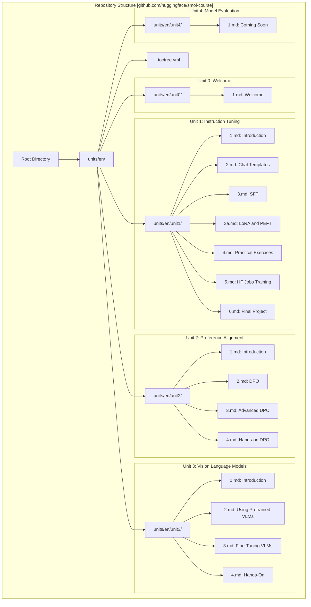
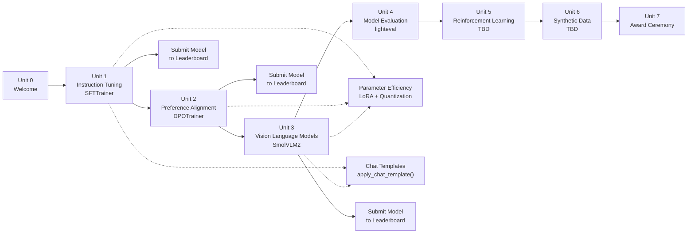
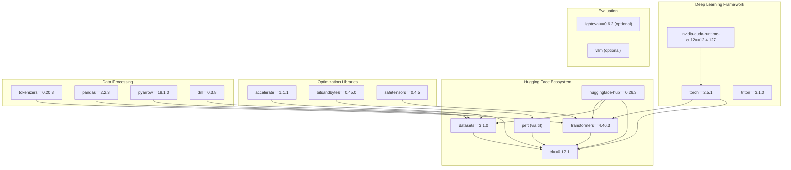

<!-- source: DeepWiki mcp.deepwiki.com · repo huggingface/smol-course · page 1 Course Overview · fetched 2026-10-26 -->

# Course Overview

Relevant source files

The following files were used as context for generating this wiki page:

- [.gitignore](.gitignore)
- [LICENSE](LICENSE)
- [README.md](README.md)
- [banner.png](banner.png)
- [requirements.txt](requirements.txt)
- [units/en/_toctree.yml](units/en/_toctree.yml)

This document provides an overview of the smol-course, a practical training program for aligning language models to specific use cases. The course covers the complete pipeline from instruction tuning through preference alignment and multimodal model adaptation, using the SmolLM3 and SmolVLM2 model families. For detailed installation instructions, see [Installation and Setup](#1.1). For specific training methodologies, see [Instruction Tuning](#2), [Preference Alignment](#4), and [Vision-Language Models](#5).

**Sources:** [README.md:1-69]()

## Course Objectives

The smol-course teaches practical alignment techniques for language models that run on consumer hardware. The curriculum emphasizes hands-on learning with minimal GPU requirements and no paid cloud services. Key learning outcomes include:

- **Instruction Tuning**: Adapting pre-trained models to follow instructions using supervised fine-tuning with `SFTTrainer`
- **Parameter Efficiency**: Implementing LoRA and quantization to train models on limited hardware
- **Preference Alignment**: Aligning models to human preferences using DPO and ORPO algorithms
- **Multimodal Adaptation**: Fine-tuning vision-language models for image understanding tasks
- **Model Evaluation**: Benchmarking models using `lighteval` framework with standard and custom metrics
- **Production Deployment**: Training on Hugging Face Jobs infrastructure and publishing to Hub

The course uses SmolLM3-3B for text-only tasks and SmolVLM2-2.2B for multimodal applications. Skills learned with these models transfer to larger models and other small LLM/VLM architectures.

**Sources:** [README.md:5-56]()

## Model Architecture

### Course Unit to Codebase Mapping

**Sources:** [units/en/_toctree.yml:1-48]()

### Base Models

The course utilizes two pre-trained model families from the Hugging Face Hub:

| Model | Parameters | Architecture | Use Cases |
|-------|-----------|--------------|-----------|
| SmolLM3-3B-Base | 3 billion | Decoder-only transformer | Text instruction tuning, preference alignment |
| SmolVLM2-2.2B-Base | 2.2 billion | Vision encoder + language decoder | Multimodal tasks, image understanding, chart/diagram analysis |

Both models are optimized for efficiency and can be fine-tuned on consumer GPUs with 16GB+ VRAM when using parameter-efficient techniques. The base models are pre-trained on large text corpora (SmolLM3) or multimodal data (SmolVLM2) and require task-specific fine-tuning for instruction following.

**Sources:** [README.md:5-6]()

## Course Structure

The curriculum consists of seven units organized into three phases: core training modules (Units 1-3), evaluation methodology (Unit 4), and advanced techniques (Units 5-6). Unit 7 provides a capstone experience.

### Current Curriculum Status

| Unit | Topic | Status | Key Techniques |
|------|-------|--------|----------------|
| 0 | Welcome | ✅ Released | Course orientation |
| 1 | Instruction Tuning | ✅ Released | `SFTTrainer`, chat templates, LoRA, quantization |
| 2 | Preference Alignment | ✅ Released | `DPOTrainer`, ORPO, preference datasets |
| 3 | Vision Language Models | ✅ Released | `AutoProcessor`, multimodal templates, VLM fine-tuning |
| 4 | Model Evaluation | ✅ Released | `lighteval`, benchmarks, custom metrics |
| 5 | Reinforcement Learning | 🚧 October 2025 | Policy optimization, reward models |
| 6 | Synthetic Data | 🚧 November 2025 | Data generation, distillation |
| 7 | Award Ceremony | 🚧 December 2025 | Project showcase |

Each unit includes markdown documentation, interactive Jupyter notebooks, and hands-on exercises. Units 1-4 progress from basic instruction tuning to advanced evaluation methodologies. Future units will cover reinforcement learning from human feedback and synthetic data generation.

**Sources:** [README.md:31-43](), [units/en/_toctree.yml:1-48]()

### Learning Progression

**Sources:** [README.md:31-43](), [units/en/_toctree.yml:1-48]()

## Technical Stack

### Core Dependencies

The course uses a curated set of libraries from the Hugging Face ecosystem and PyTorch. All dependencies are managed via `requirements.txt` with pinned versions for reproducibility.

**Sources:** [requirements.txt:1-65]()

### Library Versions and Roles

| Library | Version | Role |
|---------|---------|------|
| `torch` | 2.5.1 | Deep learning framework, model computation |
| `transformers` | 4.46.3 | Model loading, tokenization, inference APIs |
| `trl` | 0.12.1 | Training orchestration (`SFTTrainer`, `DPOTrainer`) |
| `datasets` | 3.1.0 | Dataset loading, preprocessing, streaming |
| `accelerate` | 1.1.1 | Distributed training, device management |
| `bitsandbytes` | 0.45.0 | 4-bit/8-bit quantization for memory efficiency |
| `huggingface-hub` | 0.26.3 | Model/dataset download, Hub uploads |
| `safetensors` | 0.4.5 | Fast, secure model serialization format |

The `trl` library serves as the primary training interface, integrating models from `transformers`, efficiency techniques from `peft`, and data from `datasets`. The `accelerate` library enables multi-GPU training and mixed precision, while `bitsandbytes` provides quantization for memory-constrained environments.

**Sources:** [requirements.txt:3-65]()

### CUDA Dependencies

For GPU acceleration on Linux x86_64 systems, the course includes NVIDIA CUDA 12.4 libraries:

- `nvidia-cuda-runtime-cu12==12.4.127`: CUDA runtime
- `nvidia-cublas-cu12==12.4.5.8`: Linear algebra operations
- `nvidia-cudnn-cu12==9.1.0.70`: Neural network primitives
- `nvidia-nccl-cu12==2.21.5`: Multi-GPU communication

These dependencies are automatically installed on compatible systems and enable GPU training without manual CUDA installation.

**Sources:** [requirements.txt:27-38]()

## Learning Methodology

### Community-Driven Approach

The course operates as a peer-reviewed, open learning platform. Students actively contribute to the course content through pull requests, creating a continuously improving curriculum.

**Participation Model:**
1. Follow the `smol-course` organization on Hugging Face Hub
2. Read unit documentation and complete exercises locally
3. Train models and submit results to the community leaderboard
4. Open pull requests with trained models, evaluation results, and training commands
5. Receive community feedback and climb the leaderboard rankings

This approach encourages collaborative learning where students learn from each other's implementations and training strategies. The leaderboard serves as both a motivational tool and a repository of successful training configurations.

**Sources:** [README.md:7-17](), [README.md:19-23]()

### Repository Access

The course materials are hosted at `https://github.com/huggingface/smol-course`. The repository structure includes:

- `units/en/`: Course content organized by unit
- `requirements.txt`: Python dependencies
- `README.md`: Course overview and quick start
- `v1/`: Legacy course materials (Jupyter notebooks)

Future releases will migrate to Hugging Face Learn platform while maintaining GitHub as the primary development repository.

**Sources:** [README.md:27-29](), [README.md:65-68]()

## Hardware Requirements

### Local Training

The course is designed for consumer hardware with minimal GPU requirements. Successful local training requires:

| Component | Minimum | Recommended |
|-----------|---------|-------------|
| GPU VRAM | 16GB | 24GB+ |
| System RAM | 16GB | 32GB+ |
| Storage | 50GB | 100GB+ (for datasets) |
| OS | Linux, Windows, macOS | Linux (best CUDA support) |

With 16GB VRAM, students can train SmolLM3-3B using 4-bit quantization and LoRA (rank 8-16). Larger batch sizes and higher LoRA ranks require more VRAM. The course provides memory optimization techniques (gradient checkpointing, gradient accumulation) to work within hardware constraints.

**Sources:** [README.md:48-56]()

### Cloud Training Alternative

For students without local GPU access, Hugging Face Jobs provides cloud training infrastructure:

- **a10g-large**: NVIDIA A10G (24GB VRAM)
- **a100-large**: NVIDIA A100 (40GB/80GB VRAM)

Unit 1, section 5 covers cloud training workflows using the `hf jobs` CLI. This enables identical training code to run locally or on cloud infrastructure without modification.

**Sources:** [units/en/_toctree.yml:19]()

## Prerequisites

Students should have foundational knowledge before starting the course:

### Required Background

- **Machine Learning Fundamentals**: Understanding of supervised learning, loss functions, gradient descent
- **Natural Language Processing**: Familiarity with tokenization, embeddings, transformer architectures
- **Python Programming**: Proficiency with Python 3.8+, package management (pip, conda, uv)
- **PyTorch Basics**: Tensor operations, model loading, basic training loops
- **Transformers Library**: Experience with `AutoModel`, `AutoTokenizer`, `pipeline` APIs

### Optional But Helpful

- Experience with Jupyter notebooks for interactive development
- Git/GitHub for version control and collaboration
- Linux command line for cloud training workflows
- Understanding of model evaluation metrics (perplexity, accuracy)

Students without extensive PyTorch experience can still succeed by following the provided code examples and gradually building understanding through hands-on exercises.

**Sources:** [README.md:58-63]()

## Why Small Language Models

The course focuses on small models (2-3B parameters) rather than large models (70B+) for practical and pedagogical reasons:

### Advantages of Small Models

| Benefit | Description |
|---------|-------------|
| **Efficiency** | Train and deploy on consumer hardware without cloud costs |
| **Customization** | Faster iteration cycles for domain-specific adaptation |
| **Control** | Easier to understand and debug model behavior |
| **Cost** | Lower training and inference costs for production deployment |
| **Privacy** | Can run entirely on-premises without external API calls |
| **Sustainability** | Reduced energy consumption and carbon footprint |
| **Research Accessibility** | Enables academic research without institutional compute clusters |

### Performance Trade-offs

Small models sacrifice some general capability for efficiency. They excel at focused tasks where domain-specific fine-tuning provides the necessary knowledge. The course teaches how to maximize small model performance through:

- High-quality instruction data curation
- Effective preference alignment
- Task-specific evaluation metrics
- Multi-stage training pipelines

Skills learned with SmolLM3-3B and SmolVLM2-2.2B transfer directly to larger models, making this course a practical starting point for language model alignment regardless of target model size.

**Sources:** [README.md:46-56]()

---

