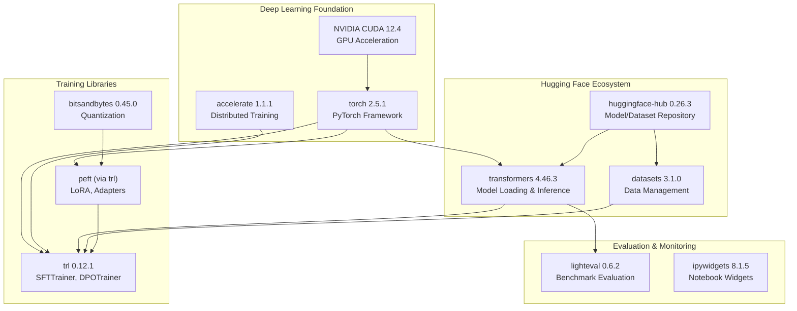
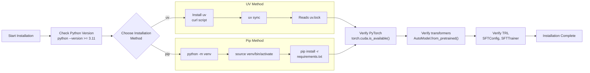
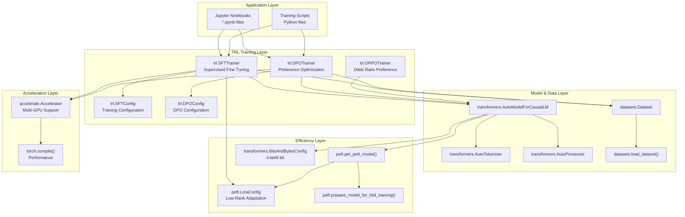
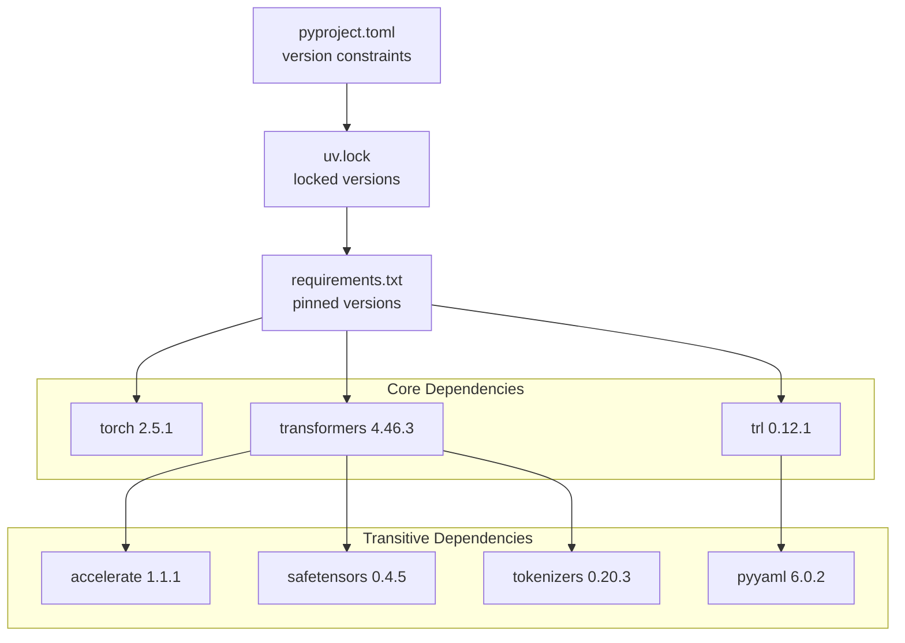

<!-- source: DeepWiki mcp.deepwiki.com · repo huggingface/smol-course · page 1.1 Installation and Setup · fetched 2026-10-26 -->

# Installation and Setup

<details>
<summary>Relevant source files</summary>

The following files were used as context for generating this wiki page:

- [.gitignore](.gitignore)
- [.python-version](.python-version)
- [LICENSE](LICENSE)
- [README.md](README.md)
- [banner.png](banner.png)
- [pyproject.toml](pyproject.toml)
- [requirements.txt](requirements.txt)
- [uv.lock](uv.lock)

</details>


This page provides instructions for installing dependencies and configuring the development environment for the smol-course. It covers Python environment setup, core library installation, hardware requirements, and verification procedures. For information about using the TRL CLI tools after installation, see [TRL CLI Tools](#7.2). For details on cloud-based training infrastructure, see [Training with Hugging Face Jobs](#2.3).

## Prerequisites

The course requires Python 3.11 or higher. This version constraint is defined in [pyproject.toml:6](). The codebase uses the Python 3.11 runtime as specified in [.python-version:1]().

Basic familiarity with the following is assumed:
- Python programming and PyTorch fundamentals
- Natural language processing concepts
- Command-line interface usage
- Git for version control

Hardware recommendations depend on the training approach:
- **Local training**: 16GB+ VRAM GPU (NVIDIA recommended for CUDA support)
- **Notebook exploration**: 8GB+ VRAM or CPU-only for inference
- **Cloud training**: Hugging Face Jobs with `a10g-large` or `a100-large` instances

## Core Dependencies

The smol-course technical stack consists of five primary library categories defined in [pyproject.toml:7-15]():



**Dependency Hierarchy**

Sources: [pyproject.toml:7-15](), [requirements.txt:3-65]()

### Primary Libraries

| Library | Version | Purpose | Configuration File |
|---------|---------|---------|-------------------|
| `transformers` | 4.46.3 | Model architectures, tokenizers, pipelines | [pyproject.toml:12]() |
| `trl` | 0.12.1 | `SFTTrainer`, `DPOTrainer`, `ORPOTrainer` classes | [pyproject.toml:13]() |
| `datasets` | 3.1.0 | Dataset loading, preprocessing, streaming | [pyproject.toml:8]() |
| `bitsandbytes` | 0.45.0 | 4-bit/8-bit quantization via `BitsAndBytesConfig` | [pyproject.toml:14]() |
| `torch` | 2.5.1 | Core tensor operations, autograd, CUDA interface | [requirements.txt:56]() |

Sources: [pyproject.toml:7-15](), [requirements.txt:3-65]()

### CUDA Dependencies

NVIDIA CUDA libraries are automatically included for Linux x86_64 systems as specified in [requirements.txt:27-38](). The following CUDA 12.4 components are required:

- `nvidia-cuda-runtime-cu12` (12.4.127): Runtime library
- `nvidia-cublas-cu12` (12.4.5.8): Basic Linear Algebra Subprograms
- `nvidia-cudnn-cu12` (9.1.0.70): Deep Neural Network library
- `nvidia-nccl-cu12` (2.21.5): Multi-GPU communication

Sources: [requirements.txt:27-38]()

## Installation Methods

### Using uv (Recommended)

The course uses `uv` as the package manager, with dependencies locked in [uv.lock:1-6](). Install all dependencies:

```bash
# Install uv package manager
curl -LsSf https://astral.sh/uv/install.sh | sh

# Install project dependencies
uv sync
```

This creates a virtual environment and installs all packages from [uv.lock:1]().

Sources: [uv.lock:1-6]()

### Using pip

For standard pip-based installation:

```bash
# Create virtual environment
python3.11 -m venv venv
source venv/bin/activate  # On Windows: venv\Scripts\activate

# Install dependencies
pip install -r requirements.txt
```

Sources: [requirements.txt:1-65](), [.python-version:1]()

### Using pyproject.toml

For development installations:

```bash
pip install -e .
```

This installs the package in editable mode with dependencies from [pyproject.toml:7-15]().

Sources: [pyproject.toml:1-16]()

## Installation Workflow



Sources: [pyproject.toml:6](), [requirements.txt:1-2](), [uv.lock:1-6]()

## Verification Steps

### Test PyTorch and CUDA

Verify PyTorch installation and GPU availability:

```python
import torch
print(f"PyTorch version: {torch.__version__}")
print(f"CUDA available: {torch.cuda.is_available()}")
print(f"CUDA version: {torch.version.cuda}")
print(f"GPU count: {torch.cuda.device_count()}")
```

Expected output shows `torch==2.5.1` with CUDA 12.4 support.

Sources: [requirements.txt:56](), [requirements.txt:27-38]()

### Test Transformers Library

Verify `transformers` can load models:

```python
from transformers import AutoTokenizer, AutoModelForCausalLM

tokenizer = AutoTokenizer.from_pretrained("HuggingFaceTB/SmolLM2-135M")
model = AutoModelForCausalLM.from_pretrained("HuggingFaceTB/SmolLM2-135M")
print(f"Transformers version: {transformers.__version__}")
```

This verifies the `transformers==4.46.3` installation and Hugging Face Hub connectivity.

Sources: [requirements.txt:58](), [requirements.txt:16]()

### Test TRL Trainers

Verify `trl` trainer classes are available:

```python
from trl import SFTConfig, SFTTrainer, DPOConfig, DPOTrainer

print(f"TRL version: {trl.__version__}")
print(f"SFTConfig available: {SFTConfig is not None}")
print(f"SFTTrainer available: {SFTTrainer is not None}")
```

This confirms `trl==0.12.1` with core trainer implementations.

Sources: [requirements.txt:60](), [pyproject.toml:13]()

### Test Quantization

Verify `bitsandbytes` for quantization:

```python
import bitsandbytes as bnb
from transformers import BitsAndBytesConfig

bnb_config = BitsAndBytesConfig(
    load_in_4bit=True,
    bnb_4bit_compute_dtype=torch.bfloat16
)
print(f"bitsandbytes version: {bnb.__version__}")
```

This tests `bitsandbytes==0.45.0` functionality.

Sources: [requirements.txt:14](), [pyproject.toml:14]()

## Library Architecture and Relationships



**Class and Function Mapping**

Sources: [requirements.txt:56-60](), [pyproject.toml:7-15]()

## Hardware and CUDA Configuration

### GPU Requirements by Task

| Task | Minimum VRAM | Recommended GPU | Quantization |
|------|--------------|-----------------|--------------|
| SmolLM3-3B Inference | 6GB | GTX 1660 Ti | None |
| SmolLM3-3B SFT (LoRA) | 12GB | RTX 3060 | 4-bit |
| SmolLM3-3B SFT (Full) | 24GB | RTX 3090 | None |
| SmolVLM2-2.2B SFT (LoRA) | 16GB | RTX 4060 Ti | 4-bit |
| Multi-GPU Training | 2x16GB | 2x RTX 4080 | 8-bit |

Sources: [README.md:58-64]()

### CUDA Device Detection

The installation includes CUDA libraries only for Linux x86_64 systems with conditional installation specified in [requirements.txt:27]():

```python
# Check CUDA availability after installation
import torch
if torch.cuda.is_available():
    print(f"CUDA devices: {torch.cuda.device_count()}")
    for i in range(torch.cuda.device_count()):
        print(f"  Device {i}: {torch.cuda.get_device_name(i)}")
        print(f"  Memory: {torch.cuda.get_device_properties(i).total_memory / 1e9:.2f} GB")
else:
    print("CUDA not available, using CPU")
```

Sources: [requirements.txt:27-38]()

## Environment Variables

### Hugging Face Hub Authentication

For model downloads and Hub uploads:

```bash
# Set authentication token
export HF_TOKEN="your_token_here"

# Or use huggingface-cli
huggingface-cli login
```

The `huggingface-hub==0.26.3` library handles authentication via token storage.

Sources: [requirements.txt:16](), [pyproject.toml:9]()

### CUDA Configuration

```bash
# Set visible GPUs
export CUDA_VISIBLE_DEVICES=0,1

# Enable TF32 precision (Ampere+ GPUs)
export TORCH_ALLOW_TF32=1

# Set CUDA memory allocation strategy
export PYTORCH_CUDA_ALLOC_CONF=max_split_size_mb:512
```

Sources: [requirements.txt:27-38]()

## Package Manager Details

### UV Lock File Structure

The [uv.lock:1-6]() file specifies:

```
version = 1
requires-python = ">=3.11"
resolution-markers = [
    "python_full_version < '3.12'",
    "python_full_version >= '3.12'",
]
```

This ensures consistent installations across environments with Python 3.11+ support.

Sources: [uv.lock:1-6]()

### Dependency Resolution

The dependency tree resolves to specific versions:



Sources: [pyproject.toml:7-15](), [uv.lock:1-6](), [requirements.txt:1-65]()

## Common Installation Issues

### CUDA Version Mismatch

If `torch.cuda.is_available()` returns `False`:

1. Verify NVIDIA driver version: `nvidia-smi`
2. Check CUDA toolkit installation: `nvcc --version`
3. Reinstall PyTorch with correct CUDA version:
   ```bash
   pip install torch==2.5.1 --index-url https://download.pytorch.org/whl/cu124
   ```

Sources: [requirements.txt:56](), [requirements.txt:27-38]()

### bitsandbytes Compilation Errors

The `bitsandbytes==0.45.0` package requires CUDA for quantization. On non-CUDA systems, use CPU-only mode:

```python
# Skip quantization on CPU systems
from transformers import AutoModelForCausalLM
model = AutoModelForCausalLM.from_pretrained("model_name", device_map="cpu")
```

Sources: [requirements.txt:14](), [pyproject.toml:14]()

### Hugging Face Hub Connection Failures

If dataset/model downloads fail:

1. Check internet connectivity
2. Verify `huggingface-hub==0.26.3` is installed
3. Test Hub access:
   ```python
   from huggingface_hub import HfApi
   api = HfApi()
   print(api.whoami())  # Should not raise error after login
   ```

Sources: [requirements.txt:16](), [pyproject.toml:9]()

## Next Steps

After completing installation:

1. **Instruction Tuning**: Proceed to [Instruction Tuning](#2) to learn supervised fine-tuning
2. **TRL CLI**: Explore [TRL CLI Tools](#7.2) for command-line training workflows
3. **Cloud Training**: Set up [Training with Hugging Face Jobs](#2.3) for scalable training

Sources: [README.md:32-43]()

---

