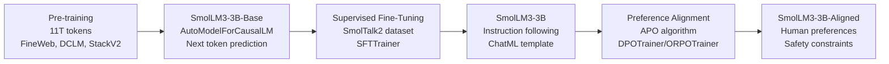
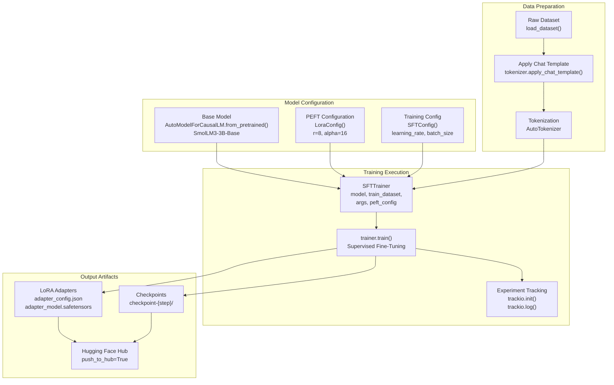
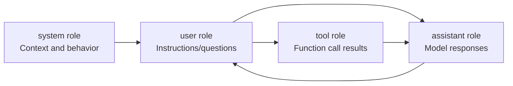
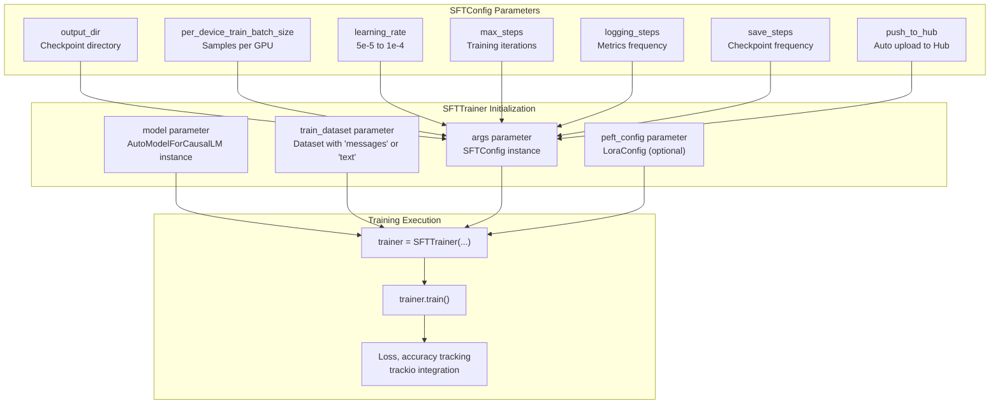
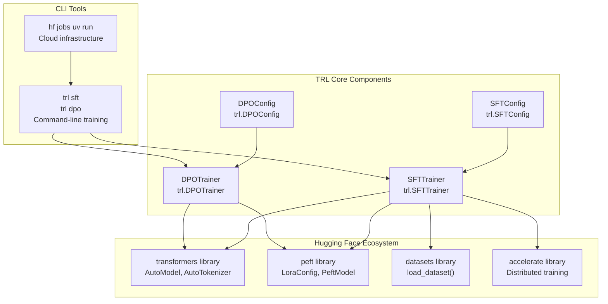
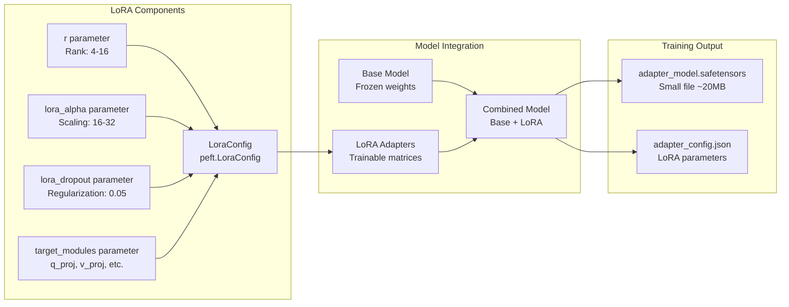
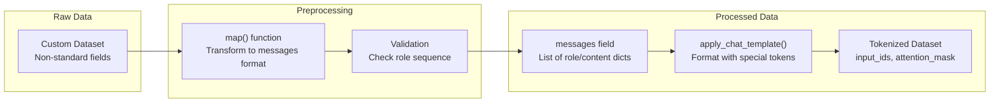

<!-- source: DeepWiki mcp.deepwiki.com · repo huggingface/smol-course · page 2 Instruction Tuning · fetched 2026-10-26 -->

# Instruction Tuning

<details>
<summary>Relevant source files</summary>

The following files were used as context for generating this wiki page:

- [units/en/unit0/1.mdx](units/en/unit0/1.mdx)
- [units/en/unit1/1.md](units/en/unit1/1.md)
- [units/en/unit1/2.md](units/en/unit1/2.md)
- [units/en/unit1/3.md](units/en/unit1/3.md)
- [units/en/unit1/3a.md](units/en/unit1/3a.md)
- [units/en/unit1/4.md](units/en/unit1/4.md)
- [units/en/unit1/5.md](units/en/unit1/5.md)
- [units/en/unit1/6.md](units/en/unit1/6.md)

</details>


## Purpose and Scope

This document introduces **instruction tuning**, the process of adapting pre-trained language models to follow human instructions and engage in structured conversations. Instruction tuning transforms base models like `SmolLM3-3B-Base` into instruction-following assistants like `SmolLM3-3B` through supervised fine-tuning on curated datasets.

This page covers the foundational concepts and overall architecture. For detailed implementation:
- Chat template formatting and conversation structure: see [Chat Templates](#2.1)
- Supervised fine-tuning process and training: see [Supervised Fine-Tuning (SFT)](#2.2)
- Cloud-based training infrastructure: see [Training with Hugging Face Jobs](#2.3)
- Parameter-efficient methods (LoRA, quantization): see [LoRA and Adapters](#3.1) and [Quantization Techniques](#3.2)

## Base Models vs Instruction-Tuned Models

The fundamental transformation in instruction tuning converts a text completion model into an instruction-following assistant.

### Model Comparison

| Aspect | Base Model (`SmolLM3-3B-Base`) | Instruct Model (`SmolLM3-3B`) |
|--------|-------------------------------|-------------------------------|
| Training Objective | Next token prediction | Instruction following + preference alignment |
| Input Format | Raw text strings | Structured chat messages with roles |
| Output Behavior | Continues text | Responds to instructions |
| Chat Template | None (raw text) | ChatML format with special tokens |
| Reasoning Mode | N/A | Dual-mode (`/think`, `/no_think`) |
| Training Data | 11T tokens general text | SmolTalk2 + preference datasets |
| Use Case | Completion, embeddings | Conversational AI, task completion |

### Behavioral Differences

```python
# Base model behavior - text continuation
# Input: "The capital of France is"
# Output: " Paris, which is located on the Seine River and has a population..."

# Instruct model behavior - instruction following
# Input: [{"role": "user", "content": "What is the capital of France?"}]
# Output: [{"role": "assistant", "content": "The capital of France is Paris."}]
```

Sources: [units/en/unit1/1.md:10-19](), [units/en/unit1/3.md:6-28]()

## The SmolLM3 Model Family

### Model Variants



**Diagram: SmolLM3 Training Pipeline from Pre-training to Alignment**

Sources: [units/en/unit1/1.md:26-35](), [units/en/unit1/3.md:19-28]()

### Key Capabilities

- **Context Length**: 8K tokens (base), extended variants up to 128K tokens
- **Multilingual**: Trained on diverse language data
- **Dual-Mode Reasoning**: `/think` mode shows reasoning, `/no_think` provides direct answers
- **Tool Use**: Supports function calling and MCP server integration
- **Model Size**: 3B parameters, optimized for single GPU training

Sources: [units/en/unit1/1.md:26-35]()

## Instruction Tuning Pipeline Architecture

### End-to-End Workflow



**Diagram: Complete SFT Pipeline with TRL Components**

Sources: [units/en/unit1/3.md:406-433](), [units/en/unit1/3a.md:116-146]()

### Code Entity Mapping

| Component | Primary Class/Function | File References |
|-----------|----------------------|-----------------|
| Dataset Loading | `load_dataset()` | [units/en/unit1/4.md:732-741]() |
| Chat Formatting | `tokenizer.apply_chat_template()` | [units/en/unit1/2.md:173-181](), [units/en/unit1/4.md:196-215]() |
| Model Loading | `AutoModelForCausalLM.from_pretrained()` | [units/en/unit1/4.md:95-99]() |
| Tokenizer | `AutoTokenizer.from_pretrained()` | [units/en/unit1/4.md:91-92]() |
| PEFT Config | `LoraConfig()` | [units/en/unit1/3a.md:54-64](), [units/en/unit1/3a.md:124-131]() |
| Training Config | `SFTConfig()` | [units/en/unit1/3.md:467-474]() |
| Trainer | `SFTTrainer()` | [units/en/unit1/3.md:476-482]() |
| Tracking | `trackio.init()`, `trackio.log()` | [units/en/unit1/3.md:270-281]() |

## Core Component: Chat Templates

Chat templates structure conversations using the ChatML format with special tokens `<|im_start|>` and `<|im_end|>` to delineate message boundaries.

### Message Role Structure



**Diagram: Chat Message Role Flow**

### Template Application Modes

| Parameter | Purpose | Use Case | Code Example |
|-----------|---------|----------|--------------|
| `add_generation_prompt=True` | Add assistant prompt token | Inference time | [units/en/unit1/2.md:280-285]() |
| `add_generation_prompt=False` | Complete conversation | Training data | [units/en/unit1/2.md:270-274]() |
| `continue_final_message=True` | Continue last message | Structured output | [units/en/unit1/2.md:327-343]() |
| `tokenize=False` | Return string | Debug/inspect | [units/en/unit1/2.md:174-178]() |
| `tokenize=True` | Return tensors | Direct model input | Implied in pipeline usage |

### Dual-Mode Reasoning

SmolLM3 supports two reasoning modes controlled through system message metadata:

```python
# /no_think mode - direct answers
{"role": "assistant", "content": "The answer is 42"}

# /think mode - show reasoning process  
{"role": "assistant", "content": "\n\nThe answer is 42"}
```

Sources: [units/en/unit1/2.md:130-154](), [units/en/unit1/4.md:483-522]()

For comprehensive chat template documentation, see [Chat Templates](#2.1).

## Core Component: Supervised Fine-Tuning

### SFT Training Objective

SFT minimizes the token-level cross-entropy loss:

$$
\mathcal{L}_{\text{SFT}}(\theta) = - \sum_{t=1}^{T} \log p_\theta(y_t \mid y_{<t})
$$

where $y_t$ is the target token at timestep $t$. The model learns to predict the next token given previous context, with padding tokens masked during loss computation.

Sources: [units/en/unit1/3.md:394-404]()

### SFTTrainer Configuration



**Diagram: SFTTrainer Initialization and Configuration Flow**

### Hyperparameter Ranges

| Parameter | Conservative | Balanced | Aggressive | Impact |
|-----------|-------------|----------|------------|--------|
| `learning_rate` | 5e-5 | 1e-4 | 2e-4 | Convergence speed vs stability |
| `per_device_train_batch_size` | 2 | 4 | 8 | Memory usage |
| `gradient_accumulation_steps` | 8 | 4 | 2 | Effective batch size |
| `max_seq_length` | 512 | 1024-2048 | 4096 | Context window vs memory |
| `warmup_steps` | 100 | 200-300 | 500 | Training stability |

Sources: [units/en/unit1/3.md:99-177]()

### Dataset Format Requirements

SFTTrainer accepts multiple dataset formats:

**Conversational Format (Recommended)**:
```python
{
    "messages": [
        {"role": "system", "content": "You are helpful."},
        {"role": "user", "content": "Question?"},
        {"role": "assistant", "content": "Answer."}
    ]
}
```

**Prompt-Completion Format**:
```python
{
    "prompt": [{"role": "user", "content": "Question?"}],
    "completion": [{"role": "assistant", "content": "Answer."}]
}
```

**Text Format**:
```python
{"text": "<|im_start|>user\nQuestion?<|im_end|><|im_start|>assistant\nAnswer.<|im_end|>"}
```

Sources: [units/en/unit1/3.md:328-365]()

For detailed SFT implementation and best practices, see [Supervised Fine-Tuning (SFT)](#2.2).

## Training Infrastructure

### TRL Library Architecture



**Diagram: TRL Library Integration with Hugging Face Ecosystem**

### Training Execution Approaches

| Approach | Code Entry Point | Use Case | Reference |
|----------|-----------------|----------|-----------|
| Python API | `SFTTrainer(model, dataset, args)` | Custom workflows, experimentation | [units/en/unit1/3.md:449-483]() |
| TRL CLI | `trl sft --model_name ... --dataset_name ...` | Standardized training, reproducibility | [units/en/unit1/3.md:486-504]() |
| HF Jobs | `hf jobs uv run --flavor a10g-large ...` | Cloud training, scalability | [units/en/unit1/5.md:109-124]() |
| UV Script | Inline dependencies in `# /// script` block | Portable training scripts | [units/en/unit1/5.md:29-72]() |

Sources: [units/en/unit1/3.md:406-443](), [units/en/unit1/5.md:1-11]()

### Experiment Tracking with Trackio

Trackio provides lightweight experiment tracking with Hugging Face integration:

```python
# Initialization
import trackio
trackio.init(project="smollm3-sft")

# Automatic tracking via SFTConfig
config = SFTConfig(
    output_dir="./output",
    report_to="trackio"  # Enable trackio integration
)

# Logged metrics
# - global_step: Optimizer steps
# - epoch: Dataset iteration
# - num_tokens: Total tokens processed
# - loss: Cross-entropy loss
# - entropy: Token distribution entropy
# - mean_token_accuracy: Top-1 prediction accuracy
# - learning_rate: Current LR
# - grad_norm: Gradient L2 norm
```

Sources: [units/en/unit1/3.md:259-327]()

For cloud-based training infrastructure, see [Training with Hugging Face Jobs](#2.3).

## Parameter-Efficient Fine-Tuning Integration

### LoRA Configuration



**Diagram: LoRA Configuration and Integration Flow**

### LoRA Parameter Guidelines

| Parameter | Typical Values | Impact | Trade-off |
|-----------|---------------|--------|-----------|
| `r` (rank) | 4, 8, 16 | Model capacity | Higher = more parameters, better fit |
| `lora_alpha` | 16, 32 | Adapter influence | Higher = stronger adaptation |
| `lora_dropout` | 0.05, 0.1 | Regularization | Higher = less overfitting |
| `target_modules` | `["q_proj", "v_proj"]` or `"all-linear"` | Coverage | More = more parameters |
| `bias` | `"none"`, `"all"` | Bias adaptation | `"all"` increases parameters |

### Memory Comparison

| Configuration | Parameters | VRAM Usage | Training Speed |
|--------------|------------|------------|----------------|
| Full Fine-Tuning (3B) | 3B trainable | ~40GB | Baseline |
| LoRA r=8 | ~30M trainable | ~16GB | 1.5x faster |
| LoRA r=16 | ~60M trainable | ~18GB | 1.4x faster |
| LoRA + 4-bit Quantization | ~30M trainable | ~8GB | 1.2x faster |

Sources: [units/en/unit1/3a.md:11-71](), [units/en/unit1/3a.md:116-146]()

For detailed PEFT methods, see [LoRA and Adapters](#3.1) and [Quantization Techniques](#3.2).

## Training Datasets

### SmolTalk2 Dataset Structure

The primary SFT dataset for SmolLM3 is `HuggingFaceTB/smoltalk2`:

```python
from datasets import load_dataset

# Load SFT subset
dataset = load_dataset("HuggingFaceTB/smoltalk2", "SFT")

# Structure:
# - 25 different splits (subsets)
# - Total: 3,383,242 rows
# - Each row contains "messages" field with conversation

# Example splits:
# - smoltalk_everyday_convs_reasoning_Qwen3_32B_think
# - OpenThoughts3_1.2M_think  
# - aya_dataset_Qwen3_32B_think
# - table_gpt_Qwen3_32B_think
```

Sources: [units/en/unit1/4.md:732-763]()

### Dataset Preprocessing



**Diagram: Dataset Preprocessing Pipeline**

Example preprocessing function:

```python
# From units/en/unit1/3.md:349-365
def preprocess_function(example):
    return {
        "prompt": [{"role": "user", "content": example["Question"]}],
        "completion": [
            {"role": "assistant", 
             "content": f"{example['Response']}"}
        ],
    }

dataset = dataset.map(preprocess_function, remove_columns=["Question", "Response", "Complex_CoT"])
```

Sources: [units/en/unit1/3.md:349-383]()

## Loss Monitoring and Convergence Patterns

### Healthy Training Pattern

| Phase | Training Loss | Validation Loss | Interpretation |
|-------|--------------|-----------------|----------------|
| Initial (0-100 steps) | 2.5-4.0 | 2.5-4.0 | Model adapting to data distribution |
| Stabilization (100-500 steps) | 1.5-2.5 | 1.5-2.5 | Gradual improvement |
| Convergence (500+ steps) | 0.5-1.5 | 0.6-1.6 | Stable performance |

### Warning Signs

**Overfitting Pattern**: Training loss ↓, validation loss ↑  
**Underfitting Pattern**: Both losses remain high  
**Memorization**: Training loss < 0.3, poor generalization

Sources: [units/en/unit1/3.md:204-257]()

## Complete Training Example

### Python API Workflow

```python
# From units/en/unit1/3.md:449-483
from transformers import AutoModelForCausalLM, AutoTokenizer
from trl import SFTTrainer, SFTConfig
from datasets import load_dataset
from peft import LoraConfig
import trackio

# 1. Initialize tracking
trackio.init(project="smollm3-sft", name="my-first-sft-run")

# 2. Load model and tokenizer
model = AutoModelForCausalLM.from_pretrained("HuggingFaceTB/SmolLM3-3B-Base")
tokenizer = AutoTokenizer.from_pretrained("HuggingFaceTB/SmolLM3-3B-Base")

# 3. Load dataset
dataset = load_dataset("HuggingFaceTB/smoltalk2_everyday_convs_think")

# 4. Configure LoRA
peft_config = LoraConfig(
    r=8,
    lora_alpha=16,
    lora_dropout=0.05,
    bias="none",
    task_type="CAUSAL_LM"
)

# 5. Configure training
config = SFTConfig(
    output_dir="./smollm3-finetuned",
    per_device_train_batch_size=4,
    learning_rate=5e-5,
    max_steps=1000,
    report_to="trackio",
    push_to_hub=True,
    hub_model_id="username/smollm3-custom"
)

# 6. Create trainer
trainer = SFTTrainer(
    model=model,
    train_dataset=dataset["train"],
    args=config,
    peft_config=peft_config
)

# 7. Train
trainer.train()

# 8. Push to Hub (automatic with push_to_hub=True)
```

Sources: [units/en/unit1/3.md:449-483](), [units/en/unit1/3a.md:116-146]()

### CLI Workflow

```bash
# From units/en/unit1/3.md:486-504
trl sft \
    --model_name_or_path HuggingFaceTB/SmolLM3-3B-Base \
    --dataset_name HuggingFaceTB/smoltalk2_everyday_convs_think \
    --output_dir ./smollm3-sft-model \
    --per_device_train_batch_size 4 \
    --learning_rate 5e-5 \
    --max_steps 1000 \
    --logging_steps 50 \
    --save_steps 200 \
    --report_to trackio \
    --push_to_hub \
    --hub_model_id username/smollm3-custom \
    --use_peft \
    --lora_r 8 \
    --lora_alpha 16
```

Sources: [units/en/unit1/3.md:486-504](), [units/en/unit1/5.md:163-185]()

## Key Design Decisions

### Why SFT Over Prompting

SFT is appropriate when:
- Prompting existing models fails to achieve desired behavior
- Consistent output formats are required
- Domain-specific knowledge needs integration
- High-quality training data (1,000+ examples) is available
- Computational resources for training are accessible

Sources: [units/en/unit1/3.md:46-58]()

### Why SmolLM3 for Learning

- **Single GPU Training**: Fits on consumer hardware (16GB+ VRAM)
- **Complete Documentation**: Full training recipes and datasets available
- **State-of-the-art Performance**: Competitive with larger models
- **Dual-Mode Reasoning**: Supports both direct and reasoning responses
- **Production Ready**: Used in real-world applications

Sources: [units/en/unit1/1.md:26-35]()

### TRL vs Alternative Frameworks

| Framework | Strengths | Use Case |
|-----------|-----------|----------|
| TRL | LLM-specific, SFT/DPO/PPO support | Instruction tuning, alignment |
| Transformers Trainer | General-purpose, widely used | Basic fine-tuning |
| DeepSpeed | Large-scale distributed training | Multi-node training |
| Accelerate | Low-level distributed primitives | Custom training loops |

Sources: [units/en/unit1/3.md:406-442]()

## Next Steps

This overview introduced instruction tuning fundamentals. For implementation details:

1. **Start with Chat Templates** ([#2.1](#2.1)): Learn message formatting and template application
2. **Proceed to SFT Training** ([#2.2](#2.2)): Implement supervised fine-tuning with TRL
3. **Scale with HF Jobs** ([#2.3](#2.3)): Deploy training to cloud infrastructure
4. **Optimize with PEFT** ([#3.1](#3.1)): Reduce training costs with LoRA
5. **Evaluate Models** ([#6](#6)): Assess performance with lighteval

For hands-on practice, see the exercises in [units/en/unit1/4.md:1-763]().

---

