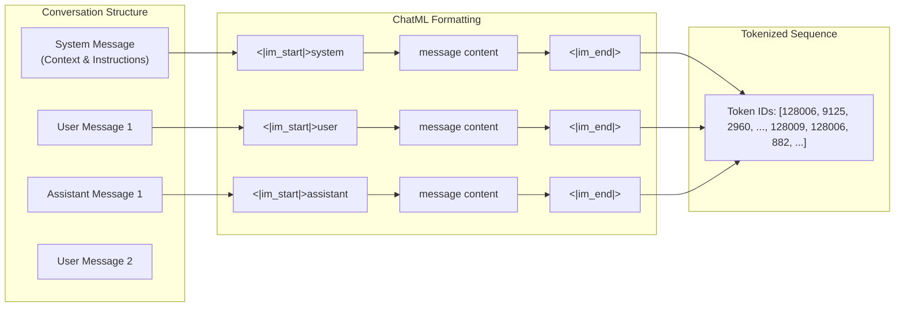
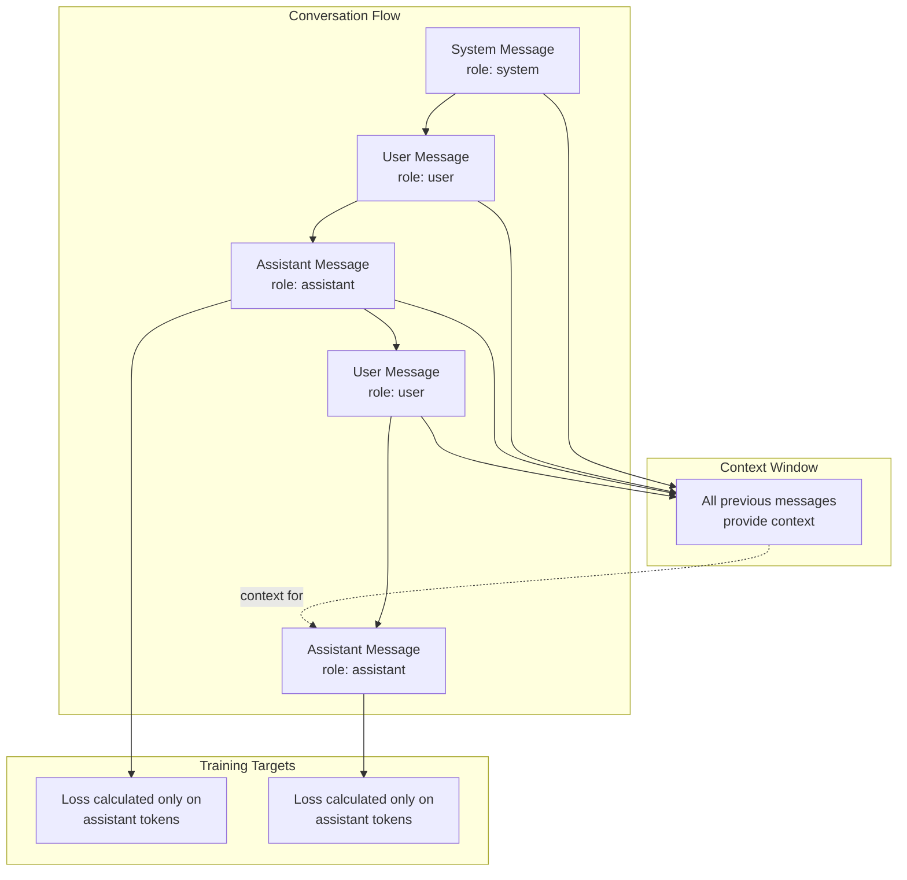
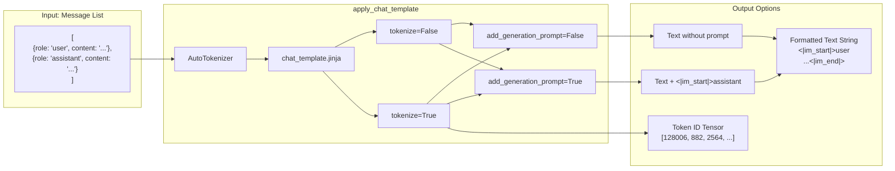
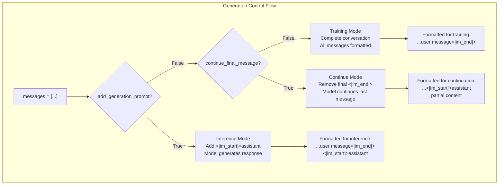

<!-- source: DeepWiki mcp.deepwiki.com · repo huggingface/smol-course · page 2.1 Chat Templates · fetched 2026-10-26 -->

# Chat Templates

<details>
<summary>Relevant source files</summary>

The following files were used as context for generating this wiki page:

- [notebooks/1/4.ipynb](notebooks/1/4.ipynb)
- [units/en/unit1/1.md](units/en/unit1/1.md)
- [units/en/unit1/2.md](units/en/unit1/2.md)
- [units/en/unit1/6.md](units/en/unit1/6.md)
- [v1/3_parameter_efficient_finetuning/notebooks/finetune_sft_peft.ipynb](v1/3_parameter_efficient_finetuning/notebooks/finetune_sft_peft.ipynb)
- [v1/es/3_parameter_efficient_finetuning/notebooks/finetune_sft_peft.ipynb](v1/es/3_parameter_efficient_finetuning/notebooks/finetune_sft_peft.ipynb)
- [v1/ja/3_parameter_efficient_finetuning/notebooks/finetune_sft_peft.ipynb](v1/ja/3_parameter_efficient_finetuning/notebooks/finetune_sft_peft.ipynb)
- [v1/ko/3_parameter_efficient_finetuning/notebooks/finetune_sft_peft.ipynb](v1/ko/3_parameter_efficient_finetuning/notebooks/finetune_sft_peft.ipynb)
- [v1/pt-br/3_parameter_efficient_finetuning/notebooks/finetune_sft_peft.ipynb](v1/pt-br/3_parameter_efficient_finetuning/notebooks/finetune_sft_peft.ipynb)
- [v1/vi/3_parameter_efficient_finetuning/notebooks/finetune_sft_peft.ipynb](v1/vi/3_parameter_efficient_finetuning/notebooks/finetune_sft_peft.ipynb)

</details>


## Purpose and Scope

Chat templates provide the standardized formatting system that enables language models to understand structured conversations. This page covers the ChatML template format used by SmolLM3, the message structure for different conversation roles, and the programmatic interfaces for applying templates during training and inference.

For information about the supervised fine-tuning process that uses these templates, see [Supervised Fine-Tuning](#2.2). For training infrastructure that automates template application, see [Hugging Face Jobs](#2.3).

Sources: [units/en/unit1/2.md:1-8]()

## What Are Chat Templates?

Chat templates convert unstructured conversations into a token sequence that language models can process. Without templates, a model trained on raw text cannot distinguish between a user question and an assistant response, or understand when one message ends and another begins.

A base model like `SmolLM3-3B-Base` predicts the next token in a sequence. An instruct model like `SmolLM3-3B` uses chat templates to understand conversation structure and generate appropriate responses within that structure.

Sources: [units/en/unit1/2.md:3-24]()

## ChatML Format Structure

SmolLM3 implements the ChatML (Chat Markup Language) format using special boundary tokens:

```xml
<|im_start|>system
You are a helpful assistant.<|im_end|>
<|im_start|>user
What is machine learning?<|im_end|>
<|im_start|>assistant
Machine learning is a branch of AI...<|im_end|>
```

### Special Tokens

| Token | Purpose |
|-------|---------|
| `<|im_start|>` | Marks the beginning of a message |
| `<|im_end|>` | Marks the end of a message |
| `<|thinking|>` | Begins reasoning section (thinking mode only) |
| `</|thinking|>` | Ends reasoning section (thinking mode only) |

The template format ensures that:
- Each message has a clearly defined role
- Message boundaries are unambiguous
- The model knows when to start generating responses
- Tool calls and reasoning can be properly structured

Sources: [units/en/unit1/2.md:108-155](), [notebooks/1/4.ipynb:719-886]()



**Diagram: Message Structure to Token Sequence Conversion**

Sources: [units/en/unit1/2.md:108-128]()

## Message Roles and Structure

Each message in a conversation follows a dictionary structure with two required keys:

```python
{
    "role": "user",  # or "system", "assistant", "tool"
    "content": "What is the capital of France?"
}
```

### Role Types

**System Messages**

Set persistent instructions and context that influence all subsequent interactions. The system message appears first in the conversation.

```python
{
    "role": "system",
    "content": "You are a helpful programming tutor. Always provide code examples."
}
```

**User Messages**

Contain questions, requests, or statements from the human user.

```python
{
    "role": "user",
    "content": "How do I define a function in Python?"
}
```

**Assistant Messages**

Contain responses generated by the model. During training, these are the target outputs the model learns to produce.

```python
{
    "role": "assistant",
    "content": "In Python, you define a function using the def keyword..."
}
```

**Tool Messages**

Contain results from function calls or external tool invocations (advanced use case).

```python
{
    "role": "tool",
    "content": '{"temperature": 72, "conditions": "sunny"}'
}
```

Sources: [units/en/unit1/2.md:193-230]()



**Diagram: Message Roles in Multi-Turn Conversations**

Sources: [units/en/unit1/2.md:236-248]()

## Applying Chat Templates in Code

### Basic Template Application

The `AutoTokenizer.apply_chat_template()` method converts message dictionaries into formatted text or token IDs:

```python
from transformers import AutoTokenizer

tokenizer = AutoTokenizer.from_pretrained("HuggingFaceTB/SmolLM3-3B")

messages = [
    {"role": "system", "content": "You are a helpful assistant."},
    {"role": "user", "content": "What is machine learning?"}
]

# Return formatted string
formatted_text = tokenizer.apply_chat_template(
    messages,
    tokenize=False,
    add_generation_prompt=True
)

# Return token IDs for training
token_ids = tokenizer.apply_chat_template(
    messages,
    tokenize=True,
    add_generation_prompt=False
)
```

### Key Parameters

| Parameter | Type | Purpose |
|-----------|------|---------|
| `messages` | List[Dict] | Conversation messages to format |
| `tokenize` | bool | Return token IDs (True) or text (False) |
| `add_generation_prompt` | bool | Add `<|im_start|>assistant` to prompt model response |
| `continue_final_message` | bool | Continue last message instead of starting new one |

Sources: [units/en/unit1/2.md:156-192](), [notebooks/1/4.ipynb:890-920]()



**Diagram: apply_chat_template Parameter Flow**

Sources: [units/en/unit1/2.md:156-192]()

## Reasoning Modes

SmolLM3 supports dual-mode reasoning through special formatting. The mode is controlled by the `/think` or `/no_think` directive in the system message.

### Standard Mode (/no_think)

Direct responses without visible reasoning:

```python
messages = [
    {"role": "system", "content": "/no_think"},
    {"role": "user", "content": "What is 15 × 24?"},
    {"role": "assistant", "content": "15 × 24 = 360"}
]
```

### Thinking Mode (/think)

Responses include visible reasoning process:

```python
messages = [
    {"role": "system", "content": "/think"},
    {"role": "user", "content": "What is 15 × 24?"},
    {"role": "assistant", "content": """<|thinking|>
I need to multiply 15 by 24. Let me break this down:
15 × 24 = 15 × (20 + 4) = (15 × 20) + (15 × 4) = 300 + 60 = 360
</|thinking|>

15 × 24 = 360"""}
]
```

The model learns when to show reasoning based on task complexity during training. The `<|thinking|>` tags are part of the assistant's content and are included in the training loss calculation.

Sources: [units/en/unit1/2.md:129-155](), [units/en/unit1/2.md:420-471](), [notebooks/1/4.ipynb:851-886]()

## Generation Control Parameters

### add_generation_prompt

Controls whether the template adds the `<|im_start|>assistant` token to signal where the model should begin generating:

```python
# For inference - prompts model to generate response
formatted = tokenizer.apply_chat_template(
    messages,
    tokenize=False,
    add_generation_prompt=True  # Adds <|im_start|>assistant
)

# For training - complete conversations without generation prompt
formatted = tokenizer.apply_chat_template(
    messages,
    tokenize=False,
    add_generation_prompt=False  # No additional tokens
)
```

**When to use:**
- `True`: Inference, evaluation, testing model responses
- `False`: Training data preparation, logging complete conversations

Sources: [units/en/unit1/2.md:251-320]()

### continue_final_message

Makes the model continue the last message instead of starting a new one. Useful for structured output generation:

```python
# Prefill JSON structure
messages = [
    {"role": "user", "content": "Format the answer as JSON"},
    {"role": "assistant", "content": '{"name": "'}
]

formatted = tokenizer.apply_chat_template(
    messages,
    tokenize=False,
    continue_final_message=True  # Model continues from '{"name": "'
)
```

**Constraints:**
- Cannot use `add_generation_prompt=True` and `continue_final_message=True` together
- Final message must have `"role": "assistant"`
- Removes `<|im_end|>` token from the final message

**Use cases:**
- Structured output (JSON, XML)
- Code completion
- Guided reasoning formats

Sources: [units/en/unit1/2.md:322-418]()



**Diagram: Generation Control Decision Tree**

Sources: [units/en/unit1/2.md:251-418]()

## Pipeline Integration

The `transformers.pipeline` abstraction handles chat templates automatically, eliminating manual template management:

```python
from transformers import pipeline

pipe = pipeline(
    "text-generation",
    "HuggingFaceTB/SmolLM3-3B",
    device_map="auto"
)

messages = [
    {"role": "system", "content": "You are a helpful assistant."},
    {"role": "user", "content": "What is machine learning?"}
]

# Pipeline automatically:
# 1. Applies chat template based on model's tokenizer config
# 2. Handles tokenization
# 3. Generates response
# 4. Returns structured output
response = pipe(messages, max_new_tokens=128)
print(response[0]['generated_text'][-1])  # Last message (assistant's response)
```

### Pipeline with Generation Config

```python
generation_config = {
    "max_new_tokens": 200,
    "temperature": 0.8,
    "do_sample": True,
    "top_p": 0.9,
    "repetition_penalty": 1.1
}

response = pipe(messages, **generation_config)
```

The pipeline retrieves the chat template from `tokenizer_config.json` in the model's Hugging Face Hub repository. This ensures consistent formatting across different usage contexts.

Sources: [units/en/unit1/2.md:25-93](), [notebooks/1/4.ipynb:94-113]()

```mermaid
graph LR
    subgraph "User Code"
        Messages["messages = [<br/>{role: 'user', content: '...'},<br/>...]"]
        PipeCall["pipe(messages, **config)"]
    end
    
    subgraph "Pipeline Internal Flow"
        LoadConfig["Load tokenizer_config.json<br/>from Hub repo"]
        GetTemplate["Extract chat_template.jinja"]
        ApplyTemplate["tokenizer.apply_chat_template<br/>(add_generation_prompt=True)"]
        Tokenize["tokenizer.encode()"]
        Generate["model.generate()"]
        Decode["tokenizer.decode()"]
        ParseOutput["Parse generated text<br/>into message format"]
    end
    
    subgraph "Output"
        Response["[<br/>{role: 'user', content: '...'},<br/>{role: 'assistant', content: '...'}<br/>]"]
    end
    
    Messages --> PipeCall
    PipeCall --> LoadConfig
    LoadConfig --> GetTemplate
    GetTemplate --> ApplyTemplate
    ApplyTemplate --> Tokenize
    Tokenize --> Generate
    Generate --> Decode
    Decode --> ParseOutput
    ParseOutput --> Response
```



**Diagram: Pipeline Automatic Chat Template Processing**

Sources: [units/en/unit1/2.md:25-93]()

## Training Dataset Preparation

During supervised fine-tuning, chat templates convert conversation datasets into training sequences. The `SFTTrainer` from TRL handles this automatically:

```python
from trl import SFTTrainer, SFTConfig

# Dataset format: list of message dictionaries
dataset = [
    {
        "messages": [
            {"role": "system", "content": "You are a helpful assistant."},
            {"role": "user", "content": "What is Python?"},
            {"role": "assistant", "content": "Python is a programming language..."}
        ]
    },
    # ... more examples
]

trainer = SFTTrainer(
    model=model,
    args=SFTConfig(output_dir="./output"),
    train_dataset=dataset,
    # SFTTrainer automatically applies chat template during training
    # and calculates loss only on assistant tokens
)
```

The trainer:
1. Applies `tokenizer.apply_chat_template()` with `tokenize=True`
2. Creates attention masks that ignore padding
3. Creates labels where only assistant tokens contribute to loss (user and system tokens are masked with -100)
4. Handles batching and sequence packing for efficiency

Sources: [v1/3_parameter_efficient_finetuning/notebooks/finetune_sft_peft.ipynb:105-127](), [v1/ja/3_parameter_efficient_finetuning/notebooks/finetune_sft_peft.ipynb:105-127]()

## Template Configuration Files

Chat templates are stored in `tokenizer_config.json` as Jinja2 templates. For SmolLM3, the key configuration elements are:

```json
{
  "chat_template": "...",
  "bos_token": "<|im_start|>",
  "eos_token": "<|im_end|>",
  "pad_token": "<|im_end|>"
}
```

Custom templates can be specified during tokenizer initialization:

```python
tokenizer.chat_template = "..."
```

The Jinja2 template has access to:
- `messages`: List of conversation messages
- `add_generation_prompt`: Boolean flag
- `bos_token`, `eos_token`: Special tokens from tokenizer config

Sources: [units/en/unit1/2.md:108-128](), [notebooks/1/4.ipynb:719-886]()

## Common Patterns and Best Practices

### System Message Guidelines

- **Specificity**: Provide clear, detailed instructions rather than vague directives
- **Context**: Include relevant background information for domain-specific tasks
- **Examples**: When possible, show the desired format in the system message
- **Boundaries**: Set explicit constraints on behavior (e.g., "Always respond in JSON format")

### Multi-Turn Conversation Handling

```python
conversation = []

# Initial user message
conversation.append({"role": "user", "content": "Hello"})

# Generate response
response = pipe(conversation, max_new_tokens=50)
conversation = response[0]['generated_text']

# Continue conversation
conversation.append({"role": "user", "content": "Follow-up question"})
response = pipe(conversation, max_new_tokens=50)
```

### Template Compatibility

Different models use different chat templates. Always use the tokenizer associated with the specific model:

```python
# Correct: Template matches model
tokenizer = AutoTokenizer.from_pretrained("HuggingFaceTB/SmolLM3-3B")
model = AutoModelForCausalLM.from_pretrained("HuggingFaceTB/SmolLM3-3B")

# Incorrect: Mismatched template
tokenizer = AutoTokenizer.from_pretrained("meta-llama/Llama-2-7b-chat-hf")
model = AutoModelForCausalLM.from_pretrained("HuggingFaceTB/SmolLM3-3B")
```

Sources: [units/en/unit1/2.md:209-248](), [notebooks/1/4.ipynb:890-920]()

---

