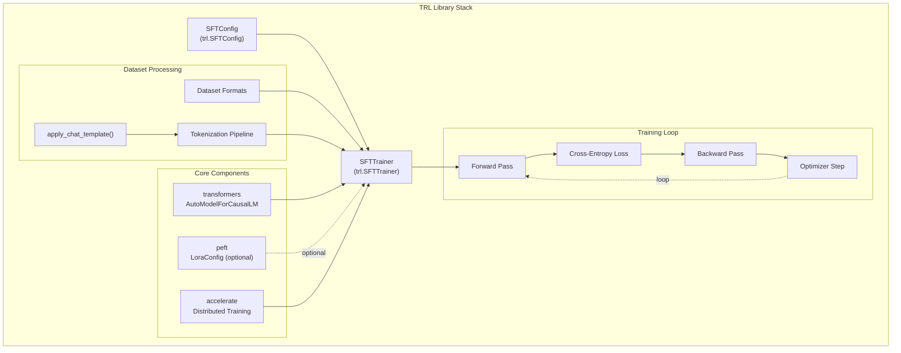
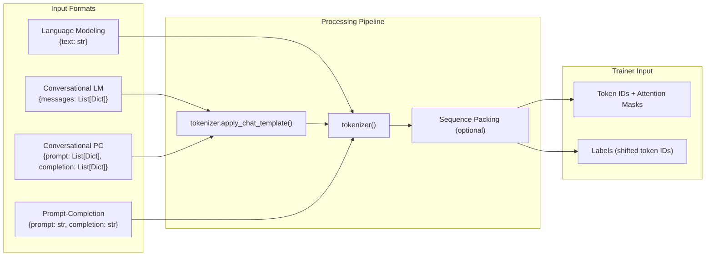
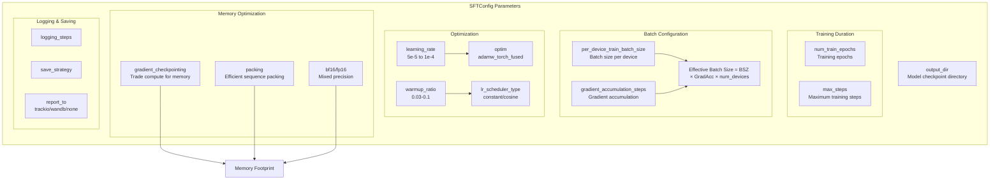

<!-- source: DeepWiki mcp.deepwiki.com · repo huggingface/smol-course · page 2.2 Supervised Fine-Tuning (SFT) · fetched 2026-10-26 -->

# Supervised Fine-Tuning (SFT)

<details>
<summary>Relevant source files</summary>

The following files were used as context for generating this wiki page:

- [notebooks/1/4.ipynb](notebooks/1/4.ipynb)
- [units/en/unit0/1.mdx](units/en/unit0/1.mdx)
- [units/en/unit1/3.md](units/en/unit1/3.md)
- [units/en/unit1/3a.md](units/en/unit1/3a.md)
- [units/en/unit1/4.md](units/en/unit1/4.md)
- [units/en/unit1/5.md](units/en/unit1/5.md)
- [v1/3_parameter_efficient_finetuning/notebooks/finetune_sft_peft.ipynb](v1/3_parameter_efficient_finetuning/notebooks/finetune_sft_peft.ipynb)
- [v1/es/3_parameter_efficient_finetuning/notebooks/finetune_sft_peft.ipynb](v1/es/3_parameter_efficient_finetuning/notebooks/finetune_sft_peft.ipynb)
- [v1/ja/3_parameter_efficient_finetuning/notebooks/finetune_sft_peft.ipynb](v1/ja/3_parameter_efficient_finetuning/notebooks/finetune_sft_peft.ipynb)
- [v1/ko/3_parameter_efficient_finetuning/notebooks/finetune_sft_peft.ipynb](v1/ko/3_parameter_efficient_finetuning/notebooks/finetune_sft_peft.ipynb)
- [v1/pt-br/3_parameter_efficient_finetuning/notebooks/finetune_sft_peft.ipynb](v1/pt-br/3_parameter_efficient_finetuning/notebooks/finetune_sft_peft.ipynb)
- [v1/vi/3_parameter_efficient_finetuning/notebooks/finetune_sft_peft.ipynb](v1/vi/3_parameter_efficient_finetuning/notebooks/finetune_sft_peft.ipynb)

</details>


Supervised Fine-Tuning (SFT) is the process of continuing to train a pre-trained language model on task-specific datasets with labeled input-output pairs. This page details the technical implementation using TRL's `SFTTrainer`, dataset formatting requirements, training configuration via `SFTConfig`, and the complete training workflow.

For information about chat template systems used during SFT, see [Chat Templates](#2.1). For cloud-based training infrastructure, see [Training with Hugging Face Jobs](#2.3). For parameter-efficient methods that reduce memory requirements, see [LoRA and Adapters](#3.1).

## What is Supervised Fine-Tuning

SFT adapts pre-trained models to follow instructions by training on curated examples that demonstrate desired input-output behaviors. Unlike pre-training which teaches general language understanding, SFT reshapes how existing knowledge is applied to specific tasks, response formats, and behavioral patterns.

**Key Mechanism**: During SFT, the model's parameters are updated through gradient descent on task-specific examples. The process minimizes cross-entropy loss between predicted tokens and target responses, gradually shifting probability distributions to favor demonstrated response patterns.

**Behavioral Changes**:
- **Pattern Recognition**: Model learns to identify instruction cues and respond appropriately
- **Format Adaptation**: Output distributions favor desired response structures
- **Knowledge Application**: Existing knowledge is presented in task-specific contexts rather than learned from scratch

Sources: [units/en/unit1/3.md:6-44]()

## Core Architecture: SFTTrainer and TRL

The `SFTTrainer` class from the TRL (Transformers Reinforcement Learning) library provides the primary interface for supervised fine-tuning. It extends the Hugging Face `Trainer` with specialized features for instruction tuning.



**Key Classes**:

| Class | Module | Purpose |
|-------|--------|---------|
| `SFTTrainer` | `trl.SFTTrainer` | Main training orchestration |
| `SFTConfig` | `trl.SFTConfig` | Training hyperparameters |
| `AutoModelForCausalLM` | `transformers` | Model loading |
| `AutoTokenizer` | `transformers` | Tokenization |
| `LoraConfig` | `peft` | Parameter-efficient training config |

Sources: [units/en/unit1/3.md:406-433](), [units/en/unit1/3a.md:49-71]()

## Dataset Formats and Requirements

`SFTTrainer` supports multiple dataset formats for both language modeling and prompt-completion tasks. The trainer automatically applies chat templates to conversational datasets.

### Supported Format Types



### Format Specifications

**Standard Language Modeling**:
```python
{"text": "The sky is blue."}
```

**Conversational Language Modeling**:
```python
{
    "messages": [
        {"role": "user", "content": "What color is the sky?"},
        {"role": "assistant", "content": "It is blue."}
    ]
}
```

**Standard Prompt-Completion**:
```python
{
    "prompt": "The sky is",
    "completion": " blue."
}
```

**Conversational Prompt-Completion**:
```python
{
    "prompt": [{"role": "user", "content": "What color is the sky?"}],
    "completion": [{"role": "assistant", "content": "It is blue."}]
}
```

### Dataset Preprocessing Example

When your dataset doesn't match expected formats, preprocess it before training:

```python
from datasets import load_dataset

dataset = load_dataset("FreedomIntelligence/medical-o1-reasoning-SFT", "en")

def preprocess_function(example):
    return {
        "prompt": [{"role": "user", "content": example["Question"]}],
        "completion": [
            {"role": "assistant", "content": f"{example['Response']}"}
        ],
    }

dataset = dataset.map(preprocess_function, remove_columns=["Question", "Response", "Complex_CoT"])
```

Sources: [units/en/unit1/3.md:328-383](), [units/en/unit1/4.md:732-765]()

## Training Configuration: SFTConfig

The `SFTConfig` class defines all training hyperparameters. It extends Hugging Face's `TrainingArguments` with SFT-specific options.

### Core Configuration Parameters



### Recommended Configuration

**For SmolLM3-3B (Conservative)**:
```python
from trl import SFTConfig

config = SFTConfig(
    output_dir="./smollm3-sft",
    # Duration
    num_train_epochs=1,
    max_steps=1000,
    # Batch configuration
    per_device_train_batch_size=4,
    gradient_accumulation_steps=4,  # Effective batch = 16
    # Optimization
    learning_rate=5e-5,
    optim="adamw_torch_fused",
    lr_scheduler_type="constant",
    warmup_ratio=0.03,
    max_grad_norm=0.3,
    # Memory optimization
    gradient_checkpointing=True,
    packing=True,
    bf16=True,
    # Logging
    logging_steps=50,
    save_strategy="epoch",
    report_to="trackio",
    # Hub integration
    push_to_hub=True,
    hub_model_id="username/model-name"
)
```

**Parameter Guidelines**:

| Parameter | Range | Impact |
|-----------|-------|--------|
| `learning_rate` | 5e-5 to 2e-4 | Higher = faster learning, potential instability |
| `per_device_train_batch_size` | 2 to 16 | Constrained by GPU memory |
| `gradient_accumulation_steps` | 2 to 8 | Simulates larger batch sizes |
| `max_seq_length` | 512 to 4096 | Longer = more context, more memory |
| `warmup_ratio` | 0.03 to 0.1 | Portion of steps for learning rate warmup |

Sources: [units/en/unit1/3.md:98-177](), [units/en/unit1/3.md:463-474]()

## Loss Computation and Training Mechanics

SFT uses token-level cross-entropy loss, training the model to predict the next token given previous context.

### Loss Function

The SFT loss is defined as:

$$
\mathcal{L}_{\text{SFT}}(\theta) = - \sum_{t=1}^{T} \log p_\theta(y_t \mid y_{<t})
$$

where:
- $y_t$ is the target token at timestep $t$
- $p_\theta(y_t \mid y_{<t})$ is the model's predicted probability for $y_t$
- Padding tokens are masked out during computation

### Training Flow

```mermaid
graph TB
    subgraph "Input Processing"
        Dataset["Dataset<br/>(messages or text)"]
        ChatApply["apply_chat_template()<br/>if conversational"]
        Tokenizer["tokenizer()")
        InputIDs["input_ids<br/>attention_mask<br/>labels"]
    end
    
    subgraph "Forward Pass"
        Model["model.forward()"]
        Logits["logits<br/>(batch, seq_len, vocab_size)"]
        ShiftLogits["Shift logits left by 1"]
        ShiftLabels["Shift labels left by 1"]
    end
    
    subgraph "Loss Computation"
        CrossEntropy["torch.nn.functional.cross_entropy"]
        MaskPadding["Mask padding tokens"]
        FinalLoss["Loss (scalar)"]
    end
    
    subgraph "Backward Pass"
        Backward["loss.backward()"]
        GradAccum["Accumulate gradients"]
        ClipGrad["gradient clipping (max_grad_norm)"]
        OptStep["optimizer.step()"]
        LRSchedule["scheduler.step()"]
    end
    
    subgraph "Logging"
        Metrics["loss, learning_rate, grad_norm<br/>num_tokens, token_accuracy"]
        Trackio["trackio.log()"]
    end
    
    Dataset --> ChatApply
    ChatApply --> Tokenizer
    Tokenizer --> InputIDs
    
    InputIDs --> Model
    Model --> Logits
    Logits --> ShiftLogits
    InputIDs --> ShiftLabels
    
    ShiftLogits --> CrossEntropy
    ShiftLabels --> CrossEntropy
    CrossEntropy --> MaskPadding
    MaskPadding --> FinalLoss
    
    FinalLoss --> Backward
    Backward --> GradAccum
    GradAccum --> ClipGrad
    ClipGrad --> OptStep
    OptStep --> LRSchedule
    
    FinalLoss --> Metrics
    Metrics --> Trackio
```

### Tokenization and Label Creation

During preprocessing:
1. **Chat Template Application**: For conversational data, `tokenizer.apply_chat_template()` converts messages to formatted text
2. **Tokenization**: Text is converted to token IDs
3. **Label Creation**: For prompt-completion format, prompt tokens are masked (set to -100) so loss is only computed on completion tokens
4. **Padding Masking**: Padding tokens (-100 in labels) are excluded from loss computation

Sources: [units/en/unit1/3.md:385-405]()

## Complete Training Workflow

### Basic Python API Usage

```python
from transformers import AutoModelForCausalLM, AutoTokenizer
from trl import SFTTrainer, SFTConfig
from datasets import load_dataset

# Load model and tokenizer
model = AutoModelForCausalLM.from_pretrained("HuggingFaceTB/SmolLM3-3B-Base")
tokenizer = AutoTokenizer.from_pretrained("HuggingFaceTB/SmolLM3-3B-Base")

# Load dataset
dataset = load_dataset("HuggingFaceTB/smoltalk2_everyday_convs_think")

# Configure training
config = SFTConfig(
    output_dir="./smollm3-sft",
    per_device_train_batch_size=4,
    learning_rate=5e-5,
    max_steps=1000,
    logging_steps=50,
    save_steps=200,
    report_to="trackio",
    push_to_hub=True,
    hub_model_id="username/smollm3-sft"
)

# Create trainer
trainer = SFTTrainer(
    model=model,
    train_dataset=dataset["train"],
    args=config,
)

# Train
trainer.train()
```

### TRL CLI Usage

```bash
trl sft \
    --model_name_or_path HuggingFaceTB/SmolLM3-3B-Base \
    --dataset_name HuggingFaceTB/smoltalk2_everyday_convs_think \
    --output_dir ./smollm3-sft \
    --per_device_train_batch_size 4 \
    --learning_rate 5e-5 \
    --max_steps 1000 \
    --logging_steps 50 \
    --save_steps 200 \
    --report_to trackio \
    --push_to_hub \
    --hub_model_id username/smollm3-sft
```

### With LoRA/PEFT Integration

```python
from peft import LoraConfig

# Define LoRA configuration
peft_config = LoraConfig(
    r=8,
    lora_alpha=16,
    lora_dropout=0.05,
    bias="none",
    task_type="CAUSAL_LM",
    target_modules="all-linear"
)

# Create trainer with PEFT
trainer = SFTTrainer(
    model=model,
    train_dataset=dataset["train"],
    args=config,
    peft_config=peft_config  # Add LoRA configuration
)

trainer.train()
```

Sources: [units/en/unit1/3.md:444-506](), [units/en/unit1/3a.md:116-146]()

## Monitoring and Metrics

### Logged Metrics

During training, `SFTTrainer` records the following metrics at each logging step:

| Metric | Description |
|--------|-------------|
| `global_step` | Total optimizer steps taken |
| `epoch` | Current epoch number |
| `loss` | Average cross-entropy loss over non-masked tokens |
| `learning_rate` | Current learning rate (may vary with scheduler) |
| `grad_norm` | L2 norm of gradients before clipping |
| `num_tokens` | Total tokens processed |
| `mean_token_accuracy` | Proportion of tokens where top-1 prediction matches ground truth |
| `entropy` | Average entropy of predicted token distribution |

### Experiment Tracking with Trackio

Trackio provides lightweight experiment tracking with Hugging Face infrastructure:

```python
import os

# Set environment variables
os.environ["TRACKIO_PROJECT_NAME"] = "smollm3-sft"
os.environ["TRACKIO_SPACE_ID"] = "username/space_id"

# SFTTrainer automatically logs to Trackio when report_to="trackio"
config = SFTConfig(
    output_dir="./output",
    report_to="trackio",
    # ... other parameters
)

trainer = SFTTrainer(
    model=model,
    train_dataset=dataset["train"],
    args=config,
)
```

### Loss Patterns and Interpretation

**Healthy Training Pattern**:
```
Training Loss:   2.5 -> 1.8 -> 1.2 -> 0.9 -> 0.7 (smooth decrease)
Validation Loss: 2.6 -> 1.9 -> 1.3 -> 1.0 -> 0.8 (tracks training)
Gap: Small and stable
```

**Overfitting Pattern** (validation loss increases while training loss decreases):
- Reduce training steps or epochs
- Increase dataset size/diversity
- Add regularization (dropout, weight decay)
- Use early stopping

**Underfitting Pattern** (both losses plateau at high values):
- Increase learning rate
- Train for more steps
- Check data quality
- Consider larger model

**Memorization Pattern** (extremely low training loss, poor generalization):
- Model may be memorizing training examples
- Check validation performance on new examples
- Reduce model capacity or increase regularization

Sources: [units/en/unit1/3.md:179-327]()

## Integration with Chat Templates

During training, chat templates are automatically applied to conversational datasets. The trainer handles:

1. **Template Application**: Converts message lists to formatted strings using `tokenizer.apply_chat_template()`
2. **Special Token Handling**: Inserts `<|im_start|>`, `<|im_end|>` and other format-specific tokens
3. **Generation Prompt**: Adds `add_generation_prompt=True` for training on assistant responses
4. **Tokenization**: Converts formatted text to token IDs

Example transformation:
```python
# Input messages
messages = [
    {"role": "user", "content": "What is quantum computing?"}
]

# After apply_chat_template (automatic in SFTTrainer)
formatted = """<|im_start|>system
You are a helpful AI assistant.
<|im_start|>user
What is quantum computing?<|im_end|>
<|im_start|>assistant
"""
```

The model is then trained to predict the assistant's response following this formatted prompt.

Sources: [units/en/unit1/3.md:385-405]()

## Dataset Packing

When `packing=True` in `SFTConfig`, the trainer concatenates multiple examples into a single sequence up to `max_seq_length`. This improves GPU utilization by reducing padding.

**Without Packing**:
```
Sequence 1: [tokens...] [PAD] [PAD] [PAD]
Sequence 2: [tokens...] [PAD] [PAD] [PAD] [PAD]
Sequence 3: [tokens...] [PAD]
```

**With Packing**:
```
Packed Seq: [seq1_tokens...] [EOS] [seq2_tokens...] [EOS] [seq3_tokens...] [EOS]
```

Packing requires careful attention mask handling to prevent cross-contamination between examples.

Sources: [units/en/unit1/3.md:273-288](), [v1/3_parameter_efficient_finetuning/notebooks/finetune_sft_peft.ipynb:274-288]()

## Key Takeaways

1. **SFTTrainer**: Primary interface from TRL for supervised fine-tuning, built on Hugging Face Trainer
2. **Dataset Formats**: Supports conversational and standard formats with automatic chat template application
3. **SFTConfig**: Comprehensive configuration for hyperparameters, memory optimization, and logging
4. **Loss Function**: Token-level cross-entropy with padding masking
5. **Monitoring**: Built-in metrics (loss, accuracy, grad_norm) with Trackio integration
6. **PEFT Integration**: Native support for LoRA and other parameter-efficient methods
7. **CLI and Python API**: Flexible interfaces for both experimentation and production

For cloud-based training workflows, see [Training with Hugging Face Jobs](#2.3). For parameter-efficient training techniques, see [LoRA and Adapters](#3.1).

---

