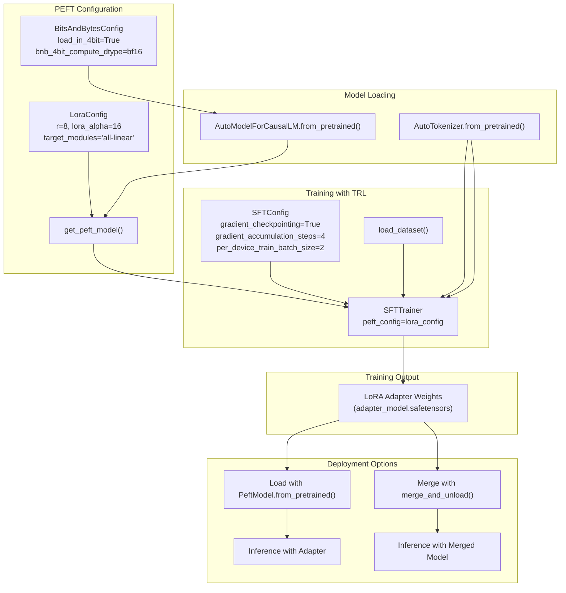
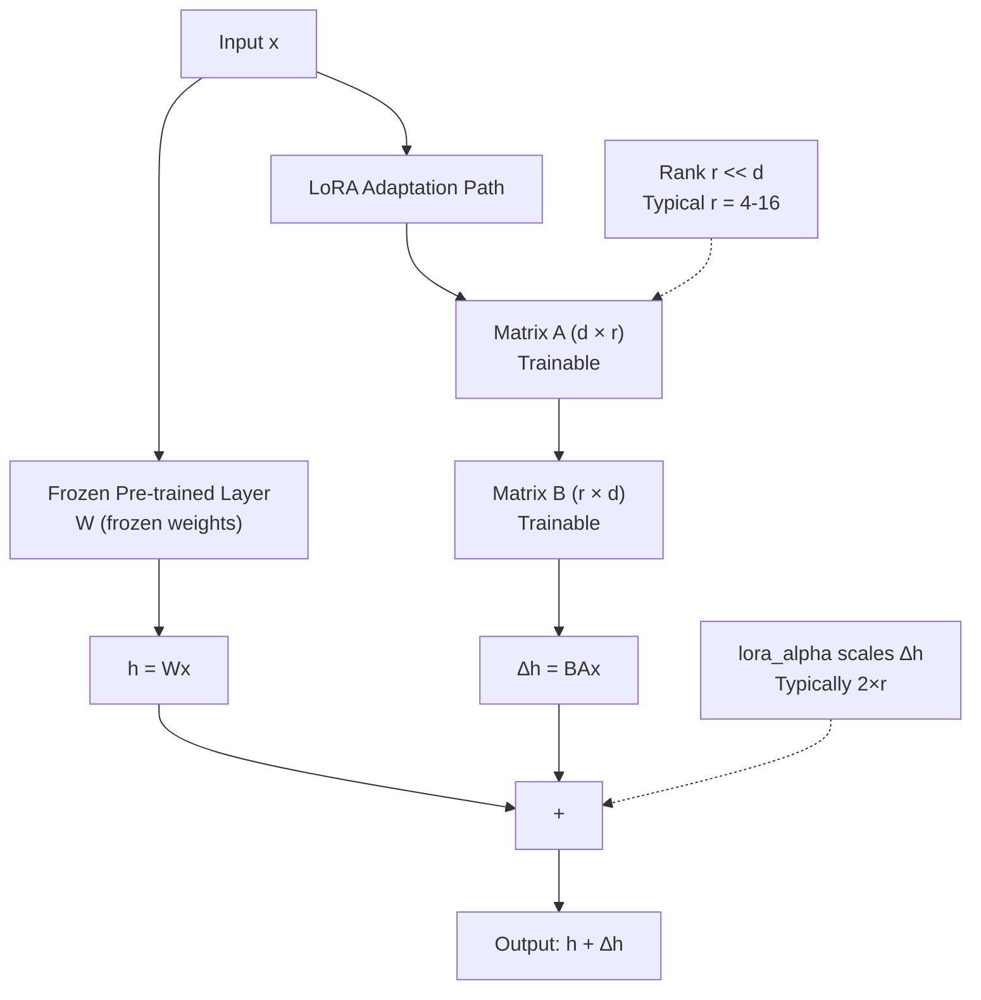

<!-- source: DeepWiki mcp.deepwiki.com · repo huggingface/smol-course · page 3 Parameter-Efficient Fine-Tuning · fetched 2026-10-26 -->

# Parameter-Efficient Fine-Tuning

<details>
<summary>Relevant source files</summary>

The following files were used as context for generating this wiki page:

- [units/en/unit0/1.mdx](units/en/unit0/1.mdx)
- [units/en/unit1/3.md](units/en/unit1/3.md)
- [units/en/unit1/3a.md](units/en/unit1/3a.md)
- [units/en/unit1/4.md](units/en/unit1/4.md)
- [units/en/unit1/5.md](units/en/unit1/5.md)
- [units/es/unit1/0.md](units/es/unit1/0.md)
- [units/es/unit2/0.md](units/es/unit2/0.md)
- [units/es/unit2/2.md](units/es/unit2/2.md)
- [units/es/unit3/0.md](units/es/unit3/0.md)
- [units/es/unit3/2.md](units/es/unit3/2.md)
- [units/es/unit4/0.md](units/es/unit4/0.md)
- [units/ja/unit1/1.md](units/ja/unit1/1.md)
- [units/ja/unit2/1.md](units/ja/unit2/1.md)
- [units/ja/unit2/3.md](units/ja/unit2/3.md)
- [units/ja/unit3/1.md](units/ja/unit3/1.md)
- [v1/3_parameter_efficient_finetuning/lora_adapters.md](v1/3_parameter_efficient_finetuning/lora_adapters.md)
- [v1/es/3_parameter_efficient_finetuning/lora_adapters.md](v1/es/3_parameter_efficient_finetuning/lora_adapters.md)
- [v1/ja/3_parameter_efficient_finetuning/lora_adapters.md](v1/ja/3_parameter_efficient_finetuning/lora_adapters.md)
- [v1/ko/3_parameter_efficient_finetuning/lora_adapters.md](v1/ko/3_parameter_efficient_finetuning/lora_adapters.md)
- [v1/pt-br/3_parameter_efficient_finetuning/lora_adapters.md](v1/pt-br/3_parameter_efficient_finetuning/lora_adapters.md)
- [v1/vi/3_parameter_efficient_finetuning/lora_adapters.md](v1/vi/3_parameter_efficient_finetuning/lora_adapters.md)

</details>


Parameter-Efficient Fine-Tuning (PEFT) methods enable fine-tuning large language models with significantly reduced computational resources by updating only a small subset of model parameters while keeping most of the model frozen. This approach addresses the increasing challenges of traditional fine-tuning as language models grow larger.

PEFT is a cross-cutting technique applied throughout the smol-course: it's used in instruction tuning ([Instruction Tuning](#2)), preference alignment ([Preference Alignment](#4)), and vision-language model fine-tuning ([Vision-Language Models](#5)). This page provides an overview of PEFT concepts and methods that are referenced throughout the course modules.

For information about basic instruction fine-tuning techniques, see [Instruction Tuning](#2). For preference-based alignment methods, see [Preference Alignment](#4).

## Introduction to PEFT

As language models grow larger, traditional fine-tuning becomes increasingly challenging. A full fine-tuning of even a 1.7B parameter model requires substantial GPU memory, makes storing separate model copies expensive, and risks catastrophic forgetting of the model's original capabilities.

PEFT methods address these challenges by modifying only a small subset of model parameters (often less than 1% of the original model size), offering several advantages:

- Fine-tuning on consumer hardware with limited GPU memory (e.g., 16GB VRAM GPUs)
- Storing multiple task-specific adaptations efficiently (adapters are typically a few MB)
- Better generalization in low-data scenarios
- Faster training and iteration cycles
- Reduced risk of catastrophic forgetting

### When to Use PEFT

PEFT is particularly useful when:

- You have limited compute or memory budget
- You need to quickly adapt a base model to multiple tasks/domains
- You want fast iteration and small artifacts (adapter weights are usually a few MB)
- You're training on consumer hardware like RTX 4080 or A10G GPUs

For example, when applied to GPT-3 175B, LoRA reduced trainable parameters by 10,000x and GPU memory requirements by 3x compared to full fine-tuning.

Sources: [units/en/unit1/3a.md:1-15]()

## PEFT Methods Overview

The smol-course covers three primary PEFT approaches:

1. **LoRA (Low-Rank Adaptation)**: Injects trainable low-rank matrices into the model's attention layers, typically reducing trainable parameters by about 90% while maintaining comparable performance to full fine-tuning. This is the most widely used PEFT method.

2. **Quantization Techniques**: Uses 4-bit or 8-bit quantization (via `bitsandbytes`) to reduce memory footprint, often combined with LoRA (QLoRA) for maximum efficiency.

3. **Memory Optimization Strategies**: Techniques like gradient checkpointing, gradient accumulation, and mixed precision training (bf16) that enable training on resource-constrained hardware.

4. **Prompt Tuning**: Adds trainable tokens to the input rather than modifying model weights (less commonly used for smaller models like SmolLM).

### PEFT in the Training Pipeline

**PEFT Training Workflow with TRL and Hugging Face Ecosystem**



This diagram shows the complete PEFT workflow using the Hugging Face ecosystem, from model loading through configuration, training with TRL's `SFTTrainer`, and deployment options.

Sources: [units/en/unit1/3a.md:49-71](), [units/en/unit1/3a.md:116-146]()

## LoRA (Low-Rank Adaptation)

LoRA has become the most widely adopted PEFT method due to its effectiveness and implementation simplicity. Instead of training all model parameters during fine-tuning, LoRA freezes the pre-trained model weights and injects trainable rank decomposition matrices into the model's layers.

### How LoRA Works

LoRA (Low-Rank Adaptation) freezes the pre-trained model weights and injects trainable rank decomposition matrices into the model's layers. Instead of training all model parameters during fine-tuning, LoRA decomposes the weight updates into smaller matrices through low-rank decomposition.

**LoRA Architecture**



**Key LoRA Parameters:**
- `r` (rank): Dimensionality of the low-rank matrices (typically 4-16)
- `lora_alpha`: Scaling factor for the LoRA contribution (typically 2×r)
- `lora_dropout`: Dropout rate applied to LoRA layers for regularization
- `target_modules`: Which model layers to apply LoRA to (e.g., `"all-linear"` or specific attention layers)
- `bias`: Whether to train bias parameters (`"none"`, `"all"`, or `"lora_only"`)

During inference, these adapter weights can be merged with the base model using `merge_and_unload()`, resulting in no additional latency overhead.

Sources: [units/en/unit1/3a.md:11-17](), [v1/3_parameter_efficient_finetuning/lora_adapters.md:6-9]()

### Implementing LoRA

The smol-course provides a streamlined implementation of LoRA using the PEFT library integrated with TRL's `SFTTrainer`. Here's the complete workflow:

#### 1. Configure LoRA Parameters

The `LoraConfig` class from the `peft` library defines the LoRA adapter configuration:

```python
from peft import LoraConfig

# Configure LoRA adapter
peft_config = LoraConfig(
    r=8,                         # Rank dimension (start with 4-8)
    lora_alpha=16,               # Scaling factor (typically 2×r)
    lora_dropout=0.05,           # Dropout for regularization
    bias="none",                 # Bias training strategy
    task_type="CAUSAL_LM",       # Task type for causal LM
    target_modules="all-linear"  # Apply to all linear layers
)
```

See [units/en/unit1/3a.md:120-131]() for the configuration structure.

#### 2. Set Up Training with TRL SFTTrainer

The `SFTTrainer` natively integrates with PEFT, allowing you to pass the `peft_config` directly:

```python
from trl import SFTTrainer, SFTConfig
from transformers import AutoModelForCausalLM, AutoTokenizer
from datasets import load_dataset

# Load model and tokenizer
model = AutoModelForCausalLM.from_pretrained("HuggingFaceTB/SmolLM2-360M")
tokenizer = AutoTokenizer.from_pretrained("HuggingFaceTB/SmolLM2-360M")

# Load dataset
dataset = load_dataset("HuggingFaceTB/smoltalk2_everyday_convs_think")

# Configure training
sft_config = SFTConfig(
    output_dir="./lora-adapter",
    num_train_epochs=1,
    per_device_train_batch_size=2,
    gradient_accumulation_steps=4,
    learning_rate=5e-5,
    max_seq_length=512,
    packing=True,
    logging_steps=10,
)

# Create trainer with PEFT config
trainer = SFTTrainer(
    model=model,
    args=sft_config,
    train_dataset=dataset["train"],
    peft_config=peft_config,  # Pass LoRA configuration
    tokenizer=tokenizer,
)

# Train
trainer.train()
```

See [units/en/unit1/3a.md:116-146]() for the complete training setup.

#### 3. Training Output

After training, the adapter weights are saved to disk:
- `adapter_config.json`: Configuration of the LoRA adapter
- `adapter_model.safetensors`: Trained adapter weights (typically 1-50 MB)

These small adapter files can be loaded on top of the base model or merged for deployment.

Sources: [units/en/unit1/3a.md:116-146]()

### Working with LoRA Adapters

After training, you can work with LoRA adapters in two primary ways:

#### Loading LoRA Adapters

Adapters can be loaded onto a pretrained model with `PeftModel.from_pretrained()`, which is useful for trying out different adapters whose weights aren't merged:

```python
from transformers import AutoModelForCausalLM
from peft import PeftModel

# Load the base model
base_model = AutoModelForCausalLM.from_pretrained("HuggingFaceTB/SmolLM2-360M")

# Load LoRA adapter on top of base model
peft_model_id = "your-username/smollm2-lora-adapter"
model = PeftModel.from_pretrained(base_model, peft_model_id)
```

You can use `set_adapter()` to switch between different adapters, or `unload()` to return to the base model. This makes it easy to switch between different task-specific weights.

See [units/en/unit1/3a.md:19-32]() for adapter loading details.

#### Merging LoRA Adapters with Base Model

For easier deployment, you can merge the adapter weights back into the base model. This creates a single model with the combined weights, eliminating the need to load adapters separately during inference:

```python
import torch
from transformers import AutoModelForCausalLM, AutoTokenizer
from peft import PeftModel

# 1. Load the base model
base_model = AutoModelForCausalLM.from_pretrained(
    "base_model_name",
    dtype=torch.bfloat16,
    device_map="auto"
)

# 2. Load the PEFT model with adapter
peft_model = PeftModel.from_pretrained(
    base_model,
    "path/to/adapter",
    dtype=torch.bfloat16
)

# 3. Merge adapter weights with base model
try:
    merged_model = peft_model.merge_and_unload()
except RuntimeError as e:
    print(f"Merging failed: {e}")
    # Implement fallback strategy or memory optimization

# 4. Save the merged model
merged_model.save_pretrained("path/to/save/merged_model")

# Also save the tokenizer
tokenizer = AutoTokenizer.from_pretrained("base_model_name")
tokenizer.save_pretrained("path/to/save/merged_model")
```

**Important considerations for merging:**
- Ensure sufficient GPU/CPU memory is available (you need to load both base model and adapter simultaneously)
- Use `device_map="auto"` for automatic memory management
- Maintain consistent precision (e.g., `bfloat16`) throughout the process
- Validate the merged model by comparing outputs with the adapter-based version

See [units/en/unit1/3a.md:73-114]() for the complete merging implementation.

Sources: [units/en/unit1/3a.md:19-32](), [units/en/unit1/3a.md:73-114]()

## OLoRA: Enhanced LoRA Initialization

OLoRA (Orthogonal LoRA) is an enhancement to standard LoRA that utilizes QR decomposition to initialize the LoRA adapters. OLoRA translates the base weights of the model by a factor of their QR decompositions—that is, it mutates the weights before performing any training on them.

This approach significantly improves:
- **Stability**: More stable training dynamics
- **Convergence Speed**: Faster convergence to optimal parameters
- **Performance**: Superior final performance compared to standard LoRA

OLoRA can be enabled in the PEFT library's `LoraConfig` by setting the initialization method appropriately.

Sources: [units/en/unit1/3a.md:45-47](), [v1/3_parameter_efficient_finetuning/lora_adapters.md:40-42]()

## Quantization Techniques

Quantization reduces the memory footprint of models by representing weights in lower precision formats (4-bit or 8-bit instead of 16-bit or 32-bit). The smol-course uses the `bitsandbytes` library for quantization, which can be combined with LoRA to create QLoRA (Quantized LoRA).

### BitsAndBytesConfig

The `BitsAndBytesConfig` class configures 4-bit or 8-bit quantization:

```python
from transformers import BitsAndBytesConfig
import torch

# Configure 4-bit quantization
bnb_config = BitsAndBytesConfig(
    load_in_4bit=True,                      # Enable 4-bit quantization
    bnb_4bit_compute_dtype=torch.bfloat16,  # Compute dtype for 4-bit base models
    bnb_4bit_use_double_quant=True,         # Nested quantization for better memory savings
    bnb_4bit_quant_type="nf4"               # Quantization type (nf4 or fp4)
)

# Load model with quantization
model = AutoModelForCausalLM.from_pretrained(
    "HuggingFaceTB/SmolLM2-1.7B",
    quantization_config=bnb_config,
    device_map="auto"
)
```

### QLoRA: Combining Quantization with LoRA

QLoRA combines 4-bit quantization with LoRA adapters, enabling efficient fine-tuning of large models on limited hardware. The quantized base model remains frozen in 4-bit precision, while LoRA adapters are trained in higher precision (bfloat16).

**Memory Savings:**
- 4-bit quantization: ~4x memory reduction compared to float16
- 8-bit quantization: ~2x memory reduction
- Combined with LoRA: Enables training 7B+ models on consumer GPUs

See the subsection "LoRA/PEFT on Jobs" in [units/en/unit1/5.md:162-190]() for an example of using quantization with LoRA in training scripts.

Sources: [units/en/unit1/3a.md:1-3]() (mentions quantization)

## Memory Optimization Strategies

Beyond LoRA and quantization, several memory optimization techniques enable training on resource-constrained hardware:

### Gradient Checkpointing

Gradient checkpointing trades compute for memory by not storing all intermediate activations during the forward pass. Instead, activations are recomputed during the backward pass when needed.

Enable in `SFTConfig`:
```python
args = SFTConfig(
    gradient_checkpointing=True,
    gradient_checkpointing_kwargs={"use_reentrant": False},
    # ... other config
)
```

**Tradeoff:** ~30% slower training but significantly reduced memory usage.

### Gradient Accumulation

Gradient accumulation simulates larger batch sizes by accumulating gradients over multiple forward/backward passes before updating model weights:

```python
args = SFTConfig(
    per_device_train_batch_size=2,        # Small batch per device
    gradient_accumulation_steps=8,         # Accumulate over 8 steps
    # Effective batch size = 2 × 8 = 16
)
```

This allows training with larger effective batch sizes on limited memory.

### Mixed Precision Training (BF16)

Using bfloat16 instead of float32 reduces memory usage and speeds up training on modern GPUs:

```python
args = SFTConfig(
    bf16=True,  # Enable bfloat16 if supported
    # ... other config
)
```

### Batch Size Optimization

Start with small batch sizes and use gradient accumulation to achieve larger effective batch sizes:

```python
# Limited GPU Memory (16GB)
per_device_train_batch_size = 2
gradient_accumulation_steps = 8  # Effective batch size: 16

# Balanced GPU Memory (24GB)
per_device_train_batch_size = 4
gradient_accumulation_steps = 4  # Effective batch size: 16

# More GPU Memory (40GB+)
per_device_train_batch_size = 8
gradient_accumulation_steps = 2  # Effective batch size: 16
```

See [units/en/unit1/3.md:99-178]() for detailed guidance on hyperparameter configuration for resource-constrained training.

Sources: [units/en/unit1/3.md:99-178]()

## PEFT Methods Comparison

When deciding which PEFT method to use, consider the following comparison:

| Method | Trainable Parameters | Memory Usage | Training Speed | Best For |
|--------|---------------------|--------------|----------------|----------|
| LoRA | Low (~0.1-1%) | Low | Fast | General fine-tuning, best balance |
| QLoRA (4-bit) | Low (~0.1-1%) | Very Low | Moderate | Large models on limited hardware |
| Quantization Only | 100% | Low | Fast | Inference optimization |
| Gradient Checkpointing | 100% | Medium | Slow (~30% overhead) | Full fine-tuning with memory constraints |
| Full Fine-tuning | 100% | High | Fast | When resources allow and maximum performance needed |

**Recommended Combinations:**
- **Consumer GPU (16GB)**: LoRA + 4-bit Quantization + Gradient Checkpointing
- **Professional GPU (24-40GB)**: LoRA or LoRA + 8-bit Quantization
- **High-end GPU (80GB)**: LoRA or Full Fine-tuning

LoRA offers the best balance between parameter efficiency and performance for most use cases in the smol-course.

Sources: [units/en/unit1/3a.md:1-15]()

## PEFT Integration with TRL

PEFT methods integrate seamlessly with TRL (Transformers Reinforcement Learning) library for efficient training across different alignment techniques:

### SFT with PEFT

The `SFTTrainer` natively supports PEFT configurations:

```python
from peft import LoraConfig
from trl import SFTTrainer, SFTConfig

# Configure LoRA
lora_config = LoraConfig(
    r=8,
    lora_alpha=16,
    lora_dropout=0.05,
    bias="none",
    task_type="CAUSAL_LM",
    target_modules="all-linear"
)

# Create trainer with PEFT
trainer = SFTTrainer(
    model=model,
    args=SFTConfig(output_dir="./lora-model"),
    train_dataset=dataset["train"],
    peft_config=lora_config,  # Pass LoRA config
    tokenizer=tokenizer,
)

trainer.train()
```

### DPO with PEFT

PEFT can also be applied to preference alignment methods like DPO:

```python
from trl import DPOTrainer, DPOConfig

# Configure DPO with LoRA
dpo_config = DPOConfig(
    output_dir="./dpo-lora-model",
    beta=0.1,  # DPO temperature parameter
    # ... other DPO parameters
)

trainer = DPOTrainer(
    model=model,
    args=dpo_config,
    train_dataset=preference_dataset,
    peft_config=lora_config,  # Apply LoRA to DPO
    tokenizer=tokenizer,
)

trainer.train()
```

### Using TRL CLI with PEFT

The TRL CLI supports PEFT through command-line flags:

```bash
# SFT with LoRA via CLI
trl sft \
    --model_name_or_path HuggingFaceTB/SmolLM2-1.7B \
    --dataset_name HuggingFaceTB/smoltalk2 \
    --output_dir ./lora-output \
    --use_peft \
    --lora_r 8 \
    --lora_alpha 16 \
    --lora_dropout 0.05 \
    --lora_target_modules all-linear
```

See [units/en/unit1/5.md:162-190]() for complete examples of using PEFT with Hugging Face Jobs.

Sources: [units/en/unit1/3a.md:49-71](), [units/en/unit1/5.md:162-190]()

## Practical Considerations and Best Practices

When implementing PEFT methods in the smol-course, consider these practical guidelines:

### LoRA Configuration

**Start with conservative values:**
- `r=4-8` for initial experiments, increase to 16-32 only if needed
- `lora_alpha=16` (typically 2×r) as the scaling factor
- `lora_dropout=0.05` for regularization
- `target_modules="all-linear"` to apply LoRA to all linear layers

**Example starting configuration:**
```python
peft_config = LoraConfig(
    r=8,
    lora_alpha=16,
    lora_dropout=0.05,
    bias="none",
    task_type="CAUSAL_LM",
    target_modules="all-linear"
)
```

### Memory Management

**For 16GB GPU (e.g., RTX 4080):**
- Use 4-bit quantization with LoRA
- Enable gradient checkpointing
- Set `per_device_train_batch_size=2` with `gradient_accumulation_steps=8`

**For 24GB GPU (e.g., A10G):**
- Use LoRA without quantization or 8-bit quantization
- Optionally enable gradient checkpointing
- Set `per_device_train_batch_size=4` with `gradient_accumulation_steps=4`

**For 40GB+ GPU (e.g., A100):**
- Use LoRA without quantization
- Can train without gradient checkpointing
- Set `per_device_train_batch_size=8` with `gradient_accumulation_steps=2`

See configuration examples in [units/en/unit1/3.md:128-178]().

### Training Monitoring

**Watch for these patterns:**
- Training loss should decrease steadily
- Validation loss should track training loss (small gap indicates good generalization)
- If validation loss increases while training loss decreases, you're overfitting

**Using Trackio for monitoring:**
The smol-course integrates with Trackio for experiment tracking. Set environment variables:
```bash
export TRACKIO_PROJECT_NAME="my-lora-training"
export TRACKIO_SPACE_ID="username/space_id"
```

Then `SFTTrainer` automatically logs metrics. See [units/en/unit1/3.md:260-314]() for Trackio integration details.

### Deployment Considerations

**When to load adapters separately:**
- Serving multiple task-specific models from the same base
- Rapid switching between different model variants
- Saving storage space (adapters are typically 1-50 MB)

**When to merge adapters:**
- Simplified deployment with a single model file
- No need for adapter management in production
- When inference latency is critical (merged models have no adapter overhead)

See adapter merging details in [units/en/unit1/3a.md:73-114]().

### Common Pitfalls

1. **Using too high rank**: Start small (r=4-8), increase only if validation metrics improve
2. **Not using gradient accumulation**: Leads to unstable training with small batch sizes
3. **Forgetting to save tokenizer**: Save both model and tokenizer for complete deployments
4. **Not validating merged models**: Always test that merged models produce expected outputs

Sources: [units/en/unit1/3a.md:1-15](), [units/en/unit1/3.md:128-178](), [units/en/unit1/3.md:260-314]()

## Resources

- [PEFT Documentation](https://huggingface.co/docs/peft)
- [LoRA Paper](https://arxiv.org/abs/2106.09685)
- [QLoRA Paper](https://arxiv.org/abs/2305.14314)
- [Prompt Tuning Paper](https://arxiv.org/abs/2104.08691)
- Course Notebooks:
  - LoRA Fine-tuning: [3_parameter_efficient_finetuning/notebooks/finetune_sft_peft.ipynb]()
  - Load LoRA Adapters: [3_parameter_efficient_finetuning/notebooks/load_lora_adapter.ipynb]()

Sources: [3_parameter_efficient_finetuning/README.md:32-40]()

---

