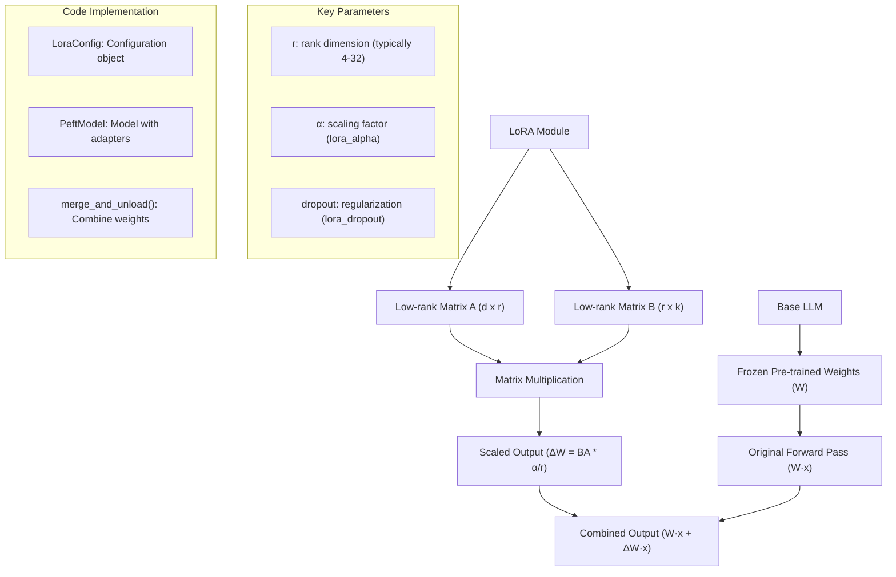
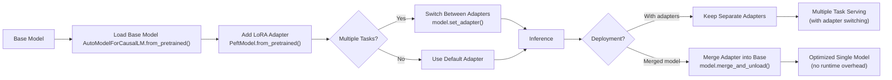

<!-- source: DeepWiki mcp.deepwiki.com · repo huggingface/smol-course · page 3.1 LoRA and Adapters · fetched 2026-10-26 -->

# LoRA and Adapters

<details>
<summary>Relevant source files</summary>

The following files were used as context for generating this wiki page:

- [units/en/unit0/1.mdx](units/en/unit0/1.mdx)
- [units/en/unit1/3.md](units/en/unit1/3.md)
- [units/en/unit1/3a.md](units/en/unit1/3a.md)
- [units/en/unit1/4.md](units/en/unit1/4.md)
- [units/en/unit1/5.md](units/en/unit1/5.md)
- [units/es/unit3/1.md](units/es/unit3/1.md)
- [units/ja/unit3/2.md](units/ja/unit3/2.md)
- [units/ko/unit3/2.md](units/ko/unit3/2.md)
- [units/pt-br/unit3/2.md](units/pt-br/unit3/2.md)
- [units/vi/unit3/2.md](units/vi/unit3/2.md)
- [v1/3_parameter_efficient_finetuning/lora_adapters.md](v1/3_parameter_efficient_finetuning/lora_adapters.md)
- [v1/es/3_parameter_efficient_finetuning/lora_adapters.md](v1/es/3_parameter_efficient_finetuning/lora_adapters.md)
- [v1/ja/3_parameter_efficient_finetuning/lora_adapters.md](v1/ja/3_parameter_efficient_finetuning/lora_adapters.md)
- [v1/ko/3_parameter_efficient_finetuning/lora_adapters.md](v1/ko/3_parameter_efficient_finetuning/lora_adapters.md)
- [v1/pt-br/3_parameter_efficient_finetuning/lora_adapters.md](v1/pt-br/3_parameter_efficient_finetuning/lora_adapters.md)
- [v1/vi/3_parameter_efficient_finetuning/lora_adapters.md](v1/vi/3_parameter_efficient_finetuning/lora_adapters.md)

</details>


LoRA (Low-Rank Adaptation) is a parameter-efficient fine-tuning technique that has become the most widely adopted PEFT method. This page explains how LoRA works, how to implement it in your projects, and best practices for using adapters effectively. By using LoRA, you can fine-tune large language models with only a small fraction of trainable parameters, making fine-tuning possible on consumer hardware.

For information about Prompt Tuning, which is another PEFT method that adds trainable tokens to the input, see [Prompt Tuning](#4.2).

## Understanding LoRA

LoRA is a parameter-efficient fine-tuning technique that freezes the pre-trained model weights and injects trainable rank decomposition matrices into the model's layers. Instead of training all model parameters during fine-tuning, LoRA decomposes the weight updates into smaller matrices through low-rank decomposition, significantly reducing the number of trainable parameters.

When applied to large models like GPT-3 175B, LoRA reduced trainable parameters by 10,000x and GPU memory requirements by 3x compared to full fine-tuning, while maintaining comparable performance.

### How LoRA Works in Transformer Models



Sources: [3_parameter_efficient_finetuning/lora_adapters.md:7-9]()

LoRA works by:
1. **Freezing base model weights**: The original pre-trained model remains unchanged
2. **Adding low-rank matrices**: Pairs of matrices (A, B) are added to transformer layers, typically focusing on attention weights
3. **Low-rank decomposition**: Using matrices with small rank r (typically 4-32), greatly reducing parameter count
4. **Scale factor**: Using a scaling parameter α (lora_alpha) to control update magnitude

## Working with LoRA Adapters

LoRA adapters provide a flexible way to adapt models for different tasks while keeping the base model intact. They can be loaded, switched, and even merged back into the base model.

### Loading and Managing Adapters

```python
from transformers import AutoModelForCausalLM
from peft import PeftModel

base_model = AutoModelForCausalLM.from_pretrained("<base_model_name>")
peft_model_id = "<peft_adapter_id>"
model = PeftModel.from_pretrained(base_model, peft_model_id)
```

Once loaded, adapters can be managed using:
- `model.set_adapter()`: Switch between different adapters
- `model.unload()`: Remove all LoRA modules to return to the base model

### Adapter Usage Workflow



Sources: [3_parameter_efficient_finetuning/lora_adapters.md:12-14](), [3_parameter_efficient_finetuning/notebooks/load_lora_adapter.ipynb:214-216]()

## Training with LoRA

Training a model with LoRA requires configuring the LoRA parameters and using a trainer that supports parameter-efficient fine-tuning.

### LoRA Configuration

The most important parameters to configure for LoRA are:

```python
from peft import LoraConfig

peft_config = LoraConfig(
    r=8,                     # Rank dimension - lower means fewer parameters
    lora_alpha=16,           # Scaling factor - typically 2x the rank
    lora_dropout=0.05,       # Dropout probability for regularization
    bias="none",             # Whether to train biases
    target_modules="all-linear",  # Which modules to apply LoRA to
    task_type="CAUSAL_LM",   # Task type for the model architecture
)
```

### Integration with SFTTrainer

The SFTTrainer from the `trl` library directly supports LoRA through the integration with PEFT:

```python
from trl import SFTTrainer

trainer = SFTTrainer(
    model=model,
    args=training_args,
    train_dataset=dataset["train"],
    peft_config=peft_config,  # LoRA configuration
    tokenizer=tokenizer,
)

# Start training
trainer.train()

# Save the model with LoRA adapter
trainer.save_model()
```

Sources: [3_parameter_efficient_finetuning/notebooks/finetune_sft_peft.ipynb:188-205](), [3_parameter_efficient_finetuning/notebooks/finetune_sft_peft.ipynb:272-287]()

## Merging LoRA Adapters

After training with LoRA, you might want to merge the adapter weights back into the base model for easier deployment. This creates a single model with combined weights, eliminating the need to load adapters separately during inference.

### When to Merge

Merging adapters is beneficial when:
1. **Deployment simplification**: Single file instead of base model + adapters
2. **Inference speed**: No additional computation for adapter weights
3. **Framework compatibility**: Better compatibility with serving frameworks

### Merging Process

```python
import torch
from peft import AutoPeftModelForCausalLM

# Load LoRA model
model = AutoPeftModelForCausalLM.from_pretrained(
    "path/to/adapter",
    torch_dtype=torch.float16,
    low_cpu_mem_usage=True,
)

# Merge adapter with base model
merged_model = model.merge_and_unload()

# Save the merged model
merged_model.save_pretrained(
    "path/to/save/merged_model", 
    safe_serialization=True,
    max_shard_size="2GB"
)

# Don't forget to save the tokenizer
tokenizer.save_pretrained("path/to/save/merged_model")
```

Sources: [3_parameter_efficient_finetuning/lora_adapters.md:77-104](), [3_parameter_efficient_finetuning/notebooks/finetune_sft_peft.ipynb:371-385]()

## Comparison with Other Fine-tuning Methods

LoRA is one of several approaches to fine-tuning language models, each with different tradeoffs:

| Method | Parameters | Memory Usage | Task Switching | Use Case |
|--------|------------|---------|----------------|----------|
| LoRA | Low (~1%) | Low | Requires Loading | General purpose fine-tuning |
| Prompt Tuning | Very Low (<0.1%) | Minimal | Easy | Simple adaptations, multi-task |
| Full Fine-tuning | High (100%) | High | New Model Copy | When maximum performance is needed |

Sources: [3_parameter_efficient_finetuning/prompt_tuning.md:46-51]()

## Advanced LoRA Techniques

### OLoRA

OLoRA is an improved version of LoRA that utilizes QR decomposition to initialize the adapters. It translates the base weights of the model by a factor of their QR decompositions before training, which:

- Significantly improves training stability
- Accelerates convergence speed
- Achieves superior performance

Sources: [3_parameter_efficient_finetuning/lora_adapters.md:41-42]()

### Integration with TRL

LoRA works well with the Transformers Reinforcement Learning (TRL) library, making it particularly useful for RLHF:

```python
from peft import LoraConfig
from transformers import AutoModelForCausalLM

# Configure LoRA
lora_config = LoraConfig(
    r=16,
    lora_alpha=32,
    lora_dropout=0.05,
    bias="none",
    task_type="CAUSAL_LM"
)

# Load model with LoRA config
model = AutoModelForCausalLM.from_pretrained(
    "your-model-name",
    load_in_8bit=True,  # Optional quantization
    device_map="auto",  # Automatic device placement
    peft_config=lora_config
)
```

Sources: [3_parameter_efficient_finetuning/lora_adapters.md:49-68]()

## Implementation Best Practices

### Parameter Selection

- **Rank (r)**: Start with small values (4-8) and increase if needed for complex tasks
- **Alpha (lora_alpha)**: Typically set to 2x the rank value
- **Target modules**: Focus on attention layers for best efficiency/performance tradeoff
- **Dropout**: Use small values (0.05-0.1) to prevent overfitting

### Memory Management

- Use `device_map="auto"` for automatic memory management with large models
- Consider quantization (load_in_8bit=True) for additional memory savings
- Use gradient checkpointing during training for larger batch sizes

### Validation Strategy

- Always compare with a base model to ensure improvements
- Validate on diverse examples to ensure robust performance
- Save checkpoints during training to select the best model
- Test merged models thoroughly before deployment

Sources: [3_parameter_efficient_finetuning/lora_adapters.md:37-38]()

## Conclusion

LoRA provides an efficient way to fine-tune large language models with limited computational resources. By adding small rank decomposition matrices to attention weights while keeping the base model frozen, LoRA typically reduces trainable parameters by about 90%, making it possible to fine-tune large models on consumer hardware while maintaining comparable performance to full fine-tuning.

The ability to create, switch between, and merge adapters makes LoRA a versatile tool for adapting models to specific tasks or domains. Whether you're working with small models or large ones, LoRA offers a practical approach to parameter-efficient fine-tuning.

---

