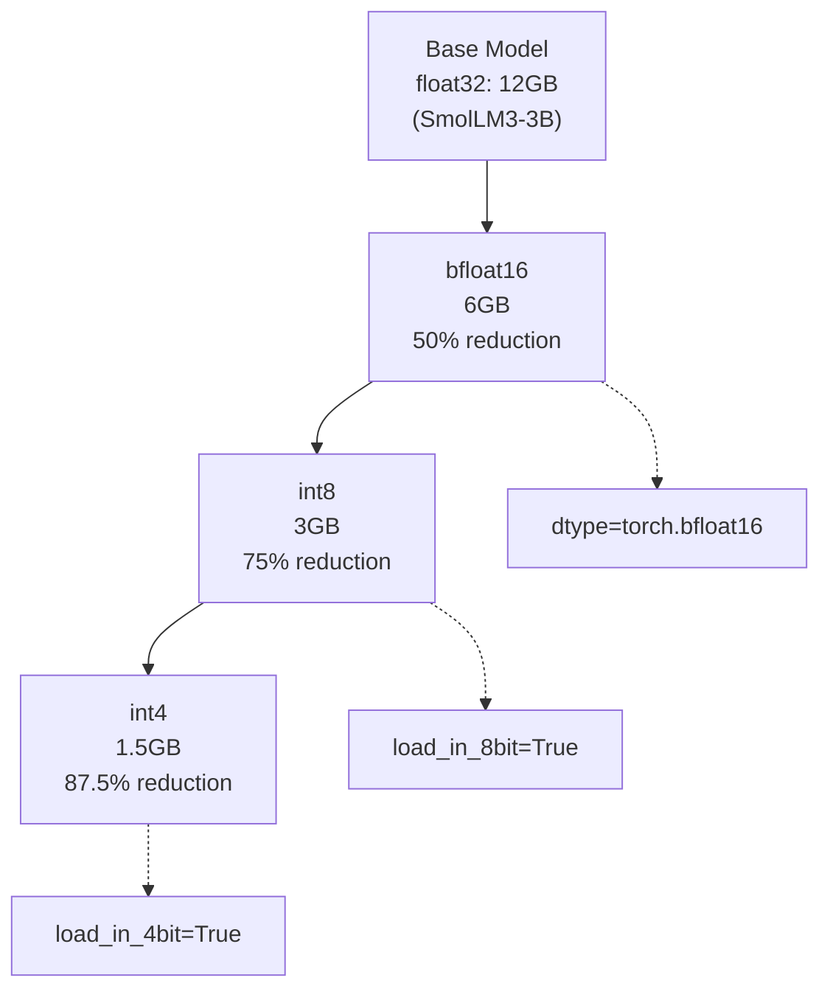
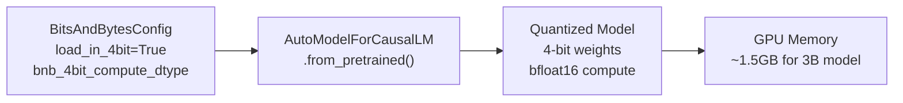
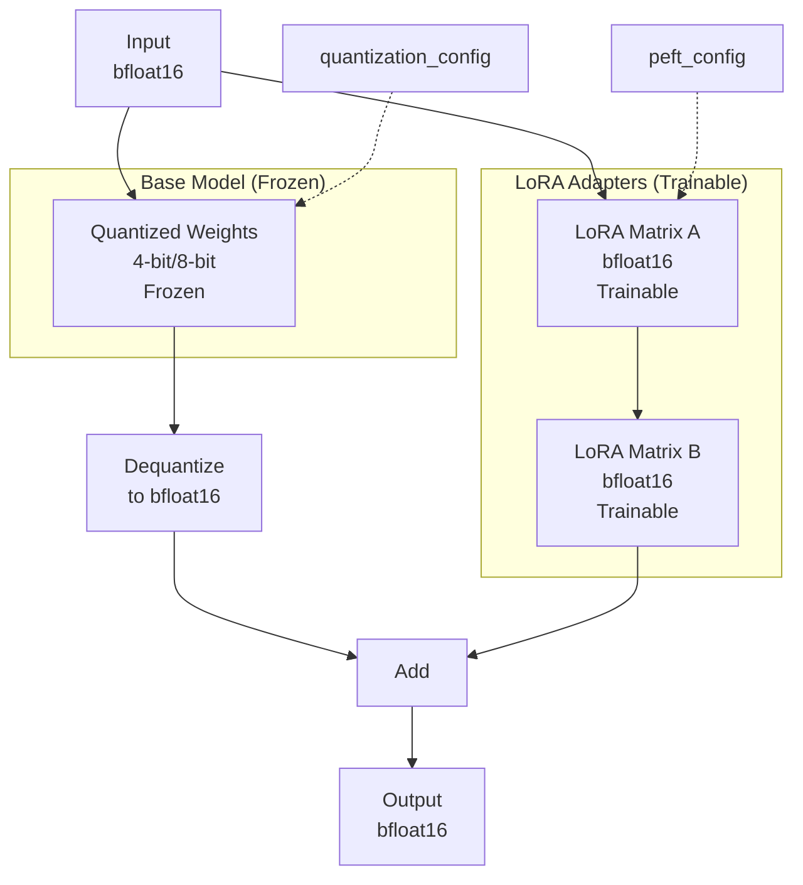
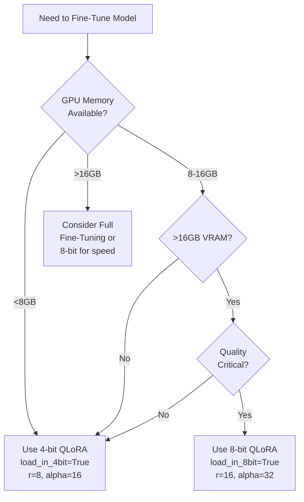

<!-- source: DeepWiki mcp.deepwiki.com · repo huggingface/smol-course · page 3.2 Quantization Techniques · fetched 2026-10-26 -->

# Quantization Techniques

<details>
<summary>Relevant source files</summary>

The following files were used as context for generating this wiki page:

- [units/en/unit0/1.mdx](units/en/unit0/1.mdx)
- [units/en/unit1/3.md](units/en/unit1/3.md)
- [units/en/unit1/3a.md](units/en/unit1/3a.md)
- [units/en/unit1/4.md](units/en/unit1/4.md)
- [units/en/unit1/5.md](units/en/unit1/5.md)
- [units/en/unit2/1.md](units/en/unit2/1.md)
- [units/en/unit2/2.md](units/en/unit2/2.md)
- [units/en/unit2/3.md](units/en/unit2/3.md)
- [units/en/unit2/4.md](units/en/unit2/4.md)
- [units/en/unit3/1.md](units/en/unit3/1.md)
- [units/en/unit3/2.md](units/en/unit3/2.md)
- [units/en/unit3/3.md](units/en/unit3/3.md)
- [units/en/unit3/4.md](units/en/unit3/4.md)

</details>


## Purpose and Scope

This document explains quantization techniques for parameter-efficient fine-tuning of language models, focusing on 4-bit and 8-bit quantization using the `bitsandbytes` library. It covers the `BitsAndBytesConfig` class, memory savings calculations, and QLoRA (quantization combined with LoRA). For information about LoRA adapters and low-rank adaptation, see [3.1](#3.1). For broader memory optimization strategies including gradient checkpointing and batch size optimization, see [3.3](#3.3).

---

## Understanding Quantization

### What is Quantization

Quantization reduces the numerical precision of model weights and activations from higher precision formats (float32, float16) to lower precision formats (int8, int4). This process decreases memory consumption and accelerates computation while attempting to preserve model quality.

During quantization, continuous floating-point values are mapped to a discrete set of values. For example, instead of representing a weight with 32 bits (float32), we can represent it with 8 bits (int8) or even 4 bits (int4). The `bitsandbytes` library provides optimized CUDA kernels for these quantization operations.

### Memory Savings Analysis

The memory reduction from quantization is directly proportional to the bit-width reduction:

| Precision | Bytes per Parameter | Memory for 3B Model | Memory for 7B Model |
|-----------|---------------------|---------------------|---------------------|
| float32 | 4 bytes | ~12 GB | ~28 GB |
| float16/bfloat16 | 2 bytes | ~6 GB | ~14 GB |
| int8 | 1 byte | ~3 GB | ~7 GB |
| int4 | 0.5 bytes | ~1.5 GB | ~3.5 GB |

**Diagram: Memory Reduction Through Quantization**



Sources: [units/en/unit3/3.md:10-15](), [units/en/unit1/3a.md:1-10]()

### Why Use Quantization

Quantization enables training and inference on consumer hardware:

- **Accessibility**: Train 3B-7B models on GPUs with 8-16GB VRAM
- **Cost Efficiency**: Reduce cloud compute costs by using smaller GPU instances
- **Inference Speed**: Lower precision arithmetic executes faster on modern GPUs
- **Deployment**: Smaller models fit on edge devices and mobile platforms

Quantization is particularly critical for VLMs where image features increase memory demands beyond text-only models.

Sources: [units/en/unit3/3.md:6-16](), [units/en/unit3/1.md:34-38]()

---

## Quantization Methods with bitsandbytes

The `bitsandbytes` library provides two primary quantization approaches: 8-bit and 4-bit. Both methods maintain acceptable model quality while significantly reducing memory requirements.

### 8-Bit Quantization

8-bit quantization (int8) provides a balanced trade-off between memory savings and model quality. The `bitsandbytes` library implements LLM.int8(), which uses mixed-precision decomposition to preserve outlier features.

**Key characteristics**:
- 75% memory reduction compared to float32
- Minimal quality degradation (typically <1% performance drop)
- Suitable for models where quality is critical
- Faster than 4-bit for certain operations

### 4-Bit Quantization

4-bit quantization (int4) achieves maximum memory reduction at the cost of slightly lower quality. The `bitsandbytes` library supports multiple 4-bit quantization schemes:

- **NF4 (NormalFloat4)**: Optimized for normally distributed weights, default for most use cases
- **FP4**: Standard 4-bit floating-point representation

**Key characteristics**:
- 87.5% memory reduction compared to float32
- 50% reduction compared to 8-bit
- Small quality degradation (typically 1-3% performance drop)
- Enables training of larger models on limited hardware

### Comparison Table

| Feature | 8-bit (int8) | 4-bit (int4) |
|---------|--------------|--------------|
| Memory vs float32 | 4x reduction | 8x reduction |
| Quality Loss | <1% | 1-3% |
| Speed vs float16 | ~1.5x faster | ~2x faster |
| Recommended For | Quality-critical tasks | Maximum memory savings |
| Training Stability | More stable | Requires careful tuning |

Sources: [units/en/unit1/3a.md:1-15](), [units/en/unit3/3.md:10-15]()

---

## BitsAndBytesConfig

The `BitsAndBytesConfig` class from `transformers` provides a unified interface for configuring quantization parameters when loading models.

**Diagram: BitsAndBytesConfig in Model Loading Pipeline**



Sources: [units/en/unit3/4.md:51-52](), [units/en/unit3/2.md:117-122]()

### Configuration Parameters

The `BitsAndBytesConfig` class accepts several key parameters:

| Parameter | Type | Description | Common Values |
|-----------|------|-------------|---------------|
| `load_in_8bit` | bool | Enable 8-bit quantization | `True`, `False` |
| `load_in_4bit` | bool | Enable 4-bit quantization | `True`, `False` |
| `bnb_4bit_compute_dtype` | torch.dtype | Computation precision | `torch.bfloat16`, `torch.float16` |
| `bnb_4bit_quant_type` | str | Quantization algorithm | `"nf4"`, `"fp4"` |
| `bnb_4bit_use_double_quant` | bool | Enable nested quantization | `True`, `False` |

### Implementation Examples

**4-bit Quantization Configuration:**

```python
from transformers import BitsAndBytesConfig
import torch

# Basic 4-bit quantization
quant_config = BitsAndBytesConfig(
    load_in_4bit=True,
    bnb_4bit_compute_dtype=torch.bfloat16,
    bnb_4bit_quant_type="nf4",
    bnb_4bit_use_double_quant=True
)
```

**Loading a Quantized Model:**

The configuration is passed to `from_pretrained()` to automatically quantize weights during loading:

```python
from transformers import AutoModelForCausalLM

model = AutoModelForCausalLM.from_pretrained(
    "HuggingFaceTB/SmolLM3-3B-Base",
    quantization_config=quant_config,
    device_map="auto"
)
```

Sources: [units/en/unit3/4.md:51-52](), [units/en/unit3/2.md:116-123]()

**8-bit Quantization Configuration:**

```python
# 8-bit quantization for better quality
quant_config_8bit = BitsAndBytesConfig(
    load_in_8bit=True
)

model = AutoModelForCausalLM.from_pretrained(
    "HuggingFaceTB/SmolLM3-3B-Base",
    quantization_config=quant_config_8bit,
    device_map="auto"
)
```

The `device_map="auto"` parameter enables automatic distribution of quantized layers across available devices.

Sources: [units/en/unit1/4.md:94-99](), [units/en/unit3/4.md:88-94]()

---

## QLoRA: Quantization + LoRA

QLoRA (Quantized Low-Rank Adaptation) combines quantization with LoRA to enable parameter-efficient fine-tuning of quantized models. This approach allows training large models on consumer GPUs by freezing quantized weights and training small LoRA adapters in higher precision.

### How QLoRA Works

**Diagram: QLoRA Training Architecture**



Sources: [units/en/unit1/3a.md:49-71](), [units/en/unit3/4.md:206-303]()

### Key Components

1. **Quantized Base Model**: Frozen 4-bit or 8-bit weights reduce memory
2. **LoRA Adapters**: Small trainable matrices in bfloat16/float16
3. **Mixed Precision Compute**: Computations performed in higher precision
4. **Gradient Flow**: Only adapter parameters receive gradients

### Memory Savings Calculation

For a 3B parameter model:

| Component | Memory (4-bit QLoRA) | Memory (Full Fine-tune) |
|-----------|----------------------|-------------------------|
| Base Weights | ~1.5 GB (4-bit) | ~12 GB (float32) |
| LoRA Adapters | ~50 MB (r=8) | - |
| Optimizer States | ~100 MB | ~24 GB |
| Gradients | ~50 MB | ~12 GB |
| **Total** | **~1.7 GB** | **~48 GB** |

QLoRA reduces memory requirements by ~28x compared to full fine-tuning.

Sources: [units/en/unit1/3a.md:1-15]()

### Implementation Example

**Configuring QLoRA Training:**

```python
from transformers import AutoModelForCausalLM, BitsAndBytesConfig
from peft import LoraConfig, get_peft_model
import torch

# 1. Configure 4-bit quantization
quant_config = BitsAndBytesConfig(
    load_in_4bit=True,
    bnb_4bit_compute_dtype=torch.bfloat16,
    bnb_4bit_quant_type="nf4",
    bnb_4bit_use_double_quant=True
)

# 2. Load quantized base model
model = AutoModelForCausalLM.from_pretrained(
    "HuggingFaceTB/SmolLM3-3B-Base",
    quantization_config=quant_config,
    device_map="auto"
)

# 3. Configure LoRA
peft_config = LoraConfig(
    r=8,
    lora_alpha=16,
    lora_dropout=0.05,
    target_modules=["q_proj", "v_proj"],
    task_type="CAUSAL_LM",
)

# 4. Apply PEFT to quantized model
peft_model = get_peft_model(model, peft_config)
peft_model.print_trainable_parameters()
```

Sources: [units/en/unit3/4.md:275-301](), [units/en/unit1/3a.md:53-71]()

**Using QLoRA with SFTTrainer:**

The `SFTTrainer` from TRL integrates seamlessly with quantized models:

```python
from trl import SFTTrainer, SFTConfig

training_args = SFTConfig(
    output_dir="./qlora-smollm3",
    per_device_train_batch_size=4,
    gradient_accumulation_steps=4,
    learning_rate=2e-4,
    num_train_epochs=3,
    bf16=True,
    gradient_checkpointing=True,
)

trainer = SFTTrainer(
    model=model,  # Quantized model with LoRA
    args=training_args,
    train_dataset=dataset,
    peft_config=peft_config,
)

trainer.train()
```

Sources: [units/en/unit1/3a.md:116-142](), [units/en/unit3/4.md:313-343]()

---

## Practical Usage Patterns

### Loading Pre-Quantized Models

Some models on Hugging Face Hub are pre-quantized and can be loaded directly without `BitsAndBytesConfig`:

```python
# Load a pre-quantized model
model = AutoModelForCausalLM.from_pretrained(
    "TheBloke/SmolLM3-3B-GPTQ",  # Example GPTQ quantized model
    device_map="auto"
)
```

However, for most use cases, quantizing during loading provides more flexibility.

### Training vs Inference Quantization

**Inference-Only Quantization:**

```python
# Quantize for inference (no gradients needed)
quant_config = BitsAndBytesConfig(
    load_in_4bit=True,
    bnb_4bit_compute_dtype=torch.bfloat16
)

model = AutoModelForCausalLM.from_pretrained(
    model_name,
    quantization_config=quant_config,
    device_map="auto"
)

# Use for inference
with torch.no_grad():
    outputs = model.generate(...)
```

**Training with QLoRA:**

Requires LoRA adapters to enable gradient flow through frozen quantized weights. See the QLoRA section above for complete training setup.

Sources: [units/en/unit3/2.md:116-149](), [units/en/unit3/4.md:206-303]()

### VLM-Specific Quantization

Vision-Language Models benefit significantly from quantization due to their larger size:

```python
from transformers import AutoProcessor, AutoModelForImageTextToText

# Quantized VLM loading
quant_config = BitsAndBytesConfig(load_in_4bit=True)

model = AutoModelForImageTextToText.from_pretrained(
    "HuggingFaceTB/SmolVLM2-2.2B-Instruct",
    quantization_config=quant_config,
    device_map="auto"
)

processor = AutoProcessor.from_pretrained(
    "HuggingFaceTB/SmolVLM2-2.2B-Instruct"
)
```

Sources: [units/en/unit3/2.md:112-123](), [units/en/unit3/4.md:82-94]()

---

## Trade-offs and Best Practices

### Choosing Quantization Level

**Use 8-bit quantization when:**
- Model quality is critical (evaluation benchmarks, production deployment)
- You have 12-16GB GPU memory available
- Training stability is a priority
- Minimal quality degradation is required

**Use 4-bit quantization when:**
- GPU memory is severely limited (8GB or less)
- Training larger models (7B+) on consumer hardware
- Experimentation and rapid iteration are priorities
- Slight quality loss (1-3%) is acceptable

### Quality vs Memory Trade-off Table

| Model Size | Full Precision | 8-bit QLoRA | 4-bit QLoRA |
|------------|----------------|-------------|-------------|
| Memory (3B) | ~48 GB | ~4 GB | ~1.7 GB |
| Memory (7B) | ~112 GB | ~9 GB | ~4 GB |
| Quality Loss | 0% | <1% | 1-3% |
| Training Speed | Baseline | 1.3x | 1.5x |

Sources: [units/en/unit1/3a.md:1-15](), [units/en/unit3/3.md:6-28]()

### Best Practices

1. **Start with 8-bit**: Test with 8-bit quantization first to establish a quality baseline
2. **Use NF4 for 4-bit**: The `"nf4"` quantization type generally outperforms `"fp4"`
3. **Enable Double Quantization**: Set `bnb_4bit_use_double_quant=True` for additional memory savings with minimal quality impact
4. **Match Compute Dtype**: Use `torch.bfloat16` for compute when available (A100, H100 GPUs)
5. **Combine with Gradient Checkpointing**: Enable `gradient_checkpointing=True` for additional memory savings during training
6. **Monitor Training Loss**: Quantization can affect training dynamics; monitor loss curves carefully

**Diagram: Decision Flow for Quantization Selection**



Sources: [units/en/unit3/3.md:19-28](), [units/en/unit1/3a.md:5-10]()

### Common Issues and Solutions

**Issue: Model quality degradation after quantization**
- Solution: Use 8-bit instead of 4-bit, or increase LoRA rank (r=16 instead of r=8)

**Issue: Out of memory during training**
- Solution: Enable gradient checkpointing, reduce batch size, increase gradient accumulation steps

**Issue: Slow training speed**
- Solution: Ensure `bnb_4bit_compute_dtype=torch.bfloat16` is set, use larger batch sizes with gradient accumulation

Sources: [units/en/unit3/3.md:119-131](), [units/en/unit1/3a.md:40-43]()

---

## Integration with TRL Training

The `SFTTrainer` and `DPOTrainer` from TRL support quantization through the `peft_config` parameter. This enables seamless QLoRA training:

```python
from trl import SFTTrainer, SFTConfig
from peft import LoraConfig

# LoRA configuration for quantized model
peft_config = LoraConfig(
    r=8,
    lora_alpha=16,
    lora_dropout=0.05,
    bias="none",
    task_type="CAUSAL_LM",
)

# Training configuration
training_args = SFTConfig(
    output_dir="./qlora-output",
    per_device_train_batch_size=4,
    gradient_accumulation_steps=4,
    learning_rate=2e-4,
    max_steps=1000,
    bf16=True,
    gradient_checkpointing=True,
)

# Trainer automatically handles quantized models
trainer = SFTTrainer(
    model=quantized_model,  # Model loaded with BitsAndBytesConfig
    args=training_args,
    train_dataset=dataset,
    peft_config=peft_config,
)
```

Sources: [units/en/unit1/3a.md:116-142](), [units/en/unit3/4.md:313-343]()

---

## Resources and Further Reading

- [bitsandbytes Documentation](https://github.com/TimDettmers/bitsandbytes) - Official library documentation
- [QLoRA Paper](https://huggingface.co/papers/2305.14314) - Original research paper introducing QLoRA
- [PEFT Documentation](https://huggingface.co/docs/peft) - Parameter-Efficient Fine-Tuning guide including quantization
- [LLM.int8() Paper](https://huggingface.co/papers/2208.07339) - Research on 8-bit quantization methods
- [Transformers Quantization Guide](https://huggingface.co/docs/transformers/quantization) - Official quantization documentation

Sources: [units/en/unit1/3a.md:148-153](), [units/en/unit3/1.md:71-86]()

---

