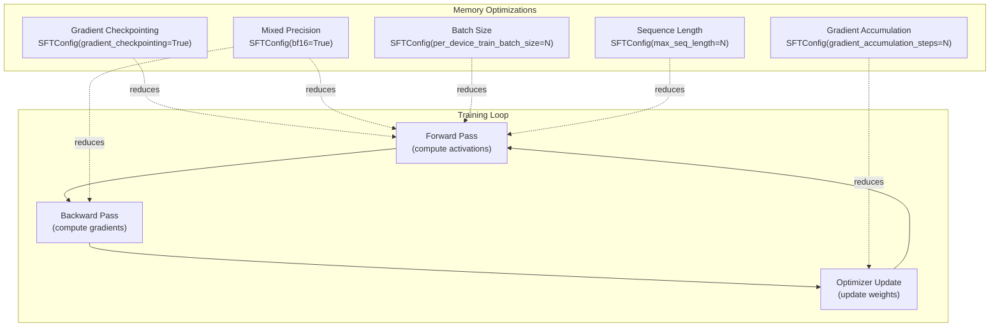
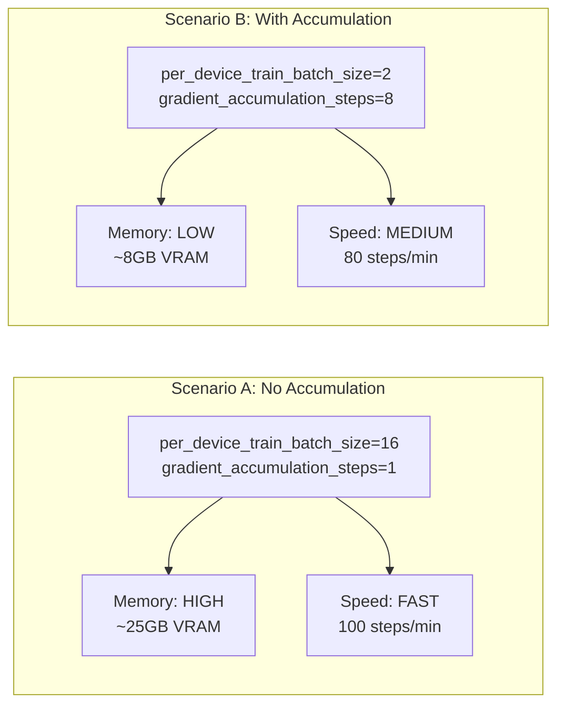
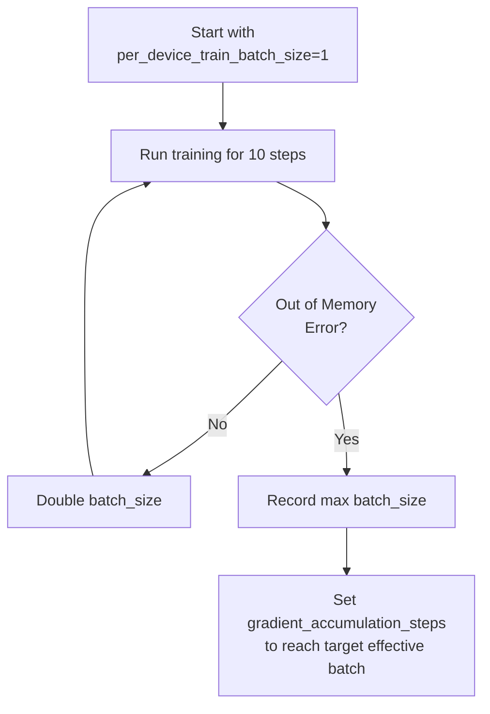
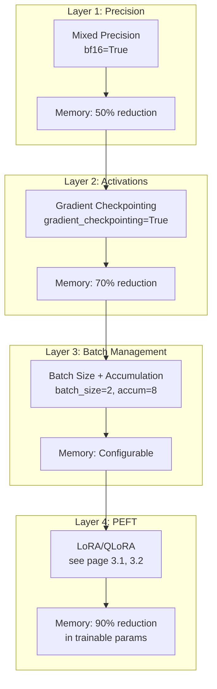

<!-- source: DeepWiki mcp.deepwiki.com · repo huggingface/smol-course · page 3.3 Memory Optimization Strategies · fetched 2026-10-26 -->

# Memory Optimization Strategies

<details>
<summary>Relevant source files</summary>

The following files were used as context for generating this wiki page:

- [units/en/unit0/1.mdx](units/en/unit0/1.mdx)
- [units/en/unit1/3.md](units/en/unit1/3.md)
- [units/en/unit1/3a.md](units/en/unit1/3a.md)
- [units/en/unit1/4.md](units/en/unit1/4.md)
- [units/en/unit1/5.md](units/en/unit1/5.md)
- [units/en/unit2/1.md](units/en/unit2/1.md)
- [units/en/unit2/2.md](units/en/unit2/2.md)
- [units/en/unit2/3.md](units/en/unit2/3.md)
- [units/en/unit2/4.md](units/en/unit2/4.md)
- [units/en/unit3/1.md](units/en/unit3/1.md)
- [units/en/unit3/2.md](units/en/unit3/2.md)
- [units/en/unit3/3.md](units/en/unit3/3.md)
- [units/en/unit3/4.md](units/en/unit3/4.md)

</details>


## Purpose and Scope

This page documents memory optimization techniques for fine-tuning large language models in resource-constrained environments. These strategies complement parameter-efficient methods like [LoRA](#3.1) and [quantization](#3.2), enabling training on consumer-grade GPUs (16GB+ VRAM) and efficient use of cloud resources.

The techniques covered apply to both text-only models (SmolLM3) and vision-language models (SmolVLM2). For parameter reduction strategies, see [LoRA and Adapters](#3.1). For precision reduction, see [Quantization Techniques](#3.2).

## Memory Challenges in Fine-Tuning

Fine-tuning large language models requires significant GPU memory for:
- **Model parameters**: Weights of the base model
- **Optimizer states**: Adam/AdamW stores first and second moment estimates (2-3x model size)
- **Gradients**: Same size as trainable parameters
- **Activations**: Intermediate computations during forward pass (grows with batch size and sequence length)

For a 3B parameter model in bfloat16:
- Model weights: ~6GB
- Optimizer states (AdamW): ~12GB
- Gradients: ~6GB
- Activations: Varies by batch size/sequence length

Without optimization, training SmolLM3-3B can require 40GB+ VRAM, exceeding consumer GPU capacity.

Sources: [units/en/unit1/3.md:87-96](), [units/en/unit3/3.md:6-27]()

## Memory Optimization Architecture



Sources: [units/en/unit1/3.md:99-177](), [units/en/unit3/3.md:20-27]()

## Gradient Checkpointing

### Overview

Gradient checkpointing trades computation time for memory by selectively discarding intermediate activations during the forward pass and recomputing them during the backward pass. This technique can reduce activation memory by 3-5x with minimal (~20%) training slowdown.

### Implementation with SFTConfig

Enable gradient checkpointing via `SFTConfig`:

```python
from trl import SFTConfig

config = SFTConfig(
    gradient_checkpointing=True,
    gradient_checkpointing_kwargs={"use_reentrant": False},
    output_dir="./output"
)
```

The `use_reentrant=False` flag uses a more memory-efficient implementation that works better with most models.

### Memory Impact

For SmolLM3-3B with batch size 4, sequence length 2048:
- Without checkpointing: ~18GB activation memory
- With checkpointing: ~4GB activation memory
- Training time increase: ~15-20%

Sources: [units/en/unit3/3.md:20-27](), [units/en/unit3/4.md:308-330]()

## Gradient Accumulation

### Overview

Gradient accumulation simulates larger batch sizes by accumulating gradients over multiple forward-backward passes before performing an optimizer step. This enables effective large batch training on memory-constrained hardware.

**Effective Batch Size** = `per_device_train_batch_size` × `gradient_accumulation_steps` × `num_gpus`

### Configuration

```python
from trl import SFTConfig

# Simulate batch size of 16 with only 2 samples per step
config = SFTConfig(
    per_device_train_batch_size=2,
    gradient_accumulation_steps=8,  # Effective batch size = 16
    gradient_checkpointing=True,
    output_dir="./output"
)
```

### Memory vs Computation Trade-off



### Recommended Configurations

| GPU Memory | per_device_train_batch_size | gradient_accumulation_steps | Effective Batch Size |
|------------|----------------------------|----------------------------|---------------------|
| 8-12GB     | 1                          | 16                         | 16                  |
| 12-16GB    | 2                          | 8                          | 16                  |
| 16-24GB    | 4                          | 4                          | 16                  |
| 24GB+      | 8                          | 2                          | 16                  |

Sources: [units/en/unit1/3.md:143-161](), [units/en/unit1/4.md:143-161]()

## Mixed Precision Training

### Overview

Mixed precision training uses lower-precision formats (bfloat16 or float16) for most operations while keeping critical computations in float32. This reduces memory usage by ~50% and accelerates training on modern GPUs (Ampere/Ada architectures) without significant accuracy loss.

### Precision Format Comparison

| Format   | Memory per Parameter | Numeric Range | Recommended Use |
|----------|---------------------|---------------|-----------------|
| float32  | 4 bytes            | High          | Baseline (no optimization) |
| float16  | 2 bytes            | Limited       | Older GPUs (V100) |
| bfloat16 | 2 bytes            | Same as fp32  | Modern GPUs (A100, RTX 40xx) |

### Implementation

```python
from trl import SFTConfig

# bfloat16 (recommended for modern GPUs)
config = SFTConfig(
    bf16=True,
    output_dir="./output"
)

# float16 (for older GPUs)
config = SFTConfig(
    fp16=True,
    output_dir="./output"
)
```

For VLM training, mixed precision is typically combined with other techniques:

[units/en/unit3/4.md:308-330]() shows VLM training with `bf16=True`.

### Hardware Compatibility

- **bfloat16**: Requires Ampere (A100, RTX 30xx) or newer
- **float16**: Supported on Volta (V100) and newer
- **Automatic detection**: `SFTConfig` will raise an error if the selected precision is unsupported

Sources: [units/en/unit3/3.md:10-15](), [units/en/unit3/4.md:308-330]()

## Batch Size Optimization

### Overview

Batch size directly impacts memory usage and training dynamics. Smaller batches reduce memory consumption but increase gradient noise; larger batches provide more stable gradients but require more memory.

### Finding Optimal Batch Size



### Configuration Examples

From [units/en/unit1/3.md:143-161]():

**Limited GPU Memory (8-12GB)**:
```python
SFTConfig(
    per_device_train_batch_size=2,
    gradient_accumulation_steps=8,
    gradient_checkpointing=True,
    bf16=True
)
```

**Balanced GPU Memory (16-24GB)**:
```python
SFTConfig(
    per_device_train_batch_size=4,
    gradient_accumulation_steps=4,
    gradient_checkpointing=True,
    bf16=True
)
```

**High GPU Memory (24GB+)**:
```python
SFTConfig(
    per_device_train_batch_size=8,
    gradient_accumulation_steps=2,
    gradient_checkpointing=True,
    bf16=True
)
```

Sources: [units/en/unit1/3.md:143-161](), [units/en/unit1/4.md:143-161]()

## Sequence Length Management

### Overview

Sequence length (also called `max_seq_length` or `max_length`) determines the maximum number of tokens processed in a single training example. Memory usage grows linearly with sequence length due to attention computation scaling as O(n²).

### Configuration

```python
from trl import SFTConfig

config = SFTConfig(
    max_seq_length=2048,  # Standard for most tasks
    output_dir="./output"
)
```

### Recommended Sequence Lengths

From [units/en/unit1/4.md:164-177]():

| Use Case | max_seq_length | Memory Impact |
|----------|----------------|---------------|
| Short conversations | 512 | Minimal |
| Standard chat | 1024 | Moderate |
| Long conversations | 2048 | Standard |
| Extended context | 4096 | High |

### VLM-Specific Considerations

For vision-language models, **always set `max_length=None`** in `SFTConfig` to prevent truncation of image tokens:

```python
from trl import SFTConfig

# VLM training
config = SFTConfig(
    max_length=None,  # Critical for VLMs
    gradient_checkpointing=True,
    bf16=True,
    output_dir="./output"
)
```

Failure to set `max_length=None` will cause image tokens to be truncated, breaking the model's ability to process visual inputs.

Sources: [units/en/unit1/4.md:164-177](), [units/en/unit3/3.md:68-70]()

## Combining Strategies

### Memory Optimization Stack

Memory optimization is most effective when strategies are combined systematically:



### Complete Configuration Example

For SmolLM3-3B on a 16GB GPU:

```python
from trl import SFTConfig, SFTTrainer
from peft import LoraConfig

# Memory optimization configuration
training_args = SFTConfig(
    # Precision
    bf16=True,
    
    # Gradient management
    gradient_checkpointing=True,
    gradient_checkpointing_kwargs={"use_reentrant": False},
    
    # Batch configuration
    per_device_train_batch_size=2,
    gradient_accumulation_steps=8,  # Effective batch size = 16
    
    # Sequence length
    max_seq_length=2048,
    
    # Other settings
    output_dir="./smollm3-memory-optimized",
    learning_rate=5e-5,
    max_steps=1000,
    logging_steps=50,
    save_steps=200
)

# PEFT configuration
peft_config = LoraConfig(
    r=8,
    lora_alpha=16,
    lora_dropout=0.05,
    bias="none",
    task_type="CAUSAL_LM"
)

trainer = SFTTrainer(
    model=model,
    args=training_args,
    train_dataset=dataset,
    peft_config=peft_config
)
```

This configuration enables training SmolLM3-3B on a consumer GPU that would otherwise require 40GB+ VRAM.

Sources: [units/en/unit1/3.md:117-141](), [units/en/unit1/3a.md:117-141]()

## VLM-Specific Optimizations

Vision-language models require additional memory considerations due to image processing:

### VLM Memory Configuration

From [units/en/unit3/4.md:308-330]():

```python
from trl import SFTConfig, SFTTrainer
from peft import LoraConfig

# VLM-optimized configuration
training_args = SFTConfig(
    output_dir="smol-course-smolvlm2-2.2b-instruct",
    
    # VLM-specific: prevent image token truncation
    max_length=None,
    
    # Memory optimizations
    bf16=True,
    gradient_checkpointing=True,
    per_device_train_batch_size=4,
    gradient_accumulation_steps=4,
    
    # Training parameters
    num_train_epochs=1,
    learning_rate=1e-4,
    logging_steps=25,
    save_steps=25,
    optim="adamw_torch_fused"
)

# LoRA for VLMs
peft_config = LoraConfig(
    lora_alpha=16,
    lora_dropout=0.05,
    r=8,
    target_modules=["q_proj", "v_proj"],
    task_type="CAUSAL_LM"
)
```

### VLM Memory Breakdown

For SmolVLM2-2.2B processing chart images:
- Base model: ~4.4GB (bfloat16)
- Image encoder: ~1GB
- Activations (batch_size=4): ~6-8GB
- Optimizer states (with LoRA): ~200MB
- Total: ~12-14GB (fits on 16GB GPU)

Sources: [units/en/unit3/4.md:273-330](), [units/en/unit3/3.md:47-76]()

## Training on Hugging Face Jobs

### Jobs Configuration with Memory Optimization

Hugging Face Jobs automatically applies sensible memory defaults, but you can override them:

```bash
hf jobs uv run \
    --flavor a10g-large \
    --timeout 2h \
    --secrets HF_TOKEN \
    "https://raw.githubusercontent.com/huggingface/trl/main/trl/scripts/sft.py" \
    --model_name_or_path HuggingFaceTB/SmolLM3-3B-Base \
    --dataset_name HuggingFaceTB/smoltalk2_everyday_convs_think \
    --output_dir smollm3-sft-optimized \
    --per_device_train_batch_size 4 \
    --gradient_accumulation_steps 4 \
    --learning_rate 5e-5 \
    --max_steps 1000 \
    --bf16 True \
    --gradient_checkpointing True \
    --push_to_hub \
    --hub_model_id your-username/smollm3-sft
```

### Hardware Selection by Memory Requirements

| Hardware Flavor | VRAM | Recommended For |
|----------------|------|-----------------|
| `t4-small` | 16GB | SmolLM3-3B with full memory optimization |
| `l4x1` | 24GB | SmolLM3-3B or SmolVLM2-2.2B with standard optimization |
| `a10g-large` | 24GB | SmolLM3-3B with larger batches, SmolVLM2-2.2B |
| `a100-large` | 40GB | 7B+ models or minimal optimization overhead |

Sources: [units/en/unit1/5.md:86-105](), [units/en/unit1/5.md:109-124]()

## Monitoring Memory Usage

### Tracking Memory During Training

Memory usage can be monitored through Trackio logging or by inspecting job logs:

```bash
# Monitor job with memory tracking
hf jobs logs <job_id> --follow
```

Key metrics to watch:
- **Peak memory usage**: Should stay below 90% of GPU capacity
- **Out of memory (OOM) errors**: Indicates need for further optimization
- **Training throughput**: Steps per second (should be stable)

### Memory Debugging

If OOM errors occur:
1. Reduce `per_device_train_batch_size` by half
2. Increase `gradient_accumulation_steps` to maintain effective batch size
3. Enable `gradient_checkpointing` if not already enabled
4. Reduce `max_seq_length` if appropriate for your task
5. Consider quantization (see [Quantization Techniques](#3.2))

Sources: [units/en/unit1/5.md:215-230](), [units/en/unit1/3.md:179-257]()

## Best Practices Summary

### Optimization Priority Order

1. **Enable mixed precision** (`bf16=True`): 50% memory reduction, minimal setup
2. **Enable gradient checkpointing**: 70% activation memory reduction, 15-20% slower
3. **Tune batch size and accumulation**: Balance memory and throughput
4. **Add PEFT (LoRA)**: 90% reduction in trainable parameters (see [LoRA and Adapters](#3.1))
5. **Apply quantization**: Further memory reduction at precision cost (see [Quantization Techniques](#3.2))

### Configuration Template

```python
from trl import SFTConfig

# Start with this conservative configuration
conservative_config = SFTConfig(
    # Memory optimizations
    bf16=True,
    gradient_checkpointing=True,
    per_device_train_batch_size=1,
    gradient_accumulation_steps=16,
    max_seq_length=2048,
    
    # Training
    learning_rate=5e-5,
    max_steps=1000,
    output_dir="./output"
)

# Then incrementally increase batch_size and decrease accumulation
# until you reach optimal memory utilization
```

### Common Mistakes to Avoid

- Setting `max_length` on VLMs (prevents image processing)
- Using `fp16` on modern GPUs (use `bf16` instead)
- Disabling gradient checkpointing for small memory gains
- Setting batch size too large without monitoring
- Forgetting to enable PEFT for large models

Sources: [units/en/unit1/3.md:99-177](), [units/en/unit3/3.md:1-76]()

## Resources

- [TRL SFTConfig Documentation](https://huggingface.co/docs/trl/sft_trainer#trl.SFTConfig)
- [TRL SFTTrainer Documentation](https://huggingface.co/docs/trl/sft_trainer)
- [PEFT Documentation](https://huggingface.co/docs/peft)
- [Hugging Face Jobs Guide](https://huggingface.co/docs/huggingface_hub/guides/jobs)

---

