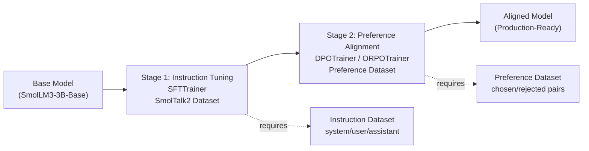
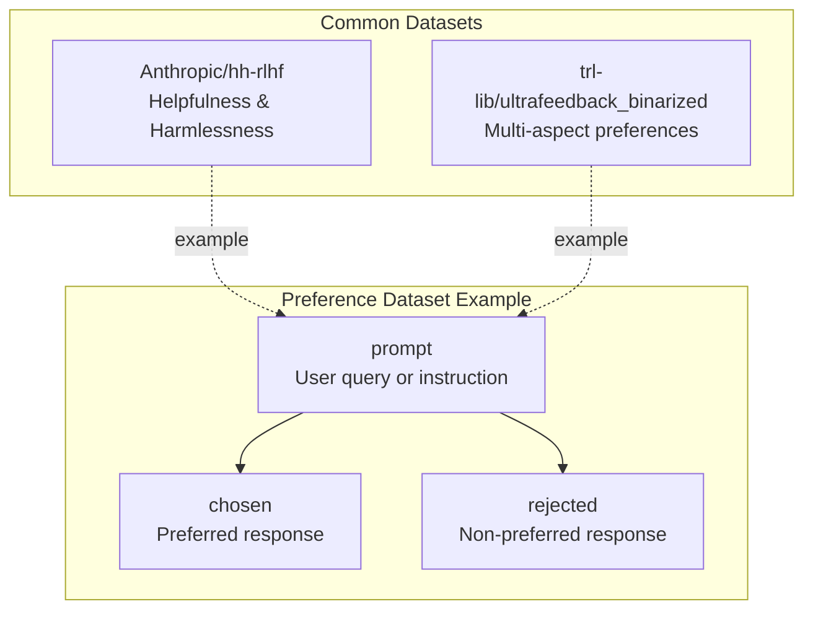
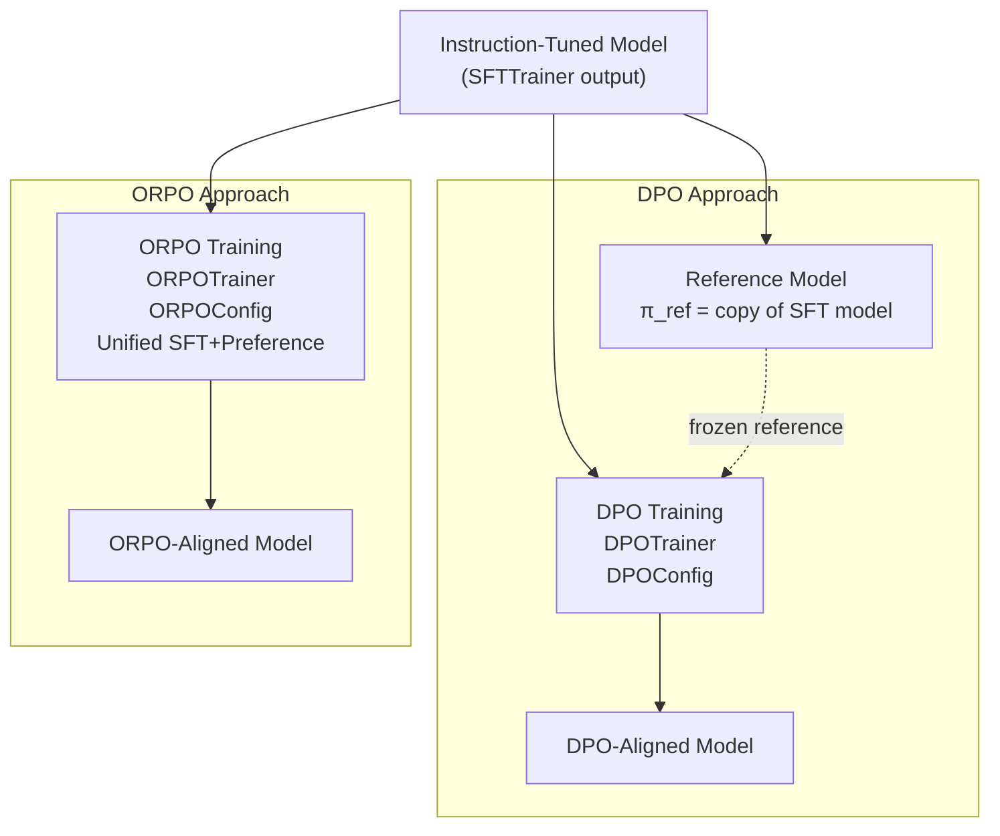
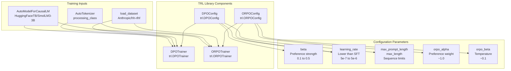
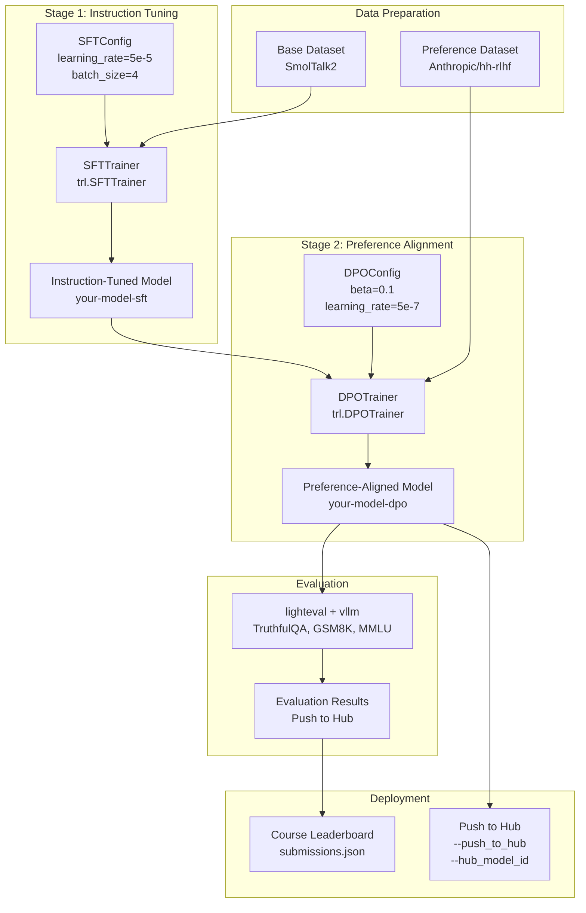

<!-- source: DeepWiki mcp.deepwiki.com · repo huggingface/smol-course · page 4 Preference Alignment · fetched 2026-10-26 -->

# Preference Alignment

<details>
<summary>Relevant source files</summary>

The following files were used as context for generating this wiki page:

- [units/en/unit2/1.md](units/en/unit2/1.md)
- [units/en/unit2/2.md](units/en/unit2/2.md)
- [units/en/unit2/3.md](units/en/unit2/3.md)
- [units/en/unit2/4.md](units/en/unit2/4.md)
- [units/en/unit3/1.md](units/en/unit3/1.md)
- [units/en/unit3/2.md](units/en/unit3/2.md)
- [units/en/unit3/3.md](units/en/unit3/3.md)
- [units/en/unit3/4.md](units/en/unit3/4.md)
- [units/es/unit1/0.md](units/es/unit1/0.md)
- [units/es/unit2/0.md](units/es/unit2/0.md)
- [units/es/unit2/2.md](units/es/unit2/2.md)
- [units/es/unit3/0.md](units/es/unit3/0.md)
- [units/es/unit3/2.md](units/es/unit3/2.md)
- [units/es/unit4/0.md](units/es/unit4/0.md)
- [units/ja/unit1/1.md](units/ja/unit1/1.md)
- [units/ja/unit2/1.md](units/ja/unit2/1.md)
- [units/ja/unit2/3.md](units/ja/unit2/3.md)
- [units/ja/unit3/1.md](units/ja/unit3/1.md)

</details>


## Purpose and Scope

Preference alignment is the process of training language models to generate responses that match human preferences and values. While supervised fine-tuning (SFT) teaches models to follow instructions, preference alignment refines the model to produce outputs that are more helpful, harmless, and honest according to human judgment. This page covers the foundational concepts of preference alignment, human preference data formats, and the relationship between instruction tuning and preference optimization.

For detailed implementation of specific algorithms, see [Direct Preference Optimization (DPO)](#4.1) and [ORPO and Advanced Techniques](#4.2). For the prerequisite instruction tuning concepts, see [Instruction Tuning](#2).

Sources: [units/en/unit2/1.md:1-41]()

## What is Preference Alignment

Preference alignment addresses the gap between instruction-following capability and human-aligned behavior. A model trained only with supervised fine-tuning can follow instructions accurately but may generate responses that are unhelpful, biased, or misaligned with human values. Preference alignment takes a model that has already undergone instruction tuning and further optimizes it using human preference data.

The key distinction is:
- **Instruction Tuning**: Teaches the model *how* to follow instructions and format responses correctly
- **Preference Alignment**: Teaches the model *which* responses humans prefer when multiple valid options exist

Preference alignment improves several dimensions of model behavior:
- Reduces harmful, biased, or inappropriate outputs
- Increases usefulness and relevance of responses  
- Improves truthfulness and reduces hallucinations
- Better reflects human values and ethical considerations
- Enhances overall response quality and coherence

Sources: [units/en/unit2/1.md:10-18]()

## Training Pipeline Position



**Training Pipeline: Preference Alignment in Context**

Preference alignment occurs as the second stage in the model training pipeline, building directly on instruction-tuned models. The base model first undergoes supervised fine-tuning using instruction datasets with conversational formats (system/user/assistant messages). The resulting instruction-tuned model then enters preference alignment training, which uses preference datasets containing pairs of chosen and rejected responses. This two-stage approach creates production-ready models that both follow instructions correctly and align with human preferences.

Sources: [units/en/unit2/1.md:23-27](), [units/en/unit2/2.md:23-30]()

## Preference Data Format

### Dataset Structure

Preference alignment requires datasets where each example contains a prompt and two responses - one preferred by humans (`chosen`) and one less preferred (`rejected`). This binary preference signal allows the model to learn which types of responses humans value more highly.



**Preference Dataset Structure**

The table below shows the required fields in a preference dataset:

| Field | Description | Example |
|-------|-------------|---------|
| `prompt` | The input prompt or question | "Explain quantum computing in simple terms" |
| `chosen` | The preferred response | "Quantum computing uses quantum mechanics principles to process information in fundamentally different ways..." |
| `rejected` | The less preferred response | "Quantum computing is very complex and hard to understand..." |

Optional fields can enhance training:
- `system`: System prompt providing instructions for model behavior
- Multi-turn conversations with preference annotations
- Metadata: preference strength, annotator agreement, rejection reason

Sources: [units/en/unit2/2.md:46-68]()

### Conversational vs Standard Format

The TRL library supports two dataset formats for preference alignment:

**Conversational Format**: Uses the chat template structure with messages containing `role` and `content` fields. The trainer automatically applies the chat template to format the data:

```json
{
  "prompt": [
    {"role": "system", "content": "You are a helpful assistant."},
    {"role": "user", "content": "What is machine learning?"}
  ],
  "chosen": [
    {"role": "assistant", "content": "Machine learning is a subset of AI..."}
  ],
  "rejected": [
    {"role": "assistant", "content": "It's just computers learning stuff."}
  ]
}
```

**Standard Format**: Uses plain text strings for prompt, chosen, and rejected fields. The trainer can work with either explicit prompts (recommended) or implicit prompts extracted from the chosen/rejected text.

Sources: [units/en/unit2/2.md:108-114]()

## Preference Optimization Methods

### Overview of Approaches

Two main approaches dominate preference alignment in the smol-course:



**Comparison of DPO and ORPO Approaches**

**DPO (Direct Preference Optimization)** is a two-stage approach:
1. First stage: Supervised fine-tuning produces an instruction-tuned model
2. Second stage: The SFT model is copied as a frozen reference model (`π_ref`), while another copy is trained using preference data via `DPOTrainer`

The reference model provides stability by anchoring the training process and preventing the model from deviating too far from the instruction-tuned baseline.

**ORPO (Odds Ratio Preference Optimization)** is a single-stage approach:
- Combines instruction tuning and preference alignment in one unified training process
- No separate reference model required
- Uses `ORPOTrainer` with modified loss function that incorporates both SFT and preference objectives

Sources: [units/en/unit2/1.md:19-28](), [units/en/unit2/2.md:6-16](), [units/es/unit2/2.md:13-20]()

### Method Comparison

| Aspect | DPO | ORPO |
|--------|-----|------|
| **Training Stages** | Two (SFT → DPO) | One (unified) |
| **Reference Model** | Required (frozen copy) | Not required |
| **Memory Usage** | Higher (needs reference model) | Lower (single model) |
| **Computational Cost** | 2x forward passes per batch | 1x forward pass per batch |
| **Implementation** | `DPOTrainer` + `DPOConfig` | `ORPOTrainer` + `ORPOConfig` |
| **Key Hyperparameters** | `beta`, `learning_rate` | `orpo_alpha`, `orpo_beta`, `learning_rate` |
| **Use Case** | Standard preference alignment | Resource-constrained or rapid iteration |

Sources: [units/en/unit2/2.md:1-152](), [units/es/unit2/2.md:1-90]()

## Implementation with TRL

### Core Components



**TRL Implementation Components**

The Transformers Reinforcement Learning (TRL) library provides the core infrastructure for preference alignment. Both DPO and ORPO implementations follow a similar pattern:

1. **Trainer Classes**: `DPOTrainer` and `ORPOTrainer` handle the training loop, loss computation, and model updates
2. **Configuration Classes**: `DPOConfig` and `ORPOConfig` define hyperparameters and training settings
3. **Model Input**: Standard `AutoModelForCausalLM` models from the transformers library
4. **Data Processing**: The `processing_class` parameter (typically a tokenizer) handles data formatting
5. **Dataset**: Preference datasets loaded via `datasets.load_dataset()`

Sources: [units/en/unit2/2.md:72-106](), [units/en/unit2/3.md:1-335]()

### DPO Training Example

The basic DPO training workflow using TRL:

```python
from trl import DPOTrainer, DPOConfig
from transformers import AutoModelForCausalLM, AutoTokenizer
from datasets import load_dataset

# Load model and tokenizer
model = AutoModelForCausalLM.from_pretrained("HuggingFaceTB/SmolLM3-3B")
tokenizer = AutoTokenizer.from_pretrained("HuggingFaceTB/SmolLM3-3B")

# Configure DPO training
training_args = DPOConfig(
    beta=0.1,                    # Temperature parameter
    learning_rate=5e-7,          # Lower LR for stability
    max_prompt_length=512,       # Maximum prompt length
    max_length=1024,             # Maximum total length
    per_device_train_batch_size=4,
    gradient_accumulation_steps=4,
    num_train_epochs=1,
)

# Initialize trainer
trainer = DPOTrainer(
    model=model,
    args=training_args,
    train_dataset=preference_dataset,
    processing_class=tokenizer,
)

# Train the model
trainer.train()
```

Sources: [units/en/unit2/2.md:76-106](), [units/en/unit2/3.md:149-227]()

### Training with Hugging Face Jobs

For production workflows, preference alignment training can be executed on Hugging Face Jobs infrastructure:

```bash
# DPO training via HF Jobs
hf jobs uv run \
    --flavor a100-large \
    --secrets HF_TOKEN \
    "https://raw.githubusercontent.com/huggingface/trl/main/trl/scripts/dpo.py" \
    --model_name_or_path HuggingFaceTB/SmolLM3-3B \
    --dataset_name Anthropic/hh-rlhf \
    --learning_rate 5e-7 \
    --beta 0.1 \
    --max_steps 1000 \
    --push_to_hub \
    --hub_model_id your-username/smollm3-dpo-aligned \
    --report_to trackio
```

The TRL library maintains production-ready scripts at:
- DPO script: `https://raw.githubusercontent.com/huggingface/trl/main/trl/scripts/dpo.py`
- ORPO script: `https://raw.githubusercontent.com/huggingface/trl/main/trl/scripts/orpo.py`

These scripts can be invoked directly via `hf jobs uv run` with command-line arguments for configuration.

Sources: [units/en/unit2/3.md:142-275](), [units/en/unit2/4.md:26-39]()

## Key Hyperparameters

### Beta Parameter (DPO)

The `beta` parameter in DPO controls the strength of preference optimization. It appears in the DPO loss function as a temperature term that scales the log-probability ratios between chosen and rejected responses.

| Beta Range | Behavior | Use Case |
|------------|----------|----------|
| 0.1 - 0.2 | Conservative, stays close to reference model | Safe default, minimal divergence |
| 0.3 - 0.4 | Moderate preference alignment | Balanced approach |
| 0.5+ | Aggressive preference alignment | Risk of overfitting to preference data |

**Guidance**: Start with `beta=0.1`. Increase if the model shows insufficient preference alignment. Decrease if the model loses general capabilities or becomes repetitive.

Sources: [units/en/unit2/2.md:116-121]()

### Learning Rate

Preference alignment requires lower learning rates than supervised fine-tuning to maintain stability and prevent catastrophic forgetting.

**Recommended Range**: 5e-7 to 5e-6 (compared to 1e-5 to 5e-5 for SFT)

**Rationale**: 
- The model has already learned instruction-following during SFT
- Preference alignment makes subtle adjustments to output distribution
- High learning rates can cause the model to forget instruction-following capability
- Lower learning rates maintain better balance between preference learning and capability retention

**Adjustment Strategy**:
- Start with 5e-7 for conservative training
- Increase to 1e-6 or 2e-6 if training is too slow
- Reduce further if you observe training instability or loss oscillations

Sources: [units/en/unit2/2.md:116-121]()

### Dataset Size and Quality

Unlike supervised fine-tuning which benefits from massive datasets, preference alignment works effectively with smaller, high-quality preference datasets.

**Minimum Requirements**:
- Domain-specific tasks: ~1,000 high-quality preference pairs
- General alignment: ~10,000 preference pairs
- Robust alignment across diverse scenarios: 50,000+ pairs

**Quality Considerations**:
- Clear preference distinction between chosen and rejected responses
- Diverse coverage of target behaviors and edge cases
- Consistent annotation guidelines
- Representative of production use cases
- Balanced representation of different preference types

**Quality vs Quantity**: A small dataset of 1,000 carefully curated preference pairs with clear distinctions often outperforms a large dataset of 10,000+ pairs with ambiguous or inconsistent preferences. Focus on annotation quality, clear guidelines, and representative examples rather than maximizing dataset size.

Sources: [units/en/unit2/2.md:116-121](), [units/en/unit2/2.md:123-131]()

## Best Practices

### Data Quality First

High-quality preference data is the foundation of successful preference alignment:

1. **Clear Annotation Guidelines**: Establish explicit criteria for what makes one response preferable to another
2. **Diverse Examples**: Include preference pairs covering different aspects of desired behavior (helpfulness, harmlessness, honesty)
3. **Consistent Labeling**: Ensure annotators apply criteria consistently across examples
4. **Representative Coverage**: Preference data should reflect real-world use cases and edge cases
5. **Quality Filtering**: Consider filtering large datasets to retain only high-quality examples with clear preference signals

Sources: [units/en/unit2/2.md:123-131]()

### Monitor Training Stability

Preference alignment training requires careful monitoring to ensure stable convergence:

**Loss Convergence**:
- DPO/ORPO loss should decrease smoothly without oscillations
- Erratic loss patterns indicate learning rate too high or dataset issues
- Plateauing loss may indicate beta parameter too low

**Output Quality Checks**:
- Regularly generate outputs on held-out prompts during training
- Compare outputs with reference model to verify improvement
- Check for signs of catastrophic forgetting (loss of instruction-following ability)

**Gradient Monitoring**:
- Use gradient clipping to prevent training instability (typical value: `max_grad_norm=1.0`)
- Watch for exploding gradients, especially with higher learning rates
- Monitor gradient norms across training to identify instability early

Sources: [units/en/unit2/2.md:133-145]()

### Evaluation Strategy

Comprehensive evaluation is critical for preference alignment:

**Automatic Benchmarks**:
- TruthfulQA: Tests truthfulness and honesty of responses
- GSM8K: Mathematical reasoning and helpfulness
- MMLU: Broad knowledge retention across domains
- HellaSwag: Common sense reasoning
- Arc: Science question answering

**Human Evaluation**:
- Side-by-side comparison with reference model
- Multi-dimensional scoring (helpfulness, harmlessness, honesty)
- Edge case testing for alignment quality

**Production Testing**:
- A/B testing with real users when possible
- Monitor for regression in general capabilities
- Track user satisfaction metrics

Sources: [units/en/unit2/4.md:44-68](), [units/en/unit2/2.md:136-145]()

### Common Pitfalls

**Overfitting to Preferences**:
- **Symptom**: Model becomes repetitive or loses general capabilities
- **Solution**: Lower beta parameter, reduce training duration, increase dataset diversity

**Insufficient Alignment**:
- **Symptom**: Little improvement over reference model in preference alignment
- **Solution**: Increase beta parameter, improve dataset quality, extend training duration

**Distribution Shift**:
- **Symptom**: Model performs well on training domain but poorly generalizes
- **Solution**: Ensure preference dataset covers target use cases comprehensively, include diverse examples

**Catastrophic Forgetting**:
- **Symptom**: Model loses instruction-following capability from SFT stage
- **Solution**: Lower learning rate, reduce beta parameter, shorten training duration

Sources: [units/en/unit2/2.md:140-145]()

## Integration with Training Pipeline

### Complete Workflow



**Complete Preference Alignment Workflow**

The full training workflow integrates multiple stages:

1. **Data Preparation**: Separate datasets for instruction tuning (SmolTalk2) and preference alignment (Anthropic/hh-rlhf)
2. **Stage 1 - Instruction Tuning**: Use `SFTTrainer` with `SFTConfig` to create instruction-following capability
3. **Stage 2 - Preference Alignment**: Use `DPOTrainer` with `DPOConfig` (lower learning rate, beta parameter) to align with preferences
4. **Evaluation**: Assess aligned model using `lighteval` with standard benchmarks
5. **Deployment**: Push trained model and evaluation results to Hugging Face Hub, submit to course leaderboard

Key configuration differences between stages:
- SFT uses higher learning rates (5e-5) with standard loss
- DPO uses lower learning rates (5e-7) with preference-based loss and beta parameter
- Different datasets and objectives but same underlying model architecture

Sources: [units/en/unit2/1.md:32-40](), [units/en/unit2/4.md:1-120]()

### Submission and Leaderboard

The smol-course uses a leaderboard-based submission system for preference alignment projects:

**Submission Steps**:
1. Train model using DPO or ORPO with `--push_to_hub` flag
2. Evaluate model using `hf jobs` with `lighteval`:
```bash
hf jobs uv run \
    --flavor a10g-large \
    --with "lighteval[vllm]" \
    --secrets HF_TOKEN \
    lighteval vllm "model_name=<your-model>" \
    "lighteval|truthfulqa:mc2|0|0,lighteval|hellaswag|0|0,lighteval|arc:challenge|0|0" \
    --push-to-hub --results-org <your-username>
```
3. Update `submissions.json` in the leaderboard space:
```json
{
  "username": "<your-username>",
  "model_name": "<your-model-name>",
  "chapter": "3",
  "method": "DPO",
  "submission_date": "<date>",
  "results-dataset": "<results-dataset>",
  "base_model": "HuggingFaceTB/SmolLM3-3B",
  "preference_dataset": "Anthropic/hh-rlhf"
}
```
4. Open pull request with training and evaluation commands

Sources: [units/en/unit2/4.md:1-120]()

## Next Steps

- For detailed DPO implementation including loss function derivation and reference model mechanics, see [Direct Preference Optimization (DPO)](#4.1)
- For unified single-stage training with ORPO, see [ORPO and Advanced Techniques](#4.2)
- For hands-on exercises and notebooks, refer to the course materials at [units/en/unit2/3.md]() and [units/en/unit2/4.md]()
- For evaluation methodologies specific to preference alignment, see [Model Evaluation](#6)

Sources: [units/en/unit2/1.md:32-41](), [units/en/unit2/2.md:146-152]()

---

