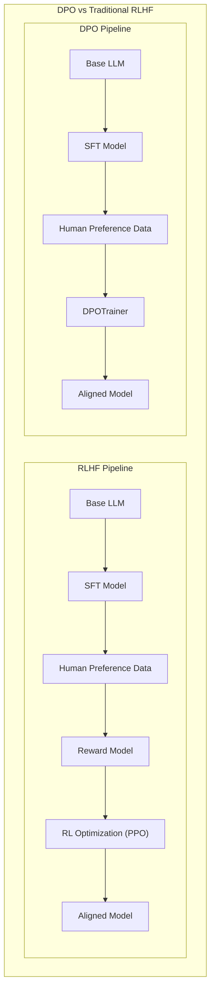
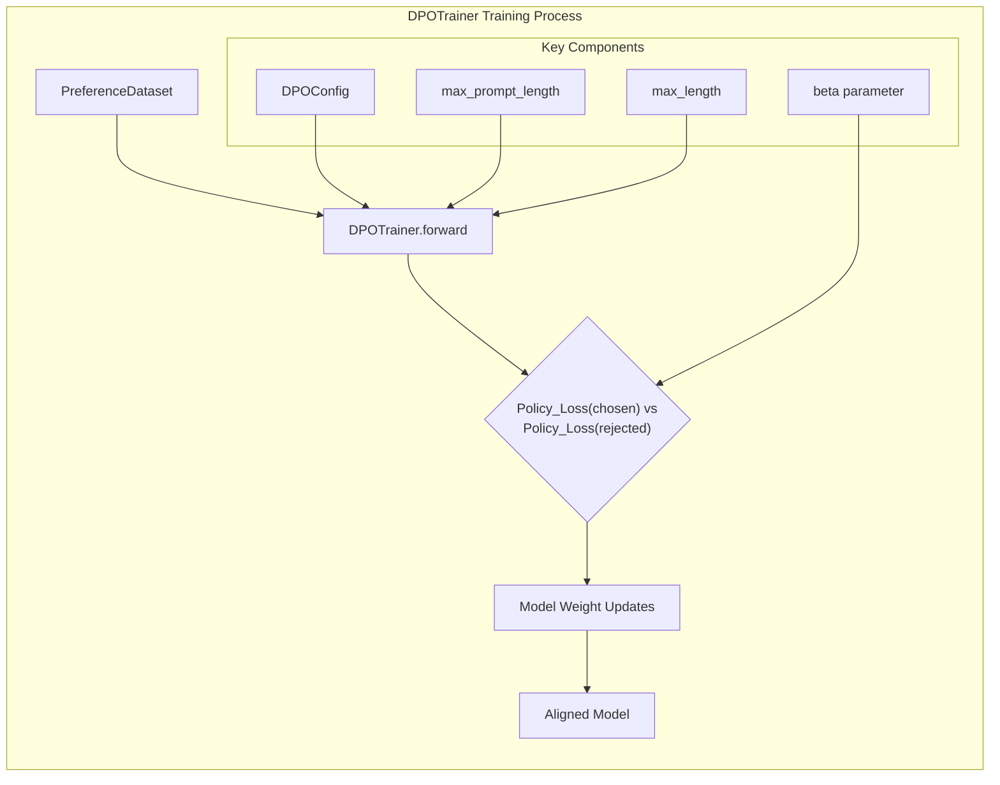
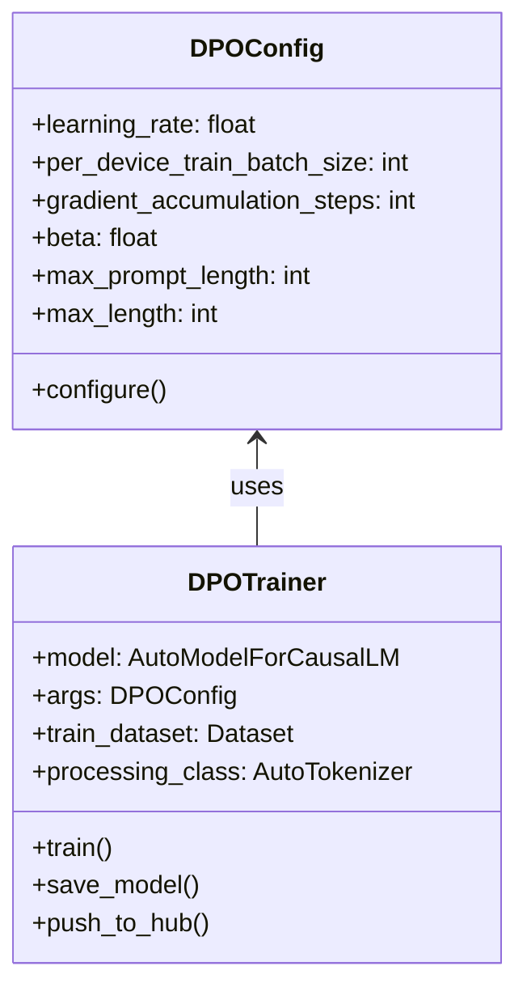
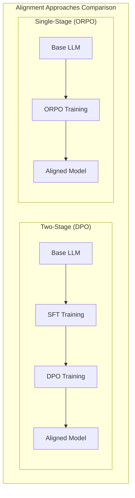

<!-- source: DeepWiki mcp.deepwiki.com · repo huggingface/smol-course · page 4.1 Direct Preference Optimization (DPO) · fetched 2026-10-26 -->

# Direct Preference Optimization (DPO)

<details>
<summary>Relevant source files</summary>

The following files were used as context for generating this wiki page:

- [units/en/unit2/1.md](units/en/unit2/1.md)
- [units/en/unit2/2.md](units/en/unit2/2.md)
- [units/en/unit2/3.md](units/en/unit2/3.md)
- [units/en/unit2/4.md](units/en/unit2/4.md)
- [units/en/unit3/1.md](units/en/unit3/1.md)
- [units/en/unit3/2.md](units/en/unit3/2.md)
- [units/en/unit3/3.md](units/en/unit3/3.md)
- [units/en/unit3/4.md](units/en/unit3/4.md)
- [units/es/unit1/0.md](units/es/unit1/0.md)
- [units/es/unit2/0.md](units/es/unit2/0.md)
- [units/es/unit2/2.md](units/es/unit2/2.md)
- [units/es/unit3/0.md](units/es/unit3/0.md)
- [units/es/unit3/2.md](units/es/unit3/2.md)
- [units/es/unit4/0.md](units/es/unit4/0.md)
- [units/ja/unit1/1.md](units/ja/unit1/1.md)
- [units/ja/unit2/1.md](units/ja/unit2/1.md)
- [units/ja/unit2/3.md](units/ja/unit2/3.md)
- [units/ja/unit3/1.md](units/ja/unit3/1.md)

</details>


Direct Preference Optimization (DPO) is a technique for aligning language models with human preferences, which simplifies the traditional Reinforcement Learning from Human Feedback (RLHF) approach. Unlike RLHF, which requires a separate reward model and complex reinforcement learning algorithms, DPO directly optimizes models using preference data in a more stable and efficient manner. This page covers DPO's implementation within the SmolLM course framework.

For information about Odds Ratio Preference Optimization (ORPO), which combines instruction tuning and preference alignment into a single stage, see [ORPO](#3.2).

## DPO Overview

DPO transforms preference alignment into a classification problem on human preference data. By comparing preferred and rejected responses to the same prompts, the model learns to generate outputs that better match human preferences. DPO requires a model that has already undergone supervised fine-tuning (SFT) as a prerequisite.

### Key Advantages of DPO

- **Simplified Training**: Eliminates the need for a separate reward model
- **Improved Stability**: More stable training than traditional RLHF
- **Efficiency**: Requires fewer computational resources
- **Effectiveness**: Achieves comparable or better results than traditional methods



Sources: [2_preference_alignment/dpo.md:1-18](), [2_preference_alignment/README.md:15-17]()

## DPO Training Process

The DPO process in the SmolLM course involves:

1. **Starting with an SFT Model**: Unlike ORPO, DPO requires a model that has already been fine-tuned on instruction data
2. **Preference Data Preparation**: Datasets containing pairs of responses to prompts (chosen/rejected)
3. **Direct Optimization**: Training the model to increase probability of preferred responses while decreasing probability of rejected ones

### Preference Dataset Structure

DPO uses datasets with the following structure:

| Column | Description |
|--------|-------------|
| Prompt | The input prompt or question |
| Chosen | The preferred/positive response |
| Rejected | The non-preferred/negative response |



Sources: [2_preference_alignment/dpo.md:19-31](), [2_preference_alignment/notebooks/dpo_finetuning_example.ipynb:75-87]()

## Implementation with TRL

The SmolLM course implements DPO using the Transformers Reinforcement Learning (TRL) library, which provides specialized trainer classes for preference alignment.

### Key Components



### Implementation Steps

1. **Configuration**: Set up DPO training parameters using `DPOConfig`
2. **Trainer Initialization**: Create a `DPOTrainer` instance with model, dataset, and tokenizer
3. **Training**: Run the training process and save the resulting model

Sources: [2_preference_alignment/notebooks/dpo_finetuning_example.ipynb:242-276](), [2_preference_alignment/notebooks/dpo_finetuning_example.ipynb:285-301](), [2_preference_alignment/dpo.md:32-56]()

## Implementation Example

Below is a pseudocode example based on the DPO implementation in the SmolLM course:

```python
# 1. Import necessary libraries
from trl import DPOTrainer, DPOConfig
from transformers import AutoModelForCausalLM, AutoTokenizer

# 2. Load SFT model (prerequisite)
model = AutoModelForCausalLM.from_pretrained("SmolLM2-135M-Instruct")
tokenizer = AutoTokenizer.from_pretrained("SmolLM2-135M-Instruct")

# 3. Load preference dataset
dataset = load_dataset("trl-lib/ultrafeedback_binarized")

# 4. Configure DPO training
training_args = DPOConfig(
    learning_rate=5e-5,
    per_device_train_batch_size=4,
    gradient_accumulation_steps=4,
    beta=0.1,               # Controls preference strength
    max_prompt_length=1024,
    max_length=1536,
    # Other parameters...
)

# 5. Initialize trainer
trainer = DPOTrainer(
    model=model,
    args=training_args,
    train_dataset=dataset,
    processing_class=tokenizer,
)

# 6. Train and save model
trainer.train()
trainer.save_model("./SmolLM2-FT-DPO")
```

Sources: [2_preference_alignment/notebooks/dpo_finetuning_example.ipynb:117-139](), [2_preference_alignment/notebooks/dpo_finetuning_example.ipynb:242-276](), [2_preference_alignment/notebooks/dpo_finetuning_example.ipynb:285-301](), [2_preference_alignment/notebooks/dpo_finetuning_example.ipynb:310-318]()

## Key Parameters and Best Practices

### Important Configuration Parameters

| Parameter | Purpose | Typical Value |
|-----------|---------|--------------|
| `beta` | Controls the strength of preference optimization | 0.1 |
| `learning_rate` | Training learning rate | 5e-5 |
| `max_prompt_length` | Maximum prompt token length | 1024 |
| `max_length` | Maximum combined length of prompt + response | 1536 |
| `gradient_accumulation_steps` | Accumulate gradients before updating | 4 |

### Best Practices

1. **Dataset Quality**: Ensure high-quality, diverse preference pairs with clear distinctions
2. **Hyperparameter Tuning**: 
   - Lower `beta` values (e.g., 0.1) create more conservative preference alignment
   - Adjust `learning_rate` and `gradient_accumulation_steps` for training stability
3. **Model Prerequisites**: Always start with an SFT model, not a base model
4. **Evaluation**: Regularly test on diverse prompts to ensure the model learns intended preferences

Sources: [2_preference_alignment/dpo.md:60-66](), [2_preference_alignment/notebooks/dpo_finetuning_example.ipynb:242-276]()

## Comparison with ORPO

While DPO is effective, it requires a two-stage process:
1. Supervised Fine-Tuning (SFT) to adapt the model to a domain
2. Preference alignment using DPO

In contrast, ORPO combines both steps into a single process, eliminating the need for a separate SFT stage. For projects with limited computational resources or when starting with a base model without SFT, consider using [ORPO](#3.2) instead.



Sources: [2_preference_alignment/orpo.md:1-11](), [2_preference_alignment/README.md:17-22]()

## Related Resources

- **TRL Library Documentation**: The official documentation for the Transformers Reinforcement Learning library
- **DPO Paper**: [Direct Preference Optimization](https://arxiv.org/abs/2305.18290) (Rafailov et al., 2023)
- **Practical Examples**: See the notebook [dpo_finetuning_example.ipynb](2_preference_alignment/notebooks/dpo_finetuning_example.ipynb) for a complete implementation

Sources: [2_preference_alignment/README.md:33-37]()

---

