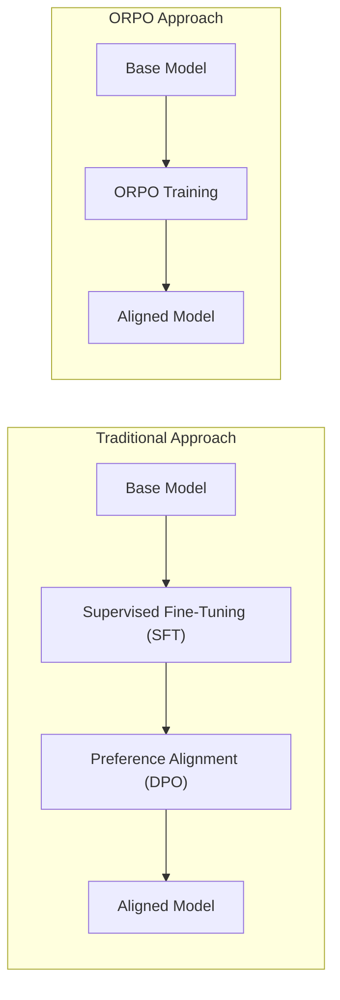
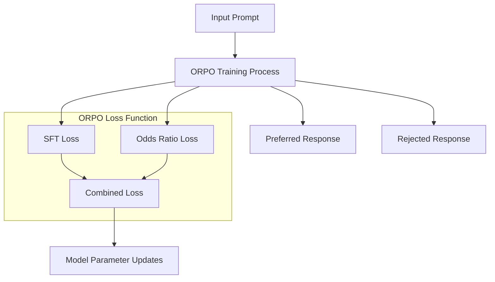
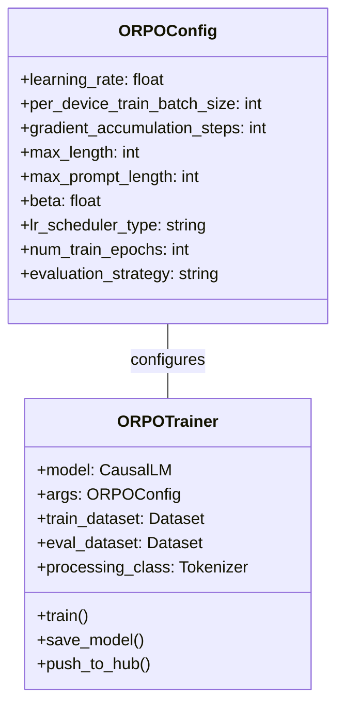
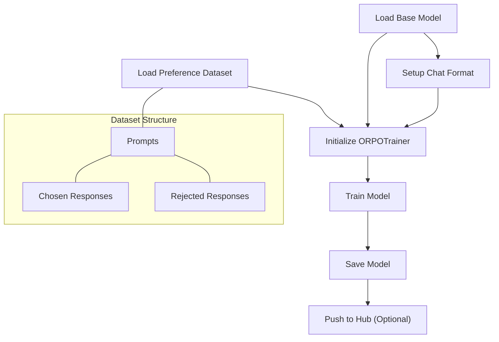
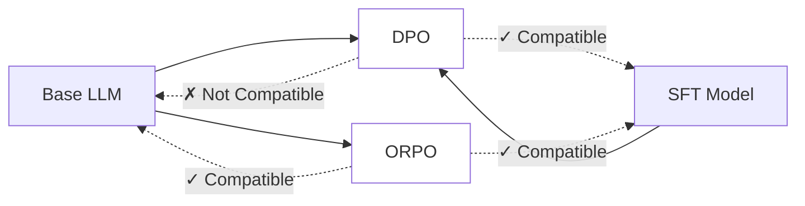

<!-- source: DeepWiki mcp.deepwiki.com · repo huggingface/smol-course · page 4.2 ORPO and Advanced Techniques · fetched 2026-10-26 -->

# Odds Ratio Preference Optimization (ORPO)

<details>
<summary>Relevant source files</summary>

The following files were used as context for generating this wiki page:

- [units/en/unit2/1.md](units/en/unit2/1.md)
- [units/en/unit2/2.md](units/en/unit2/2.md)
- [units/en/unit2/3.md](units/en/unit2/3.md)
- [units/en/unit2/4.md](units/en/unit2/4.md)
- [units/en/unit3/1.md](units/en/unit3/1.md)
- [units/en/unit3/2.md](units/en/unit3/2.md)
- [units/en/unit3/3.md](units/en/unit3/3.md)
- [units/en/unit3/4.md](units/en/unit3/4.md)
- [units/es/unit1/0.md](units/es/unit1/0.md)
- [units/es/unit2/0.md](units/es/unit2/0.md)
- [units/es/unit2/2.md](units/es/unit2/2.md)
- [units/es/unit3/0.md](units/es/unit3/0.md)
- [units/es/unit3/2.md](units/es/unit3/2.md)
- [units/es/unit4/0.md](units/es/unit4/0.md)
- [units/ja/unit1/1.md](units/ja/unit1/1.md)
- [units/ja/unit2/1.md](units/ja/unit2/1.md)
- [units/ja/unit2/3.md](units/ja/unit2/3.md)
- [units/ja/unit3/1.md](units/ja/unit3/1.md)

</details>


ORPO is a novel fine-tuning technique that combines instruction tuning and preference alignment into a single unified process. This page covers how ORPO works, its implementation with the TRL library, and how it differs from other alignment methods like Direct Preference Optimization (DPO). If you're looking for information about DPO, see [Direct Preference Optimization (DPO)](#3.1).

## Understanding ORPO

Odds Ratio Preference Optimization (ORPO) offers a streamlined approach to aligning language models with human preferences. Unlike traditional methods that require multiple training stages, ORPO integrates instruction tuning and preference alignment into a single process.

A key advantage of ORPO is that it works with base models that haven't undergone Supervised Fine-Tuning (SFT), making it suitable for directly aligning base models. This contrasts with DPO, which requires a model that has already been through SFT.



Sources: 
- [2_preference_alignment/orpo.md:1-7]()
- [2_preference_alignment/README.md:20-22]()

## How ORPO Works

ORPO creates a training objective that combines two main components:

1. **SFT Loss**: The standard negative log-likelihood loss used in language modeling, which helps the model learn to generate appropriate responses.

2. **Odds Ratio Loss**: A novel component that penalizes undesirable responses while rewarding preferred ones at the token level.

The training process leverages preference data similar to what's used for DPO, where each training example contains an input prompt along with two responses: one preferred and one rejected.



Unlike other alignment methods, ORPO doesn't require a separate reference model, making it:
- Reference model-free
- Computationally more efficient
- Memory efficient with fewer FLOPs

Sources:
- [2_preference_alignment/orpo.md:12-22]()
- [2_preference_alignment/README.md:20-22]()

## Implementation with TRL

ORPO can be implemented using the Transformers Reinforcement Learning (TRL) library through the `ORPOTrainer` class.

### Key Components and Parameters



Important parameters in `ORPOConfig`:

| Parameter | Purpose | Typical Value |
|-----------|---------|---------------|
| `learning_rate` | Controls update magnitude | 8e-6 (small to prevent catastrophic forgetting) |
| `beta` | Controls weight of odds ratio loss | 0.1 |
| `max_length` | Maximum combined length of prompt + response | 1024 |
| `max_prompt_length` | Maximum length for input prompts | 512 |
| `gradient_accumulation_steps` | Helps with training stability | 4 |
| `lr_scheduler_type` | Learning rate schedule | "linear" |

Sources:
- [2_preference_alignment/notebooks/orpo_finetuning_example.ipynb:322-357]()
- [2_preference_alignment/orpo.md:44-76]()

### Training Workflow

A typical ORPO training workflow involves:

1. Preparing a preference dataset with paired responses (preferred/rejected)
2. Setting up the model and tokenizer
3. Configuring the ORPO training parameters
4. Initializing the `ORPOTrainer`
5. Running the training process
6. Saving and evaluating the model



Sources:
- [2_preference_alignment/notebooks/orpo_finetuning_example.ipynb:366-388]()
- [2_preference_alignment/orpo.md:39-69]()

## Code Example and Implementation

Below is a simplified implementation using the TRL library:

```python
# Load model and dataset
model = AutoModelForCausalLM.from_pretrained("HuggingFaceTB/SmolLM2-135M")
tokenizer = AutoTokenizer.from_pretrained("HuggingFaceTB/SmolLM2-135M")
model, tokenizer = setup_chat_format(model, tokenizer)
dataset = load_dataset("trl-lib/ultrafeedback_binarized")

# Configure ORPO training
orpo_args = ORPOConfig(
    learning_rate=8e-6,
    lr_scheduler_type="linear",
    max_length=1024,
    max_prompt_length=512,
    beta=0.1,
    per_device_train_batch_size=2,
    gradient_accumulation_steps=4,
    num_train_epochs=1
)

# Initialize trainer
trainer = ORPOTrainer(
    model=model,
    args=orpo_args,
    train_dataset=dataset["train"],
    eval_dataset=dataset["test"],
    processing_class=tokenizer,
)

# Train and save
trainer.train()
trainer.save_model("./model_output")
```

This example showcases how to set up ORPO training with the TRL library. The process loads a base model (`SmolLM2-135M`), configures the ORPO training parameters, and trains the model on a preference dataset.

Sources:
- [2_preference_alignment/notebooks/orpo_finetuning_example.ipynb:256-388]()

## Model Compatibility and Dataset Requirements

ORPO has specific requirements and considerations for successful implementation:

### Model Compatibility

- Works with base models that haven't been through SFT
- Unlike DPO, which requires models that have already gone through SFT
- Suitable for directly aligning models from their base form



### Dataset Requirements

For optimal results, the preference dataset should:

- Follow clear annotation guidelines
- Provide a balanced representation of preferred and rejected responses
- Cover diverse scenarios and instruction types
- Be structured with prompts, chosen responses, and rejected responses

Examples of suitable datasets include:
- `trl-lib/ultrafeedback_binarized`
- `argilla/ultrafeedback-binarized-preferences`
- `mlabonne/orpo-dpo-mix-40k`

Sources:
- [2_preference_alignment/notebooks/orpo_finetuning_example.ipynb:7-19]()
- [2_preference_alignment/orpo.md:39-41]()

## Performance and Advantages

ORPO offers several advantages over traditional alignment methods:

### Efficiency Benefits

- **Computational Efficiency**: Eliminates the need for a reference model
- **Memory Efficiency**: Reduces the number of forward passes per batch
- **Training Stability**: More stable across different model sizes and datasets
- **Hyperparameter Efficiency**: Requires fewer hyperparameters to tune

### Performance Results

ORPO has demonstrated competitive or superior performance compared to traditional methods on benchmarks like:
- MT-Bench across different task categories
- AlpacaEval 2.0, where it shows better alignment with human preferences

It can match the performance of larger models while being more computationally efficient.

Sources:
- [2_preference_alignment/orpo.md:25-36]()

## Practical Training Tips

When implementing ORPO, consider these practical tips:

1. **Learning Rate**: Use a small learning rate (around 8e-6) to prevent catastrophic forgetting
2. **Beta Parameter**: The beta parameter (typically 0.1) controls the strength of the odds ratio loss
3. **Gradient Accumulation**: Helps with training stability, especially with limited GPU memory
4. **Evaluation Strategy**: Regular evaluation helps monitor training progress
5. **Data Quality**: High-quality preference data is crucial for good results

For a complete worked example, refer to the [ORPO fine-tuning notebook](2_preference_alignment/notebooks/orpo_finetuning_example.ipynb).

Sources:
- [2_preference_alignment/notebooks/orpo_finetuning_example.ipynb:322-357]()
- [2_preference_alignment/orpo.md:71-75]()

## Conclusion

ORPO represents a significant advancement in language model alignment techniques by combining instruction tuning and preference alignment into a single, efficient process. It offers computational advantages, works with base models, and has demonstrated strong performance across various benchmarks.

Its integration into the TRL library makes it accessible for practitioners looking to align language models with human preferences efficiently.

---

