<!-- source: DeepWiki mcp.deepwiki.com · repo huggingface/smol-course · page 5 Vision-Language Models · fetched 2026-10-26 -->

# Vision-Language Models

<details>
<summary>Relevant source files</summary>

The following files were used as context for generating this wiki page:

- [notebooks/4/4.ipynb](notebooks/4/4.ipynb)
- [units/en/unit2/1.md](units/en/unit2/1.md)
- [units/en/unit2/2.md](units/en/unit2/2.md)
- [units/en/unit2/3.md](units/en/unit2/3.md)
- [units/en/unit2/4.md](units/en/unit2/4.md)
- [units/en/unit3/1.md](units/en/unit3/1.md)
- [units/en/unit3/2.md](units/en/unit3/2.md)
- [units/en/unit3/3.md](units/en/unit3/3.md)
- [units/en/unit3/4.md](units/en/unit3/4.md)

</details>


## Purpose and Scope

This page documents Vision-Language Models (VLMs) as covered in Unit 3 of the smol-course. VLMs extend language models to process both images and text simultaneously, enabling multimodal tasks like visual question answering, image captioning, and chart interpretation. This document covers the architecture of VLMs, how to use pretrained models (specifically `SmolVLM2-2.2B`), and how to fine-tune them using supervised fine-tuning (SFT) and preference optimization (DPO).

For instruction tuning of text-only models, see [Instruction Tuning](#2). For preference alignment concepts, see [Preference Alignment](#4). For parameter-efficient fine-tuning techniques, see [Parameter-Efficient Fine-Tuning](#3).

**Sources:** [units/en/unit3/1.md:1-12]()

## VLM Architecture Overview

Vision-Language Models combine image processing and text generation capabilities through a unified architecture. The model processes images through a vision encoder, aligns visual features with text embeddings via projection layers, and generates text responses using a language decoder.

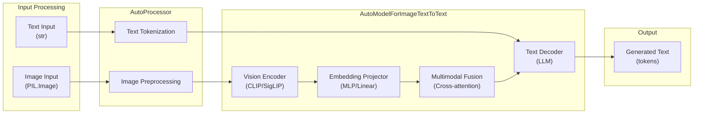

**Architecture Components:**

| Component | Purpose | Implementation |
|-----------|---------|----------------|
| **Vision Encoder** | Extract visual features from images | CLIP, SigLIP (pretrained, often frozen) |
| **Embedding Projector** | Align image features with text embeddings | Small MLP or linear layer |
| **Multimodal Fusion** | Integrate visual and textual representations | Cross-attention mechanisms |
| **Text Decoder** | Generate text from fused representations | Pretrained LLM (e.g., SmolLM3) |

**Sources:** [units/en/unit3/2.md:6-17](), [units/en/unit3/1.md:13-20]()

## Model Components

### Vision Encoder

The vision encoder converts images into numerical feature representations. Common encoders include CLIP and SigLIP, which are typically pretrained and frozen during fine-tuning to preserve learned visual features.

### Embedding Projector

This component aligns visual features with the text embedding space. It's usually a small trainable network (MLP or linear layer) that maps image encoder outputs to dimensions compatible with the language model.

### Multimodal Projector

The multimodal projector goes beyond simple alignment, enabling rich cross-modal interaction through fusion mechanisms. This allows the model to reason about relationships between visual and textual information.

### Text Decoder

The text decoder generates output text based on fused multimodal representations. It leverages a pretrained language model (like SmolLM3) that has already learned language generation capabilities.

**Sources:** [units/en/unit3/2.md:6-17]()

## Using Pretrained VLMs

### Pipeline Interface

The `pipeline` abstraction provides the simplest way to use VLMs for inference:

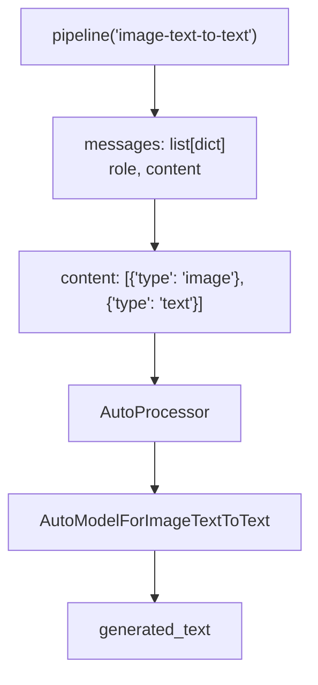

The pipeline handles multimodal message formatting automatically. Each message contains a role (`user`, `assistant`, `system`) and content that can mix images and text.

**Example usage:** [units/en/unit3/2.md:64-94]()

**Sources:** [units/en/unit3/2.md:63-103]()

### Direct Transformers Usage

For full control over the inference process, use `AutoModelForImageTextToText` and `AutoProcessor` directly:

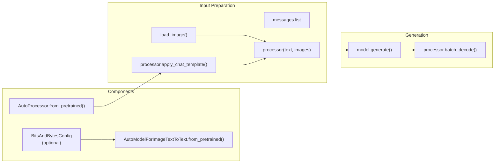

**Key Classes and Methods:**

| Class/Method | Purpose | File Reference |
|--------------|---------|----------------|
| `AutoProcessor` | Handles text tokenization and image preprocessing | [units/en/unit3/2.md:122]() |
| `AutoModelForImageTextToText` | VLM model class | [units/en/unit3/2.md:121]() |
| `BitsAndBytesConfig` | Quantization configuration | [units/en/unit3/2.md:119]() |
| `load_image()` | Load image from URL or path | [units/en/unit3/2.md:132]() |
| `apply_chat_template()` | Format messages into model prompt | [units/en/unit3/2.md:147]() |
| `model.generate()` | Generate text output | [units/en/unit3/2.md:152]() |

**Sources:** [units/en/unit3/2.md:105-177](), [units/en/unit3/4.md:82-94]()

## Chat Templates for VLMs

VLMs use structured message formats to handle multimodal conversations. The chat template system extends text-only templates to include image inputs.

### Message Structure

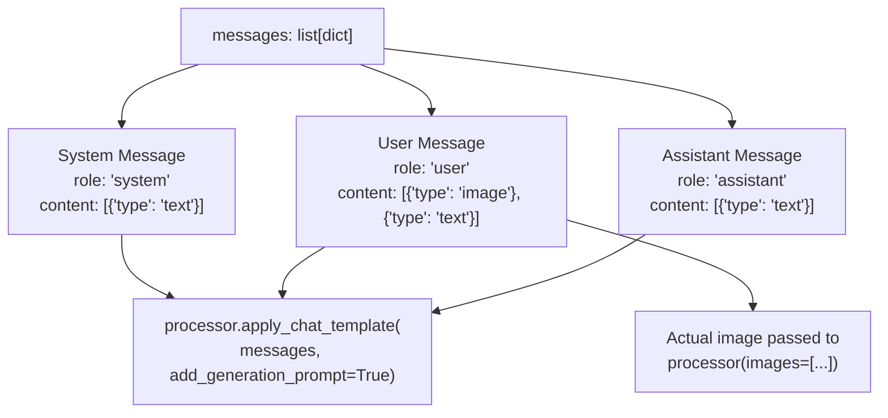

### Example Message Format

Messages combine text and images in a unified structure:

```json
[
  {
    "role": "system",
    "content": [{"type": "text", "text": "You are a VLM specialized in charts."}]
  },
  {
    "role": "user",
    "content": [
      {"type": "image"},
      {"type": "text", "text": "What is the highest value in this chart?"}
    ]
  },
  {
    "role": "assistant",
    "content": [{"type": "text", "text": "42"}]
  }
]
```

The `{"type": "image"}` placeholder indicates where the image should be inserted. The actual image data is passed to the processor via the `images` argument.

**Sources:** [units/en/unit3/2.md:31-62](), [units/en/unit3/4.md:140-170]()

## Fine-Tuning VLMs with SFT

### SFT Process

Supervised Fine-Tuning adapts a pretrained VLM to specific tasks using labeled image-text pairs. The process uses `SFTTrainer` from the TRL library with VLM-specific dataset formatting.

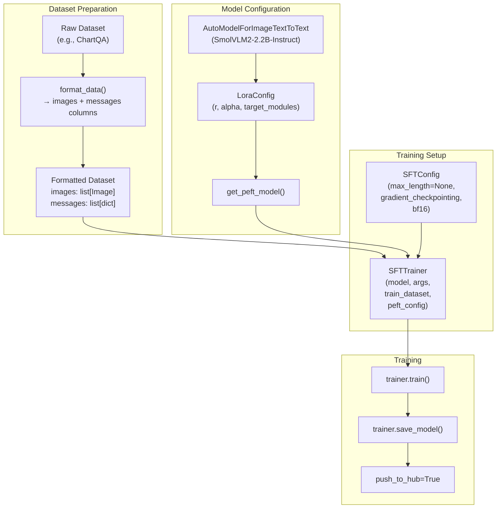

### Dataset Format Requirements

VLM training datasets must include:

| Column | Type | Description | Example |
|--------|------|-------------|---------|
| `images` | `list[PIL.Image]` | List of images (usually one per sample) | `[<PIL.Image>]` |
| `messages` | `list[dict]` | Chat-formatted messages with system/user/assistant roles | See message structure above |

**Critical Configuration:** Set `max_length=None` in `SFTConfig` to prevent truncation of image tokens during training.

**Implementation:** [units/en/unit3/4.md:238-266](), [units/en/unit3/3.md:47-73]()

**Sources:** [units/en/unit3/4.md:206-273](), [units/en/unit3/3.md:29-90]()

### SFT Training Configuration

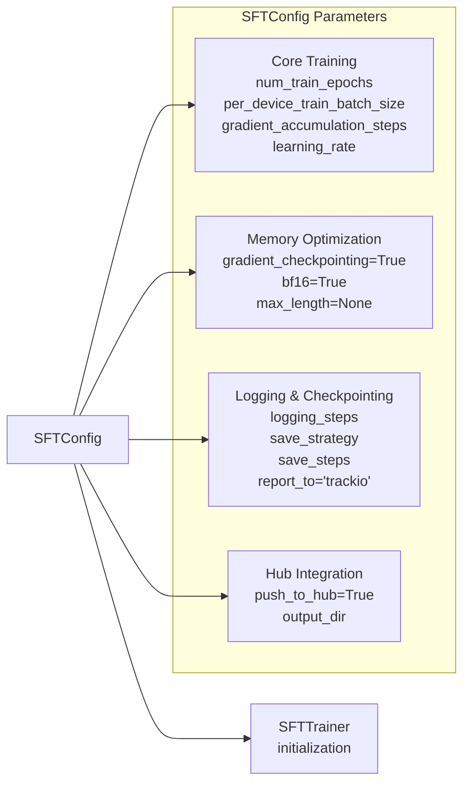

**Key parameters:** [units/en/unit3/4.md:317-331]()

**Sources:** [units/en/unit3/4.md:303-343]()

## Preference Optimization for VLMs

### DPO for VLMs

Direct Preference Optimization can be applied to VLMs using preference-labeled multimodal datasets. The process follows the same principles as text-only DPO but with image-text pairs.

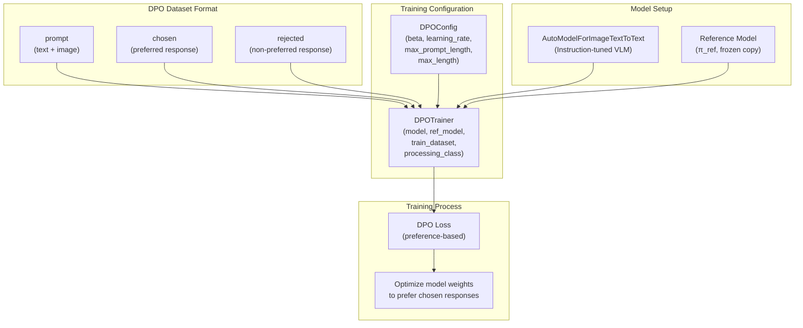

### DPO vs SFT for VLMs

| Aspect | SFT | DPO |
|--------|-----|-----|
| **Input Data** | Labeled image-text pairs | Image-text + preference-ranked outputs |
| **Loss Function** | Standard supervised (cross-entropy) | Preference-based (binary cross-entropy) |
| **Goal** | Task-specific adaptation | Human-aligned output preferences |
| **Use Case** | Domain specialization (e.g., chart QA) | Subjective or multi-choice tasks |
| **Base Model** | Pretrained or instruction-tuned | Must be instruction-tuned |

**Sources:** [units/en/unit3/3.md:89-133](), [units/en/unit2/2.md:1-145]()

## Efficiency Techniques

### Parameter-Efficient Fine-Tuning (PEFT)

LoRA (Low-Rank Adaptation) reduces trainable parameters by injecting trainable low-rank matrices into model layers:

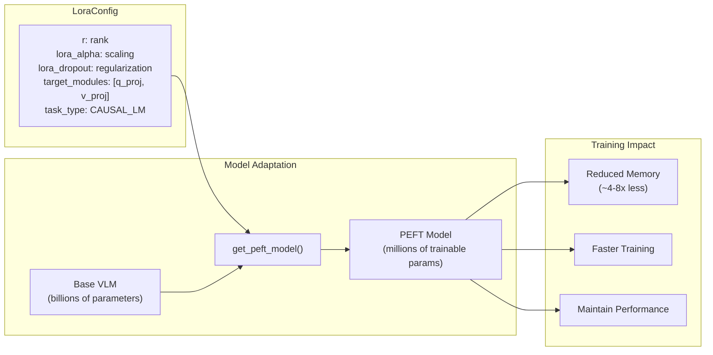

**LoRA Configuration:** [units/en/unit3/4.md:284-294]()

| Parameter | Purpose | Typical Value |
|-----------|---------|---------------|
| `r` | Rank of adaptation matrices | 8-32 |
| `lora_alpha` | Scaling factor | 16-32 |
| `lora_dropout` | Regularization | 0.05-0.1 |
| `target_modules` | Which layers to adapt | `["q_proj", "v_proj"]` |

**Sources:** [units/en/unit3/4.md:275-301](), [units/en/unit3/3.md:17-20]()

### Quantization

Quantization reduces model precision to lower memory requirements:

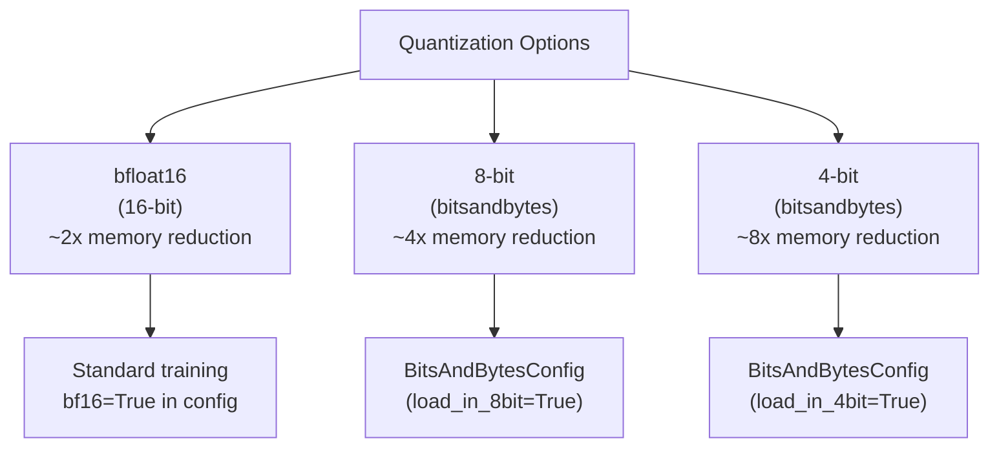

**Configuration:** [units/en/unit3/2.md:119]()

**Sources:** [units/en/unit3/3.md:10-15](), [units/en/unit3/2.md:108-123]()

### Memory Optimization Strategies

| Technique | Implementation | Memory Impact |
|-----------|----------------|---------------|
| **Gradient Checkpointing** | `gradient_checkpointing=True` | Recompute activations, save 30-50% memory |
| **Gradient Accumulation** | `gradient_accumulation_steps=N` | Effective batch size without memory increase |
| **Mixed Precision** | `bf16=True` | 50% memory reduction |
| **Batch Size Tuning** | Start large, reduce on OOM | Balance throughput and memory |

**Sources:** [units/en/unit3/3.md:21-27]()

## Training Infrastructure

### TRL Library Components

The TRL (Transformers Reinforcement Learning) library provides trainers and configurations for VLM fine-tuning:

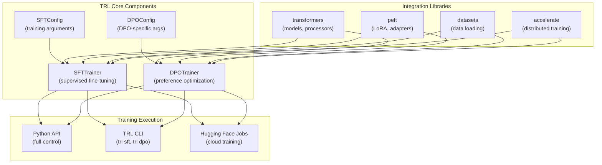

**Sources:** [units/en/unit3/4.md:1-20](), [units/en/unit3/3.md:136-160]()

### TRL CLI Workflow

The TRL CLI provides a production-ready interface for VLM training:

```bash
trl sft \
    --model_name_or_path HuggingFaceTB/SmolVLM2-2.2B-Instruct \
    --dataset_name trl-lib/llava-instruct-mix \
    --output_dir ./smolvln-instruct-sft-cli \
    --per_device_train_batch_size 1 \
    --gradient_accumulation_steps 16 \
    --learning_rate 2e-4 \
    --num_train_epochs 3 \
    --max_length -1 \
    --bf16 True \
    --push_to_hub \
    --hub_model_id your-username/smolvlm2-sft
```

**Key CLI Arguments:**

| Argument | Purpose | Example Value |
|----------|---------|---------------|
| `--model_name_or_path` | Base model to fine-tune | `HuggingFaceTB/SmolVLM2-2.2B-Instruct` |
| `--dataset_name` | Training dataset | `trl-lib/llava-instruct-mix` |
| `--max_length` | Max sequence length (-1 for VLMs) | `-1` |
| `--bf16` | Mixed precision training | `True` |
| `--push_to_hub` | Upload to Hub after training | flag |

**Implementation:** [units/en/unit3/4.md:363-402]()

**Sources:** [units/en/unit3/4.md:363-402]()

### Hugging Face Jobs

Hugging Face Jobs provides managed cloud infrastructure for VLM training:

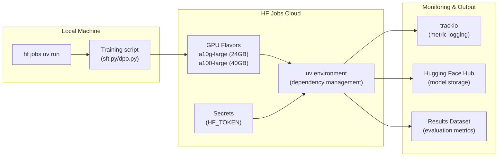

**Example HF Jobs command:** [units/en/unit3/4.md:415-433]()

```bash
hf jobs uv run \
    --flavor a10g-large \
    --timeout 2h \
    --secrets HF_TOKEN \
    --with num2words==0.5.14 \
    "https://raw.githubusercontent.com/huggingface/trl/main/trl/scripts/sft.py" \
    --model_name_or_path HuggingFaceTB/SmolVLM2-2.2B-Instruct \
    --dataset_name trl-lib/llava-instruct-mix \
    --push_to_hub \
    --report_to trackio
```

**Sources:** [units/en/unit3/4.md:404-443]()

## Dataset Formats

### SFT Dataset Format

SFT datasets for VLMs require specific column structure:

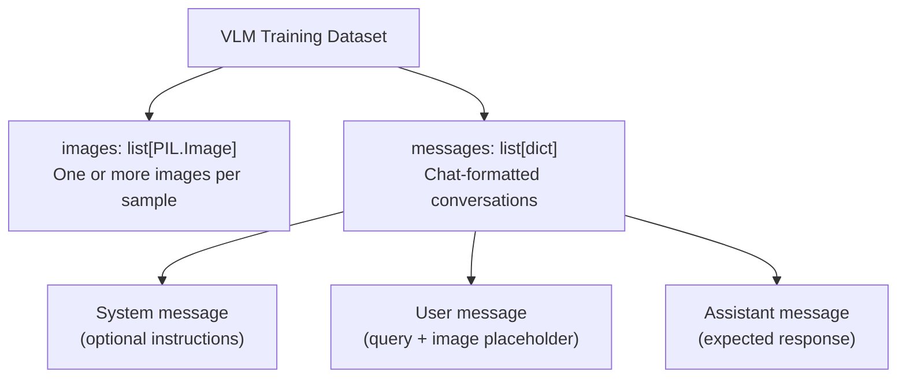

**Example dataset:** `HuggingFaceM4/ChartQA`, `trl-lib/llava-instruct-mix`

**Format function:** [units/en/unit3/4.md:238-266]()

**Sources:** [units/en/unit3/4.md:97-136](), [units/en/unit3/3.md:47-50]()

### DPO Dataset Format

DPO datasets include preference-ranked responses:

| Column | Type | Description |
|--------|------|-------------|
| `prompt` | Text + image reference | The input query with image |
| `chosen` | Text | Preferred response |
| `rejected` | Text | Non-preferred response |
| `images` | List of images | Actual image data |

The format follows the same preference structure as text-only DPO but includes visual inputs.

**Sources:** [units/en/unit3/3.md:89-115]()

## Evaluation

### Standard VLM Benchmarks

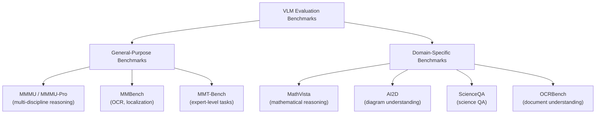

**Benchmark Descriptions:**

| Benchmark | Focus Area | Examples |
|-----------|------------|----------|
| **MMMU** | Multi-discipline reasoning | Arts, science, engineering tasks |
| **MMBench** | Visual understanding | OCR, localization, reasoning (3000+ questions) |
| **MathVista** | Mathematical reasoning | Math problems with visual context |
| **AI2D** | Diagram interpretation | Scientific diagram understanding |
| **OCRBench** | Text recognition | Document OCR capabilities |

**Sources:** [units/en/unit3/1.md:40-58]()

### Evaluation with LightEval

VLMs can be evaluated using the LightEval framework integrated with Hugging Face Jobs:

```bash
hf jobs uv run \
    --flavor a10g-large \
    --with "lighteval[vllm]" \
    --secrets HF_TOKEN \
    lighteval vllm "model_name=your-username/your-vlm-model" \
    "custom_benchmark_tasks" \
    --push-to-hub --results-org your-username
```

**Sources:** [units/en/unit2/4.md:44-61]()

### Custom Domain Evaluation

For domain-specific tasks (e.g., ChartQA), create custom evaluation datasets and metrics:

1. Curate task-specific examples with ground truth labels
2. Define evaluation metrics (accuracy, exact match, F1)
3. Run inference on test set using trained model
4. Compare outputs with baseline models

**Example domain:** Chart interpretation with `HuggingFaceM4/ChartQA` dataset

**Sources:** [units/en/unit3/4.md:97-202](), [units/en/unit3/1.md:40-58]()

## Practical Training Workflow

### Complete SFT Pipeline

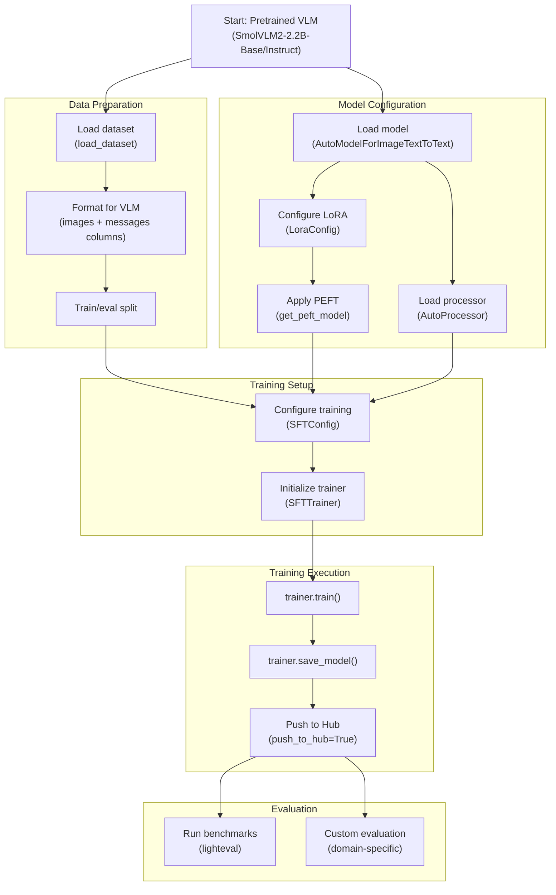

**Sources:** [units/en/unit3/4.md:1-449](), [units/en/unit3/3.md:1-168]()

## Common Use Cases

### Chart Question Answering

Fine-tuning VLMs on chart interpretation tasks using datasets like `HuggingFaceM4/ChartQA`:

**Task:** Answer questions about chart images (e.g., "What is the highest value?")

**Dataset format:** [units/en/unit3/4.md:110-136]()

**Training approach:** SFT with small dataset subset for domain specialization

**Sources:** [units/en/unit3/4.md:97-202]()

### Visual Question Answering (VQA)

General-purpose VQA across diverse image types:

**Task:** Answer arbitrary questions about image content

**Dataset examples:** `trl-lib/llava-instruct-mix`

**Training approach:** SFT on large diverse dataset, optionally followed by DPO for preference alignment

**Sources:** [units/en/unit3/2.md:20-26]()

### Document Understanding

OCR and document analysis tasks:

**Task:** Extract information from documents, diagrams, or forms

**Evaluation:** OCRBench, AI2D

**Training approach:** Specialized SFT with document-focused datasets

**Sources:** [units/en/unit3/1.md:51-56]()

## Key Considerations

### When to Fine-Tune

Fine-tune VLMs when:
- Base model struggles with specific domain (e.g., medical images, charts)
- Need domain-specific vocabulary or visual patterns
- Have labeled task-specific dataset available

**Trade-offs:**
- Requires high-quality labeled data
- Computationally intensive (use LoRA + quantization)
- Risk of overfitting on narrow datasets

**Sources:** [units/en/unit3/3.md:36-44]()

### Training Best Practices

| Practice | Implementation | Benefit |
|----------|----------------|---------|
| **Start small** | Test on dataset subset | Verify pipeline before full training |
| **Use LoRA** | `LoraConfig(r=8, alpha=16)` | 4-8x memory reduction |
| **Enable quantization** | `BitsAndBytesConfig(load_in_4bit=True)` | Further memory savings |
| **Gradient checkpointing** | `gradient_checkpointing=True` | 30-50% memory reduction |
| **Monitor checkpoints** | `save_steps=N` | Balance storage and recovery |
| **Validate frequently** | Use eval_dataset | Detect overfitting early |

**Sources:** [units/en/unit3/3.md:125-133]()

### Hardware Requirements

| Training Type | Minimum GPU | Recommended GPU | Batch Size Strategy |
|---------------|-------------|-----------------|---------------------|
| **Local inference** | 8GB VRAM | 16GB VRAM | batch_size=1 |
| **LoRA fine-tuning** | 16GB VRAM | 24GB VRAM | batch_size=1-4, gradient_accumulation |
| **Full fine-tuning** | 40GB VRAM | 80GB VRAM | Use HF Jobs with A100 |
| **Production training** | N/A | HF Jobs (managed) | Scale with cloud GPUs |

**Sources:** [units/en/unit3/4.md:27-31](), [units/en/unit3/4.md:404-443]()

---

