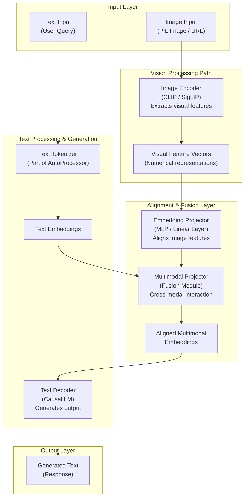
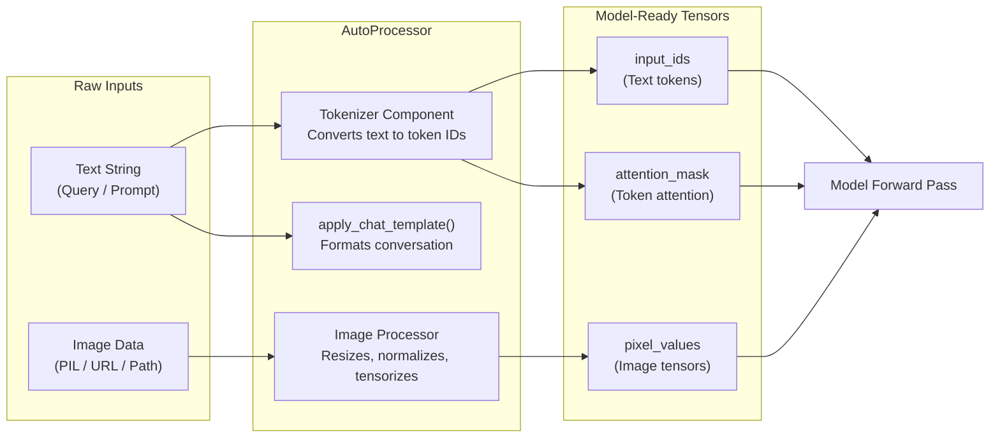
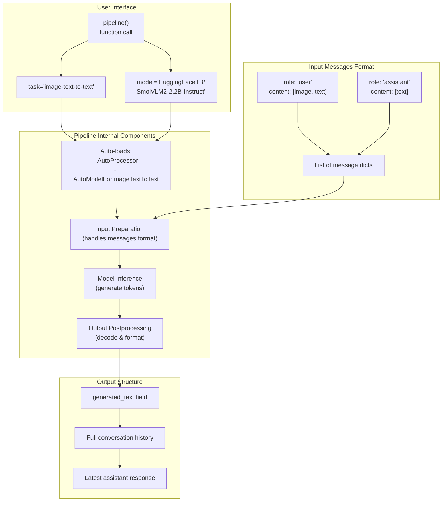
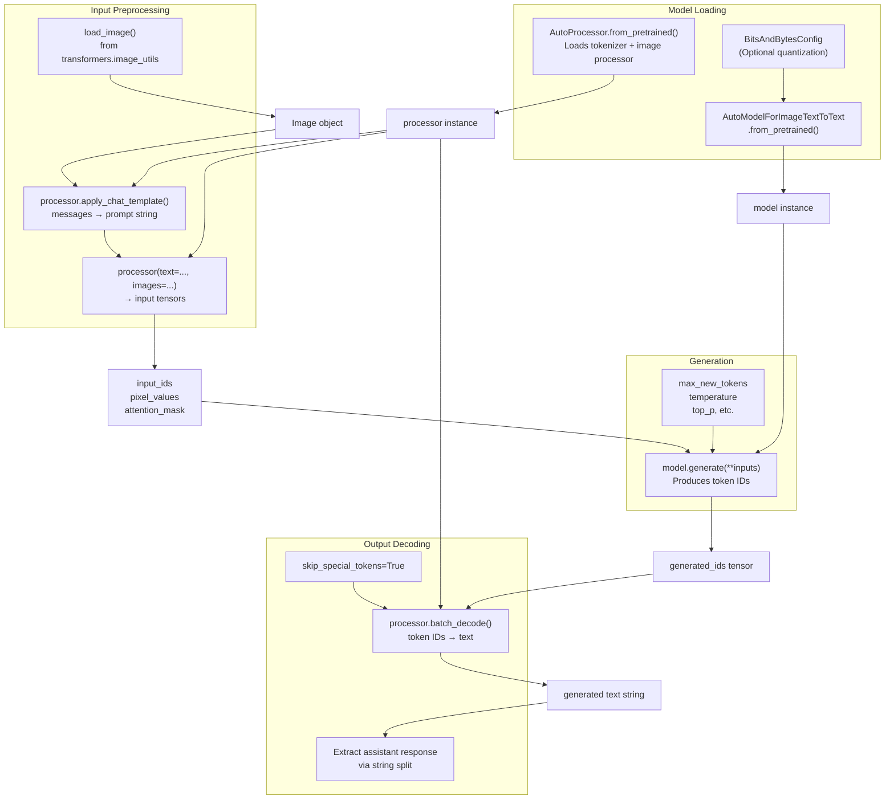
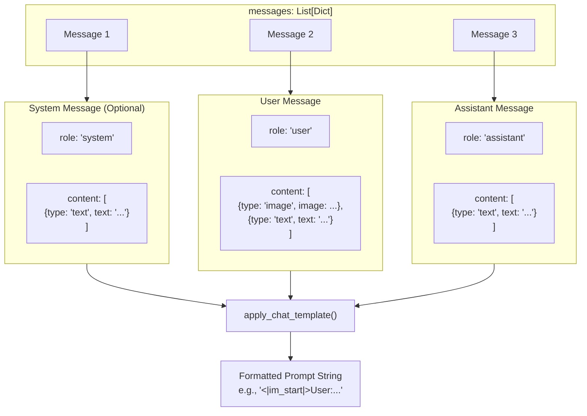
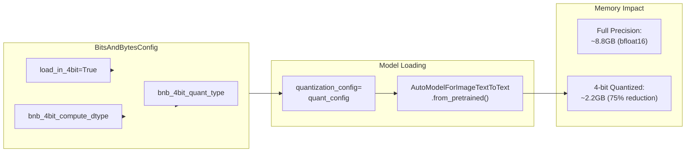
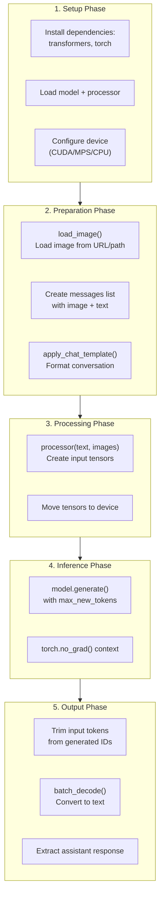

<!-- source: DeepWiki mcp.deepwiki.com · repo huggingface/smol-course · page 5.1 VLM Architecture and Usage · fetched 2026-10-26 -->

# VLM Architecture and Usage

<details>
<summary>Relevant source files</summary>

The following files were used as context for generating this wiki page:

- [notebooks/4/4.ipynb](notebooks/4/4.ipynb)
- [units/en/unit2/1.md](units/en/unit2/1.md)
- [units/en/unit2/2.md](units/en/unit2/2.md)
- [units/en/unit2/3.md](units/en/unit2/3.md)
- [units/en/unit2/4.md](units/en/unit2/4.md)
- [units/en/unit3/1.md](units/en/unit3/1.md)
- [units/en/unit3/2.md](units/en/unit3/2.md)
- [units/en/unit3/3.md](units/en/unit3/3.md)
- [units/en/unit3/4.md](units/en/unit3/4.md)

</details>


## Purpose and Scope

This document details the architecture of Vision-Language Models (VLMs) and their practical usage. It covers the core components that enable multimodal processing (image encoder, embedding projector, fusion module, text decoder), the role of `AutoProcessor` in handling multimodal inputs, and the two primary approaches for using VLMs: the simplified `pipeline` interface and direct `transformers` usage for full control. For information about fine-tuning VLMs, see [Fine-Tuning VLMs](#5.2). For general VLM concepts and evaluation, see [Vision-Language Models](#5).

**Sources:** [units/en/unit3/2.md:1-18]()

---

## VLM Architecture Components

A VLM combines image-processing and text-generation components to achieve unified multimodal understanding. The architecture consists of four main components that work together to process visual and textual inputs.

### Architecture Component Diagram



### Component Descriptions

| Component | Purpose | Implementation Details |
|-----------|---------|----------------------|
| **Image Encoder** | Converts images into compact numerical feature vectors | Pretrained vision models (CLIP, SigLIP) that extract spatial and semantic visual information |
| **Embedding Projector** | Aligns image features with text embedding space | Small MLP or linear layer fine-tuned for the specific multimodal task |
| **Multimodal Fusion Module** | Enables rich cross-modal interaction between visual and textual representations | Goes beyond simple alignment to create deep connections between modalities |
| **Text Decoder** | Generates text from fused multimodal representations | Causal language model that produces token-by-token output |

Most VLMs leverage pretrained image encoders and text decoders, then fine-tune on paired image-text datasets for efficient training and generalization.

**Sources:** [units/en/unit3/2.md:5-17](), [units/en/unit3/1.md:15-17]()

---

## AutoProcessor: The Multimodal Interface

Unlike standard LLMs that only require a tokenizer, VLMs use `AutoProcessor` to handle both text tokenization and image preprocessing. This unified interface streamlines multimodal input preparation.

### AutoProcessor Data Flow



The `AutoProcessor` class is initialized alongside the model and provides methods for:
- `apply_chat_template()`: Formats conversational inputs according to the model's chat template
- `__call__()`: Processes both text and images into model-ready tensors
- `batch_decode()`: Converts generated token IDs back to text

**Sources:** [units/en/unit3/2.md:109-123](), [units/en/unit3/4.md:82-94]()

---

## Using VLMs via Pipeline

The simplest approach for using VLMs is through the `pipeline` abstraction, which handles all preprocessing, inference, and postprocessing automatically.

### Pipeline Architecture



### Basic Pipeline Usage

The pipeline handles all complexity internally:

```python
from transformers import pipeline

pipe = pipeline("image-text-to-text", "HuggingFaceTB/SmolVLM2-2.2B-Instruct", device_map="auto")

messages = [
    {
        "role": "user",
        "content": [
            {"type": "image", "image": "path/to/image.jpg"},
            {"type": "text", "text": "Describe this image."}
        ]
    }
]

response = pipe(messages, max_new_tokens=128, temperature=0.7)
print(response[0]['generated_text'][-1]['content'])
```

The pipeline automatically:
1. Loads the `AutoProcessor` and `AutoModelForImageTextToText`
2. Applies the chat template
3. Preprocesses text and images
4. Runs inference
5. Decodes and formats the output

**Sources:** [units/en/unit3/2.md:63-103]()

---

## Using VLMs via Transformers (Full Control)

For advanced use cases requiring fine-grained control, use `transformers` classes directly. This approach provides access to all model components and inference parameters.

### Transformers Code Entity Flow



### Key Classes and Methods

| Class/Method | Purpose | Location |
|--------------|---------|----------|
| `AutoProcessor` | Unified text and image processing | [units/en/unit3/4.md:93]() |
| `AutoModelForImageTextToText` | VLM model class for generation | [units/en/unit3/4.md:88-91]() |
| `BitsAndBytesConfig` | Quantization configuration | [units/en/unit3/2.md:119]() |
| `load_image()` | Load images from URLs or paths | [units/en/unit3/2.md:132]() |
| `apply_chat_template()` | Format messages into prompt | [units/en/unit3/4.md:156-158]() |
| `generate()` | Generate tokens from inputs | [units/en/unit3/2.md:152]() |
| `batch_decode()` | Convert token IDs to text | [units/en/unit3/2.md:153-156]() |

### Example Implementation Pattern

The typical workflow follows this structure, as shown in [units/en/unit3/2.md:111-162]():

1. **Load model with quantization:** Initialize `AutoModelForImageTextToText` with `BitsAndBytesConfig` for 4-bit quantization
2. **Load processor:** Initialize `AutoProcessor` to handle both text and images
3. **Prepare messages:** Structure input as list of message dictionaries
4. **Apply template:** Use `processor.apply_chat_template()` to format conversation
5. **Process inputs:** Call `processor(text=..., images=...)` to create tensors
6. **Generate:** Call `model.generate(**inputs)` with generation parameters
7. **Decode:** Use `processor.batch_decode()` to convert tokens to text
8. **Extract response:** Parse assistant's response from generated text

**Sources:** [units/en/unit3/2.md:104-173](), [units/en/unit3/4.md:55-94]()

---

## Multimodal Chat Templates

VLMs support chat-like interactions using structured message formats. Each message contains a role and content, where content can include both text and images.

### Chat Message Structure



### Message Format Specification

Each message dictionary contains:
- `role`: One of `"system"`, `"user"`, or `"assistant"`
- `content`: List of content items, each with:
  - `type`: Either `"text"` or `"image"`
  - `text`: Text string (for text type)
  - `image`: Image data, can be PIL Image, URL, or file path (for image type)

Example from [units/en/unit3/4.md:148-153]():

```python
messages = [
    {"role": "user", "content": [
        {"type": "image", "image": image},
        {"type": "text", "text": example["query"]},
    ]}
]
```

### Chat Template Application

The `apply_chat_template()` method converts structured messages into the model's expected format. For SmolVLM2, this produces prompts like:

```
<|im_start|>User:<image>How many values are below 40?<end_of_utterance>
Assistant:
```

The `add_generation_prompt=True` parameter appends the assistant prefix to prompt the model to generate a response.

**Sources:** [units/en/unit3/2.md:31-61](), [units/en/unit3/4.md:140-170]()

---

## Quantization for Memory Efficiency

VLMs are often larger than text-only LLMs. Quantization reduces memory usage by lowering numerical precision while maintaining performance.

### BitsAndBytesConfig Usage



### Quantization Configuration

The `BitsAndBytesConfig` class configures quantization parameters:

```python
quant_config = BitsAndBytesConfig(
    load_in_4bit=True,
    bnb_4bit_compute_dtype=torch.bfloat16,
    bnb_4bit_quant_type="nf4"
)

model = AutoModelForImageTextToText.from_pretrained(
    model_name, 
    quantization_config=quant_config
)
```

| Parameter | Purpose | Typical Value |
|-----------|---------|---------------|
| `load_in_4bit` | Enable 4-bit quantization | `True` |
| `load_in_8bit` | Enable 8-bit quantization | `True` (alternative) |
| `bnb_4bit_compute_dtype` | Computation data type | `torch.bfloat16` |
| `bnb_4bit_quant_type` | Quantization algorithm | `"nf4"` (NormalFloat4) |

For SmolVLM2-2.2B-Instruct, 4-bit quantization reduces memory from ~8.8GB to ~2.2GB, enabling deployment on consumer GPUs with 8GB VRAM.

**Sources:** [units/en/unit3/2.md:118-122](), [units/en/unit3/4.md:51](), [units/en/unit3/3.md:10-15]()

---

## Complete Usage Example

### Inference Workflow



This workflow is demonstrated in [units/en/unit3/4.md:55-202](), showing the complete process from model loading through response generation.

### Input/Output Data Types

| Stage | Input Type | Output Type |
|-------|-----------|-------------|
| Image Loading | `str` (URL/path) | `PIL.Image.Image` |
| Chat Template | `List[Dict]` (messages) | `str` (formatted prompt) |
| Processor | `str` (prompt) + `List[Image]` | `BatchEncoding` (tensors) |
| Model Generate | `BatchEncoding` | `torch.Tensor` (token IDs) |
| Batch Decode | `torch.Tensor` | `List[str]` (text) |

**Sources:** [units/en/unit3/4.md:55-202](), [units/en/unit3/2.md:125-162]()

---

## Key Files and Entry Points

| File Path | Primary Classes/Functions | Purpose |
|-----------|---------------------------|---------|
| N/A (transformers library) | `AutoProcessor` | Unified text and image processing |
| N/A (transformers library) | `AutoModelForImageTextToText` | VLM model loading and inference |
| N/A (transformers library) | `pipeline("image-text-to-text")` | Simplified VLM interface |
| N/A (transformers library) | `BitsAndBytesConfig` | Quantization configuration |
| N/A (transformers library) | `load_image()` | Image loading utility |
| [units/en/unit3/4.md]() | Hands-on examples | Practical VLM usage patterns |
| [units/en/unit3/2.md]() | Architecture documentation | VLM component descriptions |

**Sources:** All referenced files throughout this document

---

