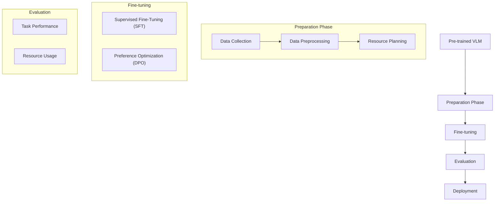
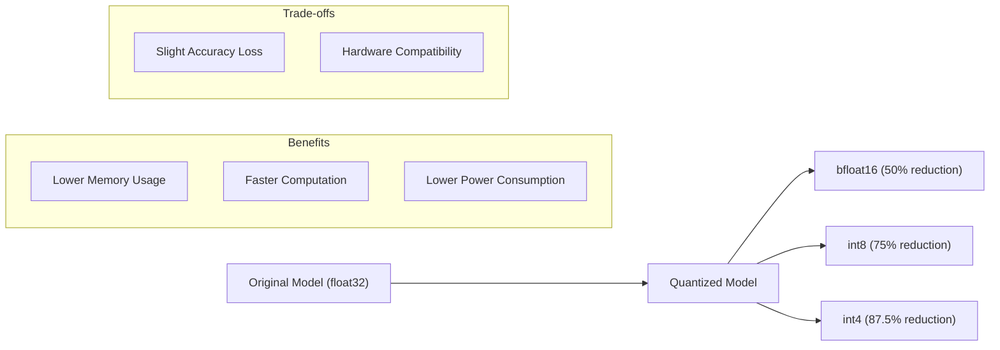
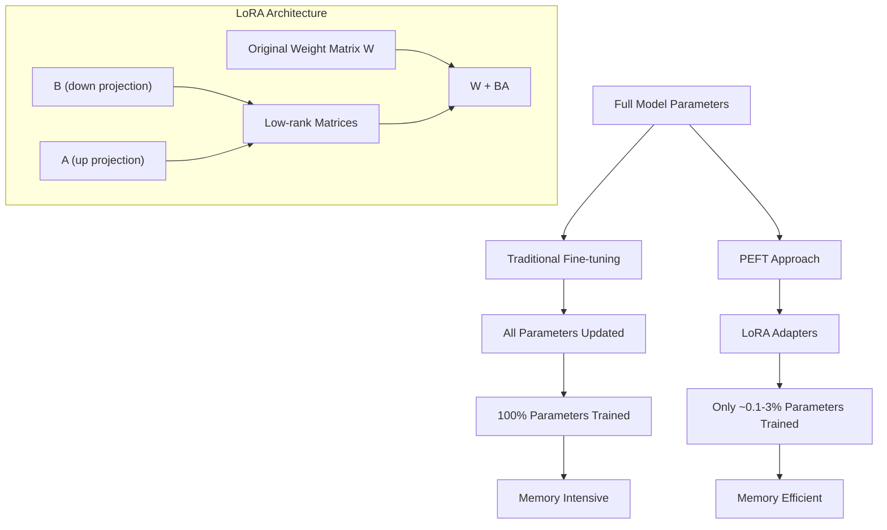
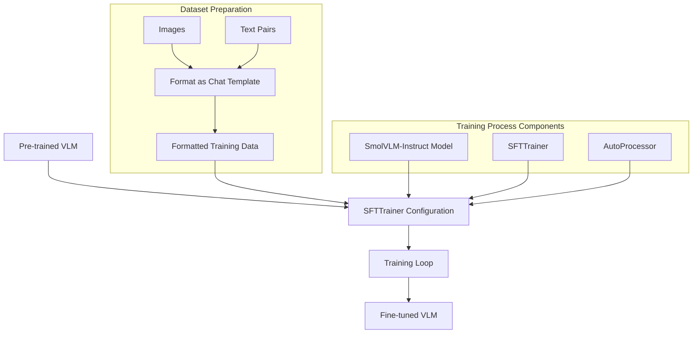
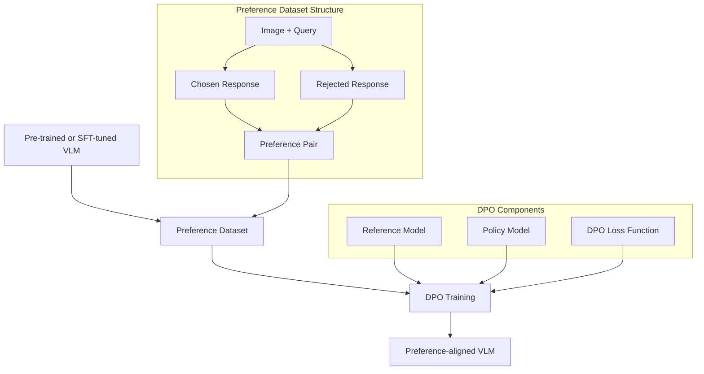
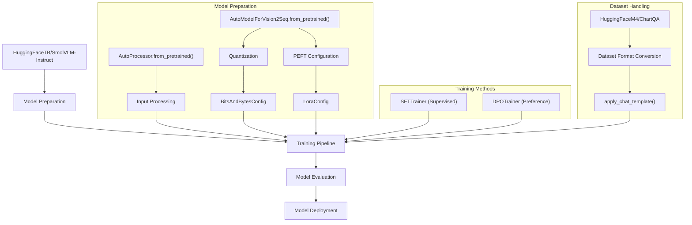

<!-- source: DeepWiki mcp.deepwiki.com · repo huggingface/smol-course · page 5.2 Fine-Tuning VLMs · fetched 2026-10-26 -->

# VLM Fine-tuning

<details>
<summary>Relevant source files</summary>

The following files were used as context for generating this wiki page:

- [notebooks/4/4.ipynb](notebooks/4/4.ipynb)
- [units/en/unit2/1.md](units/en/unit2/1.md)
- [units/en/unit2/2.md](units/en/unit2/2.md)
- [units/en/unit2/3.md](units/en/unit2/3.md)
- [units/en/unit2/4.md](units/en/unit2/4.md)
- [units/en/unit3/1.md](units/en/unit3/1.md)
- [units/en/unit3/2.md](units/en/unit3/2.md)
- [units/en/unit3/3.md](units/en/unit3/3.md)
- [units/en/unit3/4.md](units/en/unit3/4.md)

</details>


This document covers techniques and methods for fine-tuning Vision-Language Models (VLMs) within the SmolLM course framework. It focuses on adapting pre-trained VLMs like SmolVLM to perform specific tasks through supervised fine-tuning and preference optimization techniques. For basic usage of VLMs without fine-tuning, see [VLM Usage](#6.1).

## Introduction

Fine-tuning a Vision-Language Model involves adapting a pre-trained model to perform specific tasks or to operate effectively on particular datasets. This process is essential for specializing VLMs for domain-specific applications like medical image analysis, chart interpretation, or detailed scene understanding where the base model's capabilities may be insufficient.

Vision-Language Models face unique challenges during fine-tuning due to their multimodal nature. Unlike text-only models, VLMs must process and align both visual and textual information effectively, requiring careful data preparation and optimization techniques.



Sources: 
- 5_vision_language_models/README.md
- 5_vision_language_models/vlm_finetuning.md

## Efficient Fine-Tuning Techniques

Given that VLMs like SmolVLM are significantly larger than standard text models, applying efficient fine-tuning techniques becomes crucial to make the process accessible with limited computational resources.

### Quantization

Quantization reduces the precision of model weights and activations, resulting in lower memory usage and faster computations while maintaining most of the model's performance.



For example, switching from `float32` to `bfloat16` halves memory requirements while maintaining similar performance. More aggressive quantization (8-bit and 4-bit) can further reduce memory needs at the cost of some accuracy.

Example configuration in code:

```python
quantization_config = BitsAndBytesConfig(
    load_in_4bit=True,
    bnb_4bit_use_double_quant=True,
    bnb_4bit_quant_type="nf4",
    bnb_4bit_compute_dtype=torch.bfloat16
)
```

Sources:
- 5_vision_language_models/vlm_finetuning.md
- 5_vision_language_models/notebooks/vlm_sft_sample.ipynb

### PEFT & LoRA

Parameter-Efficient Fine-Tuning (PEFT) techniques like Low-Rank Adaptation (LoRA) drastically reduce the number of trainable parameters by focusing on learning compact rank-decomposition matrices while keeping original model weights frozen.



LoRA replaces full weight updates with low-rank decomposition matrices, reducing billions of trainable parameters to just millions while maintaining performance. This approach is particularly valuable for VLMs, which typically have larger parameter counts than text-only models.

Sources:
- 5_vision_language_models/vlm_finetuning.md

### Batch Size Optimization

Effective batch size management is crucial for successful VLM fine-tuning within memory constraints:

1. **Gradient Accumulation**: Increase `gradient_accumulation_steps` to effectively maintain a larger batch size by accumulating gradients over multiple smaller batches before updating weights.

2. **Gradient Checkpointing**: Enable this feature to reduce memory usage by recomputing intermediate states during the backward pass, trading computation time for reduced memory requirements.

Example training configuration:

```python
training_args = TrainingArguments(
    output_dir="./fine_tuned_model",
    per_device_train_batch_size=4,   # Small batch size per device
    num_train_epochs=3,              
    learning_rate=5e-5,              
    bf16=True,                       # Mixed precision training
    gradient_checkpointing=True,     # Memory optimization
    gradient_accumulation_steps=16,  # Accumulate over 16 steps
    logging_steps=50                 
)
```

Sources:
- 5_vision_language_models/vlm_finetuning.md

## Supervised Fine-Tuning (SFT)

Supervised Fine-Tuning adapts a pre-trained VLM to specific tasks using labeled datasets containing paired inputs (images and corresponding text).

### Overview

SFT for VLMs involves training the model to generate appropriate text responses given both image and text inputs. This process is essential when a VLM needs to specialize in domains with unique visual features or terminology.

Key characteristics of SFT for VLMs:
- Requires high-quality, labeled datasets
- Computationally intensive for large VLMs
- May risk overfitting if fine-tuned too narrowly



Sources:
- 5_vision_language_models/vlm_finetuning.md

### Implementation

The SFT implementation for VLMs involves several key components:

1. **Data Preparation**: Structure dataset into chatbot-like format with system messages, user queries with images, and corresponding answers.

2. **Model Setup**: Load a pre-trained VLM like `HuggingFaceTB/SmolVLM-Instruct` and an associated processor for preparing inputs.

3. **Training Configuration**: Set up appropriate training parameters leveraging memory optimizations.

4. **Training Process**: Use the `SFTTrainer` from the TRL library to simplify the training workflow.

Example implementation:

```python
# Load model with quantization
model = AutoModelForVision2Seq.from_pretrained(
    "HuggingFaceTB/SmolVLM-Instruct",
    quantization_config=quantization_config,
    torch_dtype=torch.bfloat16,
)
processor = AutoProcessor.from_pretrained("HuggingFaceTB/SmolVLM-Instruct")

# Prepare dataset in chat format
# [...dataset formatting code...]

# Configure and run training
trainer = SFTTrainer(
    model=model,
    train_dataset=formatted_dataset,
    args=training_args,
    peft_config=peft_config,  # Optional LoRA configuration
    formatting_func=format_chat,
)
trainer.train()
```

Sources:
- 5_vision_language_models/vlm_finetuning.md
- 5_vision_language_models/notebooks/vlm_sft_sample.ipynb

## Preference Optimization

Preference Optimization, particularly Direct Preference Optimization (DPO), trains a VLM to align with human preferences by learning to prioritize outputs that humans subjectively prefer.

### Overview

Unlike SFT, which follows strict instructional data, DPO helps models learn more nuanced responses based on human judgment. This approach is particularly valuable for tasks involving creative or subjective responses where multiple answers may be acceptable but with varying quality.



Sources:
- 5_vision_language_models/vlm_finetuning.md

### Implementation

Implementing DPO for VLMs involves:

1. **Dataset Preparation**: Create pairs of responses for each input (image + question), with one preferred response and one rejected response.

2. **Model Setup**: Integrate a pre-trained VLM with Hugging Face's TRL library, which supports the DPO algorithm.

3. **Training Pipeline**: Configure DPO-specific parameters and train with appropriate memory optimizations.

Example preference pair:

- **Question**: How many families?
  - **Rejected**: The image does not provide any information about families.
  - **Chosen**: The image shows a Union Organization table setup with 18,000 families.

The DPO training process requires a reference model (usually the pre-DPO model) and trains a policy model to favor preferred outputs.

Sources:
- 5_vision_language_models/vlm_finetuning.md

## Technical Implementation Workflow

The following diagram illustrates the complete workflow for fine-tuning VLMs within the SmolLM course framework, connecting abstract concepts to their code implementations:



Sources:
- 5_vision_language_models/vlm_finetuning.md
- 5_vision_language_models/notebooks/vlm_sft_sample.ipynb

## Best Practices and Optimization Tips

When fine-tuning VLMs, consider these best practices to maximize performance and efficiency:

| Technique | Implementation | Benefit |
|-----------|---------------|---------|
| Quantization | Use `load_in_4bit=True` in `BitsAndBytesConfig` | Reduces memory usage by up to 75% |
| LoRA | Apply `peft_config=LoraConfig(...)` | Reduces trainable parameters from billions to millions |
| Gradient Accumulation | Set `gradient_accumulation_steps=16` | Enables larger effective batch sizes |
| Gradient Checkpointing | Enable `gradient_checkpointing=True` | Reduces memory usage at the cost of computation time |
| Mixed Precision | Set `bf16=True` or `fp16=True` | Improves training speed and reduces memory usage |
| Dataset Size | Start with small subset for testing | Identifies issues before full training |

### Monitoring and Debugging

When fine-tuning VLMs, monitor these key metrics:

1. Loss values (should decrease steadily)
2. GPU memory usage
3. Perplexity (for language generation quality)
4. Task-specific metrics relevant to your application

If you encounter out-of-memory errors, try:
- Reducing batch size
- Increasing gradient accumulation steps
- Applying stronger quantization
- Switching to LoRA if not already using it

Sources:
- 5_vision_language_models/vlm_finetuning.md
- 5_vision_language_models/notebooks/vlm_sft_sample.ipynb

## Conclusion

Fine-tuning Vision-Language Models requires balancing between model performance and computational efficiency. Through techniques like quantization, PEFT, and optimized training configurations, it's possible to adapt powerful models like SmolVLM for specialized tasks even with limited computational resources.

The choice between Supervised Fine-Tuning and Preference Optimization depends on your specific needs. SFT works well for concrete tasks with clear correct answers, while DPO excels at tasks involving subjective judgment or multiple valid response styles.

For hands-on practice with these techniques, the course provides structured notebooks to implement and experiment with VLM fine-tuning approaches.

Sources:
- 5_vision_language_models/README.md
- 5_vision_language_models/vlm_finetuning.md

---

