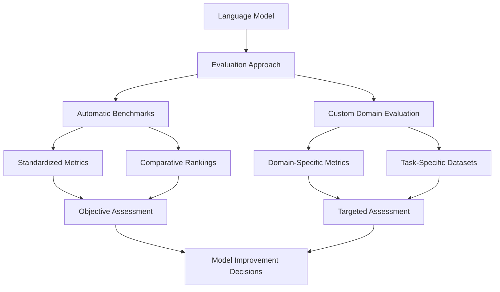
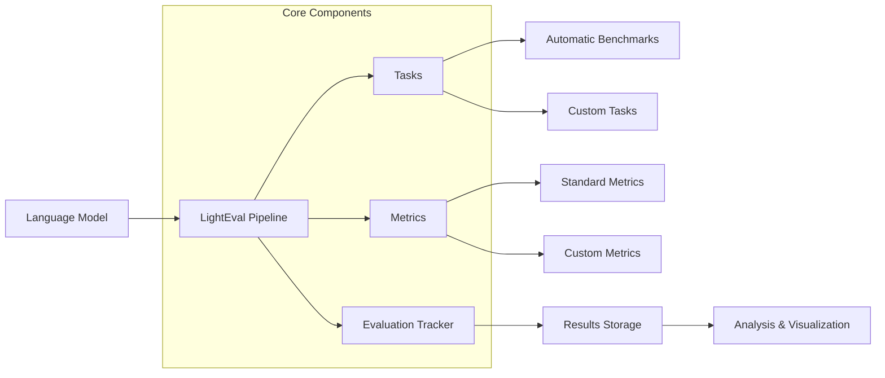
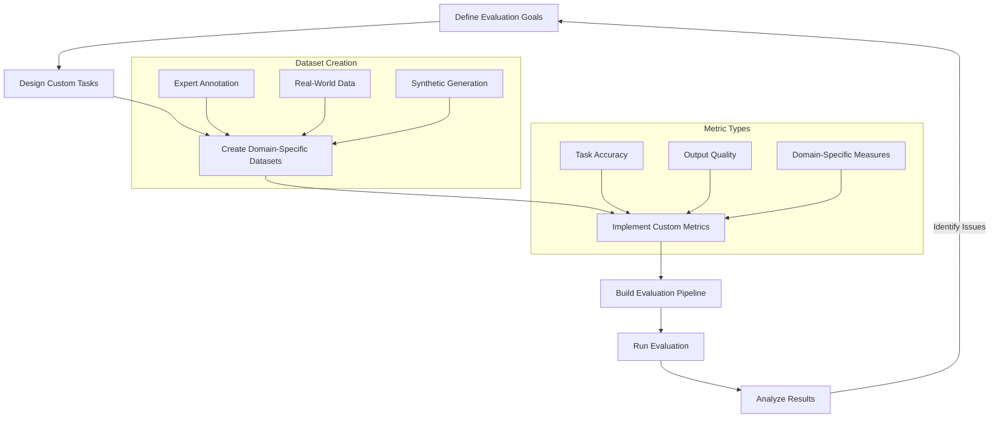
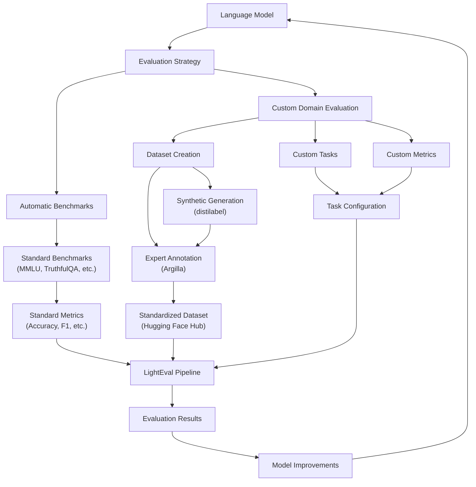

<!-- source: DeepWiki mcp.deepwiki.com · repo huggingface/smol-course · page 6 Model Evaluation · fetched 2026-10-26 -->

# Model Evaluation

<details>
<summary>Relevant source files</summary>

The following files were used as context for generating this wiki page:

- [units/en/unit1/1.md](units/en/unit1/1.md)
- [units/en/unit1/2.md](units/en/unit1/2.md)
- [units/en/unit1/6.md](units/en/unit1/6.md)
- [units/es/unit1/0.md](units/es/unit1/0.md)
- [units/es/unit2/0.md](units/es/unit2/0.md)
- [units/es/unit2/2.md](units/es/unit2/2.md)
- [units/es/unit3/0.md](units/es/unit3/0.md)
- [units/es/unit3/2.md](units/es/unit3/2.md)
- [units/es/unit4/0.md](units/es/unit4/0.md)
- [units/ja/unit1/1.md](units/ja/unit1/1.md)
- [units/ja/unit2/1.md](units/ja/unit2/1.md)
- [units/ja/unit2/3.md](units/ja/unit2/3.md)
- [units/ja/unit3/1.md](units/ja/unit3/1.md)

</details>


Model evaluation is a critical step in developing and deploying language models, helping us understand how well our models perform across different capabilities and identify areas for improvement. This document covers standard benchmarks and domain-specific evaluation approaches to comprehensively assess small language models, with a focus on using the LightEval library to evaluate model performance in a structured and reproducible way.

For information about parameter-efficient fine-tuning methods, see [Parameter-Efficient Fine-Tuning](#4).

## Overview of Evaluation Approaches

A thorough evaluation strategy examines multiple aspects of model performance:

1. **Task-specific capabilities**: Assessing performance on tasks like question answering, summarization, and reasoning
2. **Output quality**: Measuring coherence, factual accuracy, and relevance
3. **Safety evaluation**: Identifying potentially harmful outputs or biases
4. **Domain expertise**: Verifying specialized knowledge in specific fields

The SmolLM course covers two main evaluation approaches:

1. **Automatic benchmarks**: Standardized evaluation suites like MMLU and TruthfulQA
2. **Custom domain evaluation**: Tailored evaluation pipelines for specific use cases



Sources: 
- [4_evaluation/README.md]()
- [4_evaluation/automatic_benchmarks.md]()
- [4_evaluation/custom_evaluation.md]()

## LightEval Framework

LightEval is a powerful evaluation library developed by Hugging Face that integrates seamlessly with the Hugging Face ecosystem. It provides a structured way to evaluate language models on both standard benchmarks and custom tasks.



LightEval tasks are defined using a specific string format:
```
{suite}|{task}|{num_few_shot}|{auto_reduce}
```

Where:
- **suite**: The benchmark suite (e.g., 'mmlu', 'truthfulqa')
- **task**: Specific task within the suite (e.g., 'abstract_algebra')
- **num_few_shot**: Number of examples to include in prompt (0 for zero-shot)
- **auto_reduce**: Whether to automatically reduce few-shot examples if prompt is too long (0 or 1)

Sources:
- [4_evaluation/README.md]()
- [4_evaluation/automatic_benchmarks.md:57-67]()

## Automatic Benchmarks

Automatic benchmarks serve as standardized tools for evaluating language models across different tasks and capabilities. These benchmarks typically consist of curated datasets with predefined tasks and evaluation metrics.

### Common Benchmarks

| Benchmark | Description | Focus Area |
|-----------|-------------|------------|
| MMLU (Massive Multitask Language Understanding) | Tests knowledge across 57 subjects | General knowledge |
| TruthfulQA | Evaluates tendency to reproduce misconceptions | Factual accuracy |
| BBH (Big Bench Hard) | Tests complex reasoning | Logical thinking and planning |
| GSM8K | Focuses on mathematical problem-solving | Quantitative reasoning |
| HELM | Provides a holistic evaluation framework | Comprehensive assessment |
| WinoGrande | Tests common sense through pronoun disambiguation | Language understanding |

### Example Benchmark Evaluation

Here's how to set up a basic evaluation pipeline with LightEval:

```python
from lighteval.tasks import Task, Pipeline
from transformers import AutoModelForCausalLM
from lighteval.logging.evaluation_tracker import EvaluationTracker

# Define domain-specific tasks
domain_tasks = [
    "mmlu|anatomy|0|0",
    "mmlu|high_school_biology|0|0", 
    "mmlu|high_school_chemistry|0|0",
    "mmlu|professional_medicine|0|0"
]

# Configure pipeline parameters
pipeline_params = {
    "max_samples": 40,
    "batch_size": 1,
    "num_workers": 4
}

# Create evaluation tracker
evaluation_tracker = EvaluationTracker(
    output_path="./results",
    save_generations=True
)

# Load model and create pipeline
model = AutoModelForCausalLM.from_pretrained("your-model-name")
pipeline = Pipeline(
    tasks=domain_tasks,
    pipeline_parameters=pipeline_params,
    evaluation_tracker=evaluation_tracker,
    model=model
)

# Run evaluation
pipeline.evaluate()

# Get and display results
results = pipeline.get_results()
pipeline.show_results()
```

Results are displayed in a tabular format showing performance metrics for each task.

Sources:
- [4_evaluation/automatic_benchmarks.md]()
- [vi/4_evaluation/notebooks/lighteval_evaluate_and_analyse_your_LLM.ipynb:70-115]()

## Custom Domain Evaluation

While standard benchmarks are useful, many applications require specialized evaluation approaches tailored to specific domains or use cases. Custom domain evaluation involves creating evaluation pipelines that accurately assess your model's performance in your target domain.



### Creating Custom Tasks

To create a custom evaluation task with LightEval, you need to define:

1. A prompt function that converts dataset samples into a format the model can process
2. Custom metrics to evaluate model outputs
3. A task configuration that connects everything

Here's an example from the evaluation project:

```python
def prompt_fn(line, task_name: str = None):
    """Converts a dataset line to a Doc object for evaluation."""
    instruction = "Choose the correct answer for the following exam question:"
    return Doc(
        task_name=task_name,
        query=f"{instruction} {line['question']}",
        choices=[
            f" {line['answer_a']}",
            f" {line['answer_b']}",
            f" {line['answer_c']}",
            f" {line['answer_d']}",
        ],
        gold_index=["answer_a", "answer_b", "answer_c", "answer_d"].index(
            line["correct_answer"]
        ),
        instruction=instruction,
    )
```

Sources:
- [4_evaluation/custom_evaluation.md]()
- [4_evaluation/project/evaluation_task.py:16-32]()

### Custom Metrics

Domain-specific tasks often require specialized metrics. LightEval provides a framework for creating custom metrics:

```python
def sample_level_fn(formatted_doc: Doc, **kwargs) -> bool:
    response = np.argmin(kwargs["choices_logprob"])
    return response == formatted_doc.gold_index

custom_metric = SampleLevelMetric(
    metric_name="exam_question_accuracy",
    higher_is_better=True,
    category=MetricCategory.MULTICHOICE,
    use_case=MetricUseCase.NONE,
    sample_level_fn=sample_level_fn,
    corpus_level_fn=np.mean,
)
```

Sources:
- [4_evaluation/custom_evaluation.md:38-94]()
- [4_evaluation/project/evaluation_task.py:42-54]()

### Task Configuration

The final step is to configure the task with all components:

```python
task = LightevalTaskConfig(
    name="example",
    prompt_function=prompt_fn,
    suite=["community"],
    hf_repo="burtenshaw/exam_questions",
    hf_subset="default",
    hf_avail_splits=["train"],
    evaluation_splits=["train"],
    few_shots_split=None,
    few_shots_select=None,
    metric=[custom_metric],
)

# Add the task to TASKS_TABLE
TASKS_TABLE = [task]
```

Sources:
- [4_evaluation/project/evaluation_task.py:61-75]()

## Complete Evaluation Workflow

A comprehensive evaluation approach often combines automatic benchmarks with custom domain evaluation. The diagram below illustrates a complete workflow:



### Domain Evaluation Project Example

The course includes a complete example of domain-specific evaluation that follows these steps:

1. **Generate a dataset**: Create exam questions from domain documents using an LLM
   ```bash
   python generate_dataset.py --input_dir path/to/your/documents --model_id your_model_id
   ```

2. **Annotate the dataset**: Use Argilla to manually validate and improve the generated questions
   ```bash
   python annotate_dataset.py --dataset_path path/to/distiset
   ```

3. **Create a standardized dataset**: Process the annotated data and push to Hugging Face Hub
   ```bash
   python create_dataset.py --dataset_path argilla_dataset_name --dataset_repo_id your_hf_repo_id
   ```

4. **Evaluate models**: Use LightEval with your custom task to evaluate model performance
   ```bash
   lighteval accelerate --model_args "pretrained=your_model" --tasks "community|example|0|0" --custom_tasks path/to/evaluation_task.py
   ```

Sources:
- [4_evaluation/project/README.md]()
- [4_evaluation/project/generate_dataset.py]()
- [4_evaluation/project/annotate_dataset.py]()
- [4_evaluation/project/create_dataset.py]()
- [4_evaluation/project/evaluation_task.py]()

## Best Practices for Model Evaluation

1. **Combine multiple evaluation approaches**:
   - Use standard benchmarks for baseline comparison
   - Create custom evaluations for your specific domain
   - Consider both automated metrics and human evaluation

2. **Document your evaluation methodology** thoroughly, including:
   - Tasks and metrics used
   - Dataset characteristics
   - Limitations and assumptions

3. **Version control your evaluation datasets and code** to ensure reproducibility

4. **Regularly update your evaluation suite** as you discover new edge cases or requirements

5. **Focus on metrics that matter for your use case** rather than chasing benchmark leaderboards

Sources:
- [4_evaluation/custom_evaluation.md:116-122]()
- [4_evaluation/automatic_benchmarks.md:36-56]()

## Resources

The SmolLM course provides several resources for model evaluation:

- **[LightEval Documentation](https://github.com/huggingface/lighteval)**: Official documentation for the LightEval library
- **[Evaluation Guidebook](https://github.com/huggingface/evaluation-guidebook)**: Comprehensive guide to LLM evaluation
- **[Argilla Documentation](https://docs.argilla.io)**: Learn about the Argilla annotation platform
- **Custom Task Guide**: https://github.com/huggingface/lighteval/wiki/Adding-a-Custom-Task
- **Custom Metric Guide**: https://github.com/huggingface/lighteval/wiki/Adding-a-New-Metric
- **Existing Metrics List**: https://github.com/huggingface/lighteval/wiki/Metric-List

Sources:
- [4_evaluation/README.md:32-39]()
- [4_evaluation/custom_evaluation.md:124-129]()

---

