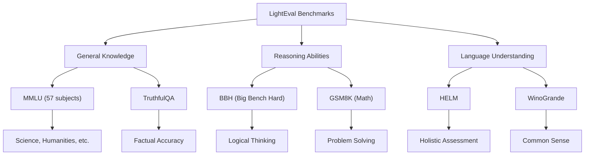
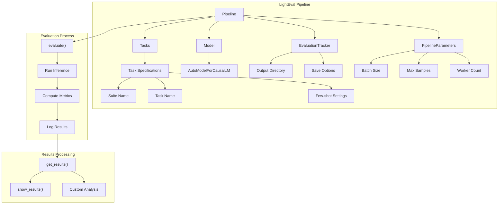
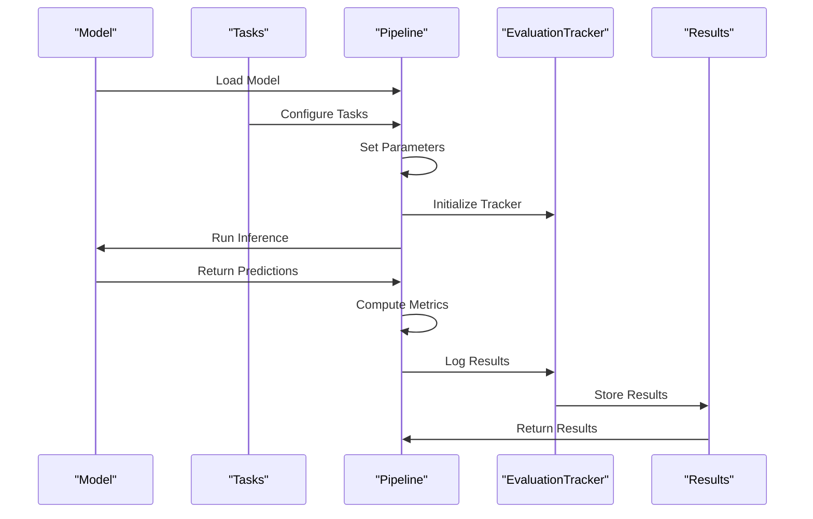

<!-- source: DeepWiki mcp.deepwiki.com · repo huggingface/smol-course · page 6.1 Automatic Benchmarks · fetched 2026-10-26 -->

# Automatic Benchmarks

<details>
<summary>Relevant source files</summary>

The following files were used as context for generating this wiki page:

- [units/en/unit1/1.md](units/en/unit1/1.md)
- [units/en/unit1/2.md](units/en/unit1/2.md)
- [units/en/unit1/6.md](units/en/unit1/6.md)
- [units/es/unit1/0.md](units/es/unit1/0.md)
- [units/es/unit2/0.md](units/es/unit2/0.md)
- [units/es/unit2/2.md](units/es/unit2/2.md)
- [units/es/unit3/0.md](units/es/unit3/0.md)
- [units/es/unit3/2.md](units/es/unit3/2.md)
- [units/es/unit4/0.md](units/es/unit4/0.md)
- [units/ja/unit1/1.md](units/ja/unit1/1.md)
- [units/ja/unit2/1.md](units/ja/unit2/1.md)
- [units/ja/unit2/3.md](units/ja/unit2/3.md)
- [units/ja/unit3/1.md](units/ja/unit3/1.md)

</details>


Automatic benchmarks provide standardized methods for evaluating language model capabilities across different tasks. This document explains how to use LightEval, the benchmarking tool integrated with the SmolLM course, to evaluate small language models on standard benchmark suites. For evaluation approaches tailored to specific domains, see [Custom Domain Evaluation](#5.2).

## Understanding Benchmarks and Their Limitations

### Types of Benchmarks in LightEval



Sources: [4_evaluation/automatic_benchmarks.md:14-18]()

While benchmarks provide consistent measurements for comparison, they have several limitations:

- Academic benchmark performance doesn't always translate to real-world effectiveness
- Standard benchmarks may not capture domain-specific expertise
- They often emphasize general knowledge over specialized capabilities
- Edge cases and real-world scenarios are frequently underrepresented

For example, MMLU tests knowledge across 57 subjects but may not reflect the depth needed for specific domains. TruthfulQA evaluates a model's factual accuracy but can't capture all forms of misinformation. BBH and GSM8K focus on reasoning tasks but might not represent the nuanced reasoning required in real applications.

Sources: [4_evaluation/automatic_benchmarks.md:11-19]()

## LightEval Architecture and Implementation

### LightEval Pipeline Architecture



Sources: [4_evaluation/automatic_benchmarks.md:59-115](), [vi/4_evaluation/notebooks/lighteval_evaluate_and_analyse_your_LLM.ipynb:164-201]()

### Task Format

LightEval tasks are defined using a specific string format:
```
{suite}|{task}|{num_few_shot}|{auto_reduce}
```

- **suite**: The benchmark suite (e.g., 'mmlu', 'truthfulqa')
- **task**: Specific task within the suite (e.g., 'abstract_algebra')
- **num_few_shot**: Number of examples to include in prompt (0 for zero-shot)
- **auto_reduce**: Whether to automatically reduce few-shot examples if prompt is too long (0 or 1)

Example: `"mmlu|abstract_algebra|0|0"` evaluates on MMLU's abstract algebra task with zero-shot inference.

Sources: [4_evaluation/automatic_benchmarks.md:60-69]()

### Evaluation Process Flow



Sources: [4_evaluation/automatic_benchmarks.md:71-115](), [vi/4_evaluation/notebooks/lighteval_evaluate_and_analyse_your_LLM.ipynb:698-711]()

## Implementing Benchmark Evaluation

### Example Implementation

Here's a complete example showing how to evaluate a model on medical domain benchmarks:

```python
from lighteval.tasks import Pipeline
from lighteval.logging.evaluation_tracker import EvaluationTracker
from transformers import AutoModelForCausalLM

# Define medical domain tasks
medical_tasks = [
    "mmlu|anatomy|5|0",
    "mmlu|clinical_knowledge|5|0",
    "mmlu|professional_medicine|5|0",
    "mmlu|college_biology|5|0"
]

# Configure evaluation parameters
pipeline_params = {
    "max_samples": 50,     # Number of samples per task
    "batch_size": 4,       # Batch size for inference
    "num_workers": 2,      # Number of worker processes
    "use_chat_template": True  # Use model's chat template
}

# Set up evaluation tracker
tracker = EvaluationTracker(
    output_dir="./medical_eval_results",
    save_details=True,
    save_generations=True
)

# Load model and create pipeline
model = AutoModelForCausalLM.from_pretrained("HuggingFaceTB/SmolLM2-340M-Instruct")
pipeline = Pipeline(
    tasks=medical_tasks,
    pipeline_parameters=pipeline_params,
    evaluation_tracker=tracker,
    model=model
)

# Run evaluation
pipeline.evaluate()

# Get and analyze results
results = pipeline.get_results()
pipeline.show_results()
```

Sources: [4_evaluation/automatic_benchmarks.md:76-115](), [vi/4_evaluation/notebooks/lighteval_evaluate_and_analyse_your_LLM.ipynb:698-710]()

### Environment Setup

Before running evaluations, you need to set up your environment correctly:

```python
import os
from lighteval.pipeline import EnvConfig, ParallelismManager, Pipeline, PipelineParameters
from lighteval.logging.evaluation_tracker import EvaluationTracker
from transformers import AutoModelForCausalLM

# Configure environment
env_config = EnvConfig(
    token=os.getenv("HF_TOKEN"),  # Hugging Face API token
    cache_dir="~/cache"           # Cache directory for models and datasets
)

# Initialize evaluation tracker
tracker = EvaluationTracker(
    output_dir="./eval_results",
    save_details=True,
    push_to_hub=False,       # Whether to push results to Hub
    push_to_tensorboard=False  # Whether to log to TensorBoard
)

# Create pipeline parameters
pipeline_params = PipelineParameters(
    launcher_type=ParallelismManager.ACCELERATE,  # Use Accelerate for distributed evaluation
    env_config=env_config,
    job_id=1,
    override_batch_size=4,
    num_fewshot_seeds=1,
    max_samples=20,
    use_chat_template=False
)
```

Sources: [vi/4_evaluation/notebooks/lighteval_evaluate_and_analyse_your_LLM.ipynb:181-200]()

## Analyzing Benchmark Results

LightEval provides results in a tabular format for easy analysis:

| Task | Version | Metric | Value | Stderr |
|------|---------|--------|-------|--------|
| all  |         | acc    | 0.3333 | 0.1169 |
| leaderboard:mmlu:_average | | acc | 0.3400 | 0.1121 |
| leaderboard:mmlu:anatomy | 0 | acc | 0.4500 | 0.1141 |
| leaderboard:mmlu:high_school_biology | 0 | acc | 0.1500 | 0.0819 |

You can parse these results programmatically for further analysis:

```python
import pandas as pd

# Convert results to DataFrame
results_df = pd.DataFrame(
    [(task, metric, value, stderr) for task, metrics in results.items() 
     for metric, (value, stderr) in metrics.items()],
    columns=["Task", "Metric", "Value", "Stderr"]
)

# Find best and worst performing tasks
best_task = results_df[results_df["Metric"] == "acc"].sort_values("Value", ascending=False).iloc[0]
worst_task = results_df[results_df["Metric"] == "acc"].sort_values("Value").iloc[0]
```

Sources: [4_evaluation/automatic_benchmarks.md:118-125]()

## Creating Custom Evaluation Tasks

For domain-specific evaluation, you can create custom tasks using the LightEval framework:

```python
from lighteval.tasks.lighteval_task import LightevalTaskConfig
from lighteval.tasks.requests import Doc
from lighteval.metrics.utils.metric_utils import SampleLevelMetric, MetricCategory, MetricUseCase

# Define prompt function
def prompt_fn(line, task_name: str = None):
    instruction = "Choose the correct answer for the following exam question:"
    return Doc(
        task_name=task_name,
        query=f"{instruction} {line['question']}",
        choices=[f" {line['answer_a']}", f" {line['answer_b']}", 
                 f" {line['answer_c']}", f" {line['answer_d']}"],
        gold_index=["answer_a", "answer_b", "answer_c", "answer_d"].index(line["correct_answer"]),
        instruction=instruction,
    )

# Define metric function
def sample_level_fn(formatted_doc: Doc, **kwargs) -> bool:
    response = np.argmin(kwargs["choices_logprob"])
    return response == formatted_doc.gold_index

# Create metric
custom_metric = SampleLevelMetric(
    metric_name="exam_question_accuracy",
    higher_is_better=True,
    category=MetricCategory.MULTICHOICE,
    use_case=MetricUseCase.NONE,
    sample_level_fn=sample_level_fn,
    corpus_level_fn=np.mean,
)

# Configure task
task = LightevalTaskConfig(
    name="example",
    prompt_function=prompt_fn,
    suite=["community"],
    hf_repo="burtenshaw/exam_questions",
    hf_subset="default",
    hf_avail_splits=["train"],
    evaluation_splits=["train"],
    few_shots_split=None,
    few_shots_select=None,
    metric=[custom_metric],
)

# Add task to task table
TASKS_TABLE = [task]
```

Sources: [4_evaluation/project/evaluation_task.py:16-72]()

## Building a Comprehensive Evaluation Strategy

For a thorough evaluation approach, combine automatic benchmarks with custom evaluations:

1. **Start with standard benchmarks** to establish baseline performance and enable comparison with other models
2. **Identify domain-specific requirements** based on your actual use cases
3. **Create custom evaluation datasets** that reflect real-world usage scenarios
4. **Implement multi-layered evaluation** combining automated metrics, human evaluation, and domain expert review

Remember that benchmark performance alone is insufficient for assessing real-world model capabilities. The most effective evaluation strategy combines standardized benchmarks with domain-specific tests tailored to your specific use cases.

Sources: [4_evaluation/automatic_benchmarks.md:37-55]()

## Next Steps

Once you've evaluated your model using automatic benchmarks, proceed to [Custom Domain Evaluation](#5.2) to create tailored evaluation pipelines for your specific domain requirements. For a complete domain-specific evaluation example, refer to the evaluation project in the course materials.

Sources: [4_evaluation/automatic_benchmarks.md:129-132](), [4_evaluation/project/README.md:1-129]()

---

