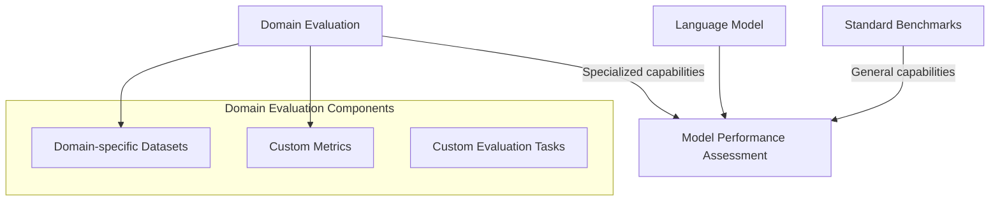
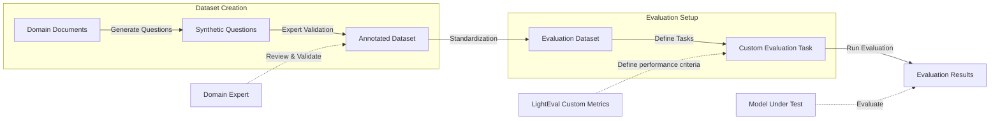
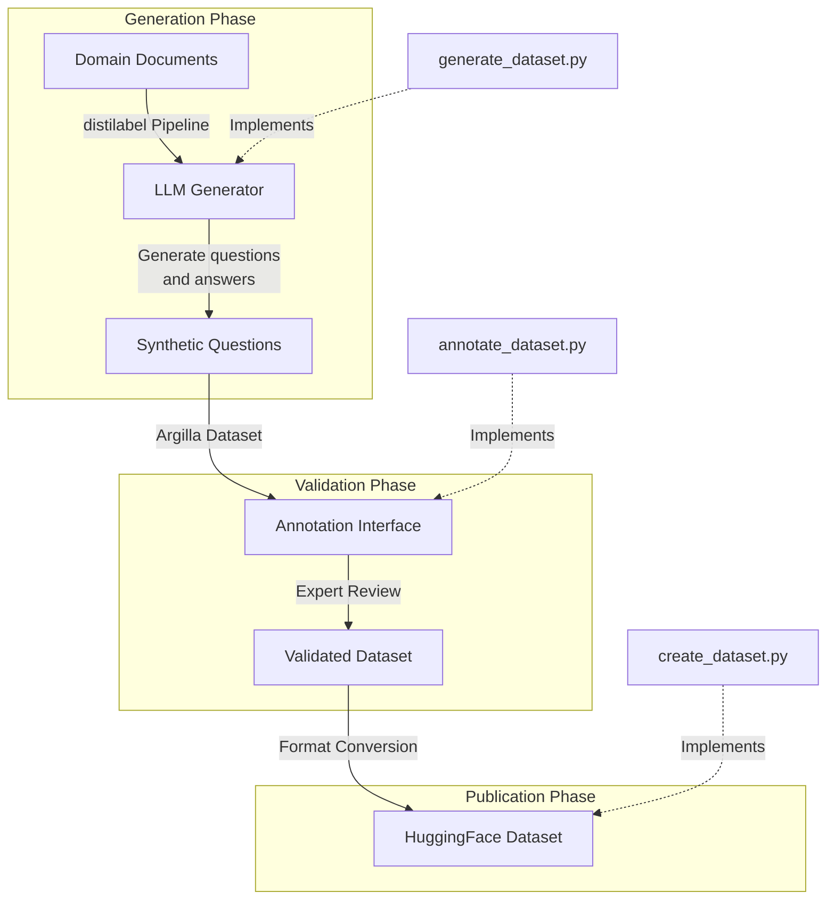
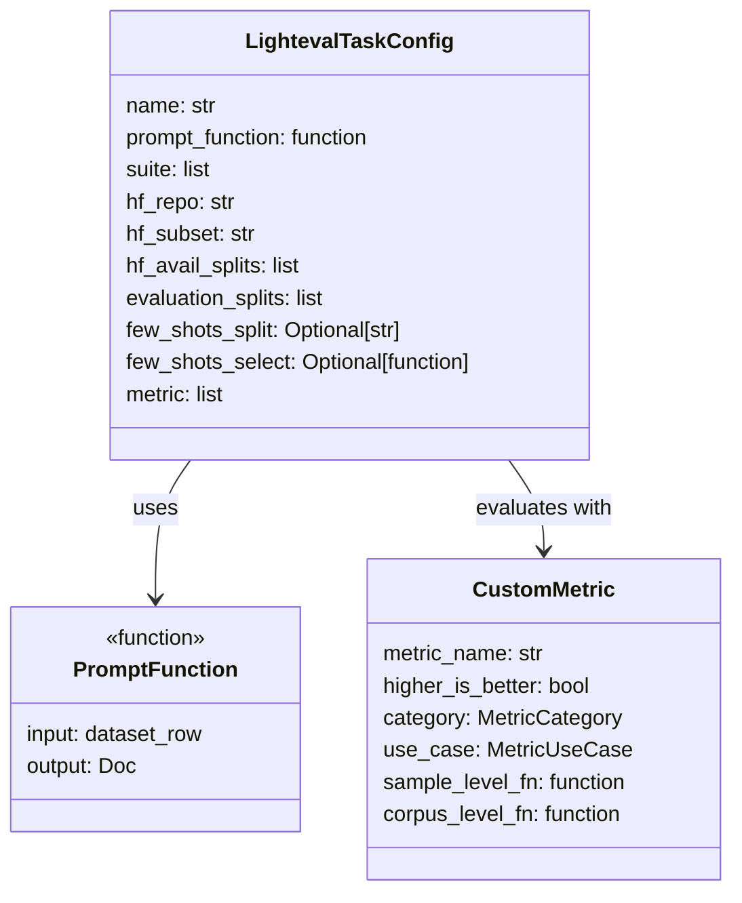
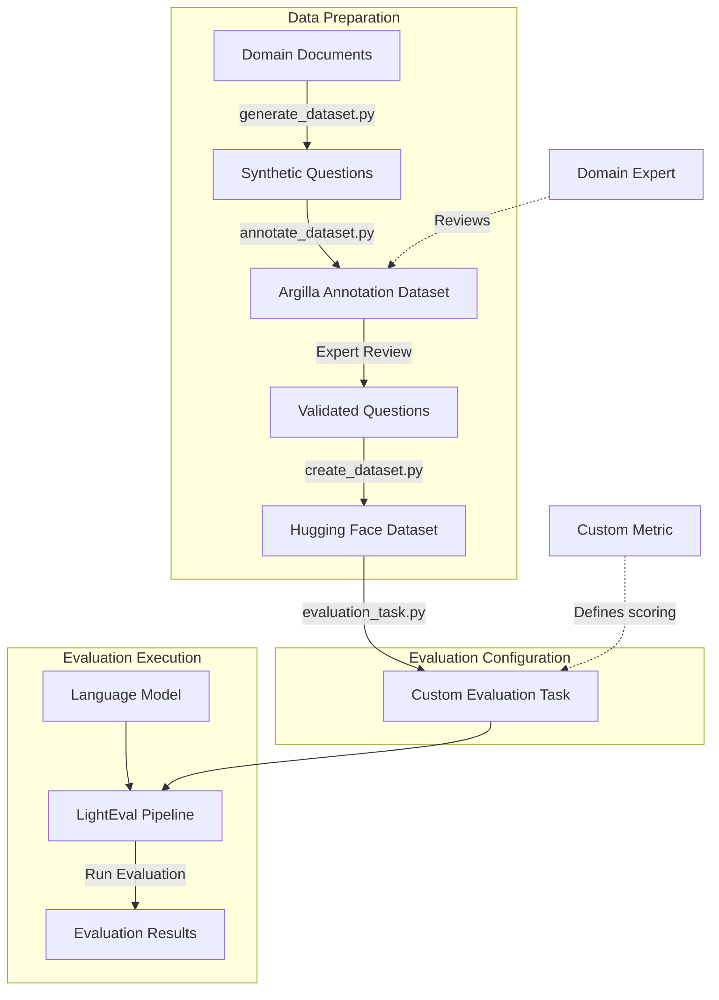
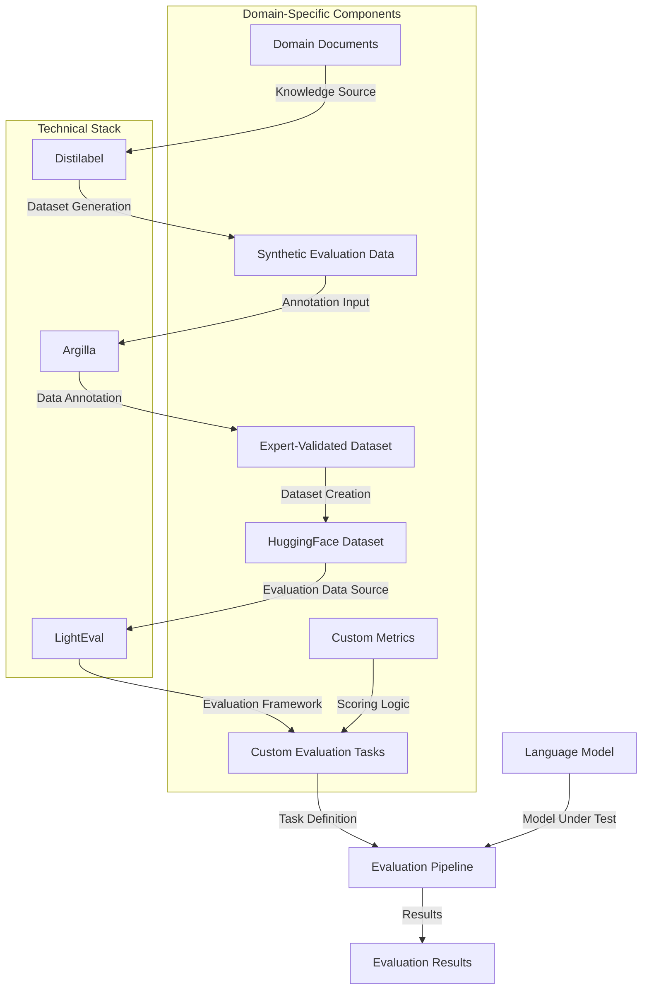

<!-- source: DeepWiki mcp.deepwiki.com · repo huggingface/smol-course · page 6.2 Custom Domain Evaluation · fetched 2026-10-26 -->

# Custom Domain Evaluation

<details>
<summary>Relevant source files</summary>

The following files were used as context for generating this wiki page:

- [units/en/unit2/1.md](units/en/unit2/1.md)
- [units/en/unit2/2.md](units/en/unit2/2.md)
- [units/en/unit2/3.md](units/en/unit2/3.md)
- [units/en/unit2/4.md](units/en/unit2/4.md)
- [units/en/unit3/1.md](units/en/unit3/1.md)
- [units/en/unit3/2.md](units/en/unit3/2.md)
- [units/en/unit3/3.md](units/en/unit3/3.md)
- [units/en/unit3/4.md](units/en/unit3/4.md)
- [units/es/unit1/0.md](units/es/unit1/0.md)
- [units/es/unit2/0.md](units/es/unit2/0.md)
- [units/es/unit2/2.md](units/es/unit2/2.md)
- [units/es/unit3/0.md](units/es/unit3/0.md)
- [units/es/unit3/2.md](units/es/unit3/2.md)
- [units/es/unit4/0.md](units/es/unit4/0.md)
- [units/ja/unit1/1.md](units/ja/unit1/1.md)
- [units/ja/unit2/1.md](units/ja/unit2/1.md)
- [units/ja/unit2/3.md](units/ja/unit2/3.md)
- [units/ja/unit3/1.md](units/ja/unit3/1.md)

</details>


This page covers the process of creating and implementing custom evaluation pipelines for language models that target specific domains or use cases. While standard benchmarks (covered in [Automatic Benchmarks](#5.1)) provide valuable baseline metrics, domain-specific evaluation is essential for assessing a model's performance on the particular tasks and knowledge areas relevant to your application.

## Overview of Domain Evaluation

Domain evaluation allows you to test your language models on specialized knowledge and capabilities that matter for your specific use case. This can include industry-specific terminology, reasoning patterns unique to your field, or particular response formats required in your application.



Sources: [4_evaluation/custom_evaluation.md](), [4_evaluation/README.md]()

## When To Use Custom Domain Evaluation

Custom domain evaluation is particularly valuable when:

1. Your application requires specialized knowledge not covered by standard benchmarks
2. You need to evaluate specific reasoning patterns or response formats
3. You want to compare models based on metrics that matter for your particular use case
4. You're fine-tuning models for a specialized domain and need targeted feedback

## Custom Evaluation Pipeline

The process of creating a custom domain evaluation typically involves several steps, from dataset creation to evaluation:



Sources: [4_evaluation/project/README.md](), [4_evaluation/custom_evaluation.md]()

## Dataset Creation for Domain Evaluation

Creating high-quality evaluation datasets is crucial for meaningful domain evaluation. There are three main approaches:

1. **Expert Annotation**: Work with domain experts to create and validate evaluation examples
2. **Synthetic Generation**: Use LLMs to generate initial examples, then have experts validate them
3. **Real-World Data**: Collect and anonymize real usage data from your domain

The project example included in the course demonstrates the synthetic generation approach followed by expert validation:



Sources: [4_evaluation/project/generate_dataset.py](), [4_evaluation/project/annotate_dataset.py](), [4_evaluation/project/create_dataset.py]()

### Dataset Generation with distilabel

The example project uses distilabel to generate exam-style questions from domain documents. This process is implemented in `generate_dataset.py`:

1. Domain documents are loaded from a specified directory
2. A system prompt instructs the model to generate questions, correct answers, and distractors
3. The output is structured as a collection of exam questions
4. Results are saved as a distilabel dataset (Distiset)

The key components include:

| Component | Purpose |
|-----------|---------|
| `distilabel.pipeline.Pipeline` | Orchestrates the generation process |
| `distilabel.steps.tasks.TextGeneration` | Handles the text generation task |
| `distilabel.llms.InferenceEndpointsLLM` | Connects to HF Inference API |
| `ExamQuestions` model | Defines the expected output structure |

Sources: [4_evaluation/project/generate_dataset.py:11-39](), [4_evaluation/project/generate_dataset.py:103-113]()

### Dataset Annotation with Argilla

Once synthetic questions are generated, they need validation by domain experts. This is implemented in `annotate_dataset.py` using Argilla:

1. An Argilla dataset is created with fields for questions and multiple-choice answers
2. The distilabel dataset is loaded and questions are extracted
3. Answer options are randomized to prevent bias
4. Correct answers are provided as suggestions in the Argilla UI
5. Experts can validate or correct the answers through the annotation interface

Sources: [4_evaluation/project/annotate_dataset.py:57-89](), [4_evaluation/project/annotate_dataset.py:96-124]()

### Dataset Publication

After annotation, the validated data is processed and published as a standardized Hugging Face dataset in `create_dataset.py`:

1. The Argilla client loads the annotated dataset
2. Records are processed to extract the questions, options, and expert-validated answers
3. The data is converted to a Hugging Face dataset format
4. The dataset is pushed to the Hugging Face Hub for use in evaluation

Sources: [4_evaluation/project/create_dataset.py:42-63](), [4_evaluation/project/create_dataset.py:68-72]()

## Custom Evaluation Tasks and Metrics

Custom evaluation requires defining both the tasks (what to evaluate) and metrics (how to measure performance). LightEval provides a flexible framework for implementing both.

### Defining Custom Evaluation Tasks

Custom tasks in LightEval are defined through the `LightevalTaskConfig` class, as shown in `evaluation_task.py`:



The key components include:

1. **Task Configuration**: Defines metadata like task name, dataset location, and metrics
2. **Prompt Function**: Converts dataset rows to formatted prompts for the model
3. **Custom Metrics**: Define how to evaluate model responses

Sources: [4_evaluation/project/evaluation_task.py:15-32](), [4_evaluation/project/evaluation_task.py:61-72]()

### Implementing Custom Metrics

LightEval supports two types of custom metrics:

1. **SampleLevelMetric**: Returns a single value for each example
2. **SampleLevelMetricGrouping**: Returns multiple values for each example

The example in `evaluation_task.py` uses a SampleLevelMetric to evaluate multiple-choice accuracy:

```python
def sample_level_fn(formatted_doc: Doc, **kwargs) -> bool:
    response = np.argmin(kwargs["choices_logprob"])
    return response == formatted_doc.gold_index

custom_metric = SampleLevelMetric(
    metric_name="exam_question_accuracy",
    higher_is_better=True,
    category=MetricCategory.MULTICHOICE,
    use_case=MetricUseCase.NONE,
    sample_level_fn=sample_level_fn,
    corpus_level_fn=np.mean,
)
```

Sources: [4_evaluation/project/evaluation_task.py:42-54](), [4_evaluation/custom_evaluation.md:39-95]()

## Running the Evaluation

Once tasks and metrics are defined, you can run the evaluation using LightEval's command-line interface:

```bash
lighteval accelerate \
    --model_args "pretrained=HuggingFaceH4/zephyr-7b-beta" \
    --tasks "community|exam_questions|0|0" \
    --custom_tasks domain-eval/evaluation_task.py \
    --output_dir "./evals"
```

This evaluates the specified model on your custom task, applying your custom metrics and producing standardized evaluation results.

Sources: [4_evaluation/project/evaluation_task.py:82-86]()

## Complete Domain Evaluation Example

The following diagram illustrates the complete workflow for domain evaluation, from document preparation to evaluation results:



Sources: [4_evaluation/project/README.md](), [4_evaluation/custom_evaluation.md]()

## Best Practices for Domain Evaluation

When creating custom domain evaluations, follow these best practices:

1. **Clear Objectives**: Document what specific capabilities you're testing
2. **Diverse Test Cases**: Include both standard examples and edge cases
3. **Version Control**: Maintain version control of your evaluation datasets and code
4. **Documentation**: Document your methodology, metrics, and any limitations
5. **Regular Updates**: Evolve your evaluation as you discover new requirements or edge cases

## Technical Components Integration



Sources: [4_evaluation/custom_evaluation.md](), [4_evaluation/project/README.md]()

## Conclusion

Custom domain evaluation is essential for truly understanding how well your language models perform on specific tasks relevant to your application. By combining standardized tools like LightEval with domain-specific datasets and metrics, you can create comprehensive evaluation pipelines that provide meaningful insights about model performance in your particular context.

The example project demonstrated in this module provides a template that you can adapt to your own domain, allowing you to create powerful, targeted evaluations that go beyond generic benchmarks.

---

