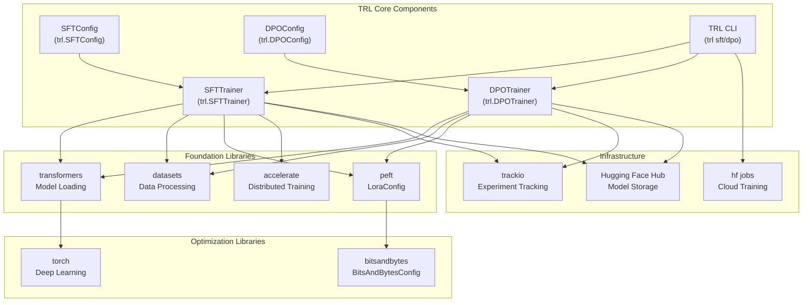
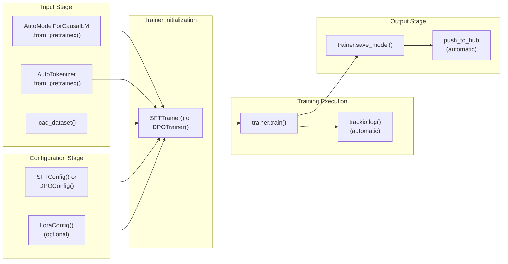
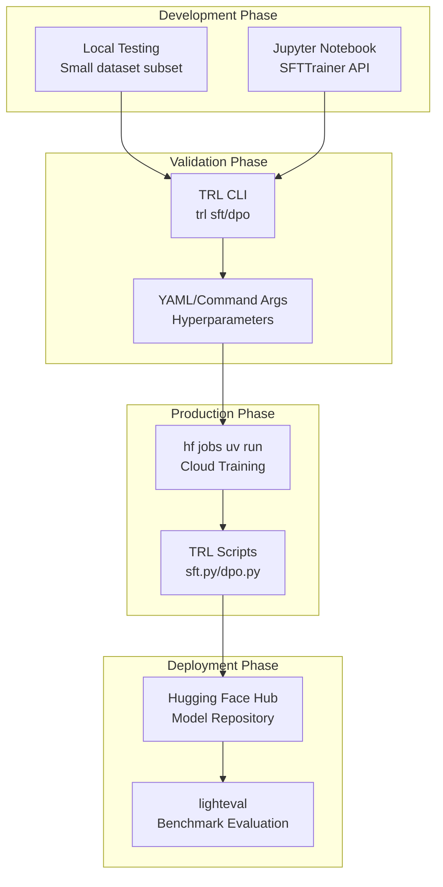

<!-- source: DeepWiki mcp.deepwiki.com · repo huggingface/smol-course · page 7 TRL Library and Training Infrastructure · fetched 2026-10-26 -->

# TRL Library and Training Infrastructure

<details>
<summary>Relevant source files</summary>

The following files were used as context for generating this wiki page:

- [units/en/unit0/1.mdx](units/en/unit0/1.mdx)
- [units/en/unit1/3.md](units/en/unit1/3.md)
- [units/en/unit1/3a.md](units/en/unit1/3a.md)
- [units/en/unit1/4.md](units/en/unit1/4.md)
- [units/en/unit1/5.md](units/en/unit1/5.md)
- [units/en/unit2/1.md](units/en/unit2/1.md)
- [units/en/unit2/2.md](units/en/unit2/2.md)
- [units/en/unit2/3.md](units/en/unit2/3.md)
- [units/en/unit2/4.md](units/en/unit2/4.md)
- [units/en/unit3/1.md](units/en/unit3/1.md)
- [units/en/unit3/2.md](units/en/unit3/2.md)
- [units/en/unit3/3.md](units/en/unit3/3.md)
- [units/en/unit3/4.md](units/en/unit3/4.md)

</details>


## Purpose and Scope

This page provides a technical overview of the **TRL (Transformers Reinforcement Learning)** library and how it serves as the primary training infrastructure throughout the smol-course. TRL provides high-level trainer classes, configuration systems, and CLI tools that orchestrate the fine-tuning workflows for both text-only models (SmolLM3) and vision-language models (SmolVLM2).

For specific trainer implementations and their configuration options, see [SFTTrainer and DPOTrainer](#7.1). For command-line workflows, see [TRL CLI Tools](#7.2). For experiment tracking integration, see [Experiment Tracking with Trackio](#7.3).

Sources: [units/en/unit1/3.md:406-443](), [units/en/unit0/1.mdx:121-123]()

## TRL Overview

TRL is a specialized library for training language models using instruction tuning and alignment techniques. It provides production-ready implementations of supervised fine-tuning (SFT), direct preference optimization (DPO), odds ratio preference optimization (ORPO), and proximal policy optimization (PPO).

**Key Characteristics:**
- **Production Ready**: Used by major organizations and research labs for model alignment
- **Comprehensive**: Single library supporting multiple training paradigms (SFT, DPO, ORPO, PPO)
- **Efficient**: Optimized for memory usage through integration with `peft` and `bitsandbytes`
- **Flexible**: Compatible with any model from the `transformers` library
- **Integrated**: Seamless connections to Hugging Face Hub, Trackio, and Weights & Biases

The library abstracts away low-level training details while providing full control over hyperparameters and training behavior through configuration classes like `SFTConfig` and `DPOConfig`.

Sources: [units/en/unit1/3.md:406-442](), [units/en/unit0/1.mdx:27-28]()

## TRL Architecture and Ecosystem Integration



**TRL Architecture: Library Dependencies and Component Relationships**

TRL serves as the integration layer that combines multiple Hugging Face libraries into cohesive training workflows. The `SFTTrainer` and `DPOTrainer` classes orchestrate model loading (via `transformers`), data handling (via `datasets`), parameter-efficient adaptation (via `peft`), and distributed execution (via `accelerate`).

The configuration classes (`SFTConfig`, `DPOConfig`) extend the base `TrainingArguments` from `transformers` with algorithm-specific parameters like `beta` for DPO or `packing` for SFT. The TRL CLI provides a command-line interface to these trainers, enabling production workflows without writing Python code.

Sources: [units/en/unit1/3.md:425-433](), [units/en/unit1/3a.md:49-71](), [units/en/unit2/2.md:72-106]()

## Core Training Components

### SFTTrainer

The `SFTTrainer` class handles supervised fine-tuning for both language models and vision-language models. It accepts datasets in standard or conversational formats and automatically applies chat templates when provided with conversational data.

**Primary Code Entities:**
- Class: `trl.SFTTrainer`
- Configuration: `trl.SFTConfig`
- Methods: `SFTTrainer.train()`, `SFTTrainer.save_model()`

**Dataset Requirements:**
- Text-only: `text` column or `(prompt, completion)` pairs
- Conversational: `messages` column with role/content structure
- Vision: Additional `images` column containing image data

The trainer tokenizes inputs using the model's tokenizer and computes token-level cross-entropy loss, masking padding tokens during loss calculation. For conversational datasets, it applies the model's chat template via `tokenizer.apply_chat_template()`.

Sources: [units/en/unit1/3.md:328-347](), [units/en/unit1/3.md:406-433](), [units/en/unit3/4.md:303-343]()

### DPOTrainer

The `DPOTrainer` class implements direct preference optimization, which aligns models with human preferences without requiring a separate reward model. It operates on preference datasets containing `prompt`, `chosen`, and `rejected` fields.

**Primary Code Entities:**
- Class: `trl.DPOTrainer`
- Configuration: `trl.DPOConfig`
- Key Parameters: `beta` (preference optimization strength), `max_prompt_length`, `max_length`

The trainer computes the DPO loss function that increases the likelihood of chosen responses while decreasing the likelihood of rejected responses, using a reference model (`π_ref`) to prevent distribution shift:

$$L_{DPO} = -\mathbb{E} \left[\log \sigma\left(\beta \log \frac{\pi_\theta(y_w|x)}{\pi_{ref}(y_w|x)} - \beta \log \frac{\pi_\theta(y_l|x)}{\pi_{ref}(y_l|x)}\right)\right]$$

Sources: [units/en/unit2/2.md:72-106](), [units/en/unit2/2.md:32-45](), [units/en/unit2/3.md:40-139]()

### Configuration Classes

Both `SFTConfig` and `DPOConfig` extend the `transformers.TrainingArguments` base class with algorithm-specific parameters:

| Parameter | SFTConfig | DPOConfig | Description |
|-----------|-----------|-----------|-------------|
| `output_dir` | ✓ | ✓ | Directory for checkpoints and logs |
| `per_device_train_batch_size` | ✓ | ✓ | Batch size per device |
| `learning_rate` | ✓ | ✓ | Optimizer learning rate |
| `max_steps` | ✓ | ✓ | Total training steps |
| `packing` | ✓ | ✗ | Concatenate sequences for efficiency |
| `max_length` | ✓ | ✓ | Maximum sequence length (set to `None` for VLMs) |
| `beta` | ✗ | ✓ | DPO preference optimization strength (0.1-0.5) |
| `max_prompt_length` | ✗ | ✓ | Maximum prompt length for DPO |
| `push_to_hub` | ✓ | ✓ | Automatically upload to Hugging Face Hub |
| `hub_model_id` | ✓ | ✓ | Repository ID for Hub upload |
| `report_to` | ✓ | ✓ | Logging backend (e.g., "trackio", "wandb") |

Sources: [units/en/unit1/3.md:452-483](), [units/en/unit2/3.md:118-128](), [units/en/unit3/4.md:314-343]()

## TRL Training Workflow



**TRL Training Pipeline: From Model Loading to Hub Upload**

The standard TRL workflow follows five stages: (1) Load pre-trained model and tokenizer from `transformers`, (2) Configure training hyperparameters via `SFTConfig`/`DPOConfig` and optionally enable PEFT via `LoraConfig`, (3) Initialize trainer with model, dataset, and configs, (4) Execute `trainer.train()` which handles tokenization, batching, gradient computation, and logging, (5) Save final model locally and optionally push to Hugging Face Hub.

The `report_to="trackio"` parameter in the config automatically integrates experiment tracking without additional code. The `push_to_hub=True` parameter triggers automatic model upload after training completes.

Sources: [units/en/unit1/3.md:452-505](), [units/en/unit1/4.md:453-483](), [units/en/unit2/3.md:148-227]()

## Integration with PEFT

TRL provides native integration with the `peft` library for parameter-efficient fine-tuning. The trainer accepts a `peft_config` parameter that configures LoRA or other PEFT methods:

```python
from peft import LoraConfig
from trl import SFTTrainer

peft_config = LoraConfig(
    r=8,                        # Rank of low-rank matrices
    lora_alpha=16,              # Scaling parameter
    lora_dropout=0.05,          # Dropout for regularization
    bias="none",                # Bias handling
    task_type="CAUSAL_LM",      # Task type
    target_modules=["q_proj", "v_proj"]  # Layers to adapt
)

trainer = SFTTrainer(
    model=model,
    train_dataset=dataset,
    peft_config=peft_config  # Pass LoRA config to trainer
)
```

When `peft_config` is provided, TRL automatically:
1. Wraps the base model with PEFT adapters using `get_peft_model()`
2. Freezes base model parameters and enables only adapter parameters
3. Saves adapter weights separately from the base model
4. Supports adapter merging via `merge_and_unload()` after training

This reduces trainable parameters by ~90% while maintaining performance, enabling fine-tuning of larger models on consumer hardware.

Sources: [units/en/unit1/3a.md:49-71](), [units/en/unit1/3a.md:116-147](), [units/en/unit3/4.md:275-301]()

## TRL CLI Tools

The TRL library provides command-line interfaces for production workflows without requiring Python scripts:

**SFT Command:**
```bash
trl sft \
    --model_name_or_path HuggingFaceTB/SmolLM3-3B-Base \
    --dataset_name HuggingFaceTB/smoltalk2_everyday_convs_think \
    --output_dir ./smollm3-sft-model \
    --per_device_train_batch_size 4 \
    --learning_rate 5e-5 \
    --max_steps 1000 \
    --push_to_hub \
    --hub_model_id username/smollm3-custom \
    --report_to trackio
```

**DPO Command:**
```bash
trl dpo \
    --model_name_or_path HuggingFaceTB/SmolLM3-3B \
    --dataset_name Anthropic/hh-rlhf \
    --beta 0.1 \
    --learning_rate 5e-7 \
    --max_steps 1000 \
    --push_to_hub \
    --hub_model_id username/smollm3-dpo \
    --report_to trackio
```

The CLI commands map directly to the Python API parameters, accepting the same configuration flags as `SFTConfig` and `DPOConfig`. This enables standardized training workflows across different environments and reproducible experiments via command history.

Sources: [units/en/unit1/3.md:486-505](), [units/en/unit1/5.md:109-124](), [units/en/unit2/3.md:254-274]()

## Integration with Hugging Face Jobs

TRL scripts can be executed on Hugging Face Jobs infrastructure using the `hf jobs uv run` command. This provides cloud-based training without local GPU requirements:

```bash
hf jobs uv run \
    --flavor a100-large \
    --timeout 2h \
    --secrets HF_TOKEN \
    "https://raw.githubusercontent.com/huggingface/trl/main/trl/scripts/sft.py" \
    --model_name_or_path HuggingFaceTB/SmolLM3-3B-Base \
    --dataset_name HuggingFaceTB/smoltalk2_everyday_convs_think \
    --learning_rate 5e-5 \
    --max_steps 1000 \
    --push_to_hub \
    --report_to trackio
```

The `--flavor` parameter selects GPU hardware (e.g., `a100-large`, `a10g-large`, `l4x1`), while `--secrets HF_TOKEN` provides authentication for Hub uploads. TRL maintains production-ready scripts at fixed URLs:

- SFT: `https://raw.githubusercontent.com/huggingface/trl/main/trl/scripts/sft.py`
- DPO: `https://raw.githubusercontent.com/huggingface/trl/main/trl/scripts/dpo.py`

These scripts accept the same parameters as the CLI tools and Python API, ensuring workflow consistency across local and cloud environments.

Sources: [units/en/unit1/5.md:109-124](), [units/en/unit1/5.md:163-190](), [units/en/unit3/4.md:404-443]()

## Experiment Tracking with Trackio

TRL integrates with Trackio for experiment tracking by setting `report_to="trackio"` in the training configuration. This automatically logs metrics during training:

**Automatically Logged Metrics:**
- `train/loss`: Cross-entropy loss over non-masked tokens
- `train/epoch`: Current epoch number
- `train/num_tokens`: Total tokens processed
- `train/mean_token_accuracy`: Token-level prediction accuracy
- `train/learning_rate`: Current learning rate (if using scheduler)
- `train/grad_norm`: L2 norm of gradients before clipping
- `train/entropy`: Entropy of predicted token distribution

Trackio can be configured via environment variables before training:

```bash
export TRACKIO_PROJECT_NAME="smollm3-sft"
export TRACKIO_SPACE_ID="username/experiment-tracker"
```

Or programmatically in Python:

```python
import os
os.environ["TRACKIO_PROJECT_NAME"] = "smollm3-sft"
os.environ["TRACKIO_SPACE_ID"] = "username/experiment-tracker"

trainer = SFTTrainer(
    model=model,
    args=SFTConfig(report_to="trackio", ...),
    train_dataset=dataset
)
```

When training completes, metrics are pushed to the specified Hugging Face Space, providing a web-based dashboard for monitoring training progress and comparing experiments.

Sources: [units/en/unit1/3.md:259-327](), [units/en/unit1/4.md:453-483]()

## Dataset Format Handling

TRL trainers automatically handle multiple dataset formats through preprocessing pipelines:

**SFT Dataset Formats:**

| Format | Structure | Example | Trainer Behavior |
|--------|-----------|---------|------------------|
| Language Modeling | `{"text": "..."}` | `{"text": "The sky is blue."}` | Direct tokenization |
| Conversational | `{"messages": [...]}` | `{"messages": [{"role": "user", "content": "Hi"}]}` | Applies `tokenizer.apply_chat_template()` |
| Prompt-Completion | `{"prompt": "...", "completion": "..."}` | `{"prompt": "Translate:", "completion": "Hello"}` | Concatenates and tokenizes |
| Vision (VLM) | `{"images": [...], "messages": [...]}` | `{"images": [img], "messages": [...]}` | Processes via `AutoProcessor` |

**DPO Dataset Formats:**

| Format | Structure | Trainer Behavior |
|--------|-----------|------------------|
| Explicit Prompt | `{"prompt": "...", "chosen": "...", "rejected": "..."}` | Uses prompt field directly |
| Implicit Prompt | `{"chosen": "...", "rejected": "..."}` | Extracts common prefix as prompt |
| Conversational | Prompt/chosen/rejected as message lists | Applies chat template to all fields |

The trainer's `remove_unused_columns=False` parameter preserves original dataset columns during preprocessing, enabling inspection of raw data alongside processed inputs.

Sources: [units/en/unit1/3.md:328-383](), [units/en/unit2/2.md:47-68](), [units/en/unit2/2.md:109-114]()

## Memory Optimization Strategies

TRL provides several mechanisms for memory-efficient training, configurable through trainer parameters:

**Quantization Integration:**
TRL trainers accept models loaded with `BitsAndBytesConfig` for 4-bit or 8-bit quantization:

```python
from transformers import BitsAndBytesConfig

quant_config = BitsAndBytesConfig(
    load_in_4bit=True,
    bnb_4bit_compute_dtype=torch.bfloat16
)

model = AutoModelForCausalLM.from_pretrained(
    "HuggingFaceTB/SmolLM3-3B-Base",
    quantization_config=quant_config
)

trainer = SFTTrainer(model=model, ...)  # Quantization preserved
```

**Gradient Checkpointing:**
Enabled via `SFTConfig(gradient_checkpointing=True)`, which trades computation for memory by recomputing activations during backward pass instead of storing them.

**Gradient Accumulation:**
The `gradient_accumulation_steps` parameter accumulates gradients over multiple micro-batches before updating parameters, achieving larger effective batch sizes:

```python
# Effective batch size = 2 × 8 = 16
SFTConfig(
    per_device_train_batch_size=2,
    gradient_accumulation_steps=8
)
```

**Mixed Precision:**
The `bf16=True` parameter enables bfloat16 mixed precision training, reducing memory usage by 50% on compatible GPUs while maintaining numerical stability.

Sources: [units/en/unit1/3a.md:1-15](), [units/en/unit3/3.md:6-27](), [units/en/unit3/4.md:118-124]()

## Production Workflow Pattern



**TRL Production Workflow: From Development to Deployment**

The recommended workflow progresses through four phases: (1) Development uses Jupyter notebooks with `SFTTrainer` API for rapid iteration on small dataset subsets, (2) Validation switches to TRL CLI commands with explicit hyperparameter configuration for reproducibility, (3) Production deploys to Hugging Face Jobs using maintained TRL scripts for scalable cloud training, (4) Deployment pushes trained models to Hub and evaluates via `lighteval` benchmarks.

This progression maintains code consistency (same TRL API) while transitioning from interactive experimentation to automated production pipelines. The `--push_to_hub` flag automates model upload, and `--report_to trackio` provides monitoring throughout.

Sources: [units/en/unit1/3.md:444-505](), [units/en/unit1/5.md:1-237](), [units/en/unit2/4.md:11-40]()

## Vision-Language Model Support

TRL's `SFTTrainer` supports vision-language models (VLMs) through the same API used for text-only models, with dataset format adjustments:

**VLM Dataset Structure:**
```python
{
    "images": [PIL.Image],  # List of images
    "messages": [           # Chat-formatted conversation
        {
            "role": "system",
            "content": [{"type": "text", "text": "..."}]
        },
        {
            "role": "user",
            "content": [
                {"type": "image", "image": "<image_data>"},
                {"type": "text", "text": "..."}
            ]
        },
        {
            "role": "assistant",
            "content": [{"type": "text", "text": "..."}]
        }
    ]
}
```

**Critical Configuration for VLMs:**
Set `max_length=None` in `SFTConfig` to prevent truncation of image tokens during training:

```python
SFTConfig(
    max_length=None,  # Required for VLMs
    ...
)
```

The trainer automatically uses the model's `AutoProcessor` (instead of tokenizer) to handle both image preprocessing and text tokenization when the model architecture includes vision components.

Sources: [units/en/unit3/3.md:29-74](), [units/en/unit3/4.md:228-273](), [units/en/unit3/4.md:314-343]()

---

