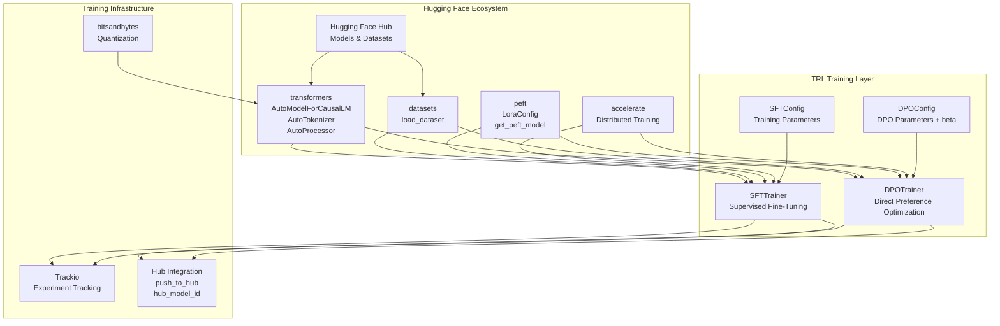
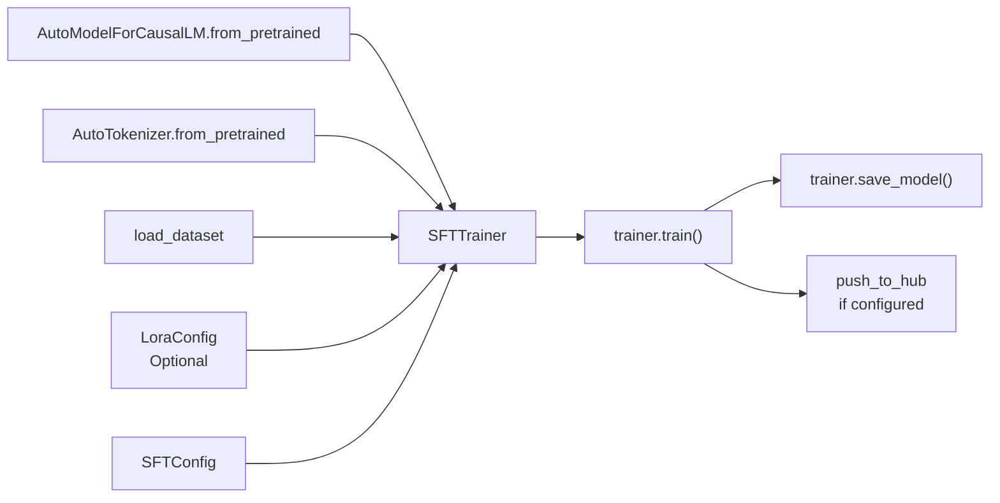
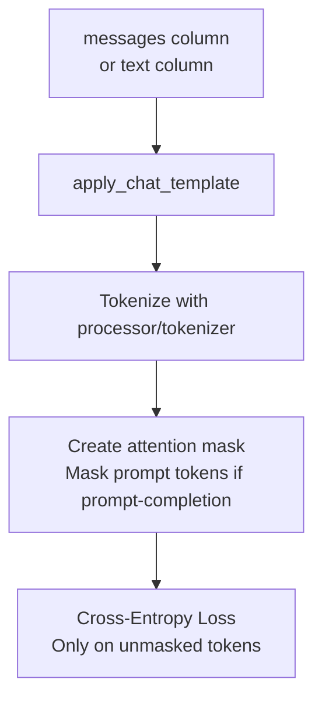
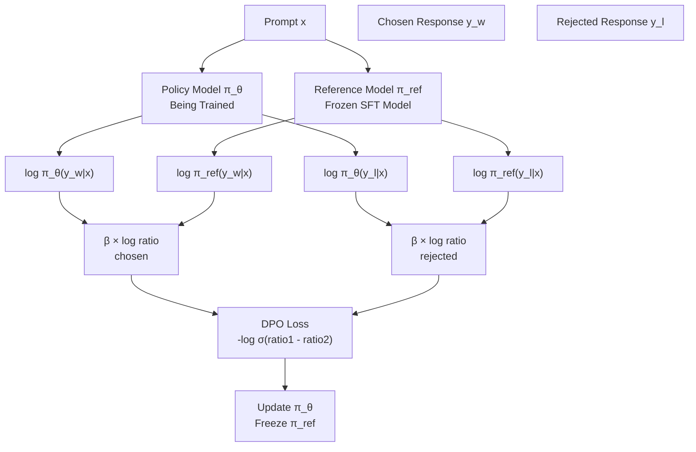
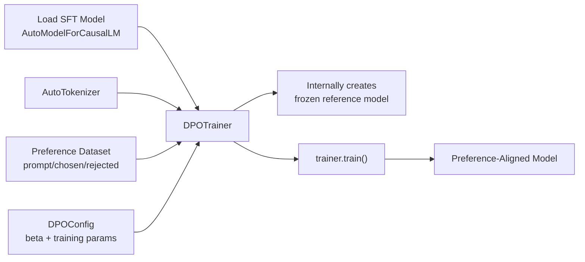
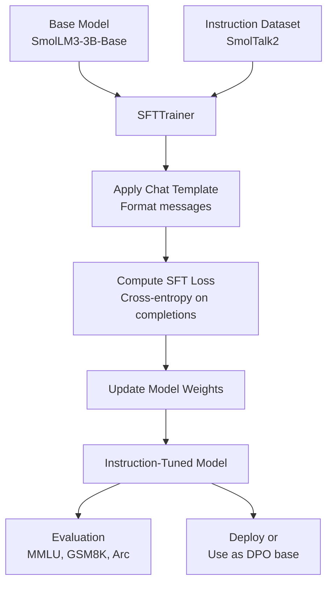
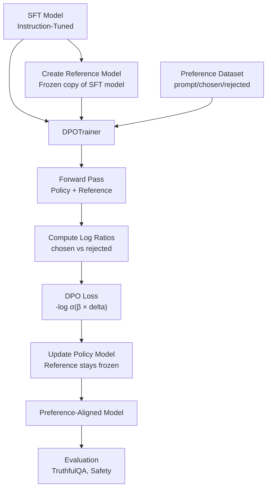

<!-- source: DeepWiki mcp.deepwiki.com · repo huggingface/smol-course · page 7.1 SFTTrainer and DPOTrainer · fetched 2026-10-26 -->

# SFTTrainer and DPOTrainer

<details>
<summary>Relevant source files</summary>

The following files were used as context for generating this wiki page:

- [units/en/unit0/1.mdx](units/en/unit0/1.mdx)
- [units/en/unit1/3.md](units/en/unit1/3.md)
- [units/en/unit1/3a.md](units/en/unit1/3a.md)
- [units/en/unit1/4.md](units/en/unit1/4.md)
- [units/en/unit1/5.md](units/en/unit1/5.md)
- [units/en/unit2/1.md](units/en/unit2/1.md)
- [units/en/unit2/2.md](units/en/unit2/2.md)
- [units/en/unit2/3.md](units/en/unit2/3.md)
- [units/en/unit2/4.md](units/en/unit2/4.md)
- [units/en/unit3/1.md](units/en/unit3/1.md)
- [units/en/unit3/2.md](units/en/unit3/2.md)
- [units/en/unit3/3.md](units/en/unit3/3.md)
- [units/en/unit3/4.md](units/en/unit3/4.md)

</details>


## Purpose and Scope

This document covers the `SFTTrainer` and `DPOTrainer` classes from the TRL (Transformers Reinforcement Learning) library, which are the primary training orchestrators for supervised fine-tuning and preference alignment respectively. These trainers provide high-level APIs for training language models and vision-language models with built-in support for PEFT methods, quantization, distributed training, and experiment tracking.

For information about LoRA and other PEFT techniques, see [LoRA and Adapters](#3.1). For information about quantization strategies, see [Quantization Techniques](#3.2). For CLI-based workflows using these trainers, see [TRL CLI Tools](#7.2). For cloud-based training infrastructure, see [Training with Hugging Face Jobs](#2.3).

Sources: [units/en/unit1/3.md:406-442](), [units/en/unit2/2.md:1-150]()

## TRL Training Architecture

The following diagram shows how `SFTTrainer` and `DPOTrainer` fit into the TRL training pipeline and their relationship with the Hugging Face ecosystem:



Sources: [units/en/unit1/3.md:406-433](), [units/en/unit2/2.md:72-106]()

## SFTTrainer

### Purpose and Use Cases

`SFTTrainer` is the primary class for supervised fine-tuning of language models and vision-language models. It extends the base `Trainer` from `transformers` with specialized functionality for instruction tuning, including automatic chat template application, proper loss masking for prompt-completion pairs, and integrated PEFT support.

**Primary Use Cases:**
- Instruction tuning base models to follow user instructions
- Domain adaptation with conversational datasets
- Vision-language model fine-tuning with image-text pairs
- Multi-modal instruction following

Sources: [units/en/unit1/3.md:1-43](), [units/en/unit3/3.md:29-70]()

### SFTTrainer Configuration

The `SFTConfig` class controls all training parameters. Key parameters include:

| Parameter | Type | Description | Typical Values |
|-----------|------|-------------|----------------|
| `output_dir` | str | Directory for checkpoints and final model | `"./output"` |
| `per_device_train_batch_size` | int | Batch size per GPU/device | 2-8 for 3B models |
| `gradient_accumulation_steps` | int | Steps to accumulate before optimizer update | 4-16 |
| `learning_rate` | float | Optimizer learning rate | 5e-5 to 1e-4 |
| `max_steps` | int | Total training steps | 1000-5000 |
| `max_length` | int or None | Maximum sequence length (use `None` for VLMs) | 2048, 4096, or `None` |
| `logging_steps` | int | Frequency of logging | 50-100 |
| `save_steps` | int | Frequency of checkpoint saves | 200-500 |
| `push_to_hub` | bool | Auto-upload to Hugging Face Hub | `True`/`False` |
| `hub_model_id` | str | Model repository name | `"username/model-name"` |
| `report_to` | str | Experiment tracker | `"trackio"`, `"wandb"`, `"tensorboard"` |
| `bf16` | bool | Use bfloat16 mixed precision | `True` |
| `gradient_checkpointing` | bool | Enable gradient checkpointing for memory efficiency | `True` |
| `packing` | bool | Pack multiple examples per sequence | `True`/`False` |

Sources: [units/en/unit1/3.md:99-178](), [units/en/unit1/4.md:134-140](), [units/en/unit3/4.md:314-343]()

### Dataset Format Requirements

`SFTTrainer` supports multiple dataset formats:

#### Language Modeling Formats

**Standard Language Modeling:**
```python
{"text": "The sky is blue."}
```

**Conversational Language Modeling:**
```python
{"messages": [
    {"role": "user", "content": "What color is the sky?"},
    {"role": "assistant", "content": "It is blue."}
]}
```

#### Prompt-Completion Formats

**Standard Prompt-Completion:**
```python
{"prompt": "The sky is", "completion": " blue."}
```

**Conversational Prompt-Completion:**
```python
{
    "prompt": [{"role": "user", "content": "What color is the sky?"}],
    "completion": [{"role": "assistant", "content": "It is blue."}]
}
```

#### Vision-Language Model Format

For VLMs, datasets must include an `images` column:
```python
{
    "images": [<PIL.Image>],
    "messages": [
        {"role": "system", "content": [{"type": "text", "text": "You are a helpful assistant."}]},
        {"role": "user", "content": [
            {"type": "image", "image": <PIL.Image>},
            {"type": "text", "text": "Describe this image."}
        ]},
        {"role": "assistant", "content": [{"type": "text", "text": "This is..."}]}
    ]
}
```

Sources: [units/en/unit1/3.md:328-383](), [units/en/unit3/4.md:232-274]()

### SFTTrainer Instantiation Pattern



**Code Pattern:**
```python
from trl import SFTTrainer, SFTConfig
from transformers import AutoModelForCausalLM, AutoTokenizer
from datasets import load_dataset
from peft import LoraConfig

# Load components
model = AutoModelForCausalLM.from_pretrained("HuggingFaceTB/SmolLM3-3B-Base")
tokenizer = AutoTokenizer.from_pretrained("HuggingFaceTB/SmolLM3-3B-Base")
dataset = load_dataset("HuggingFaceTB/smoltalk2_everyday_convs_think")

# Optional: Configure PEFT
peft_config = LoraConfig(
    r=8,
    lora_alpha=16,
    lora_dropout=0.05,
    bias="none",
    task_type="CAUSAL_LM"
)

# Configure training
config = SFTConfig(
    output_dir="./output",
    per_device_train_batch_size=4,
    learning_rate=5e-5,
    max_steps=1000,
    packing=True,
    push_to_hub=True,
    hub_model_id="username/model-name"
)

# Create trainer
trainer = SFTTrainer(
    model=model,
    args=config,
    train_dataset=dataset["train"],
    peft_config=peft_config  # Optional
)

# Train
trainer.train()
```

Sources: [units/en/unit1/3.md:445-483](), [units/en/unit1/3a.md:116-146]()

### Loss Computation in SFTTrainer

`SFTTrainer` computes token-level cross-entropy loss with proper masking:

$$\mathcal{L}_{\text{SFT}}(\theta) = - \sum_{t=1}^{T} \log p_\theta(y_t \mid y_{<t})$$

Where $y_t$ is the target token at timestep $t$. The trainer automatically:
1. Applies chat templates to convert messages to token sequences
2. Masks padding tokens during loss computation
3. For prompt-completion pairs, masks the prompt tokens so loss is only computed on completion tokens

**Preprocessing Flow:**


Sources: [units/en/unit1/3.md:386-404]()

## DPOTrainer

### Purpose and Use Cases

`DPOTrainer` implements Direct Preference Optimization, a simpler alternative to RLHF that directly optimizes models using preference data without requiring a separate reward model. It trains models to prefer "chosen" responses over "rejected" responses.

**Primary Use Cases:**
- Aligning models with human preferences
- Improving response quality and safety
- Reducing harmful or biased outputs
- Teaching models subjective preferences (e.g., tone, style)

Sources: [units/en/unit2/1.md:1-41](), [units/en/unit2/2.md:1-45]()

### DPO Algorithm Overview

DPO uses a binary cross-entropy loss that directly optimizes the policy (language model) using preference pairs:

$$L_{DPO} = -\mathbb{E}_{(\pi,r)\sim D} \left[\log \sigma\left(\beta \log \frac{\pi_\theta(y_w|x)}{\pi_{ref}(y_w|x)} - \beta \log \frac{\pi_\theta(y_l|x)}{\pi_{ref}(y_l|x)}\right)\right]$$

**Key Components:**
- $\pi_\theta$: Model being trained
- $\pi_{ref}$: Reference model (typically the SFT model, kept frozen)
- $y_w$: Preferred (winning) response
- $y_l$: Rejected (losing) response
- $\beta$: Temperature parameter controlling optimization strength
- $\sigma$: Sigmoid function



Sources: [units/en/unit2/2.md:19-45]()

### DPOTrainer Configuration

The `DPOConfig` class extends training configuration with DPO-specific parameters:

| Parameter | Type | Description | Typical Values |
|-----------|------|-------------|----------------|
| `beta` | float | Preference optimization strength | 0.1-0.5 |
| `max_prompt_length` | int | Maximum tokens for prompt | 512 |
| `max_length` | int | Maximum total sequence length | 1024 |
| `learning_rate` | float | Lower than SFT for stability | 5e-7 to 5e-6 |
| `per_device_train_batch_size` | int | Batch size per device | 2-4 |
| `gradient_accumulation_steps` | int | Accumulation steps | 8-16 |
| `max_steps` | int | Training steps | 1000-5000 |
| `remove_unused_columns` | bool | Remove extra dataset columns | `False` |

**Beta Parameter Guidance:**
- **Lower values (0.1)**: More conservative, stays closer to reference model
- **Higher values (0.5)**: Stronger preference alignment, risk of overfitting
- **Recommended starting point**: 0.1

Sources: [units/en/unit2/2.md:116-120](), [units/en/unit2/3.md:178-209]()

### DPO Dataset Format Requirements

DPO requires preference datasets with three fields:

| Field | Type | Description |
|-------|------|-------------|
| `prompt` | str or list[dict] | Input prompt or conversation history |
| `chosen` | str or list[dict] | Preferred response |
| `rejected` | str or list[dict] | Non-preferred response |

**Explicit Prompt Format (Recommended):**
```python
{
    "prompt": "Explain quantum computing in simple terms",
    "chosen": "Quantum computing uses quantum mechanics principles to process information...",
    "rejected": "Quantum computing is very complex and hard to understand..."
}
```

**Conversational Format:**
```python
{
    "prompt": [{"role": "user", "content": "What is quantum computing?"}],
    "chosen": [{"role": "assistant", "content": "Quantum computing uses..."}],
    "rejected": [{"role": "assistant", "content": "It's complex..."}]
}
```

**Implicit Format** (trainer auto-extracts prompt):
```python
{
    "chosen": "Human: What is quantum computing?\n\nAssistant: Quantum computing uses...",
    "rejected": "Human: What is quantum computing?\n\nAssistant: It's complex..."
}
```

Sources: [units/en/unit2/2.md:46-68](), [units/en/unit2/2.md:110-114]()

### DPOTrainer Instantiation Pattern



**Code Pattern:**
```python
from trl import DPOTrainer, DPOConfig
from transformers import AutoModelForCausalLM, AutoTokenizer
from datasets import load_dataset

# Load SFT model (serves as both policy and reference)
model = AutoModelForCausalLM.from_pretrained("HuggingFaceTB/SmolLM3-3B")
tokenizer = AutoTokenizer.from_pretrained("HuggingFaceTB/SmolLM3-3B")
tokenizer.pad_token = tokenizer.eos_token

# Load preference dataset
dataset = load_dataset("Anthropic/hh-rlhf", split="train")

# Configure DPO
training_args = DPOConfig(
    beta=0.1,
    learning_rate=5e-7,
    per_device_train_batch_size=2,
    gradient_accumulation_steps=8,
    max_steps=1000,
    max_prompt_length=512,
    max_length=1024,
    output_dir="./dpo_output",
    push_to_hub=True,
    hub_model_id="username/model-dpo"
)

# Create trainer (automatically creates frozen reference model)
trainer = DPOTrainer(
    model=model,
    args=training_args,
    train_dataset=dataset,
    processing_class=tokenizer
)

# Train
trainer.train()
```

Sources: [units/en/unit2/2.md:72-106](), [units/en/unit2/3.md:149-227]()

## Shared Training Infrastructure

### PEFT Integration

Both `SFTTrainer` and `DPOTrainer` support PEFT methods through the `peft_config` parameter:

```python
from peft import LoraConfig

peft_config = LoraConfig(
    r=8,                    # Rank of low-rank matrices
    lora_alpha=16,          # Scaling factor
    lora_dropout=0.05,      # Dropout probability
    bias="none",            # Bias training strategy
    task_type="CAUSAL_LM",  # Task type
    target_modules=["q_proj", "v_proj"]  # Modules to adapt
)

trainer = SFTTrainer(
    model=model,
    args=config,
    train_dataset=dataset,
    peft_config=peft_config  # Enable LoRA
)
```

When `peft_config` is provided:
1. The trainer wraps the base model with PEFT adapters
2. Only adapter weights are trained (base model frozen)
3. Final checkpoint contains only adapters (small file size)
4. Can be merged later with `merge_and_unload()`

Sources: [units/en/unit1/3a.md:49-71](), [units/en/unit1/3a.md:116-146]()

### Experiment Tracking with Trackio

Both trainers integrate with Trackio through the `report_to` parameter:

**Environment Configuration:**
```python
import os
os.environ["TRACKIO_PROJECT_NAME"] = "my-project"
os.environ["TRACKIO_SPACE_ID"] = "username/space_id"
```

**Trainer Configuration:**
```python
config = SFTConfig(
    # ... other parameters
    report_to="trackio"
)
```

**Logged Metrics:**
- `global_step`: Total optimizer steps
- `epoch`: Current epoch
- `num_tokens`: Total tokens processed
- `loss`: Average cross-entropy loss
- `entropy`: Token distribution entropy
- `mean_token_accuracy`: Proportion of correct predictions
- `learning_rate`: Current learning rate
- `grad_norm`: Gradient L2 norm

Sources: [units/en/unit1/3.md:259-327]()

### Hub Integration

Both trainers support automatic model upload to Hugging Face Hub:

```python
config = SFTConfig(
    push_to_hub=True,
    hub_model_id="username/model-name",
    hub_strategy="every_save",  # or "end"
    hub_token=None  # Uses HF_TOKEN environment variable if None
)
```

**Upload Behavior:**
- `push_to_hub=True`: Enables automatic upload
- `hub_strategy="every_save"`: Uploads at each `save_steps`
- `hub_strategy="end"`: Uploads only at training completion
- Uploads include: model weights, tokenizer, config, training args

Sources: [units/en/unit1/5.md:1-70]()

## Training Workflow Comparison

### SFT Training Pipeline



Sources: [units/en/unit1/3.md:59-258]()

### DPO Training Pipeline



Sources: [units/en/unit2/2.md:19-45]()

## VLM-Specific Considerations

Both trainers support Vision-Language Models with special handling:

### Critical Configuration for VLMs

```python
# For SFTTrainer with VLMs
config = SFTConfig(
    max_length=None,  # CRITICAL: Prevents image token truncation
    # ... other parameters
)
```

**Why `max_length=None`?**
- VLMs include image tokens in the sequence
- Image tokens are variable length depending on image size
- Setting a fixed `max_length` may truncate image information
- `None` allows the processor to handle dynamic lengths

### VLM Dataset Format

```python
{
    "images": [<PIL.Image>],  # Required for VLMs
    "messages": [
        {
            "role": "user",
            "content": [
                {"type": "image", "image": <PIL.Image>},
                {"type": "text", "text": "Query"}
            ]
        },
        {
            "role": "assistant",
            "content": [{"type": "text", "text": "Answer"}]
        }
    ]
}
```

### VLM Processor vs Tokenizer

VLMs use `AutoProcessor` instead of `AutoTokenizer`:

```python
from transformers import AutoProcessor, AutoModelForImageTextToText

# For VLMs
model = AutoModelForImageTextToText.from_pretrained("HuggingFaceTB/SmolVLM2-2.2B-Instruct")
processor = AutoProcessor.from_pretrained("HuggingFaceTB/SmolVLM2-2.2B-Instruct")

trainer = SFTTrainer(
    model=model,
    processing_class=processor,  # Use processor, not tokenizer
    # ...
)
```

Sources: [units/en/unit3/3.md:1-67](), [units/en/unit3/4.md:232-274]()

## Configuration Reference Tables

### Memory Optimization Parameters

| Parameter | SFTConfig | DPOConfig | Effect |
|-----------|-----------|-----------|--------|
| `gradient_checkpointing` | ✓ | ✓ | Reduces memory by recomputing activations |
| `bf16` | ✓ | ✓ | Half precision training |
| `gradient_accumulation_steps` | ✓ | ✓ | Effective batch size without memory increase |
| `per_device_train_batch_size` | ✓ | ✓ | Actual batch per device |
| `max_length` | ✓ | ✓ | Sequence length limit |
| `packing` | ✓ | - | Pack multiple examples per sequence |

### Training Control Parameters

| Parameter | SFTConfig | DPOConfig | Description |
|-----------|-----------|-----------|-------------|
| `num_train_epochs` | ✓ | ✓ | Number of epochs to train |
| `max_steps` | ✓ | ✓ | Maximum training steps (overrides epochs) |
| `learning_rate` | ✓ | ✓ | Optimizer learning rate |
| `warmup_steps` | ✓ | ✓ | Learning rate warmup steps |
| `lr_scheduler_type` | ✓ | ✓ | Learning rate schedule |
| `weight_decay` | ✓ | ✓ | L2 regularization strength |

### DPO-Specific Parameters

| Parameter | Description | Typical Range |
|-----------|-------------|---------------|
| `beta` | Preference optimization strength | 0.1-0.5 |
| `max_prompt_length` | Maximum prompt tokens | 256-512 |
| `max_length` | Total sequence length | 1024-2048 |

Sources: [units/en/unit1/3.md:99-178](), [units/en/unit2/2.md:116-120](), [units/en/unit2/3.md:178-209]()

## CLI Usage Patterns

Both trainers can be invoked via TRL CLI for production workflows:

### SFT via CLI

```bash
trl sft \
    --model_name_or_path HuggingFaceTB/SmolLM3-3B-Base \
    --dataset_name HuggingFaceTB/smoltalk2_everyday_convs_think \
    --output_dir ./output \
    --per_device_train_batch_size 4 \
    --learning_rate 5e-5 \
    --max_steps 1000 \
    --push_to_hub \
    --hub_model_id username/model-name
```

### DPO via CLI

```bash
trl dpo \
    --model_name_or_path HuggingFaceTB/SmolLM3-3B \
    --dataset_name Anthropic/hh-rlhf \
    --learning_rate 5e-7 \
    --beta 0.1 \
    --max_steps 1000 \
    --push_to_hub \
    --hub_model_id username/model-dpo
```

### Hugging Face Jobs Integration

```bash
hf jobs uv run \
    --flavor a100-large \
    --secrets HF_TOKEN \
    "https://raw.githubusercontent.com/huggingface/trl/main/trl/scripts/sft.py" \
    --model_name_or_path HuggingFaceTB/SmolLM3-3B-Base \
    --dataset_name HuggingFaceTB/smoltalk2_everyday_convs_think \
    --push_to_hub
```

Sources: [units/en/unit1/3.md:486-505](), [units/en/unit1/5.md:108-125](), [units/en/unit2/3.md:254-274]()

---

