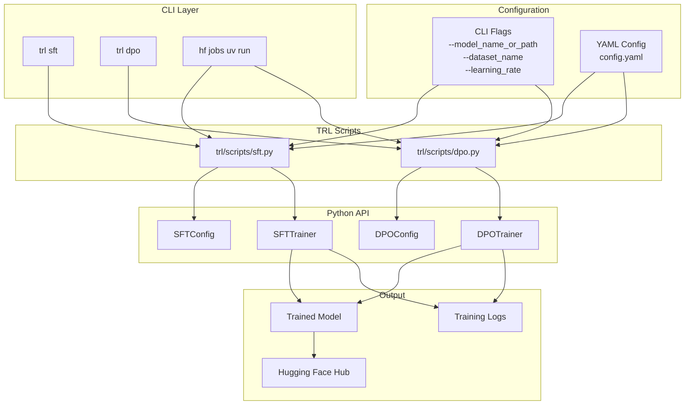
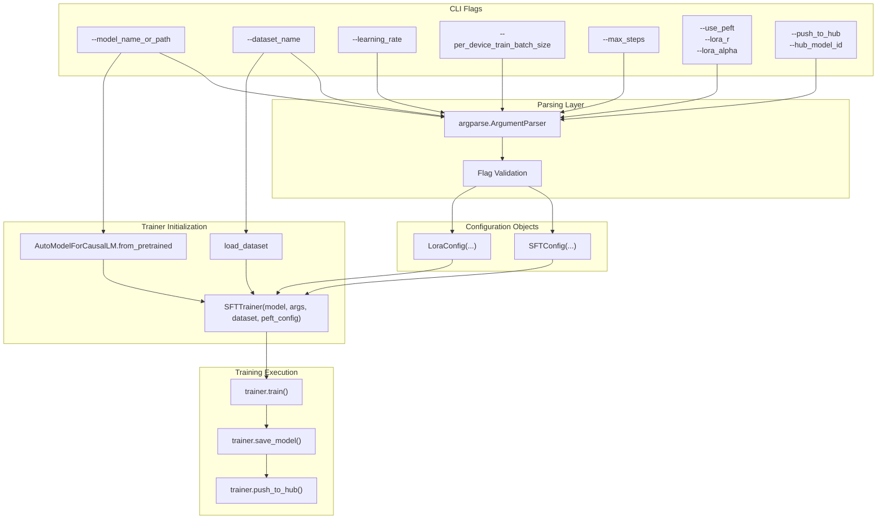

<!-- source: DeepWiki mcp.deepwiki.com · repo huggingface/smol-course · page 7.2 TRL CLI Tools · fetched 2026-10-26 -->

# TRL CLI Tools

<details>
<summary>Relevant source files</summary>

The following files were used as context for generating this wiki page:

- [units/en/unit0/1.mdx](units/en/unit0/1.mdx)
- [units/en/unit1/3.md](units/en/unit1/3.md)
- [units/en/unit1/3a.md](units/en/unit1/3a.md)
- [units/en/unit1/4.md](units/en/unit1/4.md)
- [units/en/unit1/5.md](units/en/unit1/5.md)
- [units/en/unit2/1.md](units/en/unit2/1.md)
- [units/en/unit2/2.md](units/en/unit2/2.md)
- [units/en/unit2/3.md](units/en/unit2/3.md)
- [units/en/unit2/4.md](units/en/unit2/4.md)
- [units/en/unit3/1.md](units/en/unit3/1.md)
- [units/en/unit3/2.md](units/en/unit3/2.md)
- [units/en/unit3/3.md](units/en/unit3/3.md)
- [units/en/unit3/4.md](units/en/unit3/4.md)

</details>


This document describes the command-line interface (CLI) tools provided by the TRL (Transformers Reinforcement Learning) library for training language models. The TRL CLI provides production-ready commands for supervised fine-tuning (SFT) and direct preference optimization (DPO) workflows. For detailed information about the underlying Python trainers, see [SFTTrainer and DPOTrainer](#7.1). For experiment tracking integration, see [Experiment Tracking with Trackio](#7.3).

## Overview

The TRL CLI provides standardized commands for model training that eliminate boilerplate code and enable reproducible workflows. Instead of writing custom training scripts, users can invoke pre-built training pipelines through simple command-line invocations with configurable parameters.

The CLI serves two primary use cases:
1. **Local training**: Direct execution on local or remote GPU resources
2. **Cloud training**: Integration with Hugging Face Jobs for managed infrastructure

### CLI Architecture



**TRL CLI to Python Trainer Mapping Diagram**

Sources: [units/en/unit1/3.md:489-502](), [units/en/unit1/5.md:109-124](), [units/en/unit2/3.md:254-274]()

## Available Commands

### trl sft

The `trl sft` command executes supervised fine-tuning using the `SFTTrainer` class. It accepts model specifications, dataset configurations, and training hyperparameters as command-line flags.

**Basic Usage:**

```bash
trl sft \
    --model_name_or_path HuggingFaceTB/SmolLM3-3B-Base \
    --dataset_name HuggingFaceTB/smoltalk2_everyday_convs_think \
    --output_dir ./smollm3-sft-model \
    --per_device_train_batch_size 4 \
    --learning_rate 5e-5 \
    --max_steps 1000 \
    --push_to_hub \
    --hub_model_id your-username/smollm3-custom
```

Sources: [units/en/unit1/3.md:489-502]()

### trl dpo

The `trl dpo` command executes direct preference optimization using the `DPOTrainer` class. It requires preference datasets with `prompt`, `chosen`, and `rejected` fields.

**Basic Usage:**

```bash
trl dpo \
    --model_name_or_path HuggingFaceTB/SmolLM3-3B \
    --dataset_name Anthropic/hh-rlhf \
    --learning_rate 5e-7 \
    --beta 0.1 \
    --max_steps 1000 \
    --push_to_hub \
    --hub_model_id your-username/smollm3-dpo-aligned
```

Sources: [units/en/unit2/4.md:26-38]()

## Configuration Methods

### Command-Line Flags

The CLI accepts all parameters as command-line flags with `--` prefix. Flag names correspond to the parameters of `SFTConfig` and `DPOConfig` classes.

**Common Flags:**

| Flag | Type | Description | Example |
|------|------|-------------|---------|
| `--model_name_or_path` | string | Base model identifier | `HuggingFaceTB/SmolLM3-3B-Base` |
| `--dataset_name` | string | Dataset identifier | `HuggingFaceTB/smoltalk2` |
| `--output_dir` | string | Local output directory | `./output` |
| `--per_device_train_batch_size` | int | Batch size per device | `4` |
| `--gradient_accumulation_steps` | int | Gradient accumulation steps | `4` |
| `--learning_rate` | float | Optimizer learning rate | `5e-5` |
| `--max_steps` | int | Maximum training steps | `1000` |
| `--push_to_hub` | bool | Upload to Hub after training | `--push_to_hub` |
| `--hub_model_id` | string | Hub repository name | `username/model-name` |
| `--report_to` | string | Logging backend | `trackio` |

Sources: [units/en/unit1/3.md:489-502](), [units/en/unit1/5.md:109-124]()

### YAML Configuration Files

Training configurations can be defined in YAML files and passed to the CLI. This approach improves reproducibility and version control for complex training runs.

**Example YAML Configuration:**

```yaml
model_name_or_path: HuggingFaceTB/SmolLM3-3B-Base
dataset_name: HuggingFaceTB/smoltalk2_everyday_convs_think
output_dir: ./smollm3-sft-output
per_device_train_batch_size: 4
gradient_accumulation_steps: 4
learning_rate: 5e-5
max_steps: 1000
logging_steps: 50
save_steps: 200
bf16: true
gradient_checkpointing: true
push_to_hub: true
hub_model_id: your-username/smollm3-sft
report_to: trackio
```

**Usage with YAML:**

```bash
trl sft --config config.yaml
```

Sources: [units/en/unit1/3.md:416]()

## Integration with Hugging Face Jobs

The TRL CLI integrates seamlessly with Hugging Face Jobs for cloud-based training. The maintained scripts at `trl/scripts/sft.py` and `trl/scripts/dpo.py` can be executed directly via `hf jobs uv run`.

### Workflow Diagram

```mermaid
graph LR
    subgraph "Local Development"
        USER["Developer"]
        CMDLINE["CLI Command"]
    end
    
    subgraph "Hugging Face Jobs"
        JOBSUBMIT["hf jobs uv run"]
        GPUALLOC["GPU Allocation<br/>a10g-large / a100-large"]
        ENVSETUP["Environment Setup<br/>uv dependencies"]
    end
    
    subgraph "TRL Execution"
        SCRIPT["TRL Script<br/>sft.py / dpo.py"]
        CONFIGPARSE["Parse Flags<br/>SFTConfig / DPOConfig"]
        TRAINER["Initialize Trainer<br/>SFTTrainer / DPOTrainer"]
        TRAIN["Execute Training Loop"]
    end
    
    subgraph "Output Storage"
        CHECKPOINT["Checkpoints<br/>output_dir"]
        HUBREPO["Hub Repository<br/>hub_model_id"]
        METRICS["Training Metrics<br/>Trackio"]
    end
    
    USER --> CMDLINE
    CMDLINE --> JOBSUBMIT
    JOBSUBMIT --> GPUALLOC
    GPUALLOC --> ENVSETUP
    ENVSETUP --> SCRIPT
    SCRIPT --> CONFIGPARSE
    CONFIGPARSE --> TRAINER
    TRAINER --> TRAIN
    TRAIN --> CHECKPOINT
    CHECKPOINT --> HUBREPO
    TRAIN --> METRICS
```



**HF Jobs Training Workflow Diagram**

Sources: [units/en/unit1/5.md:1-236]()

### Using TRL Scripts with HF Jobs

**SFT Training:**

```bash
hf jobs uv run \
    --flavor a10g-large \
    --timeout 2h \
    --secrets HF_TOKEN \
    "https://raw.githubusercontent.com/huggingface/trl/main/trl/scripts/sft.py" \
    --model_name_or_path HuggingFaceTB/SmolLM3-3B-Base \
    --dataset_name HuggingFaceTB/smoltalk2_everyday_convs_think \
    --learning_rate 5e-5 \
    --per_device_train_batch_size 4 \
    --max_steps 1000 \
    --output_dir smollm3-sft-jobs \
    --push_to_hub \
    --hub_model_id your-username/smollm3-sft \
    --report_to trackio
```

Sources: [units/en/unit1/5.md:109-124]()

**DPO Training:**

```bash
hf jobs uv run \
    --flavor a100-large \
    --timeout 3h \
    --secrets HF_TOKEN \
    "https://raw.githubusercontent.com/huggingface/trl/main/trl/scripts/dpo.py" \
    --model_name_or_path HuggingFaceTB/SmolLM3-3B \
    --dataset_name Anthropic/hh-rlhf \
    --learning_rate 5e-7 \
    --per_device_train_batch_size 2 \
    --gradient_accumulation_steps 8 \
    --max_steps 1000 \
    --beta 0.1 \
    --max_prompt_length 512 \
    --max_length 1024 \
    --output_dir smollm3-dpo-aligned \
    --push_to_hub \
    --hub_model_id your-username/smollm3-dpo-aligned \
    --report_to trackio
```

Sources: [units/en/unit2/3.md:254-274]()

### HF Jobs Hardware Flavors

| Flavor | GPU Memory | Use Case | Approximate Cost |
|--------|-----------|----------|------------------|
| `t4-small` | 16GB | Experimentation | ~$2-3/hour |
| `l4x1` | 24GB | Small models, budget training | ~$3-4/hour |
| `a10g-large` | 24GB | SmolLM3-3B recommended | ~$4-6/hour |
| `a100-large` | 40GB | Fastest training, large models | ~$8-12/hour |
| `l4x4` | 96GB (4x24GB) | Multi-GPU distributed training | Higher |

Sources: [units/en/unit1/5.md:86-106]()

## PEFT and LoRA Integration

The TRL CLI supports parameter-efficient fine-tuning through command-line flags that configure LoRA adapters.

### LoRA Configuration Flags

```bash
trl sft \
    --model_name_or_path HuggingFaceTB/SmolLM3-3B-Base \
    --dataset_name HuggingFaceTB/smoltalk2_everyday_convs_think \
    --output_dir smollm3-lora-sft \
    --per_device_train_batch_size 4 \
    --learning_rate 5e-5 \
    --max_steps 1000 \
    --use_peft \
    --lora_r 8 \
    --lora_alpha 16 \
    --lora_dropout 0.05 \
    --lora_target_modules all-linear \
    --push_to_hub \
    --hub_model_id your-username/smollm3-lora-sft
```

**PEFT-Specific Flags:**

| Flag | Type | Description | Typical Value |
|------|------|-------------|---------------|
| `--use_peft` | bool | Enable PEFT/LoRA | `--use_peft` |
| `--lora_r` | int | LoRA rank | `8` |
| `--lora_alpha` | int | LoRA alpha scaling | `16` |
| `--lora_dropout` | float | Dropout probability | `0.05` |
| `--lora_target_modules` | string | Target layers | `all-linear` |

Sources: [units/en/unit1/5.md:165-185](), [units/en/unit1/3a.md:117-141]()

## VLM Training with CLI

Vision Language Models can be trained using the same CLI interface with appropriate dataset formatting. The key difference is that VLM datasets include an `images` column containing image data.

**VLM SFT Example:**

```bash
trl sft \
    --model_name_or_path HuggingFaceTB/SmolVLM2-2.2B-Instruct \
    --dataset_name trl-lib/llava-instruct-mix \
    --output_dir ./smolvln-instruct-sft-cli \
    --per_device_train_batch_size 1 \
    --gradient_accumulation_steps 16 \
    --learning_rate 2e-4 \
    --num_train_epochs 3 \
    --max_length -1 \
    --logging_steps 5 \
    --save_steps 100 \
    --warmup_steps 50 \
    --bf16 True \
    --push_to_hub \
    --hub_model_id your-username/smolvlm2-sft-cli
```

**Important VLM Flags:**

- `--max_length -1`: Disables truncation to preserve image tokens
- `--bf16 True`: Mixed precision for memory efficiency

Sources: [units/en/unit3/4.md:386-402]()

## Configuration Object Mapping

The following diagram shows how CLI flags map to Python configuration objects and trainer initialization:



**CLI Flag to Trainer Configuration Mapping**

Sources: [units/en/unit1/3.md:489-502](), [units/en/unit1/5.md:165-185]()

## Common Workflows

### Local SFT Training

```bash
# Minimal configuration
trl sft \
    --model_name_or_path HuggingFaceTB/SmolLM3-3B-Base \
    --dataset_name HuggingFaceTB/smoltalk2_everyday_convs_think \
    --output_dir ./output \
    --max_steps 1000
```

### Production SFT with HF Jobs

```bash
hf jobs uv run \
    --flavor a10g-large \
    --timeout 2h \
    --secrets HF_TOKEN \
    "https://raw.githubusercontent.com/huggingface/trl/main/trl/scripts/sft.py" \
    --model_name_or_path HuggingFaceTB/SmolLM3-3B-Base \
    --dataset_name HuggingFaceTB/smoltalk2_everyday_convs_think \
    --output_dir smollm3-sft \
    --per_device_train_batch_size 4 \
    --gradient_accumulation_steps 4 \
    --learning_rate 5e-5 \
    --max_steps 1000 \
    --bf16 true \
    --gradient_checkpointing true \
    --push_to_hub \
    --hub_model_id your-username/smollm3-sft \
    --report_to trackio
```

### Memory-Efficient Training with LoRA

```bash
trl sft \
    --model_name_or_path HuggingFaceTB/SmolLM3-3B-Base \
    --dataset_name HuggingFaceTB/smoltalk2_everyday_convs_think \
    --output_dir ./lora-output \
    --use_peft \
    --lora_r 8 \
    --lora_alpha 16 \
    --per_device_train_batch_size 2 \
    --gradient_accumulation_steps 8 \
    --max_steps 1000
```

### DPO Preference Alignment

```bash
trl dpo \
    --model_name_or_path HuggingFaceTB/SmolLM3-3B \
    --dataset_name Anthropic/hh-rlhf \
    --beta 0.1 \
    --learning_rate 5e-7 \
    --max_prompt_length 512 \
    --max_length 1024 \
    --output_dir ./dpo-output \
    --max_steps 1000
```

Sources: [units/en/unit1/3.md:489-502](), [units/en/unit1/5.md:109-124](), [units/en/unit2/3.md:254-274]()

## Monitoring Training Jobs

### HF Jobs Monitoring Commands

```bash
# List all jobs
hf jobs ps -a

# Inspect specific job
hf jobs inspect <job_id>

# Stream logs in real-time
hf jobs logs <job_id> --follow

# Cancel running job
hf jobs cancel <job_id>
```

Sources: [units/en/unit1/5.md:143-159]()

### Trackio Integration

The `--report_to trackio` flag enables automatic logging to Trackio. Training metrics are pushed to a Hugging Face Space for real-time monitoring.

**Environment Variables:**

```bash
export TRACKIO_PROJECT_NAME="my-project"
export TRACKIO_SPACE_ID="username/space_id"
```

Sources: [units/en/unit1/3.md:283-298]()

## Troubleshooting

### Out of Memory Errors

**Symptoms:** CUDA out of memory errors during training.

**Solutions:**
- Reduce `--per_device_train_batch_size`
- Increase `--gradient_accumulation_steps`
- Reduce `--max_length`
- Enable `--gradient_checkpointing`
- Enable `--use_peft` with LoRA
- Use 4-bit or 8-bit quantization

### Authentication Errors

**Symptoms:** Permission denied when pushing to Hub.

**Solutions:**
- Verify `HF_TOKEN` is set correctly: `hf auth login`
- Ensure token has write permissions
- Check Hub repository exists and is accessible
- For HF Jobs, pass token via `--secrets HF_TOKEN`

### Timeout Issues

**Symptoms:** Training job terminated before completion.

**Solutions:**
- Increase `--timeout` parameter for HF Jobs
- Reduce `--max_steps` or `--num_train_epochs`
- Use more powerful hardware flavor
- Optimize data loading and preprocessing

### Dataset Format Errors

**Symptoms:** KeyError or column mismatch errors.

**Solutions:**
- Verify dataset has required columns (`text` or `messages` for SFT, `prompt`/`chosen`/`rejected` for DPO)
- Check dataset configuration with `--dataset_config` if multiple splits exist
- Inspect dataset structure: `from datasets import load_dataset; dataset = load_dataset("dataset_name"); print(dataset)`

Sources: [units/en/unit1/5.md:215-230]()

## Script Location and Customization

The maintained TRL scripts are located at:
- SFT: `https://github.com/huggingface/trl/blob/main/trl/scripts/sft.py`
- DPO: `https://github.com/huggingface/trl/blob/main/trl/scripts/dpo.py`

For custom training logic, copy and modify these scripts. The scripts use inline dependency specifications compatible with `uv` for HF Jobs execution.

Sources: [units/en/unit1/5.md:162-190](), [units/en/unit2/3.md:254-274]()

## Summary

The TRL CLI provides production-ready training commands that abstract boilerplate code while maintaining full configurability. Key features include:

- Standardized commands (`trl sft`, `trl dpo`) mapping to Python trainers
- Configuration via command-line flags or YAML files
- Seamless HF Jobs integration for cloud training
- Built-in PEFT/LoRA support for memory-efficient training
- Automatic Hub integration for model sharing
- Trackio integration for experiment tracking
- VLM support with minimal configuration changes

The CLI enables reproducible training workflows across local and cloud environments without requiring custom Python scripts.

---

