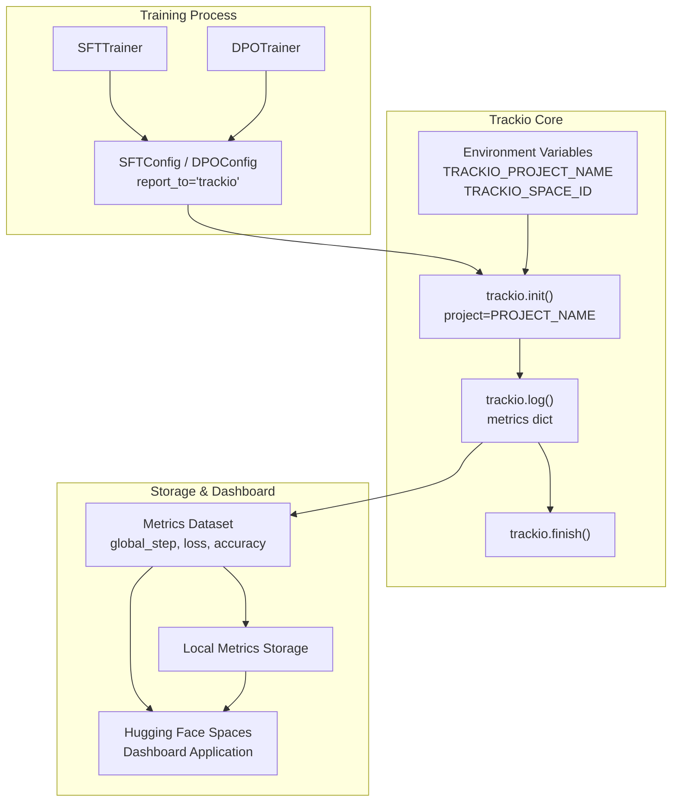
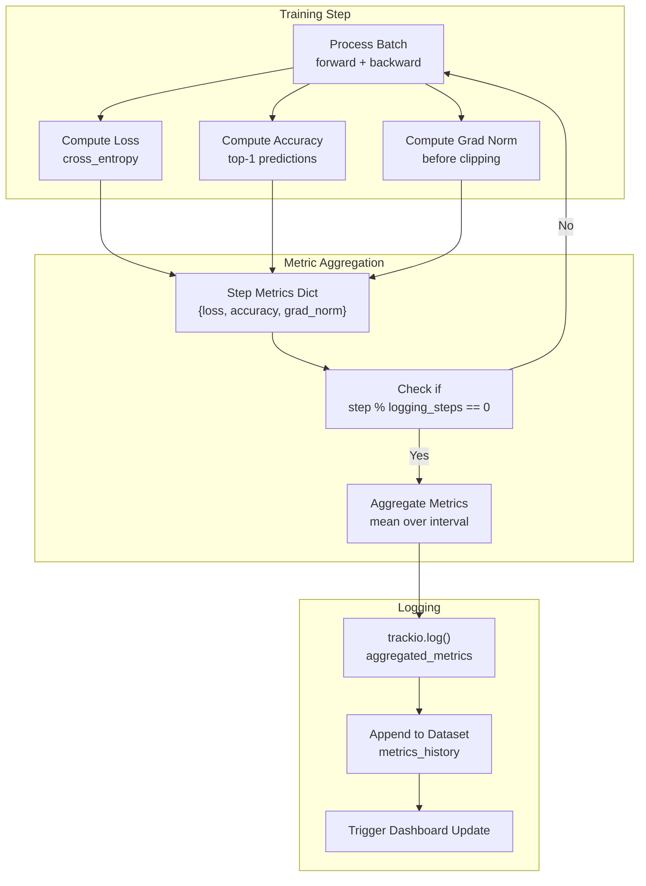
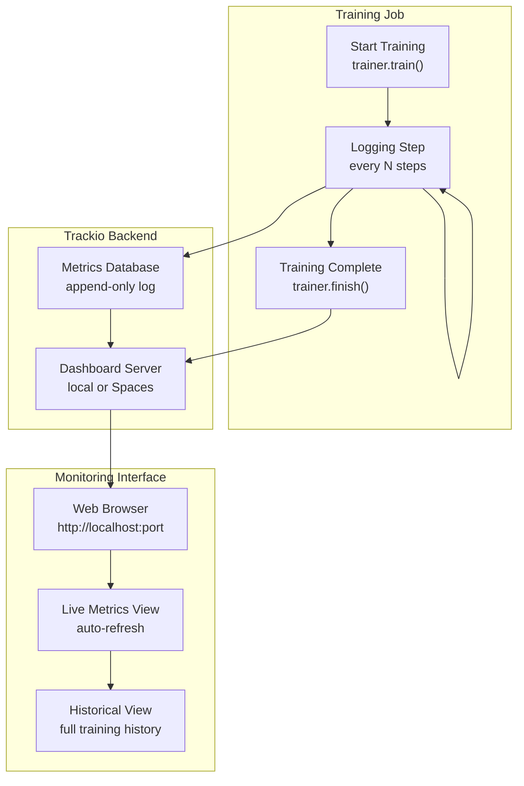
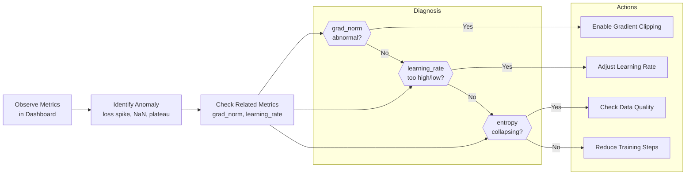
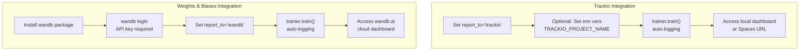

<!-- source: DeepWiki mcp.deepwiki.com · repo huggingface/smol-course · page 7.3 Experiment Tracking with Trackio · fetched 2026-10-26 -->

# Experiment Tracking with Trackio

<details>
<summary>Relevant source files</summary>

The following files were used as context for generating this wiki page:

- [units/en/unit0/1.mdx](units/en/unit0/1.mdx)
- [units/en/unit1/3.md](units/en/unit1/3.md)
- [units/en/unit1/3a.md](units/en/unit1/3a.md)
- [units/en/unit1/4.md](units/en/unit1/4.md)
- [units/en/unit1/5.md](units/en/unit1/5.md)
- [units/en/unit2/1.md](units/en/unit2/1.md)
- [units/en/unit2/2.md](units/en/unit2/2.md)
- [units/en/unit2/3.md](units/en/unit2/3.md)
- [units/en/unit2/4.md](units/en/unit2/4.md)
- [units/en/unit3/1.md](units/en/unit3/1.md)
- [units/en/unit3/2.md](units/en/unit3/2.md)
- [units/en/unit3/3.md](units/en/unit3/3.md)
- [units/en/unit3/4.md](units/en/unit3/4.md)

</details>


## Purpose and Scope

This document covers Trackio integration for logging metrics during model training, real-time monitoring of training runs, and debugging training issues using logged metrics. Trackio is the recommended experiment tracking solution for the smol-course training workflows.

For general TRL training infrastructure, see [TRL Library and Training Infrastructure](#7). For trainer configuration details, see [SFTTrainer and DPOTrainer](#7.1). For command-line training workflows, see [TRL CLI Tools](#7.2).

## What is Trackio

Trackio is a lightweight, free experiment tracking library built on Hugging Face infrastructure. It provides comprehensive training metrics logging with minimal setup and zero cost. The library is designed as a drop-in replacement for Weights & Biases (wandb), maintaining API compatibility while offering Hugging Face-native integration.

**Key Features:**
- **API Compatibility**: Drop-in replacement for `wandb.init()`, `wandb.log()`, and `wandb.finish()`
- **Local-First Design**: Dashboard runs locally by default with optional Hugging Face Spaces hosting
- **Zero Cost**: Free hosting on Hugging Face Spaces infrastructure
- **Lightweight**: Fewer than 3,000 lines of Python code, easily extensible
- **Native Integration**: Seamless integration with TRL trainers and Hugging Face ecosystem

**Sources:** [units/en/unit1/3.md:259-282]()

## Trackio Architecture

### System Integration



**Trackio Architecture Overview**

The architecture shows how Trackio integrates with TRL trainers through configuration parameters, processes metrics via the core API, and serves results through local or hosted dashboards.

**Sources:** [units/en/unit1/3.md:259-313](), [units/en/unit1/4.md:456-475]()

### Data Flow

```mermaid
graph LR
    subgraph "Training Loop"
        ForwardPass["Forward Pass<br/>Batch Processing"]
        LossCompute["Loss Computation<br/>cross_entropy_loss"]
        BackwardPass["Backward Pass<br/>Gradient Update"]
        MetricsCalc["Metrics Calculation<br/>accuracy, grad_norm"]
    end
    
    subgraph "Trackio Logging"
        LogCall["trackio.log()<br/>step_metrics"]
        MetricBuffer["Metric Buffer<br/>in-memory cache"]
        Persistence["Persist to Storage<br/>append to dataset"]
    end
    
    subgraph "Dashboard"
        DataFetch["Fetch Metrics<br/>from dataset"]
        Visualization["Plot Metrics<br/>loss curves, accuracy"]
        RealTimeUpdate["Real-time Updates<br/>auto-refresh"]
    end
    
    ForwardPass --> LossCompute
    LossCompute --> BackwardPass
    BackwardPass --> MetricsCalc
    MetricsCalc --> LogCall
    
    LogCall --> MetricBuffer
    MetricBuffer --> Persistence
    
    Persistence --> DataFetch
    DataFetch --> Visualization
    Visualization --> RealTimeUpdate
```



**Trackio Data Flow**

This diagram illustrates how metrics flow from the training loop through Trackio's logging system to the visualization dashboard.

**Sources:** [units/en/unit1/3.md:316-327]()

## Integration with TRL Trainers

### Python API Integration

Trackio integrates with TRL trainers through the `report_to` parameter in training configuration classes. The integration requires minimal code changes and can be configured via environment variables or inline code.

#### Configuration via Environment Variables

```python
import os

# Set Trackio configuration
os.environ["TRACKIO_PROJECT_NAME"] = "my-project"
os.environ["TRACKIO_SPACE_ID"] = "username/space_id"
```

**Sources:** [units/en/unit1/3.md:283-297]()

#### SFTTrainer Integration

The `SFTTrainer` automatically handles Trackio initialization and metric logging when configured:

```python
from trl import SFTTrainer, SFTConfig

config = SFTConfig(
    output_dir="./smollm3-finetuned",
    per_device_train_batch_size=4,
    learning_rate=5e-5,
    max_steps=1000,
    report_to="trackio",  # Enable Trackio logging
)

trainer = SFTTrainer(
    model=model,
    train_dataset=dataset["train"],
    args=config,
)

trainer.train()
```

**Sources:** [units/en/unit1/3.md:298-309](), [units/en/unit1/4.md:468-475]()

#### DPOTrainer Integration

The `DPOTrainer` follows the same integration pattern:

```python
from trl import DPOTrainer, DPOConfig

training_args = DPOConfig(
    beta=0.1,
    learning_rate=5e-7,
    per_device_train_batch_size=2,
    max_steps=1000,
    output_dir="./smollm3-dpo-aligned",
    report_to="trackio",  # Enable Trackio logging
)

trainer = DPOTrainer(
    model=model,
    args=training_args,
    train_dataset=train_dataset,
    processing_class=tokenizer,
)

trainer.train()
```

**Sources:** [units/en/unit2/3.md:179-209]()

#### Manual Logging API

For custom training loops, Trackio provides a simple API:

```python
import trackio

# Initialize tracking
trackio.init(project="smollm3-sft")

# Log metrics during training
trackio.log({"train_loss": 0.5, "learning_rate": 5e-5})

# Finish tracking
trackio.finish()
```

**Sources:** [units/en/unit1/3.md:267-281]()

### CLI Integration

Trackio can be enabled via the `--report_to` flag when using TRL CLI tools or Hugging Face Jobs:

#### TRL CLI

```bash
trl sft \
    --model_name_or_path HuggingFaceTB/SmolLM3-3B-Base \
    --dataset_name HuggingFaceTB/smoltalk2_everyday_convs_think \
    --output_dir ./smollm3-sft-model \
    --per_device_train_batch_size 4 \
    --learning_rate 5e-5 \
    --max_steps 1000 \
    --report_to trackio \
    --push_to_hub
```

**Sources:** [units/en/unit1/3.md:488-502]()

#### Hugging Face Jobs

```bash
hf jobs uv run \
    --flavor a10g-large \
    --timeout 2h \
    --secrets HF_TOKEN \
    "https://raw.githubusercontent.com/huggingface/trl/main/trl/scripts/sft.py" \
    --model_name_or_path HuggingFaceTB/SmolLM3-3B-Base \
    --dataset_name HuggingFaceTB/smoltalk2_everyday_convs_think \
    --output_dir smollm3-sft-jobs \
    --push_to_hub \
    --report_to trackio
```

**Sources:** [units/en/unit1/5.md:109-124]()

#### DPO Training with Jobs

```bash
hf jobs uv run \
    --flavor a100-large \
    --timeout 3h \
    --secrets HF_TOKEN \
    "https://raw.githubusercontent.com/huggingface/trl/main/trl/scripts/dpo.py" \
    --model_name_or_path HuggingFaceTB/SmolLM3-3B \
    --dataset_name Anthropic/hh-rlhf \
    --learning_rate 5e-7 \
    --beta 0.1 \
    --max_steps 1000 \
    --output_dir smollm3-dpo-aligned \
    --report_to trackio
```

**Sources:** [units/en/unit2/3.md:254-274]()

## Logged Metrics

Trackio automatically logs comprehensive training metrics at each logging step. The metrics provide insights into model performance, optimization dynamics, and resource utilization.

### Metric Definitions

| Metric | Description | Use Case |
|--------|-------------|----------|
| `global_step` | Total number of optimizer steps taken | Track training progress |
| `epoch` | Current epoch number based on dataset iteration | Monitor dataset coverage |
| `num_tokens` | Total number of tokens processed | Measure training scale |
| `loss` | Average cross-entropy loss over non-masked tokens | Primary training signal |
| `entropy` | Average entropy of predicted token distribution | Monitor output diversity |
| `mean_token_accuracy` | Proportion of correct top-1 predictions | Track prediction accuracy |
| `learning_rate` | Current learning rate (may vary with scheduler) | Debug optimizer behavior |
| `grad_norm` | L2 norm of gradients before clipping | Detect gradient issues |

**Sources:** [units/en/unit1/3.md:316-327]()

### Metric Collection Flow



**Metric Collection and Logging Flow**

This diagram shows how metrics are collected during training steps, aggregated at logging intervals, and persisted through Trackio's logging API.

**Sources:** [units/en/unit1/3.md:316-327]()

## Dashboard and Monitoring

### Accessing the Dashboard

Trackio serves a web application that visualizes training metrics in real-time. The dashboard can run locally or be hosted on Hugging Face Spaces.

**Local Dashboard:**
- Automatically launches when training starts with `report_to="trackio"`
- Accessible via localhost URL printed in training logs
- Updates in real-time as new metrics are logged

**Hugging Face Spaces Dashboard:**
- Set `TRACKIO_SPACE_ID` environment variable to enable Spaces hosting
- Dashboard persists after training completes
- Shareable URL for collaboration and reporting

**Sources:** [units/en/unit1/3.md:259-282]()

### Dashboard Features

The Trackio dashboard provides interactive visualizations of training metrics:

```
┌─────────────────────────────────────────────────────┐
│ Trackio Dashboard: smollm3-sft                     │
├─────────────────────────────────────────────────────┤
│                                                     │
│  Train Loss ──────────────────────────────────     │
│    2.5 │                                            │
│        │ ╲                                          │
│    2.0 │  ╲╲                                        │
│        │    ╲                                       │
│    1.5 │     ╲___                                   │
│        │         ╲___                               │
│    1.0 │             ╲╲__                           │
│        │                 ╲____                      │
│    0.5 │                      ╲______               │
│        └────────────────────────────────────        │
│          0    200   400   600   800   1000          │
│                    Global Step                      │
│                                                     │
│  Learning Rate ────────────────────────────────     │
│  Mean Token Accuracy ──────────────────────────     │
│  Gradient Norm ────────────────────────────────     │
│                                                     │
└─────────────────────────────────────────────────────┘
```

**Sources:** [units/en/unit1/3.md:311-313]()

### Monitoring Training Progress



**Real-time Monitoring Workflow**

This diagram illustrates how training progress is monitored through Trackio's dashboard, from metric collection to visualization.

**Sources:** [units/en/unit1/3.md:311-313]()

## Debugging Training Issues

### Common Training Problems and Diagnostic Metrics

Trackio's logged metrics enable systematic debugging of training issues. The following table maps common problems to diagnostic metrics:

| Issue | Primary Metric | Diagnostic Pattern | Action |
|-------|---------------|-------------------|---------|
| **Overfitting** | `loss` (train vs validation gap) | Training loss decreases, validation loss increases | Reduce epochs, add regularization |
| **Underfitting** | `loss` (both train and validation high) | Both losses plateau at high values | Increase model capacity, train longer |
| **Gradient Explosion** | `grad_norm` | Sudden spikes or NaN values | Reduce learning rate, enable gradient clipping |
| **Vanishing Gradients** | `grad_norm` | Extremely small values (<1e-6) | Increase learning rate, check architecture |
| **Learning Rate Issues** | `loss` + `learning_rate` | Oscillating loss or no decrease | Adjust learning rate, use scheduler |
| **Low Diversity** | `entropy` | Consistently low entropy values | Increase temperature, check data diversity |
| **Poor Predictions** | `mean_token_accuracy` | Low accuracy despite low loss | Check data quality, adjust task formulation |

**Sources:** [units/en/unit1/3.md:316-327](), [units/en/unit1/3.md:204-257]()

### Loss Pattern Analysis

```mermaid
graph TD
    subgraph "Healthy Training"
        H1["Loss starts high<br/>~2-4 for LLMs"]
        H2["Smooth decrease<br/>no oscillations"]
        H3["Convergence<br/>loss stabilizes"]
        H4["Small train-val gap<br/>good generalization"]
    end
    
    subgraph "Overfitting"
        O1["Training loss decreases"]
        O2["Validation loss increases<br/>after initial decrease"]
        O3["Growing gap<br/>train-val divergence"]
    end
    
    subgraph "Underfitting"
        U1["High initial loss"]
        U2["Slow decrease<br/>or plateau"]
        U3["Both losses remain high"]
    end
    
    subgraph "Instability"
        I1["Loss spikes<br/>sudden increases"]
        I2["Oscillations<br/>no clear trend"]
        I3["NaN or Inf values"]
    end
    
    H1 --> H2
    H2 --> H3
    H3 --> H4
    
    O1 --> O2
    O2 --> O3
    
    U1 --> U2
    U2 --> U3
    
    I1 --> I2
    I2 --> I3
```



**Training Loss Pattern Diagnostics**

This diagram categorizes common loss patterns observed in Trackio dashboards and their implications for training health.

**Sources:** [units/en/unit1/3.md:204-257]()

### Debugging Workflow



**Systematic Debugging Process with Trackio Metrics**

This workflow demonstrates how to use Trackio's logged metrics to diagnose and resolve training issues systematically.

**Sources:** [units/en/unit1/3.md:204-257]()

## Comparison with Alternative Tools

### Trackio vs Weights & Biases

| Feature | Trackio | Weights & Biases |
|---------|---------|------------------|
| **Cost** | Free (Hugging Face infrastructure) | Free tier limited, paid for teams |
| **API Compatibility** | Drop-in wandb replacement | Native wandb API |
| **Hosting** | Local or Hugging Face Spaces | Cloud-hosted |
| **Code Size** | <3,000 lines Python | Large ecosystem |
| **HF Integration** | Native (built for HF ecosystem) | Third-party integration |
| **Setup Complexity** | Minimal (environment variables) | Account + API key required |
| **Dashboard** | Simple, focused on core metrics | Rich features, team collaboration |
| **Data Storage** | Local or HF Spaces | Centralized cloud |

**Sources:** [units/en/unit1/3.md:259-282]()

### When to Use Trackio

**Use Trackio when:**
- Training on Hugging Face infrastructure (Jobs, Spaces)
- Need free, unlimited experiment tracking
- Want minimal setup and dependencies
- Prefer local-first workflow with optional sharing
- Working with TRL trainers (SFTTrainer, DPOTrainer)

**Consider alternatives when:**
- Need advanced team collaboration features
- Require extensive hyperparameter sweeps
- Want artifact versioning and model registry
- Need integration with non-HF ML tools

**Sources:** [units/en/unit1/3.md:259-282]()

### Integration Pattern Comparison



**Integration Complexity Comparison**

This diagram compares the setup steps required for Trackio versus Weights & Biases, highlighting Trackio's simpler integration path.

**Sources:** [units/en/unit1/3.md:259-282]()

## Resources and Further Reading

- [Trackio Documentation](https://huggingface.co/docs/trackio) - Official Trackio documentation
- [TRL SFTTrainer](https://huggingface.co/docs/trl/sft_trainer) - SFTTrainer configuration and usage
- [TRL DPOTrainer](https://huggingface.co/docs/trl/dpo_trainer) - DPOTrainer configuration and usage
- [Hugging Face Jobs](https://huggingface.co/docs/huggingface_hub/guides/jobs) - Cloud training infrastructure
- [Training with Hugging Face Jobs](#2.3) - Course guide to HF Jobs

**Sources:** [units/en/unit1/3.md:536-541]()

---

