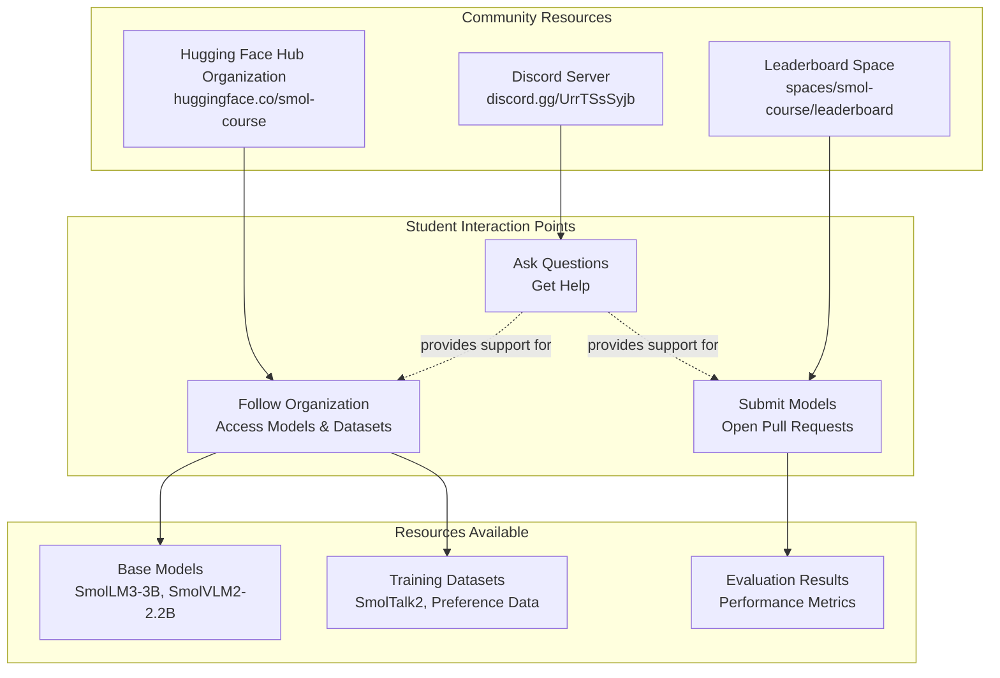
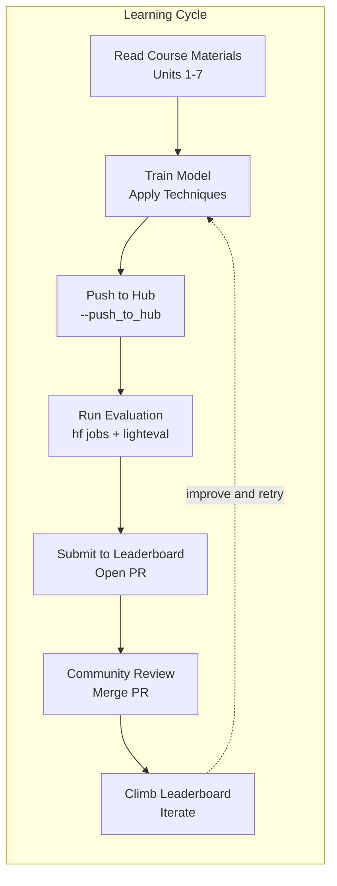
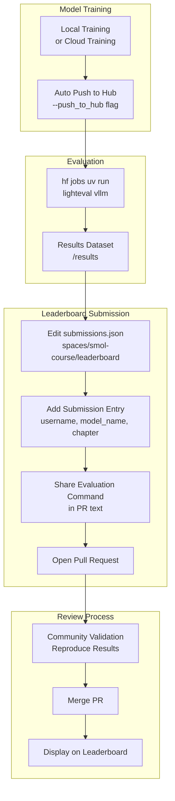
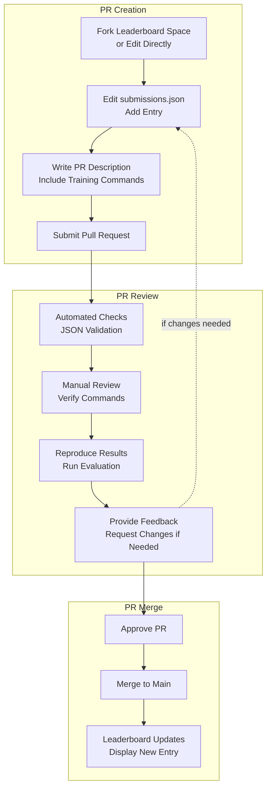
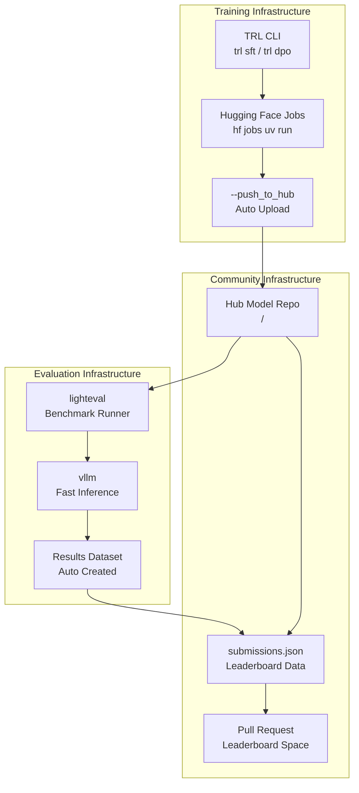

<!-- source: DeepWiki mcp.deepwiki.com · repo huggingface/smol-course · page 8 Community and Contribution · fetched 2026-10-26 -->

# Community and Contribution

<details>
<summary>Relevant source files</summary>

The following files were used as context for generating this wiki page:

- [.gitignore](.gitignore)
- [LICENSE](LICENSE)
- [README.md](README.md)
- [banner.png](banner.png)
- [requirements.txt](requirements.txt)
- [units/en/unit1/1.md](units/en/unit1/1.md)
- [units/en/unit1/2.md](units/en/unit1/2.md)
- [units/en/unit1/6.md](units/en/unit1/6.md)

</details>


This document describes the community-driven learning infrastructure and contribution workflows for the smol-course. The course operates as an open, peer-reviewed educational platform where students learn by training models, submitting their work, and engaging with community feedback through pull requests and leaderboard rankings.

For a detailed step-by-step guide on submitting models to the leaderboard, see [Submitting to the Leaderboard](#8.1).

## Community Infrastructure

The smol-course is built around three primary community resources that facilitate learning, collaboration, and evaluation:



**Sources:** [README.md:11-23](), [units/en/unit1/2.md:794-795]()

### Hugging Face Hub Organization

The `smol-course` organization on Hugging Face Hub serves as the central repository for all course materials, models, and datasets. Students must follow the organization to access base models and training datasets. The organization hosts:

- Base models: `HuggingFaceTB/SmolLM3-3B-Base`, `HuggingFaceTB/SmolVLM3-2.2B-Base`
- Instruction-tuned models: `HuggingFaceTB/SmolLM3-3B`, `HuggingFaceTB/SmolVLM2-2.2B`
- Training datasets: `HuggingFaceTB/smoltalk2`
- Student-submitted models and evaluation results

**Sources:** [README.md:11](), [units/en/unit1/1.md:10-12]()

### Discord Community

The Discord server provides real-time support and community interaction. The server is accessible at `discord.gg/UrrTSsSyjb` and facilitates peer-to-peer learning, troubleshooting, and collaboration.

**Sources:** [README.md:20-22](), [units/en/unit1/2.md:794-795]()

### Leaderboard Space

The leaderboard is hosted as a Hugging Face Space at `spaces/smol-course/leaderboard`. It tracks student submissions and rankings based on model evaluation results across multiple units.

**Sources:** [units/en/unit1/6.md:49-89]()

## Community-Driven Learning Model

The course implements a peer-reviewed learning model where students actively contribute to course improvement through pull requests. This model emphasizes hands-on learning, reproducibility, and community engagement.



**Sources:** [README.md:7-17]()

### Open and Peer Reviewed

The course operates on an open pull request model where students submit their work for community review. This approach builds a community-driven course that continuously improves through student contributions.

**Key principles:**
- All submissions are public and reproducible
- Students must share evaluation commands in PR text
- Community members review and validate results before merging
- The process encourages transparency and learning from others' approaches

**Sources:** [README.md:9-16](), [units/en/unit1/6.md:77-86]()

### Course Participation Steps

As outlined in [README.md:10-15](), participation follows these steps:

1. Follow the `smol-course` organization on Hugging Face Hub
2. Read the material, make changes, do exercises, add examples
3. Submit a model to the leaderboard
4. Climb the leaderboard through iterative improvement

**Sources:** [README.md:10-15]()

## Sharing Trained Models

Students share their trained models through the Hugging Face Hub, making them publicly accessible and reproducible. The TRL library provides built-in support for automatic model pushing during training.

### Automatic Model Pushing

The `--push_to_hub` flag automatically uploads trained models to the Hub at regular intervals and upon training completion:

```bash
hf jobs uv run \
    --flavor a100-large \
    --secrets HF_TOKEN \
    "trl/scripts/sft.py" \
    --model_name_or_path HuggingFaceTB/SmolLM3-3B-Base \
    --dataset_name HuggingFaceTB/smoltalk2 \
    --output_dir ./output \
    --push_to_hub
```

The trained model becomes available at `<username>/<model-name>` on the Hub, where `<username>` is the authenticated user's Hugging Face username.

**Sources:** [units/en/unit1/6.md:19-30]()

### Model Repository Structure

Each submitted model repository should contain:
- Model weights and configuration files
- Training hyperparameters
- Evaluation results dataset reference
- Reproducible training commands (shared in PR)

**Sources:** [units/en/unit1/6.md:30-44]()

## Submission Workflow

The submission process combines model training, evaluation, and community review through a structured pull request workflow. This workflow is detailed further in [Submitting to the Leaderboard](#8.1).



**Sources:** [units/en/unit1/6.md:1-89]()

### submissions.json Structure

The leaderboard tracks submissions through a `submissions.json` file in the leaderboard space repository. Each submission entry follows this structure:

| Field | Type | Description |
|-------|------|-------------|
| `username` | string | Hugging Face username |
| `model_name` | string | Model repository name |
| `chapter` | string | Course unit number (e.g., "1") |
| `submission_date` | string | Date of submission |
| `results-dataset` | string | Dataset containing evaluation results |

Example entry structure from [units/en/unit1/6.md:60-74]():

```json
{
    "submissions": [
        {
            "username": "<your-username>",
            "model_name": "<your-model-name>",
            "chapter": "1",
            "submission_date": "<your-submission-date>",
            "results-dataset": "<your-results-dataset>"
        }
    ]
}
```

**Sources:** [units/en/unit1/6.md:53-75]()

### Evaluation Commands

Students must share their evaluation commands in the PR text for reproducibility. The evaluation command uses `hf jobs` with `lighteval` and `vllm`:

```bash
hf jobs uv run \
    --flavor a10g-large \
    --with "lighteval[vllm]" \
    --secrets HF_TOKEN \
    lighteval vllm "model_name=<your-username>/<your-model-name>" \
    "lighteval|gsm8k|0|0" \
    --push-to-hub \
    --results-org <your-username>
```

This command evaluates the model and pushes results to a dataset repository at `<your-username>/results`.

**Sources:** [units/en/unit1/6.md:36-44](), [units/en/unit1/6.md:77-83]()

## Pull Request Workflow

The pull request workflow ensures all submissions are reviewed and validated before being added to the leaderboard. This process maintains quality and encourages learning through code review.



**Sources:** [units/en/unit1/6.md:49-89]()

### PR Requirements

Each pull request must include:

1. **Modified submissions.json**: Entry with model information and results dataset reference
2. **Evaluation command**: Complete `hf jobs` command in PR text for reproducibility
3. **Model repository**: Public model repository on Hub with training artifacts

**Sources:** [units/en/unit1/6.md:52-86]()

### Review Process

The review process validates:
- JSON syntax correctness
- Model repository accessibility
- Results dataset availability
- Command reproducibility
- Evaluation metric validity

Once validated and merged, the model appears on the public leaderboard at `spaces/smol-course/leaderboard`.

**Sources:** [units/en/unit1/6.md:87-89]()

## Community Support Resources

Multiple support channels are available for students throughout their learning journey:

| Resource | Purpose | Access |
|----------|---------|--------|
| Discord Server | Real-time help, troubleshooting, community interaction | `discord.gg/UrrTSsSyjb` |
| Hugging Face Forum | Long-form discussions, technical questions | `discuss.huggingface.co` |
| GitHub Issues | Bug reports, feature requests for course materials | Repository issues |
| Course Documentation | Written guides, examples, references | Course units and pages |

**Sources:** [README.md:20-22](), [units/en/unit1/2.md:792-795]()

### Discord Community

The Discord server provides channels for:
- General questions and help requests
- Unit-specific discussions
- Sharing results and approaches
- Troubleshooting training issues
- Community announcements

**Sources:** [README.md:20-22]()

### Hugging Face Forum

For detailed technical discussions and questions that benefit from longer-form responses, the Hugging Face Forum at `discuss.huggingface.co` offers:
- Searchable question archive
- Expert community responses
- Integration with Hugging Face ecosystem

**Sources:** [units/en/unit1/2.md:792]()

## Course Contribution Model

Beyond model submissions, students can contribute to course improvement through:

- **Documentation improvements**: Fixing errors, adding clarifications, providing examples
- **Exercise additions**: Contributing new training exercises or datasets
- **Code examples**: Sharing implementation variations or optimizations
- **Community support**: Helping other students in Discord or forums

The open-source nature of the course encourages these contributions through standard GitHub workflows.

**Sources:** [README.md:12]()

## Technical Integration Points

The community infrastructure integrates with the technical training stack at multiple levels:



**Sources:** [units/en/unit1/6.md:19-44](), [requirements.txt:1-65]()

### Training to Hub Pipeline

The `--push_to_hub` flag in TRL trainers automatically handles model uploads during training. This flag is supported by both `SFTTrainer` and `DPOTrainer` through their configuration classes (`SFTConfig`, `DPOConfig`).

**Sources:** [units/en/unit1/6.md:19-28]()

### Evaluation Pipeline

The evaluation pipeline uses Hugging Face Jobs with `lighteval` and `vllm` for scalable model evaluation. The `--push-to-hub` and `--results-org` flags automatically create results datasets that link to leaderboard submissions.

**Sources:** [units/en/unit1/6.md:36-44]()

### Leaderboard Integration

The leaderboard space reads `submissions.json` to display rankings and automatically fetches evaluation metrics from the referenced results datasets. This creates a fully automated pipeline from training to public ranking.

**Sources:** [units/en/unit1/6.md:53-75]()

## Reproducibility Requirements

Reproducibility is a core principle of the community-driven model. Each submission must provide sufficient information for others to reproduce results:

**Required elements:**
1. **Training command**: Complete command with all hyperparameters
2. **Model repository**: Publicly accessible model on Hub
3. **Evaluation command**: Full evaluation command with dataset and metrics
4. **Results dataset**: Published evaluation results on Hub

Example training command to include in PR text:

```bash
hf jobs uv run \
    --flavor a100-large \
    --secrets HF_TOKEN \
    "trl/scripts/sft.py" \
    --model_name_or_path HuggingFaceTB/SmolLM3-3B-Base \
    --dataset_name HuggingFaceTB/smoltalk2 \
    --learning_rate 2e-5 \
    --num_train_epochs 3 \
    --per_device_train_batch_size 8 \
    --gradient_accumulation_steps 4 \
    --output_dir ./smollm3-sft \
    --push_to_hub
```

**Sources:** [units/en/unit1/6.md:77-83]()

## Future Developments

The course roadmap includes additional units that will expand the community infrastructure:

| Unit | Topic | Target Release | Community Element |
|------|-------|----------------|-------------------|
| 5 | Reinforcement Learning | October 2025 | RL policy leaderboard |
| 6 | Synthetic Data | November 2025 | Dataset contribution workflow |
| 7 | Award Ceremony | December 2025 | Project showcase and recognition |

**Sources:** [README.md:35-43]()

## References and Resources

### Official Documentation
- [Hugging Face Hub Documentation](https://huggingface.co/docs/hub) - Hub features and model sharing
- [TRL Library Documentation](https://huggingface.co/docs/trl) - Training workflows and CLI tools
- [lighteval Documentation](https://github.com/huggingface/lighteval) - Evaluation framework

### Community Links
- Discord Server: `discord.gg/UrrTSsSyjb`
- Course Organization: `huggingface.co/smol-course`
- Leaderboard Space: `huggingface.co/spaces/smol-course/leaderboard`
- Hugging Face Forum: `discuss.huggingface.co`

**Sources:** [README.md:20-22](), [units/en/unit1/2.md:776-795]()

---

