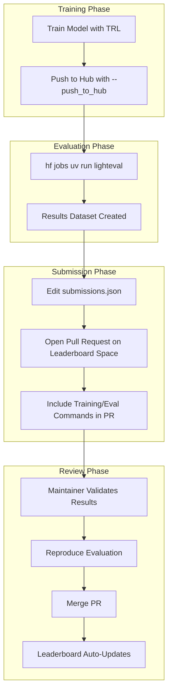
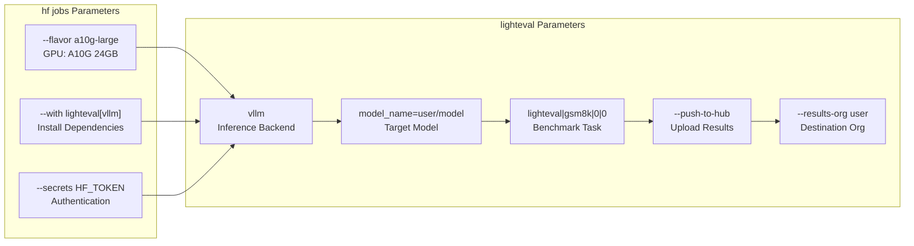
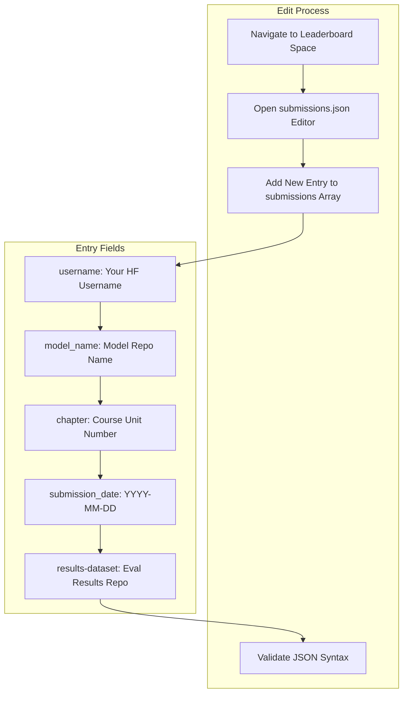
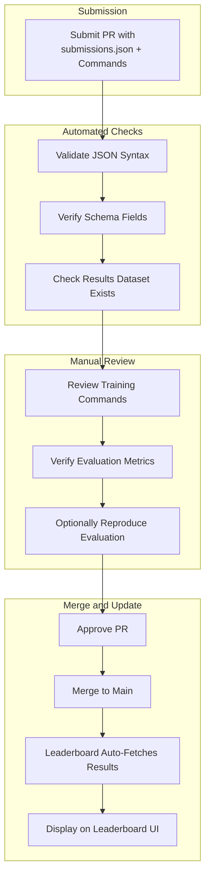
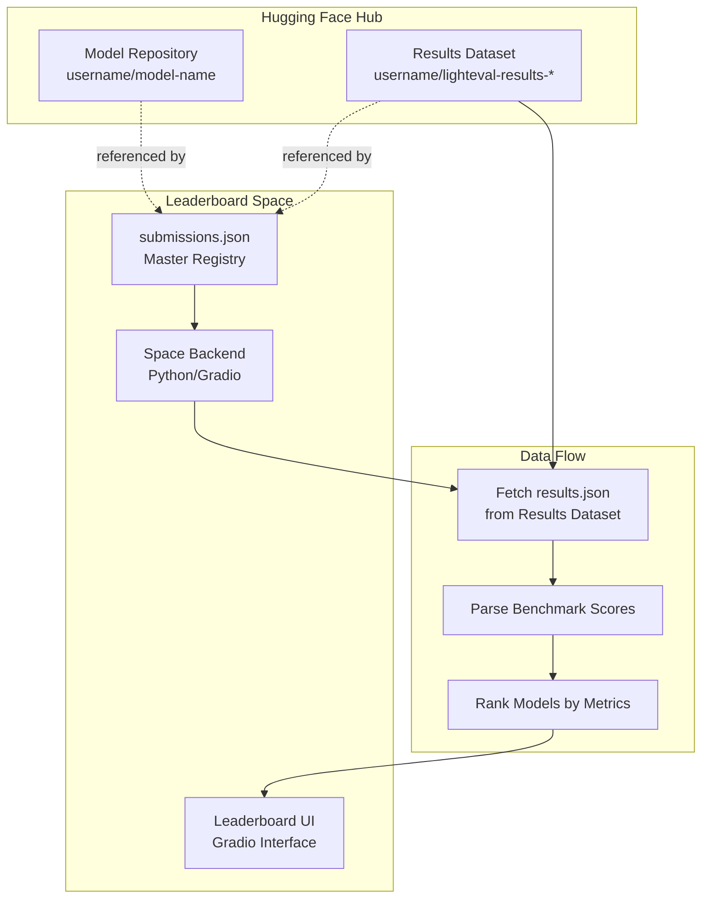

<!-- source: DeepWiki mcp.deepwiki.com · repo huggingface/smol-course · page 8.1 Submitting to the Leaderboard · fetched 2026-10-26 -->

# Submitting to the Leaderboard

<details>
<summary>Relevant source files</summary>

The following files were used as context for generating this wiki page:

- [.gitignore](.gitignore)
- [LICENSE](LICENSE)
- [README.md](README.md)
- [banner.png](banner.png)
- [requirements.txt](requirements.txt)
- [units/en/unit1/1.md](units/en/unit1/1.md)
- [units/en/unit1/2.md](units/en/unit1/2.md)
- [units/en/unit1/6.md](units/en/unit1/6.md)

</details>


This page provides a technical guide for submitting trained models to the smol-course leaderboard. The leaderboard is a community-driven system that tracks and ranks student model submissions, providing visibility to successful training experiments and fostering peer learning.

For information about training models, see [Instruction Tuning](#2), [Preference Alignment](#4), or [Vision-Language Models](#5). For details on model evaluation frameworks, see [Model Evaluation](#6).

## Purpose and Submission Requirements

The smol-course leaderboard serves as both a learning milestone and a community contribution mechanism. Each submission must include:

- A trained model pushed to Hugging Face Hub
- Evaluation results from standardized benchmarks
- Reproducible training commands
- Metadata in the leaderboard's `submissions.json` file

The submission process integrates three core Hugging Face ecosystem components: `trl` for training, `lighteval` for evaluation, and Hugging Face Spaces for leaderboard hosting.

Sources: [README.md:3-44](), [units/en/unit1/6.md:1-95]()

## Submission Workflow Overview



**Workflow Diagram: End-to-End Leaderboard Submission Process**

The workflow consists of four sequential phases. The Training Phase uses `trl` trainers (SFTTrainer, DPOTrainer, ORPOTrainer) with the `--push_to_hub` flag to automatically upload models. The Evaluation Phase executes `lighteval` via `hf jobs` to generate benchmark scores. The Submission Phase requires manual editing of the `submissions.json` file in the leaderboard Space repository. The Review Phase involves maintainer validation before the leaderboard automatically pulls and displays results.

Sources: [units/en/unit1/6.md:1-90](), [README.md:10-16]()

## Model Training and Hub Upload

### Using the --push_to_hub Flag

All TRL trainers support automatic model uploading through the `--push_to_hub` configuration parameter. This parameter triggers model checkpointing to the Hugging Face Hub at the end of training.

**Command Structure:**

```bash
hf jobs uv run \
    --flavor a100-large \
    --secrets HF_TOKEN \
    "trl/scripts/sft.py" \
    --model_name_or_path HuggingFaceTB/SmolLM3-3B \
    --dataset_name HuggingFaceTB/smoltalk2 \
    --output_dir ./output \
    --push_to_hub \
    --hub_model_id your-username/your-model-name
```

The `--push_to_hub` flag interacts with the `transformers.Trainer` checkpointing system. When enabled, the final model (or best checkpoint based on evaluation metrics) is uploaded to `your-username/your-model-name` on the Hub.

### Required Hub Credentials

The `HF_TOKEN` secret must have write permissions. This token is passed via `--secrets HF_TOKEN` to `hf jobs` and accessed within the training script through environment variables. Without this token, the push operation fails silently or raises authentication errors.

### Model Repository Structure

After successful upload, your repository contains:

| File/Directory | Description |
|----------------|-------------|
| `config.json` | Model architecture configuration |
| `model.safetensors` or `pytorch_model.bin` | Model weights |
| `tokenizer.json`, `tokenizer_config.json` | Tokenizer files |
| `adapter_config.json` | LoRA/PEFT adapter configuration (if applicable) |
| `training_args.bin` | Training hyperparameters |
| `README.md` | Auto-generated model card |

If using LoRA adapters without merging, ensure `adapter_config.json` and `adapter_model.safetensors` are present.

Sources: [units/en/unit1/6.md:17-30]()

## Running Evaluation Jobs

### Lighteval Integration

The evaluation step uses `lighteval` with `vllm` backend for efficient inference. The command structure follows the `hf jobs` pattern:

```bash
hf jobs uv run \
    --flavor a10g-large \
    --with "lighteval[vllm]" \
    --secrets HF_TOKEN \
    lighteval vllm \
    "model_name=<your-username>/<your-model-name>" \
    "lighteval|gsm8k|0|0" \
    --push-to-hub \
    --results-org <your-username>
```

**Parameter Breakdown:**



**Evaluation Parameter Flow**

Sources: [units/en/unit1/6.md:32-47]()

### Task Specification Format

The task string `"lighteval|gsm8k|0|0"` follows the `lighteval` task definition syntax:

- `lighteval`: Task suite identifier
- `gsm8k`: Specific benchmark (GSM8K, MMLU, TruthfulQA, etc.)
- `0`: Task variant/subset (0 for default)
- `0`: Few-shot examples count

Multiple tasks can be evaluated in a single run by passing multiple task strings.

### Results Dataset Structure

The `--push-to-hub --results-org <your-username>` parameters create a dataset repository at `<your-username>/lighteval-results-<timestamp>`. This dataset contains:

- `results.json`: Raw evaluation metrics
- `samples.jsonl`: Per-sample predictions and scores
- `config.json`: Evaluation configuration metadata

The leaderboard system queries this dataset to extract metrics for display.

Sources: [units/en/unit1/6.md:32-47]()

## Preparing the Leaderboard Submission

### Locating the Leaderboard Space

The leaderboard is hosted as a Hugging Face Space at `https://huggingface.co/spaces/smol-course/leaderboard`. The submission file is located at:

```
spaces/smol-course/leaderboard/submissions.json
```

Access the file editor directly via:
```
https://huggingface.co/spaces/smol-course/leaderboard/edit/main/submissions.json
```

### submissions.json Schema

The `submissions.json` file maintains a structured list of all model submissions:

```json
{
    "submissions": [
        {
            "username": "<your-username>",
            "model_name": "<your-model-name>",
            "chapter": "1",
            "submission_date": "2025-01-15",
            "results-dataset": "<your-username>/lighteval-results-20250115"
        }
    ]
}
```

**Field Specifications:**

| Field | Type | Description | Example |
|-------|------|-------------|---------|
| `username` | string | Hugging Face username | `"john-doe"` |
| `model_name` | string | Model repository name (without username prefix) | `"smollm3-finetuned-gsm8k"` |
| `chapter` | string | Course unit number | `"1"`, `"2"`, `"3"`, `"4"` |
| `submission_date` | string | ISO 8601 date (YYYY-MM-DD) | `"2025-01-15"` |
| `results-dataset` | string | Full dataset identifier for evaluation results | `"john-doe/lighteval-results-20250115"` |

The leaderboard backend fetches `results.json` from the `results-dataset` repository and parses benchmark scores.

Sources: [units/en/unit1/6.md:49-75]()

### Adding Your Submission Entry



**Leaderboard Submission File Editing Flow**

Ensure the JSON syntax is valid before committing. Common errors include missing commas between entries, trailing commas after the last entry, or mismatched quotes.

Sources: [units/en/unit1/6.md:56-75]()

## Opening the Pull Request

### PR Requirements

The pull request must include two components:

1. **File Change**: Modified `submissions.json` with your new entry
2. **PR Description**: Training and evaluation commands used

**PR Description Template:**

```markdown
## Model Submission: <your-model-name>

### Training Command
```bash
hf jobs uv run \
    --flavor a100-large \
    --secrets HF_TOKEN \
    "trl/scripts/sft.py" \
    --model_name_or_path HuggingFaceTB/SmolLM3-3B \
    --dataset_name HuggingFaceTB/smoltalk2 \
    --output_dir ./output \
    --push_to_hub \
    --hub_model_id <your-username>/<your-model-name> \
    --num_train_epochs 3 \
    --per_device_train_batch_size 4
```

### Evaluation Command
```bash
hf jobs uv run \
    --flavor a10g-large \
    --with "lighteval[vllm]" \
    --secrets HF_TOKEN \
    lighteval vllm \
    "model_name=<your-username>/<your-model-name>" \
    "lighteval|gsm8k|0|0" \
    --push-to-hub \
    --results-org <your-username>
```

### Results
- Model Repository: `<your-username>/<your-model-name>`
- Results Dataset: `<your-username>/lighteval-results-<timestamp>`
- Chapter: 1 (Instruction Tuning)
```

This information enables maintainers to reproduce your training and evaluation process for verification.

Sources: [units/en/unit1/6.md:77-86]()

### PR Review Process



**Pull Request Review and Merge Workflow**

Maintainers verify that:
- The `results-dataset` field points to a valid, accessible dataset
- Evaluation metrics are reasonable and consistent with the benchmark
- Training commands are reproducible
- JSON syntax is valid

After merge, the leaderboard Space automatically pulls updated `submissions.json` and fetches metrics from each `results-dataset`.

Sources: [units/en/unit1/6.md:87-90](), [README.md:10-16]()

## Leaderboard Infrastructure

### Component Architecture



**Leaderboard System Architecture**

The leaderboard Space reads `submissions.json` on startup and periodically refreshes to detect new submissions. For each entry, it fetches the `results-dataset` and extracts metrics from `results.json`. Models are ranked by aggregate scores across benchmarks.

Sources: [units/en/unit1/6.md:49-90]()

### Metrics Aggregation

The leaderboard displays both per-benchmark scores and aggregate metrics. Common benchmarks include:

| Benchmark | Metric | Description |
|-----------|--------|-------------|
| GSM8K | Accuracy | Grade school math problems |
| MMLU | Accuracy | Massive multitask language understanding |
| TruthfulQA | MC1/MC2 | Truthfulness in question answering |
| HellaSwag | Accuracy | Commonsense reasoning |
| Arc (Challenge/Easy) | Accuracy | Science question answering |

Aggregate scores typically use weighted averages or median ranks across benchmarks.

Sources: [units/en/unit1/6.md:32-47]()

## Troubleshooting Common Issues

### Model Upload Failures

**Issue**: Model not appearing on Hub after training
**Solutions**:
- Verify `HF_TOKEN` has write permissions
- Check `--push_to_hub` flag is set in training command
- Confirm `--hub_model_id` specifies correct repository path
- Review training logs for authentication errors

**Issue**: LoRA adapters uploaded but base model missing
**Solutions**:
- Use `--merge_adapters` flag before pushing
- Or ensure adapter files (`adapter_config.json`, `adapter_model.safetensors`) are complete

### Evaluation Job Errors

**Issue**: `lighteval` job fails with OOM errors
**Solutions**:
- Switch to smaller GPU flavor (e.g., `a10g-large` instead of `a100-large`)
- Reduce batch size in evaluation configuration
- Use `vllm` backend which optimizes memory usage

**Issue**: Results dataset not created
**Solutions**:
- Verify `--push-to-hub` flag is set in `lighteval` command
- Check `--results-org` matches your username
- Ensure `HF_TOKEN` is passed via `--secrets`

### PR Validation Failures

**Issue**: JSON syntax error in `submissions.json`
**Solutions**:
- Validate JSON using online validators (jsonlint.com)
- Check for missing/trailing commas
- Ensure all string values use double quotes
- Verify date format is YYYY-MM-DD

**Issue**: Results dataset not accessible
**Solutions**:
- Ensure dataset repository is public (not private)
- Verify repository name matches exactly in `results-dataset` field
- Check dataset contains `results.json` file

### Leaderboard Display Issues

**Issue**: Metrics not showing after PR merge
**Solutions**:
- Wait for leaderboard refresh cycle (typically 5-15 minutes)
- Verify `results.json` format matches expected schema
- Check Space logs for parsing errors

**Issue**: Model ranked incorrectly
**Solutions**:
- Review raw metrics in `results-dataset` for accuracy
- Ensure benchmark task names match expected format
- Contact maintainers if aggregation logic appears incorrect

Sources: [units/en/unit1/6.md:1-95]()

## Best Practices

### Reproducibility Guidelines

1. **Document All Hyperparameters**: Include complete training configuration in PR description
2. **Use Versioned Dependencies**: Specify exact package versions (e.g., `transformers==4.46.3`)
3. **Set Random Seeds**: Include `--seed` parameter for deterministic training
4. **Log Training Metrics**: Enable `trackio` or `wandb` logging for training curve visibility

### Model Naming Conventions

Use descriptive model names that indicate:
- Base model: `smollm3-3b-instruct-gsm8k`
- Training method: `smollm3-dpo-helpfulness`
- Dataset: `smolvlm2-chartqa-finetuned`

Avoid generic names like `my-model` or `test-1`.

### Evaluation Coverage

For comprehensive leaderboard ranking, evaluate on multiple benchmarks:

```bash
lighteval vllm \
    "model_name=username/model" \
    "lighteval|gsm8k|0|0" \
    "lighteval|mmlu|0|5" \
    "lighteval|truthfulqa|0|0" \
    "lighteval|hellaswag|0|0" \
    --push-to-hub \
    --results-org username
```

This provides a more robust assessment of model capabilities across different task types.

Sources: [units/en/unit1/6.md:1-95](), [requirements.txt:1-66]()

## Next Steps

After successful leaderboard submission:

1. **Community Engagement**: Share your model card with detailed methodology
2. **Iterate**: Use evaluation insights to refine training approach
3. **Advanced Techniques**: Explore preference alignment ([Preference Alignment](#4)) or multimodal fine-tuning ([Vision-Language Models](#5))
4. **Testing**: Complete the unit quiz to validate your understanding

The leaderboard provides visibility to your work and enables comparison with peer submissions, fostering collaborative learning within the smol-course community.

Sources: [units/en/unit1/6.md:92-95](), [README.md:10-16]()