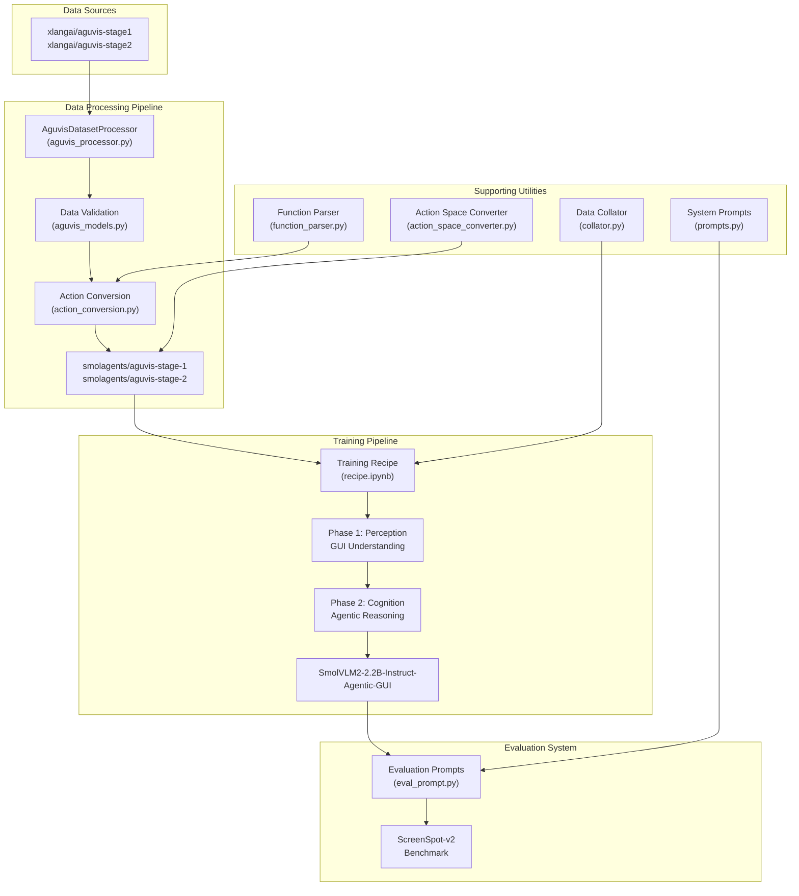
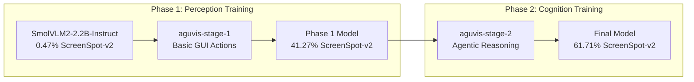
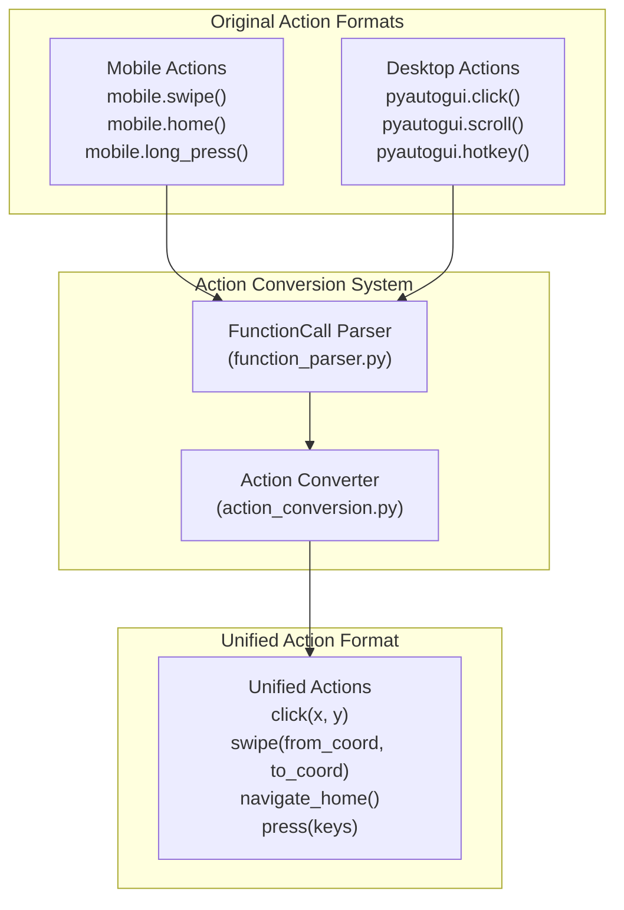
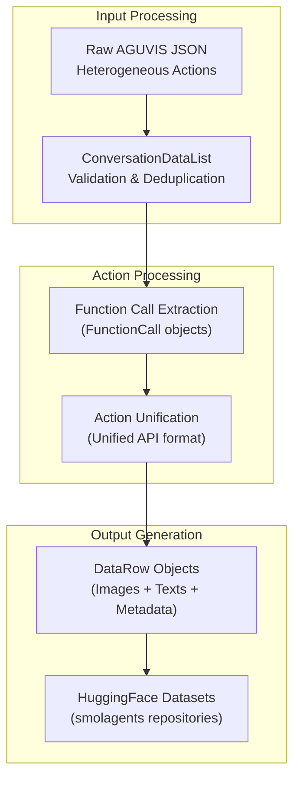

<!-- source: DeepWiki mcp.deepwiki.com · repo huggingface/smol2operator · page 1 Overview · fetched 2026-10-26 -->

# Overview

Relevant source files

The following files were used as context for generating this wiki page:

- [README.md](README.md)
- [assets/google.png](assets/google.png)
- [assets/screenspot-v2.png](assets/screenspot-v2.png)

## Purpose and Scope

The Smol2Operator system is a comprehensive pipeline for training GUI agents using vision-language models through post-training techniques. This wiki documents the complete system for transforming raw GUI interaction datasets into trained models capable of understanding and interacting with graphical user interfaces.

The system takes raw heterogeneous GUI datasets and applies a two-phase supervised fine-tuning approach to create models that can perceive GUI elements and perform agentic reasoning for computer interaction tasks. For specific implementation details of individual components, see [Data Processing Pipeline](#3), [Training System](#4), and [Utility Systems](#6).

## High-Level System Architecture

The Smol2Operator system follows a pipeline architecture that transforms raw datasets through processing, training, and evaluation stages:

Sources: [README.md:1-703]()

## Training Performance Results

The system demonstrates significant performance improvements through its two-phase approach:

| Stage | Model | ScreenSpot-v2 Performance | Improvement |
|-------|--------|--------------------------|-------------|
| Baseline | SmolVLM2-2.2B-Instruct | 0.47% | - |
| Phase 1 | After GUI Perception Training | 41.27% | +40.8% |
| Phase 2 | After Agentic Reasoning Training | 61.71% | +20.44% |

## Core Training Methodology

The system implements a progressive two-phase training strategy:

Sources: [README.md:257-703]()

## Action Space Unification

A critical component of the system is the transformation of heterogeneous action formats into a unified API:

Sources: [README.md:93-255]()

## Key System Components

The system consists of several interconnected modules:

### Data Processing Components
- **AguvisDatasetProcessor**: Main dataset processing orchestrator in [preprocessing/aguvis_processor.py]()
- **Action Conversion System**: Unifies heterogeneous action formats in [preprocessing/action_conversion.py]()
- **Data Models**: Pydantic validation models in [preprocessing/aguvis_models.py]()

### Training Infrastructure
- **Training Recipe**: Complete training pipeline in [recipe.ipynb]()
- **Data Collation**: VLM-specific data preparation in [utils/collator.py]()
- **TRL Integration**: Uses TRL library's `SFTTrainer` for supervised fine-tuning

### Evaluation System
- **ScreenSpot-v2 Evaluation**: Benchmark prompts in [eval/eval_prompt.py]()
- **Action Definitions**: System prompts and actions in [utils/prompts.py]()

### Utility Systems
- **Function Call Parser**: Extracts and reconstructs function calls in [utils/function_parser.py]()
- **Action Space Converter**: Adapts actions to custom vocabularies in [utils/action_space_converter.py]()

Sources: [README.md:674-684]()

## Dataset Transformation Pipeline

The system transforms raw AGUVIS datasets through a comprehensive processing pipeline:

Sources: [README.md:93-255](), [preprocessing/aguvis_processor.py](), [preprocessing/action_conversion.py]()

## Technical Architecture Highlights

1. **Normalized Coordinates**: Uses 0-1 normalized coordinates instead of pixel coordinates for resolution independence
2. **Progressive Training**: Two-phase approach builds perception capabilities before adding agentic reasoning
3. **Modular Design**: Clear separation between data processing, training, evaluation, and utilities
4. **Open Source**: All components, datasets, and models are publicly available
5. **Reproducible**: Complete training recipes and data processing tools enable full reproducibility

The system demonstrates how careful data curation and progressive training can transform a base vision-language model with no GUI capabilities into an effective GUI agent through supervised fine-tuning alone.

Sources: [README.md:1-703]()

---

