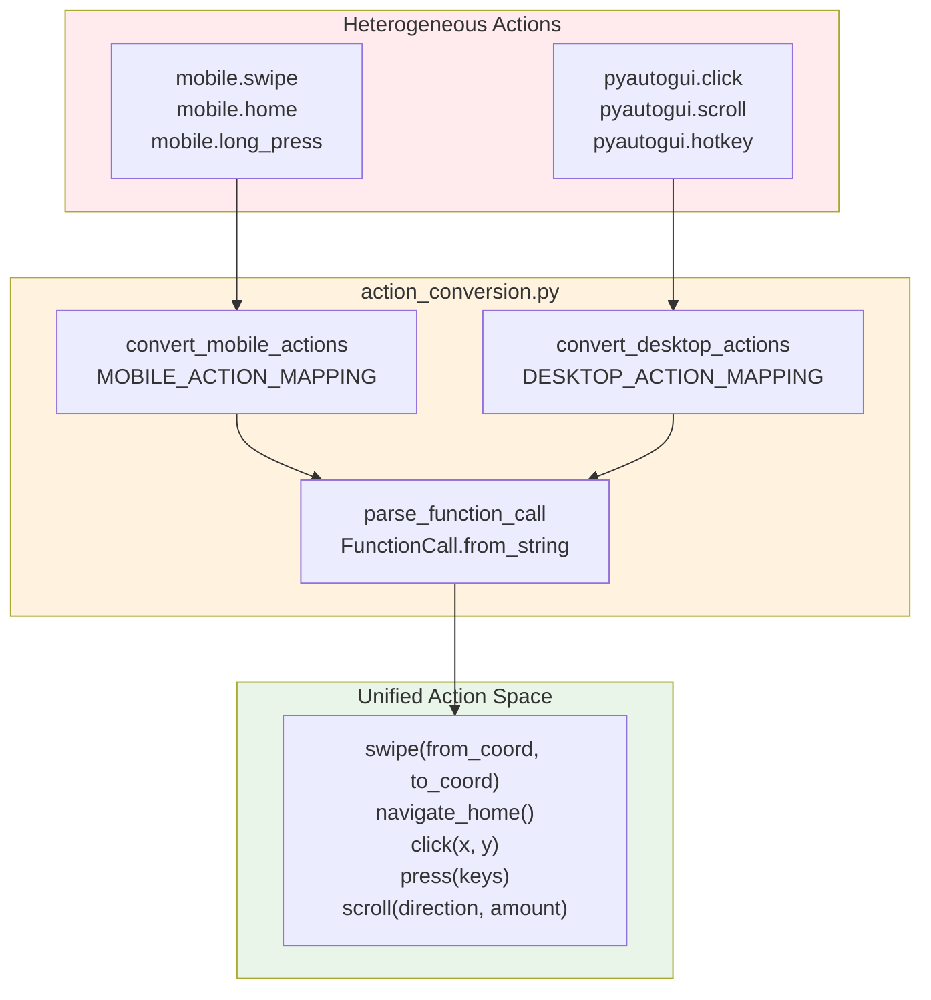
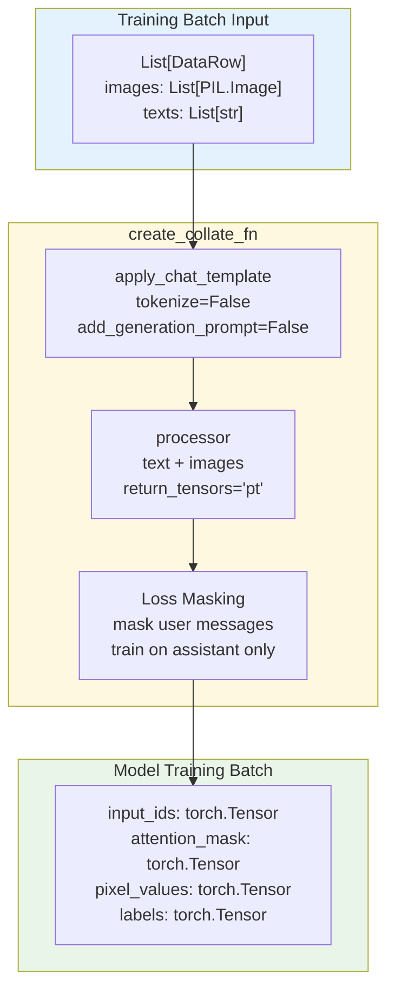

<!-- source: DeepWiki mcp.deepwiki.com · repo huggingface/smol2operator · page 2 System Architecture · fetched 2026-10-26 -->

# System Architecture

<details>
<summary>Relevant source files</summary>

The following files were used as context for generating this wiki page:

- [README.md](README.md)

</details>


## Purpose and Scope

This document details the overall system design of Smol2Operator, a comprehensive pipeline for training Vision-Language Models (VLMs) to perform GUI automation tasks. The architecture implements a two-phase training strategy that transforms a baseline VLM into an agentic GUI agent capable of understanding and interacting with graphical interfaces.

For detailed information about data processing workflows, see [Data Processing Pipeline](#3). For training implementation details, see [Training System](#4). For evaluation methodology, see [Evaluation and Benchmarking](#5).

## Overall System Design

The Smol2Operator system consists of four major subsystems that work together to create a complete GUI agent training pipeline:

**System Architecture Overview**

```mermaid
graph TB
    subgraph "Data_Processing" ["Data Processing Subsystem"]
        ADP["AguvisDatasetProcessor"] 
        ACM["aguvis_models.py<br/>ConversationData<br/>ChatMessage<br/>DataRow"]
        AC["action_conversion.py<br/>convert_mobile_actions<br/>convert_desktop_actions"]
    end
    
    subgraph "Training_Subsystem" ["Training Subsystem"]  
        RNB["recipe.ipynb<br/>TRL_SFTTrainer"]
        COL["collator.py<br/>create_collate_fn"]
        CFG["DatasetConfig<br/>ProcessingConfig"]
    end
    
    subgraph "Evaluation_Subsystem" ["Evaluation Subsystem"]
        EP["eval_prompt.py<br/>PHASE_1_PROMPT<br/>PHASE_2_PROMPT"] 
        SS["ScreenSpot-v2<br/>Benchmark"]
    end
    
    subgraph "Utility_Subsystem" ["Utility Subsystem"]
        FP["function_parser.py<br/>FunctionCall<br/>parse_function_call"]
        ASC["action_space_converter.py<br/>ActionSpaceConverter<br/>ActionMapping"]
        PR["prompts.py<br/>SYSTEM_PROMPT<br/>ACTIONS"]
    end
    
    ADP --> ACM
    ACM --> AC
    AC --> RNB
    CFG --> RNB
    COL --> RNB
    RNB --> EP
    EP --> SS
    FP --> AC
    ASC --> AC
    PR --> EP
    
    style Data_Processing fill:#f9f9f9
    style Training_Subsystem fill:#f0f8ff  
    style Evaluation_Subsystem fill:#fff8f0
    style Utility_Subsystem fill:#f0fff0
```

Sources: [README.md:1-703](), [recipe.ipynb](), [preprocessing/aguvis_processor.py](), [preprocessing/aguvis_models.py](), [preprocessing/action_conversion.py](), [utils/collator.py](), [eval_prompt.py](), [utils/function_parser.py](), [utils/action_space_converter.py](), [prompts.py]()

## Two-Phase Training Strategy

The system implements a progressive training approach where each phase builds specific capabilities:

**Two-Phase Training Flow**

```mermaid
graph TD
    subgraph "Phase_1" ["Phase 1: Perception Training"]
        SM1["SmolVLM2-2.2B-Instruct<br/>Base Model<br/>0.47% ScreenSpot-v2"]
        AS1["smolagents/aguvis-stage-1<br/>GUI Grounding Data"]
        ST1["SFTTrainer<br/>create_collate_fn"]
        M1["Phase 1 Model<br/>41.27% ScreenSpot-v2"]
    end
    
    subgraph "Phase_2" ["Phase 2: Cognition Training"] 
        AS2["smolagents/aguvis-stage-2<br/>Agentic Reasoning Data"]
        ST2["SFTTrainer<br/>create_collate_fn"]  
        M2["SmolVLM2-2.2B-Instruct-Agentic-GUI<br/>61.71% ScreenSpot-v2"]
    end
    
    subgraph "Training_Config" ["Training Configuration"]
        TC1["DatasetConfig<br/>8 stage-1 configs"]
        TC2["DatasetConfig<br/>15 stage-2 configs"]
        WB["wandb<br/>Experiment Tracking"]
    end
    
    SM1 --> AS1
    AS1 --> ST1
    TC1 --> ST1
    ST1 --> M1
    M1 --> AS2
    AS2 --> ST2
    TC2 --> ST2
    ST2 --> M2
    WB --> ST1
    WB --> ST2
    
    style Phase_1 fill:#e8f5e8
    style Phase_2 fill:#f0f8ff
    style Training_Config fill:#fff8f0
```

Sources: [README.md:257-648](), [recipe.ipynb](), [preprocessing/aguvis_models.py:1-50](), [utils/collator.py:1-100]()

## Component Interactions

The system components interact through well-defined interfaces and data structures:

**Component Interaction Flow**

```mermaid
graph LR
    subgraph "Input_Data" ["Input Data Sources"]
        RD["xlangai/aguvis-stage1<br/>xlangai/aguvis-stage2<br/>Raw JSON"]
    end
    
    subgraph "Data_Models" ["Data Models"] 
        CD["ConversationData<br/>image: PIL.Image<br/>messages: List[ChatMessage]"]
        CM["ChatMessage<br/>role: str<br/>content: str"]
        DR["DataRow<br/>images: List<PIL.Image]<br/>texts: List[str]<br/>source: str"]
    end
    
    subgraph "Processing_Engine" ["Processing Engine"]
        ADP["AguvisDatasetProcessor<br/>process_dataset<br/>_process_batch"]
        FC["FunctionCall<br/>function_name: str<br/>parameters: Dict"]
        ASP["parse_function_call<br/>convert_mobile_actions<br/>convert_desktop_actions"] 
    end
    
    subgraph "Training_Engine" ["Training Engine"]
        CCF["create_collate_fn<br/>processor: AutoProcessor<br/>apply_chat_template"]
        SFT["SFTTrainer<br/>model: AutoModelForVision2Seq<br/>train_dataset: Dataset"]
    end
    
    RD --> ADP
    ADP --> CD
    CD --> CM
    CD --> DR
    ASP --> FC
    FC --> DR
    DR --> CCF
    CCF --> SFT
    
    style Input_Data fill:#ffebee
    style Data_Models fill:#e3f2fd
    style Processing_Engine fill:#f3e5f5
    style Training_Engine fill:#e8f5e8
```

Sources: [preprocessing/aguvis_processor.py:50-150](), [preprocessing/aguvis_models.py:20-80](), [utils/function_parser.py:1-100](), [preprocessing/action_conversion.py:1-200](), [utils/collator.py:20-80]()

## Core Processing Pipelines  

### Action Space Unification Pipeline

The system converts heterogeneous action formats from different frameworks into a unified API:

| Original Framework | Example Action | Unified Action |
|-------------------|----------------|----------------|
| Mobile Actions | `mobile.swipe(from_coord=[0.581, 0.898], to_coord=[0.601, 0.518])` | `swipe(from_coord=[0.581, 0.898], to_coord=[0.601, 0.518])` |
| Desktop Actions | `pyautogui.click(x=0.8102, y=0.9463)` | `click(x=0.8102, y=0.9463)` |
| Mobile Actions | `mobile.home()` | `navigate_home()` |
| Desktop Actions | `pyautogui.hotkey(keys=['ctrl', 'c'])` | `press(keys=['ctrl', 'c'])` |

**Action Conversion Flow**



Sources: [preprocessing/action_conversion.py:50-200](), [utils/function_parser.py:20-80](), [README.md:114-154]()

### Training Data Collation Pipeline

The `create_collate_fn` function handles VLM-specific data preparation for training:

**Data Collation Process**



Sources: [utils/collator.py:1-100](), [README.md:270-280]()

The system architecture enables complete reproducibility through modular design, with each component handling a specific aspect of the GUI agent training pipeline. The two-phase approach progressively builds capabilities from basic perception to advanced agentic reasoning, while the unified action space ensures consistent training across diverse GUI environments.

---

