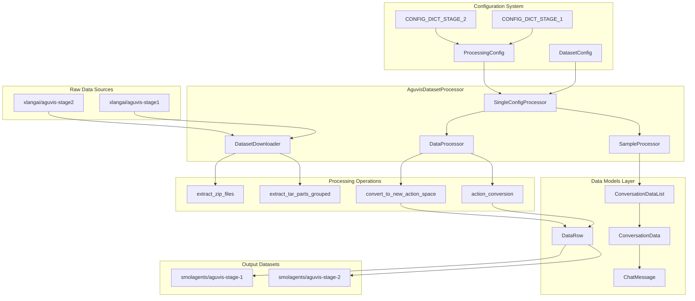
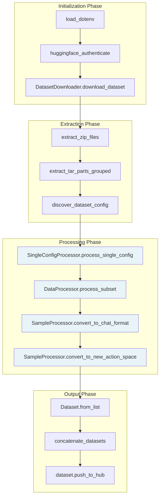
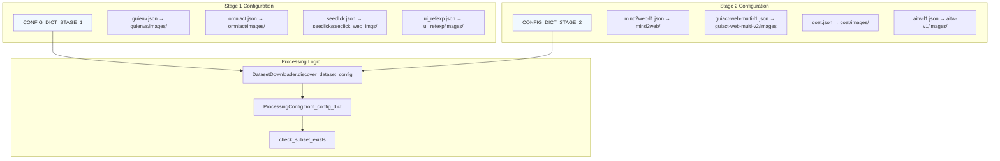
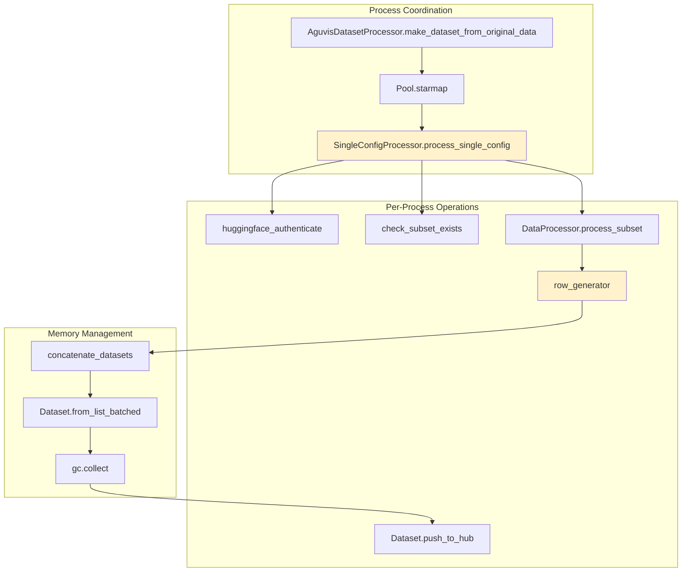

<!-- source: DeepWiki mcp.deepwiki.com · repo huggingface/smol2operator · page 3 Data Processing Pipeline · fetched 2026-10-26 -->

# Data Processing Pipeline

Relevant source files

The following files were used as context for generating this wiki page:

- [README.md](README.md)
- [preprocessing/aguvis_models.py](preprocessing/aguvis_models.py)
- [preprocessing/aguvis_processor.py](preprocessing/aguvis_processor.py)

The data processing pipeline transforms raw AGUVIS datasets into standardized, training-ready formats for GUI agent development. This system handles the complete end-to-end workflow from downloading heterogeneous datasets to producing unified, validated training data with consistent action spaces.

This document covers the core data transformation pipeline. For training system integration, see [Training System](#4). For action space unification details, see [Action Space Unification](#3.3).

## Pipeline Architecture Overview

The data processing pipeline operates through several coordinated components that handle dataset downloading, validation, transformation, and upload:

**Sources:** [preprocessing/aguvis_processor.py:1-526](), [preprocessing/aguvis_models.py:1-362]()

## Core Processing Workflow

The pipeline executes through a structured sequence of operations managed by the `AguvisDatasetProcessor` class:

**Sources:** [preprocessing/aguvis_processor.py:430-492](), [preprocessing/aguvis_processor.py:350-411]()

## Data Models and Validation Layer

The pipeline uses Pydantic models to enforce data consistency and validation throughout the transformation process:

| Model Class | Purpose | Key Validation |
|-------------|---------|----------------|
| `ChatMessage` | Individual conversation turns | Role validation (user/assistant/system) |
| `ConversationData` | Image + conversation pairs | Image path normalization, multi-image handling |
| `ConversationDataList` | Collections with deduplication | Text and image duplicate removal |
| `DataRow` | Final training format | Chat message organization, image attachment |

```mermaid
graph LR
    subgraph "Input Validation"
        A[Raw_JSON_Data]
        B[ConversationDataList.from_json_with_deduplication]
        C[ConversationData.validate_image]
    end
    
    subgraph "Data Transformation"
        D[ConversationEntry.to_chat_message]
        E[ChatMessage.from_conversation_list] 
        F[SampleProcessor.convert_to_chat_format]
    end
    
    subgraph "Output Generation"
        G[DataRow.from_chat_messages]
        H[DataRow.model_dump]
        I[Dataset.from_list]
    end
    
    A --> B
    B --> C
    C --> D
    D --> E
    E --> F
    F --> G
    G --> H
    H --> I
```

The `ConversationDataList` model implements sophisticated deduplication logic that can be controlled via the `deduplicate` parameter in `DatasetConfig`:

**Sources:** [preprocessing/aguvis_models.py:81-138](), [preprocessing/aguvis_models.py:141-191]()

## Dataset Configuration Discovery

The pipeline automatically discovers dataset configurations using predefined configuration dictionaries that map JSON files to their corresponding image directories:

The `discover_dataset_config` method scans the downloaded dataset directory and creates `ProcessingConfig` objects for each discovered configuration, enabling parallel processing of multiple dataset subsets.

**Sources:** [preprocessing/aguvis_processor.py:132-159](), [preprocessing/aguvis_models.py:240-361]()

## Parallel Processing Architecture

The pipeline supports configurable parallel processing to handle multiple dataset configurations simultaneously:

Each process handles authentication independently and implements memory management through garbage collection and dataset batching to prevent memory overflow during large dataset processing.

**Sources:** [preprocessing/aguvis_processor.py:454-492](), [preprocessing/aguvis_processor.py:334-411]()

## Sample Processing and Action Conversion

The `SampleProcessor` class handles the core transformation logic, converting raw conversation data into standardized chat formats and applying action space unification:

```mermaid
graph LR
    subgraph "Input Processing"
        A[load_image_from_folder]
        B[convert_to_chat_format]
        C[convert_to_code_agent_format]
    end
    
    subgraph "Action Space Processing"
        D[convert_to_new_action_space]
        E[parse_function_call]
        F[action_conversion]
    end
    
    subgraph "Output Generation"
        G[DataRow.from_chat_messages]
        H[model_dump]
    end
    
    A --> B
    B --> C
    C --> D
    D --> E
    E --> F
    F --> G
    G --> H
    
    style D fill:#e8f5e8
    style E fill:#e8f5e8  
    style F fill:#e8f5e8
```

The processing pipeline applies different formatting based on the `reasoning` parameter in `DatasetConfig`:
- **Stage 1 (reasoning=False)**: Direct action format without thinking blocks
- **Stage 2 (reasoning=True)**: Wrapped in `<think>` and `<code>` blocks for agentic reasoning

**Sources:** [preprocessing/aguvis_processor.py:163-278](), [preprocessing/aguvis_processor.py:310-332]()

---

