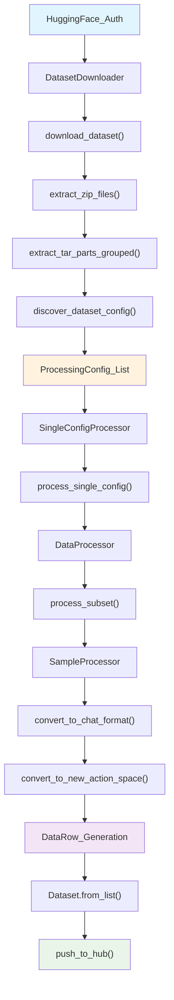
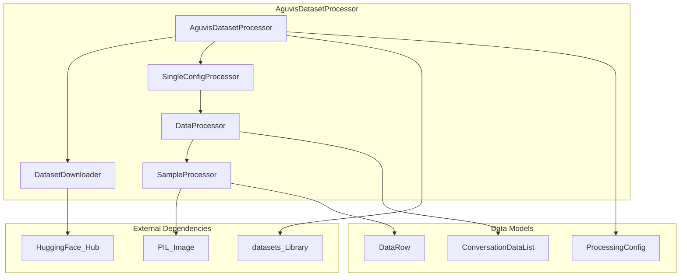
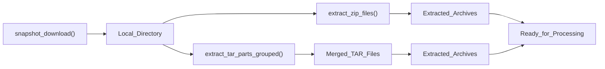
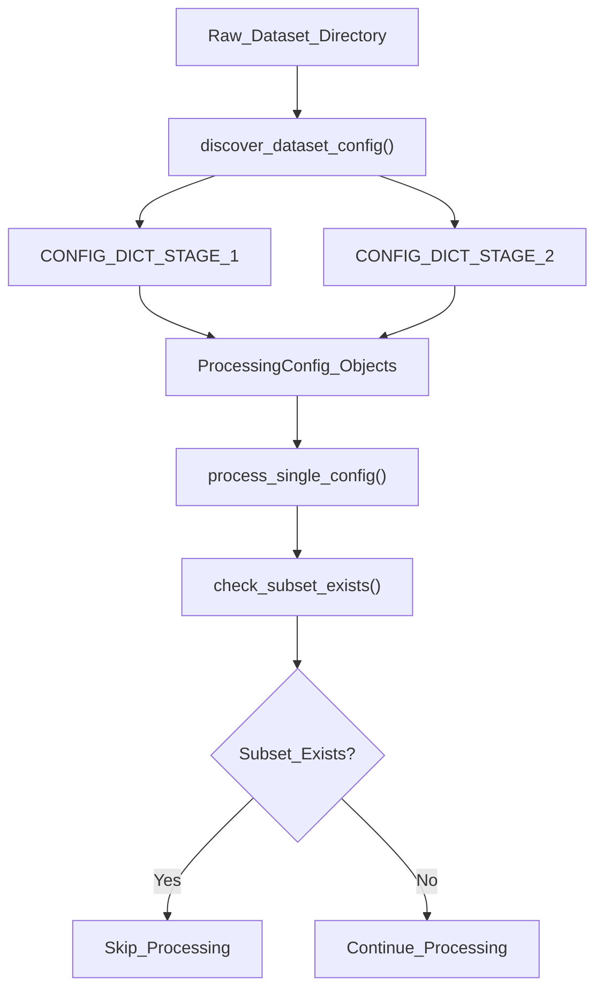
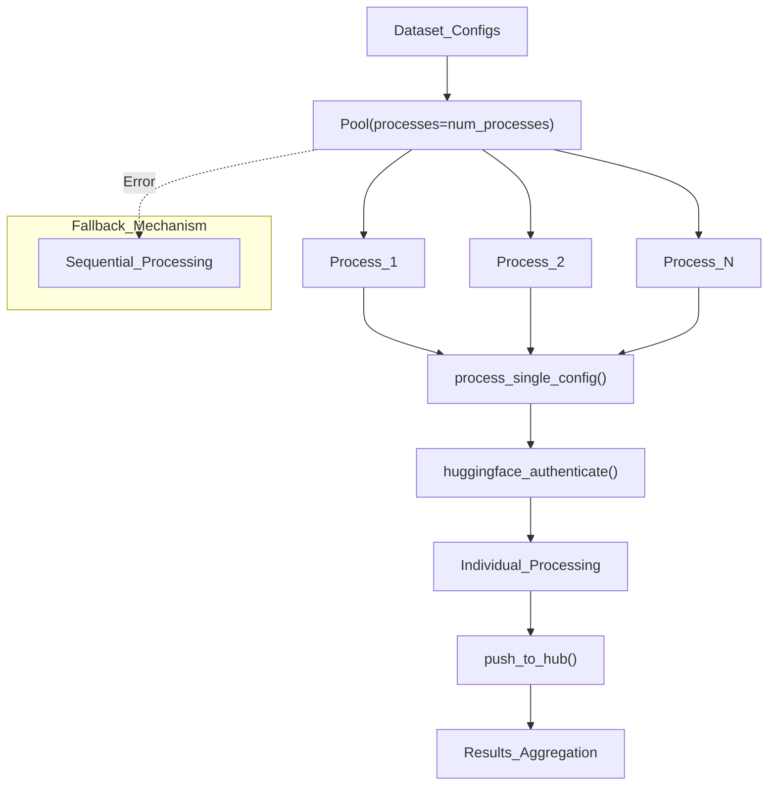

<!-- source: DeepWiki mcp.deepwiki.com · repo huggingface/smol2operator · page 3.1 Dataset Processing · fetched 2026-10-26 -->

# Dataset Processing

<details>
<summary>Relevant source files</summary>

The following files were used as context for generating this wiki page:

- [preprocessing/aguvis_processor.py](preprocessing/aguvis_processor.py)

</details>


This document covers the `AguvisDatasetProcessor` and its associated components, which implement the end-to-end transformation workflow for converting raw AGUVIS datasets from xlangai repositories into processed, training-ready datasets hosted on smolagents repositories. The system handles downloading, extraction, format conversion, action space unification, and batch uploading.

For information about the data models and validation used throughout this process, see [Data Models and Validation](#3.2). For details about action space unification specifically, see [Action Space Unification](#3.3).

## Processing Pipeline Overview

The dataset processing pipeline transforms raw AGUVIS datasets through a multi-stage workflow that handles heterogeneous data formats, extracts compressed archives, applies format conversions, and uploads the results to HuggingFace Hub.

**Dataset Processing Pipeline**


Sources: [preprocessing/aguvis_processor.py:413-521]()

## Core Components

### AguvisDatasetProcessor

The `AguvisDatasetProcessor` serves as the main orchestrator class that coordinates the entire processing pipeline. It initializes the necessary components and manages the high-level workflow.

| Component | Class | Primary Responsibility |
|-----------|-------|----------------------|
| Main Orchestrator | `AguvisDatasetProcessor` | Pipeline coordination and multiprocessing |
| Download Manager | `DatasetDownloader` | Repository downloading and archive extraction |
| Config Processor | `SingleConfigProcessor` | Individual dataset configuration processing |
| Data Transformer | `DataProcessor` | Subset processing and data generation |
| Sample Converter | `SampleProcessor` | Message format conversion and action space transformation |

**Component Architecture**


Sources: [preprocessing/aguvis_processor.py:413-419](), [preprocessing/aguvis_processor.py:55-85](), [preprocessing/aguvis_processor.py:163-178](), [preprocessing/aguvis_processor.py:280-332](), [preprocessing/aguvis_processor.py:334-411]()

### Dataset Download and Extraction

The `DatasetDownloader` handles repository cloning and archive extraction operations. It supports both ZIP files and split TAR archives that need to be merged before extraction.



The extraction process includes intelligent deduplication - archives are only extracted if the target directory doesn't already exist and contain files [preprocessing/aguvis_processor.py:74-78](). For TAR files, the system groups split parts by prefix, merges them sequentially, and then extracts the unified archive [preprocessing/aguvis_processor.py:103-130]().

Sources: [preprocessing/aguvis_processor.py:55-131]()

## Data Transformation Workflow

### Configuration Discovery and Processing

The system discovers dataset configurations by scanning the downloaded data directory and matching against predefined configuration dictionaries. Each configuration becomes a `ProcessingConfig` that defines the subset name, JSON path, and images folder.



Sources: [preprocessing/aguvis_processor.py:132-158](), [preprocessing/aguvis_processor.py:340-367]()

### Message Format Conversion

The `SampleProcessor` handles the critical transformation from raw AGUVIS message formats to training-ready chat formats. This involves several steps:

1. **Chat Format Conversion**: Raw conversation data is converted to `ChatMessage` objects using `convert_to_chat_format()` [preprocessing/aguvis_processor.py:224-230]()
2. **Code Agent Format**: Messages are transformed to include system prompts (mobile vs desktop), reasoning blocks (`<think>` and `<code>`), and content cleanup [preprocessing/aguvis_processor.py:176-221]()
3. **Action Space Conversion**: Function calls are parsed and converted to the unified action space using `convert_to_new_action_space()` [preprocessing/aguvis_processor.py:233-277]()

**Message Transformation Pipeline**


Sources: [preprocessing/aguvis_processor.py:176-277]()

### Batch Processing and Memory Management

The data processing implements sophisticated memory management through batching and garbage collection. Rows are collected up to 20,000 samples before creating intermediate datasets, which are then concatenated for final upload.

```python
# Batch processing logic from the row_generator
for row in self.data_processor.row_generator(data, image_folder, json_path, reasoning):
    rows.append(row)
    if len(rows) > 20000:
        logger.info("Creating batch dataset")
        dataset = Dataset.from_list(rows)
        datasets.append(dataset)
        rows = []
        gc.collect()
```

Sources: [preprocessing/aguvis_processor.py:372-403]()

## Parallel Processing Architecture

The system supports parallel processing of multiple dataset configurations using multiprocessing. Each configuration is processed in isolation to prevent memory issues and enable efficient resource utilization.

**Multiprocessing Workflow**


The system includes a fallback mechanism that switches to sequential processing if multiprocessing fails [preprocessing/aguvis_processor.py:467-480]().

Sources: [preprocessing/aguvis_processor.py:454-491]()

## Configuration and Execution

The main execution flow creates `DatasetConfig` objects for both Stage 1 and Stage 2 processing, with different parameters for reasoning and deduplication:

| Stage | Repository | Reasoning | Deduplication | Purpose |
|-------|------------|-----------|---------------|---------|
| Stage 1 | `xlangai/aguvis-stage1` | False | True | Basic GUI understanding |
| Stage 2 | `xlangai/aguvis-stage2` | True | False | Agentic reasoning with `<think>` blocks |

The processor is invoked through the `make_dataset_from_original_data()` method, which orchestrates the complete pipeline from download to upload [preprocessing/aguvis_processor.py:430-491]().

Sources: [preprocessing/aguvis_processor.py:494-525]()

---

