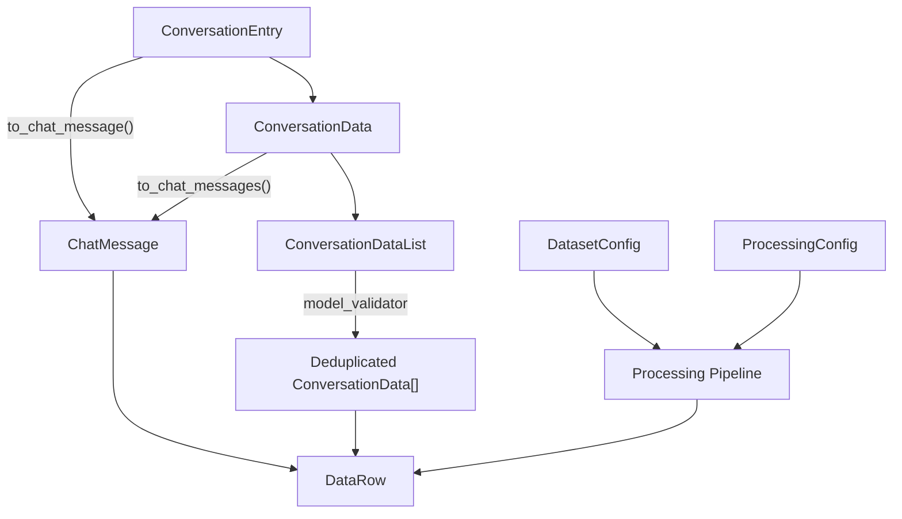
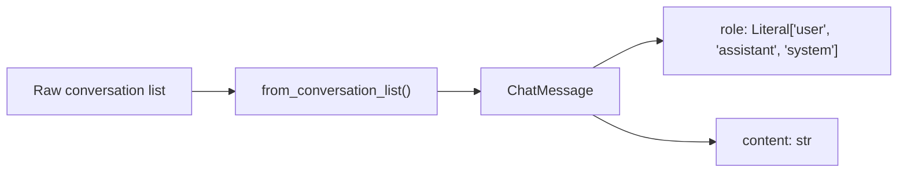
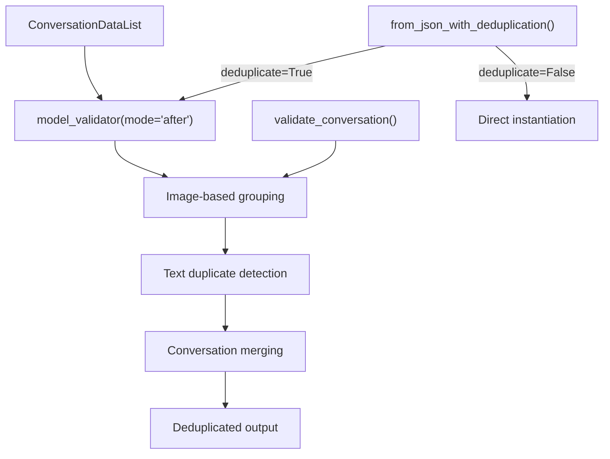
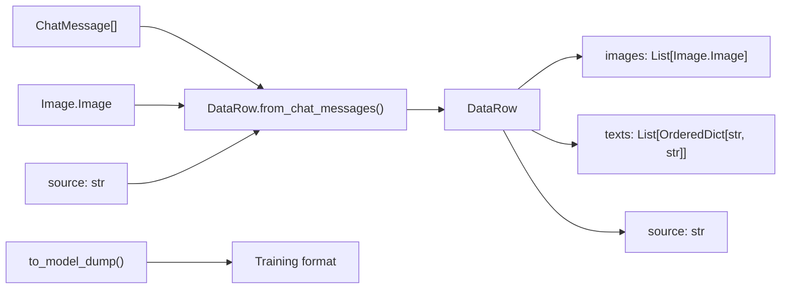

<!-- source: DeepWiki mcp.deepwiki.com · repo huggingface/smol2operator · page 3.2 Data Models and Validation · fetched 2026-10-26 -->

# Data Models and Validation

<details>
<summary>Relevant source files</summary>

The following files were used as context for generating this wiki page:

- [preprocessing/aguvis_models.py](preprocessing/aguvis_models.py)

</details>


This document covers the Pydantic data models and validation logic used throughout the AGUVIS dataset processing pipeline. These models provide structured data representation, automatic validation, and transformation capabilities that ensure data integrity as raw datasets are converted into training-ready formats.

For information about the end-to-end dataset processing workflow, see [Dataset Processing](#3.1). For details on action space conversion, see [Action Space Unification](#3.3).

## Core Data Model Hierarchy

The system uses a hierarchical set of Pydantic models that transform raw conversation data through multiple stages of validation and processing. The primary models form a clear progression from basic messages to complete training examples.



**Core Data Model Flow**

Sources: [preprocessing/aguvis_models.py:1-362]()

### ChatMessage Class

The `ChatMessage` class represents individual conversation messages with strict role validation and conversion utilities.



**ChatMessage Structure and Conversion**

The class provides the `from_conversation_list` static method that handles conversion from various input formats, ensuring consistent role mapping from source formats (`"human"`, `"gpt"`, `"system"`) to standardized roles.

Sources: [preprocessing/aguvis_models.py:13-36]()

### ConversationEntry and ConversationData Models

These models handle the intermediate representation of conversation data with image associations and validation.

| Model | Purpose | Key Validation |
|-------|---------|----------------|
| `ConversationEntry` | Single conversation turn | Role mapping via `from_` field alias |
| `ConversationData` | Complete conversation with image | Image field normalization for single/dual image inputs |

The `ConversationData` model includes a field validator for the image field that handles both single images and image pairs, selecting the appropriate image based on list length.

Sources: [preprocessing/aguvis_models.py:39-79]()

## Validation Logic and Deduplication

The `ConversationDataList` class implements sophisticated validation and deduplication logic through its model validator.



**ConversationDataList Validation Flow**

### Deduplication Algorithm

The validation process follows a three-step deduplication algorithm:

1. **Image Grouping**: Groups conversations by image path using a dictionary structure
2. **Text Deduplication**: Compares conversation content within each image group, removing exact duplicates based on `model_dump()` comparison
3. **Conversation Merging**: Merges remaining conversations for the same image into single entries

The `from_json_with_deduplication` class method provides control over whether deduplication runs, allowing bypass for performance optimization when duplicates are not expected.

Sources: [preprocessing/aguvis_models.py:81-138]()

## Configuration Models

Two configuration models control dataset processing parameters and provide structured access to processing configurations.

### DatasetConfig Model

```python
class DatasetConfig(BaseModel):
    huggingface_repo_id: str
    local_path: str  
    config_dict: List[Dict[str, Any]]
    smolagents_repo_id: str
    reasoning: bool
    deduplicate: bool = False
```

This model encapsulates all parameters needed for dataset processing, including source and target repository IDs, local paths, and processing flags.

### ProcessingConfig Model

The `ProcessingConfig` model handles individual subset processing parameters and provides factory methods for configuration creation.

| Field | Purpose |
|-------|---------|
| `subset_name` | Derived from JSON filename |
| `json_path` | Path to source JSON data |
| `images_folder` | Path to associated images |

The `from_config_dict` class method automatically generates subset names by removing `.json` extensions from file paths.

Sources: [preprocessing/aguvis_models.py:193-221]()

## Data Transformation Pipeline

The `DataRow` class represents the final processed format that bridges validated conversation data with training pipeline requirements.



**DataRow Transformation Process**

### Message Processing Logic

The `from_chat_messages` static method implements sophisticated message processing logic that handles both system-message and non-system-message conversations:

- **System Message Handling**: Requires all three roles (system, user, assistant) before creating training examples
- **Direct Conversations**: Processes user-assistant pairs directly when no system messages are present
- **Ordered Dictionary Structure**: Maintains consistent field ordering for training compatibility

The method processes messages sequentially, accumulating role-based content until complete conversation turns are formed, then converts them to `OrderedDict` structures suitable for training collation.

Sources: [preprocessing/aguvis_models.py:141-191]()

## Static Dataset Configurations

The module includes predefined configuration dictionaries for the two training stages:

| Configuration | Purpose | Dataset Count |
|--------------|---------|---------------|
| `CONFIG_DICT_STAGE_1` | Basic GUI understanding datasets | 8 datasets |
| `CONFIG_DICT_STAGE_2` | Advanced agentic reasoning datasets | 19 datasets |
| `MOBILE_FILES` | Mobile-specific action space files | 11 files |

These configurations provide standardized paths and folder structures for consistent dataset processing across different training phases.

Sources: [preprocessing/aguvis_models.py:224-361]()

---

