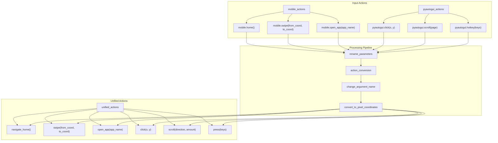
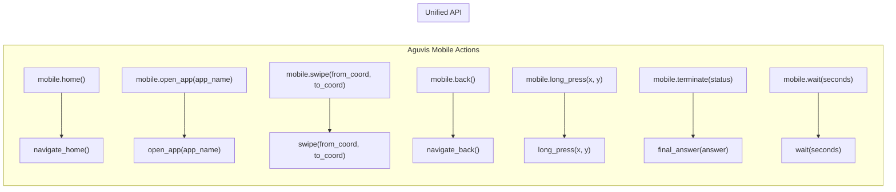
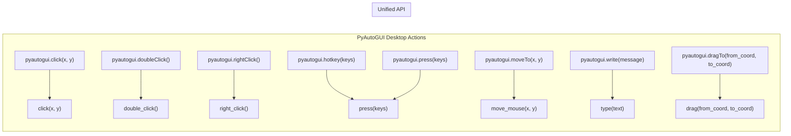
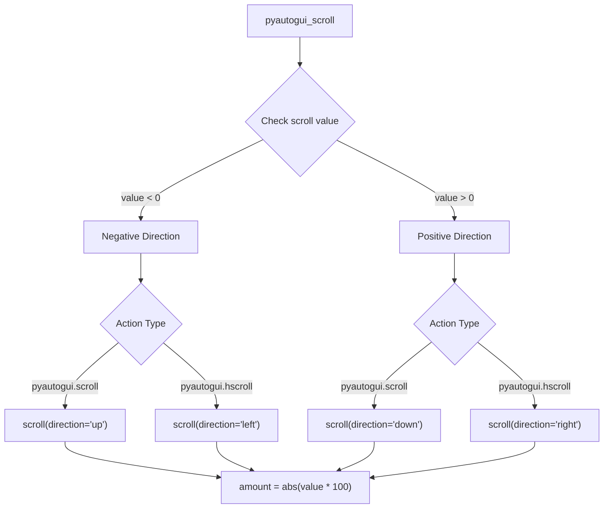
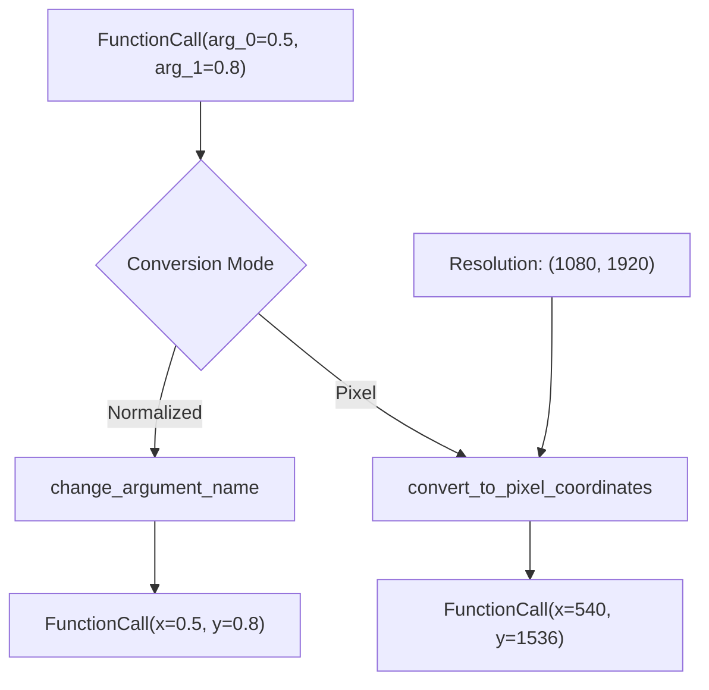

<!-- source: DeepWiki mcp.deepwiki.com · repo huggingface/smol2operator · page 3.3 Action Space Unification · fetched 2026-10-26 -->

# Action Space Unification

<details>
<summary>Relevant source files</summary>

The following files were used as context for generating this wiki page:

- [preprocessing/action_conversion.py](preprocessing/action_conversion.py)

</details>


## Purpose and Scope

The Action Space Unification system transforms heterogeneous action formats from different GUI automation frameworks into a standardized, unified API. This system enables consistent training across diverse GUI environments by converting mobile actions (Aguvis framework) and desktop actions (PyAutoGUI framework) into a common action vocabulary.

For information about how these unified actions are used during training, see [Training System](#4). For details on how the converted actions are further processed into custom formats, see [Action Space Conversion](#6.2).

## System Overview

The action conversion pipeline operates as the central unification layer between raw dataset actions and the training system. It handles coordinate normalization, parameter standardization, and semantic mapping across different action frameworks.

### Conversion Architecture



Sources: [preprocessing/action_conversion.py:120-233]()

### Core Conversion Functions

The system implements four main conversion functions that work together to transform actions:

| Function | Purpose | Input | Output |
|----------|---------|-------|--------|
| `rename_parameters` | Standardize parameter names to `arg_0`, `arg_1` format | Named parameters | Generic indexed parameters |
| `action_conversion` | Master orchestrator for all conversions | List of `FunctionCall` objects | Unified action format |
| `change_argument_name` | Convert generic args to semantic names | `arg_0`, `arg_1` | `x`, `y`, `from_coord`, `to_coord` |
| `convert_to_pixel_coordinates` | Transform normalized coords to pixels | Float coordinates (0.0-1.0) | Integer pixel coordinates |

Sources: [preprocessing/action_conversion.py:96-117](), [preprocessing/action_conversion.py:70-94](), [preprocessing/action_conversion.py:44-69](), [preprocessing/action_conversion.py:120-233]()

## Mobile Action Conversions

The system converts Aguvis mobile framework actions into the unified API format. Each mobile action maps to a corresponding unified action with standardized parameters.

### Mobile Action Mapping



The mobile action conversion logic processes each action type with specific parameter handling:

- **Navigation actions**: `mobile.home()` and `mobile.back()` become `navigate_home()` and `navigate_back()`
- **Coordinate actions**: `mobile.swipe()` and `mobile.long_press()` preserve coordinate parameters through `change_argument_name()`
- **Completion actions**: Both `mobile.terminate()` and `answer()` map to `final_answer()`
- **Timing actions**: `mobile.wait()` converts seconds parameter to integer format

Sources: [preprocessing/action_conversion.py:150-175]()

## Desktop Action Conversions

PyAutoGUI desktop actions undergo more complex transformations, particularly for scroll actions which require direction detection and coordinate actions which need parameter standardization.

### Desktop Action Mapping



### Scroll Action Intelligence

The scroll conversion implements intelligent direction detection based on the sign of the scroll value:



Sources: [preprocessing/action_conversion.py:207-222]()

## Coordinate System Handling

The system supports both normalized coordinates (0.0-1.0 range) and absolute pixel coordinates, with bidirectional conversion capabilities based on screen resolution.

### Coordinate Conversion Pipeline

The coordinate handling implements two main conversion modes:

**Normalized Coordinate Mode** (`change_argument_name`):
- Preserves float values in 0.0-1.0 range
- Converts `arg_0`, `arg_1` to semantic names (`x`, `y`, `from_coord`, `to_coord`)
- Maintains coordinate pairs as tuples

**Pixel Coordinate Mode** (`convert_to_pixel_coordinates`):
- Multiplies normalized values by screen resolution
- Converts float coordinates to integer pixel positions
- Applies resolution scaling: `pixel_x = int(normalized_x * screen_width)`



Sources: [preprocessing/action_conversion.py:70-94](), [preprocessing/action_conversion.py:44-69]()

## Implementation Details

### Parameter Standardization Process

The conversion process follows a three-stage parameter standardization pipeline:

1. **Parameter Renaming**: All parameters are first converted to generic `arg_0`, `arg_1`, `arg_2` format
2. **Action Conversion**: Function names are mapped to unified API equivalents
3. **Semantic Naming**: Generic parameters are converted back to meaningful names

This standardization ensures consistent parameter handling across all action types and frameworks.

### Error Handling and Validation

The system implements strict validation with explicit error handling for unsupported actions:

```python
# Unsupported action detection
else:
    raise ValueError(f"🚫 Unsupported action: {action.function_name}")
```

Each converted action preserves its original string representation for debugging purposes through the `original_string` attribute.

### Function Call Integration

The conversion system integrates with the `FunctionCall` class from the function parser utility, which provides the foundational data structure for representing and manipulating GUI actions throughout the pipeline.

Sources: [preprocessing/action_conversion.py:227-231](), [preprocessing/action_conversion.py:1-3]()

---

