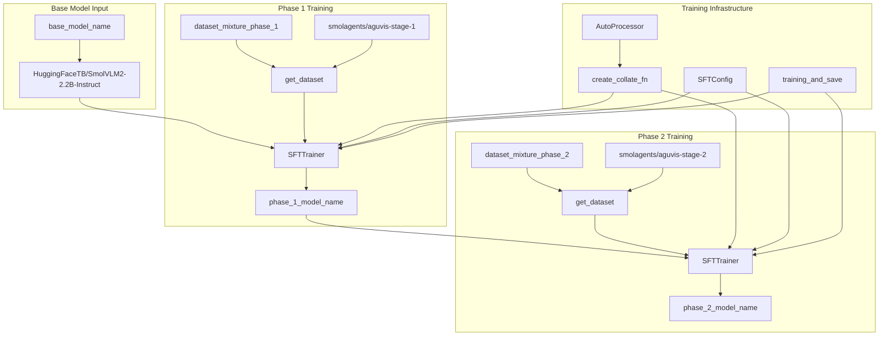
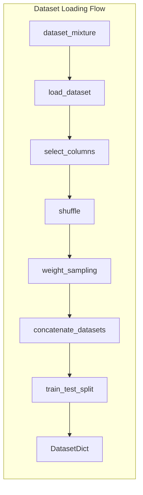
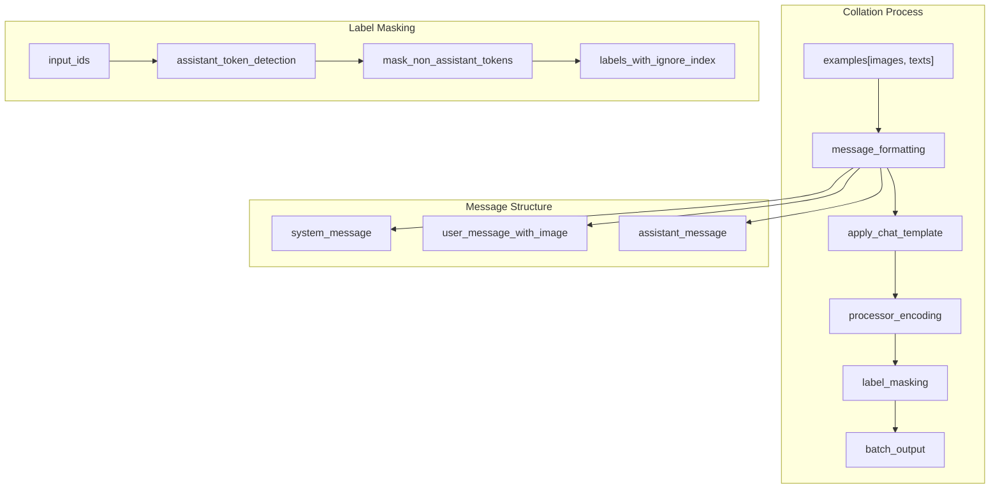

<!-- source: DeepWiki mcp.deepwiki.com · repo huggingface/smol2operator · page 4 Training System · fetched 2026-10-26 -->

# Training System

<details>
<summary>Relevant source files</summary>

The following files were used as context for generating this wiki page:

- [README.md](README.md)
- [recipe.ipynb](recipe.ipynb)

</details>


This document covers the two-phase training pipeline that transforms vision-language models into GUI agents capable of understanding and interacting with graphical user interfaces. The training system implements supervised fine-tuning using TRL's `SFTTrainer` to progress from basic GUI perception to advanced agentic reasoning capabilities.

For information about data preprocessing and action space unification, see [Data Processing Pipeline](#3). For evaluation methodologies and benchmarks, see [Evaluation and Benchmarking](#5).

## Training Pipeline Overview

The training system implements a sequential two-phase approach where Phase 1 builds fundamental GUI grounding capabilities, and Phase 2 adds sophisticated reasoning and planning abilities.



**Sources:** [recipe.ipynb:311-315](), [recipe.ipynb:514-521](), [recipe.ipynb:590-596]()

## Phase 1: Basic GUI Understanding

Phase 1 training focuses on establishing fundamental grounding capabilities by training the model to understand and locate visual elements within screenshots. This phase uses eight distinct dataset configurations from `smolagents/aguvis-stage-1`.

### Dataset Configuration

The `dataset_mixture_phase_1` variable defines the training data mixture for Phase 1:

| Dataset Config | Purpose | Weight |
|---|---|---|
| `guienv` | GUI environment understanding | 1.0 |
| `omniact` | Multi-modal action grounding | 1.0 |
| `ricoig16k` | Mobile UI icon grounding | 1.0 |
| `ricosca` | Screen content analysis | 1.0 |
| `seeclick` | Click target identification | 1.0 |
| `ui_refexp` | UI reference expression | 1.0 |
| `webui350k` | Web interface understanding | 1.0 |
| `widget_captioning` | Widget description generation | 1.0 |

**Sources:** [recipe.ipynb:55-112]()

### Training Parameters

Phase 1 uses specific hyperparameters optimized for GUI perception learning:

- **Epochs:** 2.0
- **Learning Rate:** 2.0e-05
- **Batch Size:** 2 per device with 32 gradient accumulation steps
- **Image Size:** 1152px (configured via `image_size` parameter)
- **Max Length:** 16384 tokens
- **Coordinate System:** Normalized coordinates (0-1 range)

**Sources:** [recipe.ipynb:529-562](), [recipe.ipynb:314-315]()

## Phase 2: Agentic Reasoning

Phase 2 builds upon Phase 1 capabilities by introducing explicit reasoning through `<think>` and `<code>` blocks. This phase trains the model to deliberate before acting and execute multi-step interactions.

### Dataset Configuration

The `dataset_mixture_phase_2` includes 15 dataset configurations with varying weights:

| Dataset Config | Purpose | Weight |
|---|---|---|
| `mind2web-l1/l2` | Web navigation reasoning | 1.0 |
| `guiact-web-*` | Web GUI action sequences | 1.0 |
| `miniwob-l1/l2` | MiniWoB task completion | 1.0 |
| `coat` | Code-based action training | 1.0 |
| `android_control` | Mobile device control | 1.0 |
| `gui-odyssey-l1/l2` | Complex GUI navigation | 0.33 |
| `amex-l1/l2` | Application interaction | 0.33 |
| `aitw-l1/l2` | AI task workflow | 1.0 |

**Sources:** [recipe.ipynb:128-234]()

### Training Adjustments

Phase 2 modifies training parameters to handle more complex reasoning patterns:

- **Gradient Accumulation:** Reduced to 16 steps
- **Batch Size:** Increased to 4 per device
- **Model Base:** Loads from Phase 1 checkpoint (`phase_1_model_name`)

**Sources:** [recipe.ipynb:614-618]()

## Dataset Loading and Mixing

The `get_dataset` function implements weighted dataset mixing with train/test splitting:



The function processes each dataset configuration by:

1. Loading datasets using `load_dataset` with specified `id`, `config`, and `split`
2. Selecting only required columns (`images`, `texts`)
3. Applying dataset weights through sampling
4. Combining all datasets with `concatenate_datasets`
5. Splitting into train/test sets (1% test by default)

**Sources:** [recipe.ipynb:252-295]()

## Model Training Infrastructure

### Processor Configuration

The `AutoProcessor` is configured for optimal image and text processing:

```python
processor = AutoProcessor.from_pretrained(base_model_name, ...)
processor.image_processor.size = {"longest_edge": image_size}
processor.tokenizer.truncation_side = "right"
processor.tokenizer.padding_side = "right"
```

**Sources:** [recipe.ipynb:333-340]()

### Data Collation System

The `create_collate_fn` function implements specialized VLM data preparation:



Key features of the collation system:

- **Message Formatting:** Converts raw examples into chat message format with proper role attribution
- **Image Integration:** Adds images to the first user message in each conversation
- **Label Masking:** Masks all tokens except assistant responses for loss computation using `-100` ignore index
- **Assistant Detection:** Uses tokenizer encoding to locate assistant message positions for precise masking

**Sources:** [recipe.ipynb:349-457]()

## Training Orchestration

The `training_and_save` function coordinates the complete training workflow:

### SFTTrainer Configuration

```python
trainer = SFTTrainer(
    model=model,
    args=training_args,
    data_collator=data_collator,
    train_dataset=dataset["train"],
    eval_dataset=dataset["test"],
    processing_class=processor,
)
```

### Training Workflow

1. **Model Loading:** Loads model with specified dtype (`torch.bfloat16`) and attention implementation (`sdpa`)
2. **Training Execution:** Runs training with configured `SFTConfig` parameters
3. **Metrics Logging:** Records training metrics and saves to output directory
4. **Model Persistence:** Saves trained model, tokenizer, and training state
5. **Experiment Tracking:** Integrates with Weights & Biases for monitoring

**Sources:** [recipe.ipynb:475-496]()

### SFTConfig Parameters

The training configuration uses TRL's `SFTConfig` with GUI-specific optimizations:

- **Optimization:** `adamw_torch` optimizer with cosine learning rate scheduling
- **Memory Management:** Gradient checkpointing enabled with `use_reentrant=False`
- **Evaluation Strategy:** Steps-based evaluation every 100 steps
- **Logging:** Detailed logging every 5 steps with WandB integration
- **Saving Strategy:** Epoch-based model saving with limit of 1 checkpoint

**Sources:** [recipe.ipynb:529-562]()

This training system successfully transforms the base SmolVLM2-2.2B-Instruct model from 0.47% ScreenSpot-v2 accuracy to 61.71% through the two-phase approach, demonstrating the effectiveness of progressive capability building for GUI agent training.

---

