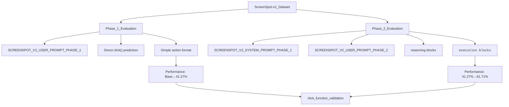
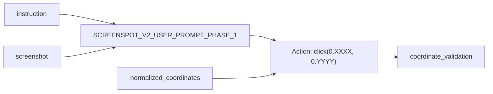
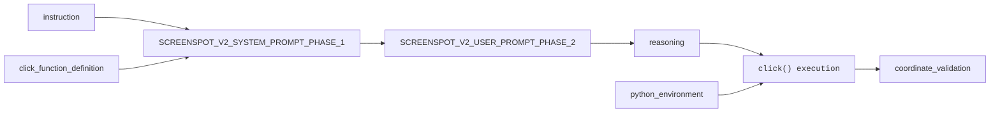

<!-- source: DeepWiki mcp.deepwiki.com · repo huggingface/smol2operator · page 5 Evaluation and Benchmarking · fetched 2026-10-26 -->

# Evaluation and Benchmarking

<details>
<summary>Relevant source files</summary>

The following files were used as context for generating this wiki page:

- [README.md](README.md)
- [utils/eval_prompt.py](utils/eval_prompt.py)

</details>


This document covers the evaluation and benchmarking system used to measure GUI agent performance throughout the Smol2Operator training pipeline. The system primarily uses the ScreenSpot-v2 benchmark to evaluate GUI grounding capabilities and tracks performance improvements across the two-phase training process.

For information about the training pipeline itself, see [Training System](#4). For details about the data processing that prepares evaluation datasets, see [Data Processing Pipeline](#3).

## ScreenSpot-v2 Benchmark

The evaluation system centers around the **ScreenSpot-v2** benchmark, which tests a model's ability to understand and locate GUI elements within screenshots. This benchmark provides quantitative measurements of GUI interaction capabilities by requiring models to generate precise click coordinates for specified interface elements.

### Benchmark Characteristics

ScreenSpot-v2 evaluates GUI grounding through:
- **Element Localization**: Models must identify target GUI elements from natural language instructions
- **Coordinate Prediction**: Accurate coordinate generation in normalized [0,1] range
- **Screenshot Understanding**: Visual comprehension of diverse GUI environments including mobile, desktop, and web interfaces

The benchmark serves as the primary metric for measuring training progress, with performance tracked from the base model (0.47% accuracy) through both training phases to the final model (61.71% accuracy).

**Sources**: [README.md:76-76](), [README.md:492-492]()

## Two-Phase Evaluation Strategy

The evaluation system implements distinct approaches for Phase 1 and Phase 2 training, reflecting the different capabilities developed at each stage.


*Evaluation Pipeline Architecture*

### Phase 1 Evaluation: Basic Grounding

Phase 1 evaluation focuses on fundamental GUI element identification and coordinate prediction. The model receives direct instructions to click on specified elements and must respond with precise coordinate predictions.

**Prompt Structure**: The evaluation uses `SCREENSPOT_V2_USER_PROMPT_PHASE_1` which requests simple action output in the format `click(0.XXXX, 0.YYYY)` with normalized coordinates.

### Phase 2 Evaluation: Agentic Reasoning

Phase 2 evaluation incorporates the agentic reasoning capabilities developed in the second training phase. The evaluation framework requires models to demonstrate explicit reasoning before action execution.

**Prompt Structure**: Uses both `SCREENSPOT_V2_SYSTEM_PROMPT_PHASE_1` and `SCREENSPOT_V2_USER_PROMPT_PHASE_2` to establish the agentic framework with `<think>` and `<code>` block structure.

**Sources**: [utils/eval_prompt.py:5-49]()

## Evaluation Prompt System

The evaluation prompts are defined in `utils/eval_prompt.py` and implement the two distinct evaluation approaches.

### Phase 1 Prompt Implementation


*Phase 1 Evaluation Flow*

The Phase 1 prompt (`SCREENSPOT_V2_USER_PROMPT_PHASE_1`) implements a direct instruction-to-action paradigm:
- Takes screenshot and instruction as input
- Requests immediate action output in standardized format
- Emphasizes normalized coordinate requirements
- Focuses on element targeting accuracy

### Phase 2 Prompt Implementation


*Phase 2 Evaluation Flow*

The Phase 2 evaluation combines system and user prompts to establish the agentic framework:
- `SCREENSPOT_V2_SYSTEM_PROMPT_PHASE_1` defines the GUI agent role and available functions
- Includes complete `click()` function definition with parameter specifications
- `SCREENSPOT_V2_USER_PROMPT_PHASE_2` structures the task presentation
- Requires explicit reasoning in `<think>` blocks before action execution

**Sources**: [utils/eval_prompt.py:7-16](), [utils/eval_prompt.py:20-42](), [utils/eval_prompt.py:44-49]()

## Coordinate System and Action Validation

The evaluation system enforces strict coordinate validation to ensure consistent performance measurement across different image resolutions and GUI environments.

### Normalized Coordinate System

All evaluation uses normalized coordinates in the [0,1] range:
- **X-coordinates**: Horizontal position relative to image width
- **Y-coordinates**: Vertical position relative to image height
- **Resolution Independence**: Coordinates remain valid across image size changes

This approach contrasts with pixel-based coordinates, which showed significantly lower performance during optimization experiments (0.55% baseline vs 0.47% for normalized coordinates).

### Action Function Definition

The evaluation system defines the `click()` function with specific parameter requirements:

```python
def click(x: Optional[float] = None, y: Optional[float] = None) -> str:
    """
    Performs a left-click at the specified normalized coordinates
    Args:
        x: The x coordinate (horizontal position)
        y: The y coordinate (vertical position)
    """
```

This function definition appears in the Phase 2 system prompt, establishing the expected action interface for agentic reasoning evaluation.

**Sources**: [utils/eval_prompt.py:32-38](), [README.md:165-168]()

## Performance Measurement and Results

The evaluation system tracks quantitative improvements across the training pipeline, demonstrating the effectiveness of the two-phase training approach.

| Training Phase | ScreenSpot-v2 Accuracy | Improvement |
|----------------|------------------------|-------------|
| Base Model | 0.47% | - |
| Phase 1 Complete | 41.27% | +40.8% |
| Phase 2 Complete | 61.71% | +20.44% |

### Optimization Experiment Results

The evaluation system was used to validate training configuration choices:

| Configuration | Coordinate System | Image Size | Accuracy |
|---------------|------------------|------------|----------|
| Optimal | Normalized | 1152px | 33.72% |
| Alternative | Normalized | 768px | 32.32% |
| Suboptimal | Pixel-based | 1152px | 4.32% |

These results informed the final training configuration selection and demonstrated the importance of normalized coordinates for GUI grounding tasks.

### Cross-Model Validation

The evaluation system also validated training strategy scalability:
- **nanoVLM-460M**: Achieved ~58% ScreenSpot-v2 accuracy
- Demonstrates training approach effectiveness across different model sizes
- Establishes SOTA performance for 460M parameter models on ScreenSpot-v2

**Sources**: [README.md:503-503](), [README.md:601-601](), [README.md:670-670]()

---

