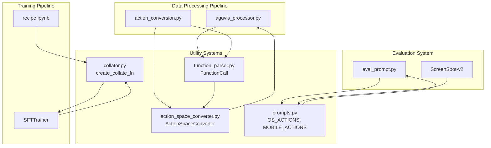
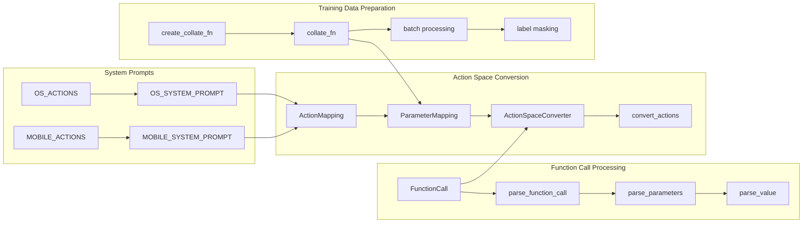

<!-- source: DeepWiki mcp.deepwiki.com · repo huggingface/smol2operator · page 6 Utility Systems · fetched 2026-10-26 -->

# Utility Systems

<details>
<summary>Relevant source files</summary>

The following files were used as context for generating this wiki page:

- [preprocessing/prompts.py](preprocessing/prompts.py)
- [utils/action_space_converter.py](utils/action_space_converter.py)
- [utils/collator.py](utils/collator.py)
- [utils/function_parser.py](utils/function_parser.py)

</details>


This document provides an overview of the supporting utility systems that enable data processing, training, and evaluation in the Smol2Operator pipeline. These utilities handle function call parsing, action space conversion, training data preparation, and system prompt management.

For detailed information about data processing workflows, see [Data Processing Pipeline](#3). For training system integration, see [Training System](#4). For evaluation workflows, see [Evaluation and Benchmarking](#5).

## Overview

The Smol2Operator system relies on several utility modules that provide essential functionality across the pipeline. These utilities transform data between different representations, parse function calls from text, prepare training batches, and manage system prompts and action definitions.

## System Architecture

The utility systems form a supporting layer that integrates with the main data processing and training pipelines:

### Utility Systems Integration



**Sources:** [utils/function_parser.py:1-546](), [utils/action_space_converter.py:1-384](), [utils/collator.py:1-111](), [preprocessing/prompts.py:1-143]()

### Core Utility Components



**Sources:** [utils/function_parser.py:12-95](), [utils/action_space_converter.py:24-157](), [utils/collator.py:4-111](), [preprocessing/prompts.py:1-143]()

## Utility System Components

### Function Call Parser

The `FunctionCall` class and parsing utilities in [utils/function_parser.py]() handle extraction and reconstruction of function calls from strings. Key components include:

| Component | Purpose | Key Methods |
|-----------|---------|-------------|
| `FunctionCall` | Represents parsed function calls | `to_string()`, `_value_to_string()` |
| `parse_function_call()` | Extracts function calls from text | Parameter and value parsing |
| `parse_parameters()` | Parses parameter strings | Handles positional and named arguments |
| `extract_function_calls_from_text()` | Finds function calls in text blocks | Text pattern matching |

### Action Space Converter

The `ActionSpaceConverter` in [utils/action_space_converter.py]() transforms unified API actions into custom action formats:

| Component | Purpose | Configuration |
|-----------|---------|---------------|
| `ActionMapping` | Defines action conversions | `source_function`, `target_function` |
| `ParameterMapping` | Maps parameters between actions | `source_name`, `target_name`, `transform` |
| `ActionSpaceConverter` | Executes action transformations | `convert_actions()`, `_convert_single_action()` |
| `create_default_unified_to_custom_converter()` | Factory for default mappings | Predefined action mappings |

### Training Data Collator

The `create_collate_fn()` function in [utils/collator.py]() prepares VLM training data:

| Stage | Process | Implementation |
|-------|---------|---------------|
| Message Processing | Formats conversation data | Multi-turn dialogue handling |
| Image Integration | Combines images with text | First message image attachment |
| Tokenization | Applies chat templates | Processor tokenization |
| Label Masking | Masks non-assistant tokens | Assistant token identification |

### System Prompts and Actions

The [preprocessing/prompts.py]() module defines action schemas and system prompts:

| Component | Content | Usage |
|-----------|---------|-------|
| `OS_ACTIONS` | Desktop GUI actions | `click()`, `type()`, `scroll()`, `drag()` |
| `MOBILE_ACTIONS` | Mobile device actions | `swipe()`, `long_press()`, `open_app()` |
| `OS_SYSTEM_PROMPT` | Desktop agent instructions | Phase 1 and Phase 2 training |
| `MOBILE_SYSTEM_PROMPT` | Mobile agent instructions | Combined OS and mobile actions |

## Data Flow Through Utilities

### Function Call Processing Flow

```mermaid
graph TD
    A["Raw Text<br/>'mobile.click(x=0.5, y=0.8)'"] --> B[parse_function_call]
    B --> C[FunctionCall<br/>function_name: 'mobile.click'<br/>parameters: {x: 0.5, y: 0.8}]
    C --> D[ActionSpaceConverter]
    D --> E[FunctionCall<br/>function_name: 'touch'<br/>parameters: {x_coord: 0.5, y_coord: 0.8}]
    E --> F[to_string]
    F --> G["Converted Text<br/>'touch(x_coord=0.5, y_coord=0.8)'"]
    
    H[ParameterMapping<br/>source_name: 'x'<br/>target_name: 'x_coord'] --> D
    I[ActionMapping<br/>source_function: 'mobile.click'<br/>target_function: 'touch'] --> D
```

**Sources:** [utils/function_parser.py:97-151](), [utils/action_space_converter.py:70-138]()

### Training Data Preparation Flow

```mermaid
graph TD
    A[Training Examples<br/>images + texts] --> B[create_collate_fn]
    B --> C[collate_fn]
    
    subgraph "Batch Processing"
        C --> D[Format Messages<br/>system, user, assistant roles]
        D --> E[Apply Chat Template<br/>processor.apply_chat_template]
        E --> F[Tokenize<br/>processor tokenization]
        F --> G[Create Labels<br/>input_ids.clone]
        G --> H[Mask Non-Assistant Tokens<br/>labels[i, pos] = -100]
    end
    
    H --> I[Training Batch<br/>input_ids, attention_mask, labels]
    
    J[Assistant Message Encoding<br/>processor.tokenizer] --> G
    K[Image Processing<br/>PIL Images] --> E
```

**Sources:** [utils/collator.py:4-111]()

## Integration with Main Pipeline

The utility systems integrate at key points in the Smol2Operator pipeline:

### Data Processing Integration

- `function_parser.py` extracts function calls during action conversion
- `action_space_converter.py` transforms actions in dataset processing
- Action definitions from `prompts.py` guide conversion logic

### Training Integration

- `collator.py` provides the data collation function for `SFTTrainer`
- System prompts from `prompts.py` structure training conversations
- Label masking ensures only assistant responses contribute to loss

### Evaluation Integration

- System prompts define the action space for ScreenSpot-v2 evaluation
- Function parsing extracts predicted actions from model outputs
- Action definitions provide the vocabulary for GUI interaction tasks

**Sources:** [utils/function_parser.py:1-546](), [utils/action_space_converter.py:1-384](), [utils/collator.py:1-111](), [preprocessing/prompts.py:1-143]()

---

