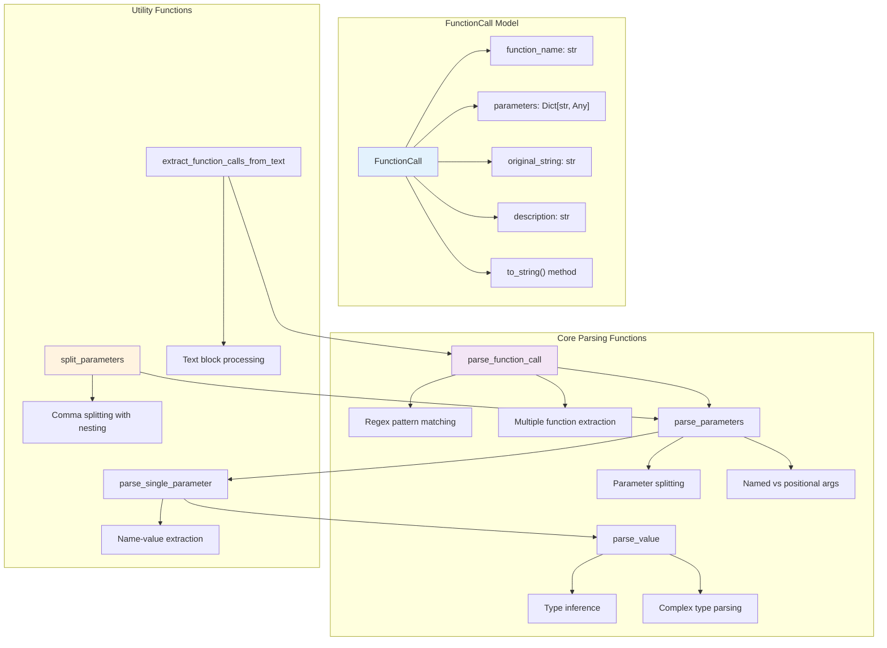
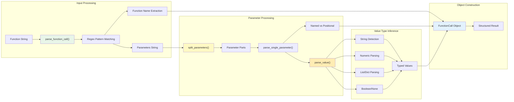
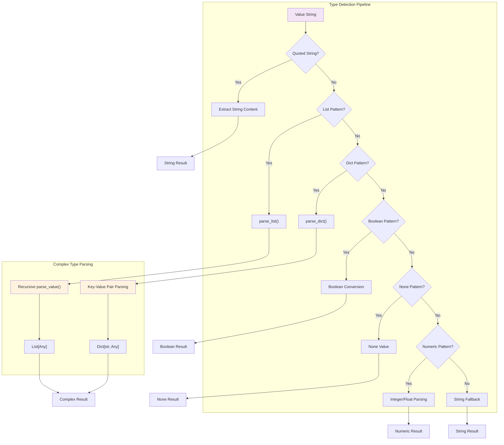
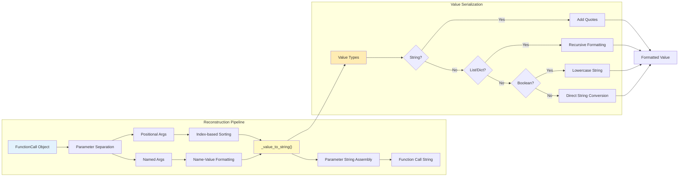

<!-- source: DeepWiki mcp.deepwiki.com · repo huggingface/smol2operator · page 6.1 Function Call Parsing · fetched 2026-10-26 -->

# Function Call Parsing

Relevant source files

The following files were used as context for generating this wiki page:

- [utils/function_parser.py](utils/function_parser.py)

## Purpose and Scope

The Function Call Parsing system extracts and reconstructs function calls from string representations, enabling the conversion between text-based function calls and structured data objects. This utility is essential for processing training data that contains function calls in various formats, particularly for mobile and desktop GUI automation actions.

The system handles complex parameter parsing including nested data structures, positional and named arguments, and provides bidirectional conversion between string representations and structured `FunctionCall` objects. For information about converting parsed function calls into specific action formats, see [Action Space Conversion](#6.2).

## Core Components

The function parsing system is built around the `FunctionCall` Pydantic model and a suite of parsing functions that handle various complexity levels of parameter extraction.

Sources: [utils/function_parser.py:12-17](), [utils/function_parser.py:97-150](), [utils/function_parser.py:153-204]()

## Function Call Parsing Pipeline

The parsing process follows a systematic pipeline that transforms string representations into structured `FunctionCall` objects through multiple stages of analysis and type inference.

Sources: [utils/function_parser.py:97-150](), [utils/function_parser.py:207-256](), [utils/function_parser.py:259-298](), [utils/function_parser.py:301-361]()

## Parameter Handling Architecture

The system distinguishes between positional and named arguments, using a sophisticated indexing scheme to preserve argument order while enabling flexible parameter access.

| Parameter Type | Storage Format | Example Input | Parsed Result |
|----------------|----------------|---------------|---------------|
| Named Arguments | `{param_name: value}` | `x=0.5, y=0.6` | `{'x': 0.5, 'y': 0.6}` |
| Positional Arguments | `{arg_N: value}` | `'hello', 123` | `{'arg_0': 'hello', 'arg_1': 123}` |
| Mixed Arguments | Combined format | `'text', x=0.5` | `{'arg_0': 'text', 'x': 0.5}` |
| Complex Types | Nested parsing | `[0.5, 0.6]` | `{'coords': [0.5, 0.6]}` |

The `parse_parameters()` function handles the complexity of splitting parameter strings while respecting nested structures such as lists, dictionaries, and quoted strings. The `split_parameters()` utility manages bracket and quote tracking to ensure accurate parameter boundary detection.

Sources: [utils/function_parser.py:153-204](), [utils/function_parser.py:207-256](), [utils/function_parser.py:259-298]()

## Value Type Inference System

The `parse_value()` function implements a comprehensive type inference system that converts string representations into appropriate Python types through pattern matching and evaluation.

Sources: [utils/function_parser.py:301-361](), [utils/function_parser.py:364-386](), [utils/function_parser.py:389-416]()

## Function Call Reconstruction

The `FunctionCall.to_string()` method provides bidirectional conversion, reconstructing valid function call strings from parsed data structures. This capability is essential for training data processing and action execution.

The reconstruction process handles the complexity of distinguishing between positional arguments (stored as `arg_0`, `arg_1`, etc.) and named parameters, ensuring proper function call syntax:

Sources: [utils/function_parser.py:19-64](), [utils/function_parser.py:66-94]()

## Text Extraction Capabilities

The system provides `extract_function_calls_from_text()` for processing text blocks that may contain multiple function calls, enabling batch processing of training data and code analysis scenarios.

| Function | Purpose | Pattern | Example Input |
|----------|---------|---------|---------------|
| `parse_function_call()` | Single/multiple calls in string | `([a-zA-Z_][a-zA-Z0-9_.]*)\(([^)]*)\)` | `"mobile.wait(seconds=3)"` |
| `extract_function_calls_from_text()` | Function calls within text | `[a-zA-Z_][a-zA-Z0-9_.]*\([^)]*\)` | Code blocks, documentation |
| `parse_multiple_functions()` | List of function strings | Iterative parsing | Batch processing |

The regex patterns support both mobile action calls (e.g., `mobile.swipe()`) and desktop automation calls (e.g., `pyautogui.click()`), making the parser suitable for diverse GUI automation scenarios.

Sources: [utils/function_parser.py:419-438](), [utils/function_parser.py:441-456](), [utils/function_parser.py:97-150]()

---

