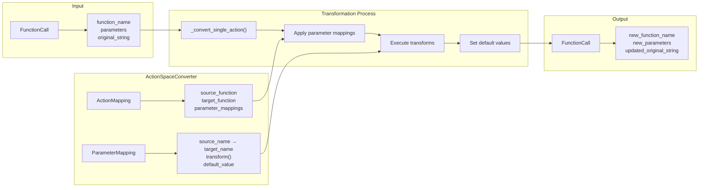
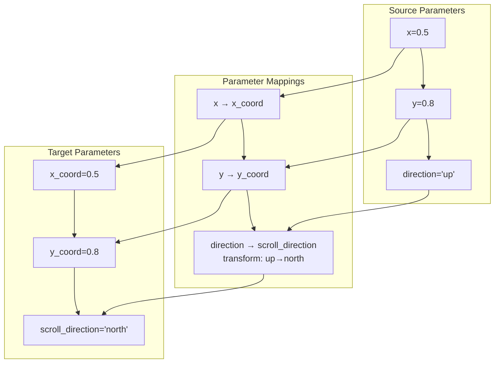
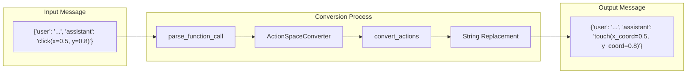

<!-- source: DeepWiki mcp.deepwiki.com · repo huggingface/smol2operator · page 6.2 Action Space Conversion · fetched 2026-10-26 -->

# Action Space Conversion

<details>
<summary>Relevant source files</summary>

The following files were used as context for generating this wiki page:

- [utils/action_space_converter.py](utils/action_space_converter.py)

</details>


This document covers the Action Space Conversion system, which provides a configurable framework for transforming unified API actions into custom action formats. This system enables users to define domain-specific action vocabularies for training assistants with different action spaces.

For information about the initial unification of heterogeneous actions into the unified API, see [Action Space Unification](#3.3). For details about how function calls are parsed and reconstructed, see [Function Call Parsing](#6.1).

## System Purpose

The `ActionSpaceConverter` allows users to map the standardized unified API actions (such as `click`, `swipe`, `navigate_home`) into custom action formats that match their specific training requirements or target environments. This flexibility enables domain-specific customization while maintaining compatibility with the broader training pipeline.

## Core Components

### Data Models

The system uses three main Pydantic models to define conversion behavior:

#### ParameterMapping
The `ParameterMapping` class [utils/action_space_converter.py:24-30]() defines how individual parameters are transformed between source and target functions:

- `source_name`: Parameter name in the original function
- `target_name`: Parameter name in the target function  
- `transform`: Optional callable for parameter value transformation
- `default_value`: Fallback value when source parameter is missing

#### ActionMapping
The `ActionMapping` class [utils/action_space_converter.py:32-38]() defines complete function conversions:

- `source_function`: Name of the unified API function
- `target_function`: Name of the custom target function
- `parameter_mappings`: List of `ParameterMapping` objects
- `custom_transform`: Optional callable for complex transformations
- `description`: Human-readable description of the mapping

#### ActionSpaceConverter
The main `ActionSpaceConverter` class [utils/action_space_converter.py:41-157]() orchestrates the conversion process and maintains the mapping registry.

**Conversion Flow Diagram**


Sources: [utils/action_space_converter.py:24-157]()

## Conversion Process

### Single Action Conversion

The `_convert_single_action` method [utils/action_space_converter.py:95-138]() handles individual function transformations:

1. **Mapping Lookup**: Retrieves the `ActionMapping` for the source function
2. **Custom Transform Check**: If `custom_transform` exists, applies it directly
3. **Parameter Processing**: Iterates through `parameter_mappings` to build new parameters
4. **Value Transformation**: Applies transform functions and handles default values
5. **Function Construction**: Creates new `FunctionCall` with target function name and parameters

### Batch Conversion

The `convert_actions` method [utils/action_space_converter.py:70-93]() processes lists of actions with error handling and logging.

**Parameter Transformation Flow**


Sources: [utils/action_space_converter.py:95-138]()

## Configuration System

### Default Mapping Factory

The `create_default_unified_to_custom_converter` function [utils/action_space_converter.py:159-325]() demonstrates comprehensive mapping configurations across different action categories:

| Action Category | Source Functions | Target Functions | Transformations |
|---|---|---|---|
| Navigation | `navigate_home`, `navigate_back` | `go_home`, `go_back` | Direct mapping |
| Touch Interaction | `click`, `long_press` | `touch`, `long_touch` | Coordinate renaming |
| Gestures | `swipe`, `drag` | `gesture_swipe`, `drag_and_drop` | Complex coordinate mapping |
| Scrolling | `scroll` | `scroll_view` | Direction vocabulary transformation |
| Input | `type`, `press` | `input_text`, `key_press` | Parameter renaming |
| Mouse Actions | `double_click`, `right_click` | `double_touch`, `context_menu` | Coordinate defaults |

### Custom Transform Examples

The default converter includes several transform patterns:

**Direction Mapping Transform** [utils/action_space_converter.py:236-239]():
```python
transform=lambda x: {"up": "north", "down": "south", "left": "west", "right": "east"}.get(x, x)
```

**Default Value Assignment** [utils/action_space_converter.py:279-280]():
```python
ParameterMapping(source_name="x", target_name="x_coord", default_value=0.5)
```

Sources: [utils/action_space_converter.py:159-325]()

## Integration Patterns

### Message Conversion

The `convert_assistant` function [utils/action_space_converter.py:327-355]() integrates with chat message processing:

1. **Function Call Extraction**: Uses `parse_function_call` to identify function calls
2. **Action Conversion**: Applies `ActionSpaceConverter.convert_actions`
3. **String Replacement**: Updates the original message text with converted function calls
4. **Message Return**: Returns modified chat message dictionary

**Message Conversion Flow**


Sources: [utils/action_space_converter.py:327-355]()

### Validation and Management

The converter includes several management capabilities:

- **Mapping Validation** [utils/action_space_converter.py:59-68](): Ensures target functions are specified and parameter names are unique
- **Dynamic Management** [utils/action_space_converter.py:140-156](): Add/remove mappings and query supported actions
- **Error Handling** [utils/action_space_converter.py:86-91](): Comprehensive logging and exception handling during conversion

## Training Pipeline Integration

The Action Space Conversion system serves as a bridge between the unified action API and domain-specific training requirements. It enables:

1. **Custom Vocabulary Training**: Train models with action names that match target deployment environments
2. **Parameter Format Adaptation**: Adjust parameter naming and value formats for different frameworks
3. **Domain-Specific Transformations**: Apply business logic transformations during action conversion
4. **Flexible Action Sets**: Support subsets or extensions of the unified action API

This system complements the data processing pipeline by allowing post-unification customization, enabling researchers and practitioners to adapt the standardized actions to their specific use cases while maintaining compatibility with the broader Smol2Operator training infrastructure.

Sources: [utils/action_space_converter.py:1-384]()

---

