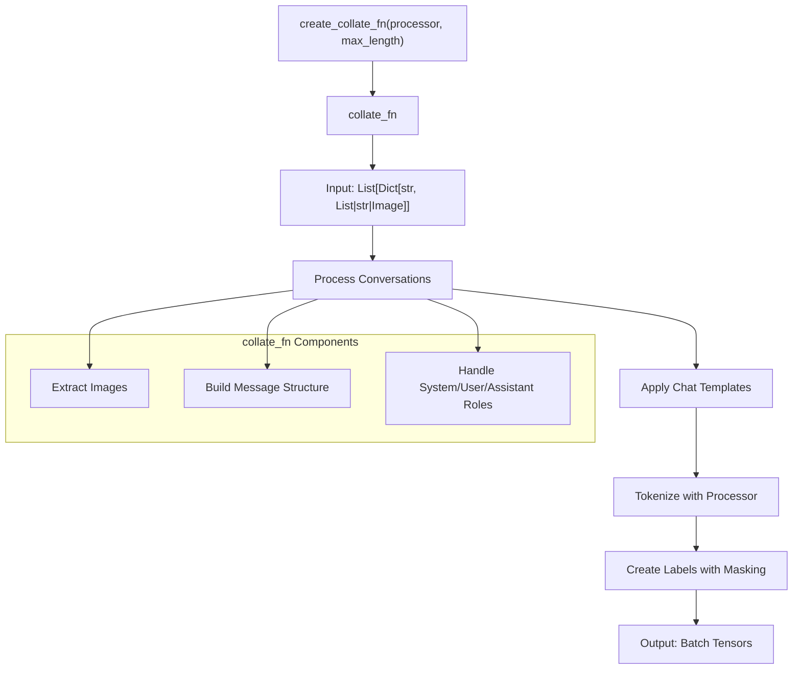
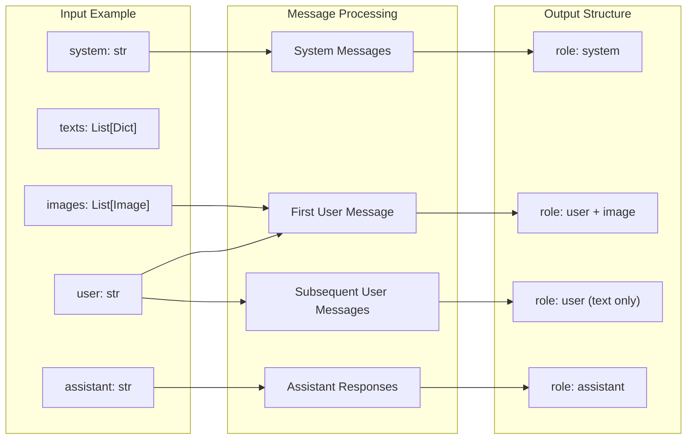
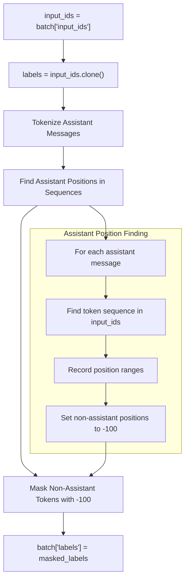
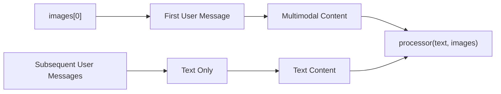
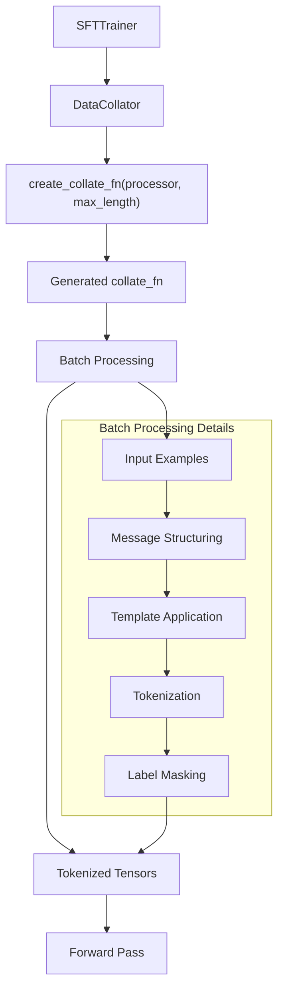

<!-- source: DeepWiki mcp.deepwiki.com · repo huggingface/smol2operator · page 6.3 Training Data Collation · fetched 2026-10-26 -->

# Training Data Collation

Relevant source files

The following files were used as context for generating this wiki page:

- [utils/collator.py](utils/collator.py)

This document describes the training data collation system used to prepare Vision-Language Model (VLM) batches during training. The system handles the conversion of conversational GUI interaction data into properly formatted and masked tensors for supervised fine-tuning.

For information about the overall training pipeline, see [Training System](#4). For details about data preprocessing before collation, see [Data Processing Pipeline](#3).

## Overview

The training data collation system is implemented in [utils/collator.py]() and provides the `create_collate_fn` function that generates custom collate functions for VLM training. The primary purpose is to transform batches of conversational examples containing images and text into tokenized tensors with appropriate masking for supervised learning.

The collation process handles multimodal data (images + text), applies chat templates, and implements a masking strategy that trains the model only on assistant responses while ignoring system prompts and user inputs.

Sources: [utils/collator.py:1-111]()

## Collation Function Architecture

The system uses a factory pattern where `create_collate_fn` creates customized collate functions based on the provided processor and maximum sequence length.

Sources: [utils/collator.py:4-11]()

## Data Processing Flow

The collate function processes each example through several stages to create properly formatted conversational data:

### Conversation Structure Building

The system processes examples with the following structure:
- `images`: List of PIL Image objects
- `texts`: List of conversation turns containing system, user, and assistant messages

Sources: [utils/collator.py:12-56]()

### Chat Template Application

The processed conversations are formatted using the processor's chat template system:

[utils/collator.py:58-63]()

The `apply_chat_template` method converts the structured conversation format into the specific text format expected by the model, handling special tokens and formatting conventions.

Sources: [utils/collator.py:58-73]()

## Token Masking Strategy

The collation system implements a sophisticated masking strategy to ensure the model only learns from assistant responses during training.

### Label Creation Process

Sources: [utils/collator.py:74-108]()

### Masking Implementation Details

The masking algorithm:

1. **Clone Input IDs**: Creates labels as a copy of input tokens [utils/collator.py:75]()
2. **Tokenize Assistant Messages**: Separately tokenizes each assistant response with `<end_of_utterance>` suffix [utils/collator.py:77-84]()
3. **Position Finding**: Locates assistant token sequences within the full input sequence [utils/collator.py:87-101]()
4. **Mask Application**: Sets all non-assistant positions to `-100` to exclude from loss calculation [utils/collator.py:103-105]()

The `-100` label value is a PyTorch convention that causes CrossEntropyLoss to ignore these positions during backpropagation.

Sources: [utils/collator.py:86-108]()

## Multimodal Data Handling

The collation system properly handles Vision-Language Model requirements by coordinating image and text inputs:

| Component | Handling Method | Purpose |
|-----------|-----------------|---------|
| **Images** | First user message gets image attachment [utils/collator.py:29-34]() | Provides visual context for GUI interactions |
| **Text Processing** | Chat template formatting [utils/collator.py:58-63]() | Ensures proper conversation structure |
| **Tokenization** | Combined text-image processing [utils/collator.py:65-72]() | Creates unified multimodal tensors |

### Image Integration Strategy

Sources: [utils/collator.py:25-44]()

## Integration with Training Pipeline

The collate function integrates with the Hugging Face training ecosystem:

The function returns a collate function that can be directly used with PyTorch DataLoader or Hugging Face Trainer classes, handling the conversion from raw conversational data to training-ready tensors.

Sources: [utils/collator.py:4-111]()

## Configuration Parameters

The `create_collate_fn` function accepts two key parameters:

- **`processor`**: The model processor that handles tokenization and chat template application
- **`max_length`**: Maximum sequence length for truncation, passed to the processor during tokenization [utils/collator.py:68-69]()

The processor must support:
- `apply_chat_template` method for conversation formatting
- Combined text and image processing capabilities
- `tokenizer` attribute for assistant message encoding

Sources: [utils/collator.py:4-5]()

---

