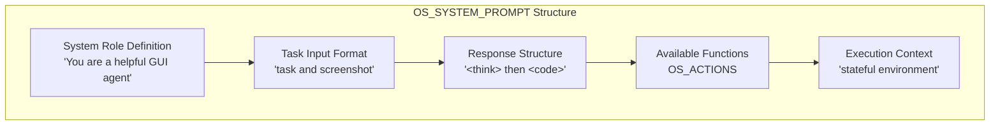
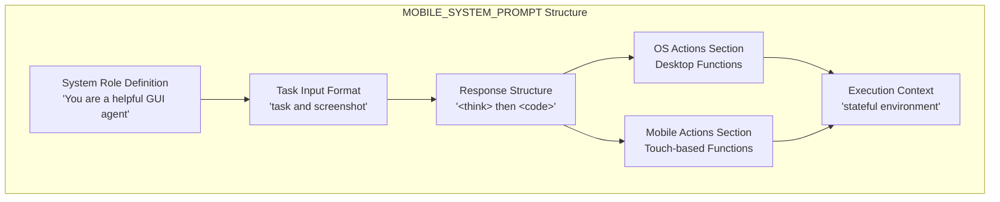
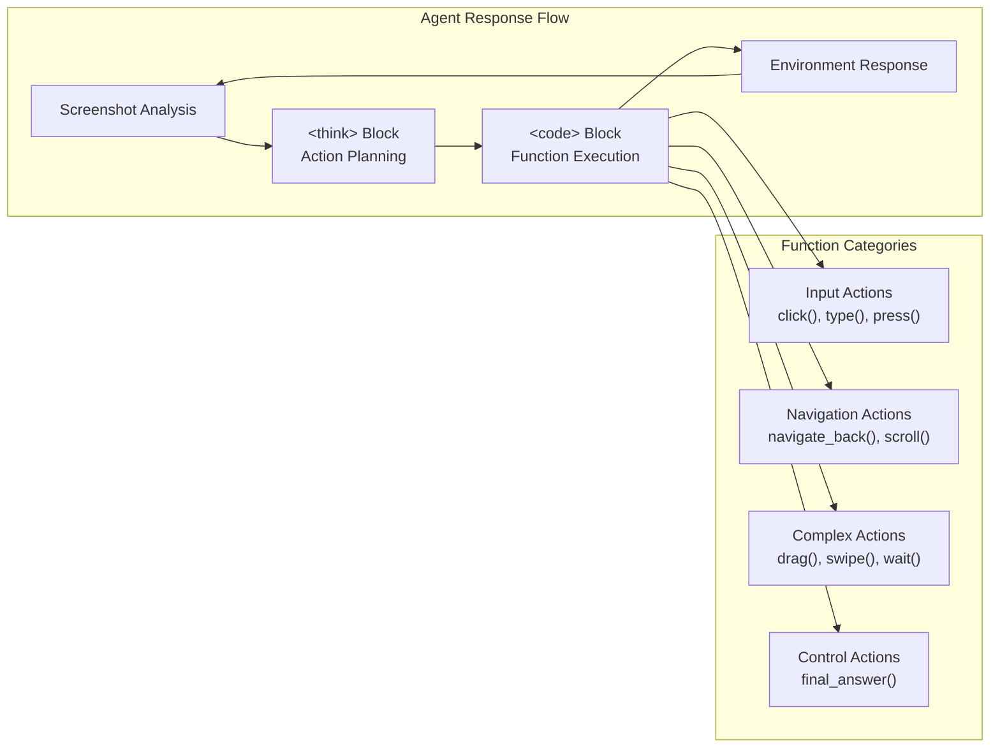

<!-- source: DeepWiki mcp.deepwiki.com · repo huggingface/smol2operator · page 6.4 System Prompts and Actions · fetched 2026-10-26 -->

# System Prompts and Actions

Relevant source files

The following files were used as context for generating this wiki page:

- [preprocessing/prompts.py](preprocessing/prompts.py)

This document covers the standardized action APIs and system prompts that define how GUI agents interact with different environments in the Smol2Operator system. These components specify the available functions that trained models can call to perform GUI interactions and the contextual instructions that guide agent behavior.

For information about how these prompts are used during evaluation, see [Evaluation and Benchmarking](#5). For details on action space conversion and unification, see [Action Space Unification](#3.3).

## Action Categories

The system defines two primary categories of actions for GUI interaction, each tailored to specific environment types. These action definitions serve as the function call vocabulary available to trained agents.

### OS/Desktop Actions

Desktop environment actions provide comprehensive control over mouse, keyboard, and browser interactions. The `OS_ACTIONS` constant defines ten core functions for desktop GUI manipulation:

| Function | Purpose | Key Parameters |
|----------|---------|----------------|
| `click()` | Left-click at normalized coordinates | `x`, `y` (Optional[float]) |
| `double_click()` | Double-click at normalized coordinates | `x`, `y` (Optional[float]) |
| `type()` | Text input at cursor position | `text` (str) |
| `press()` | Keyboard key presses | `keys` (str \| list[str]) |
| `drag()` | Click-drag-release operation | `from_coord`, `to_coord` (list[float]) |
| `scroll()` | Page/element scrolling | `direction` ("up"/"down"), `amount` (int) |
| `move_mouse()` | Cursor positioning | `x`, `y` (float) |
| `navigate_back()` | Browser back navigation | None |
| `wait()` | Execution pause | `seconds` (float) |
| `final_answer()` | Task completion signal | `answer` (any) |

**Sources:** [preprocessing/prompts.py:1-78]()

### Mobile Actions

Mobile-specific actions extend the desktop action set with touch-based interactions optimized for mobile interfaces:

| Function | Purpose | Key Parameters |
|----------|---------|----------------|
| `swipe()` | Touch gesture between coordinates | `from_coord`, `to_coord` (list[str]) |
| `long_press()` | Extended touch at coordinates | `x`, `y` (int) |
| `open_app()` | Application launcher | `app_name` (str) |
| `navigate_back()` | Return to home page | None |

**Sources:** [preprocessing/prompts.py:80-108]()

## System Prompts

System prompts establish the behavioral framework and available capabilities for GUI agents operating in different environments.

### Desktop Environment Configuration

The `OS_SYSTEM_PROMPT` provides desktop GUI agents with:
- **Structured reasoning**: `` blocks for action planning
- **Code execution**: `<code></code>` blocks for function calls
- **Function registry**: Complete OS_ACTIONS function set
- **State persistence**: Variables and imports maintained across calls

**Sources:** [preprocessing/prompts.py:110-122]()

### Mobile Environment Configuration

The `MOBILE_SYSTEM_PROMPT` combines both action sets, providing mobile GUI agents with:
- **Unified capability**: Both OS_ACTIONS and MOBILE_ACTIONS function sets
- **Cross-platform support**: Desktop and mobile interaction patterns
- **Consistent structure**: Same reasoning and execution framework as desktop

**Sources:** [preprocessing/prompts.py:124-143]()

## Action API Reference

### Coordinate System

All spatial actions use normalized coordinates where values range from 0.0 to 1.0:
- **X-axis**: 0.0 = left edge, 1.0 = right edge
- **Y-axis**: 0.0 = top edge, 1.0 = bottom edge

This normalization ensures consistency across different screen resolutions and device types.

### Function Call Patterns

**Sources:** [preprocessing/prompts.py:110-143]()

### Environment-Specific Behavior

The action system adapts to different GUI environments:

| Environment | Action Set | Coordinate Type | Special Considerations |
|-------------|------------|-----------------|----------------------|
| **Desktop/OS** | OS_ACTIONS only | Normalized float | Browser navigation support |
| **Mobile** | OS_ACTIONS + MOBILE_ACTIONS | Mixed (float/str/int) | Touch gesture optimization |

The mobile environment includes both action sets to handle hybrid interfaces that may require both traditional mouse/keyboard interactions and touch-based gestures.

**Sources:** [preprocessing/prompts.py:1-143]()

## Usage in Training and Evaluation

These prompts and actions serve as the foundation for:
- **Training data generation**: Function calls are parsed from agent responses during dataset processing
- **Model evaluation**: ScreenSpot-v2 benchmarks measure agent performance using these action APIs
- **Multi-environment support**: Single models can operate across desktop and mobile interfaces

The standardized action vocabulary ensures consistent behavior across different GUI environments while maintaining the flexibility to handle environment-specific interaction patterns.

**Sources:** [preprocessing/prompts.py:1-143]()

---

