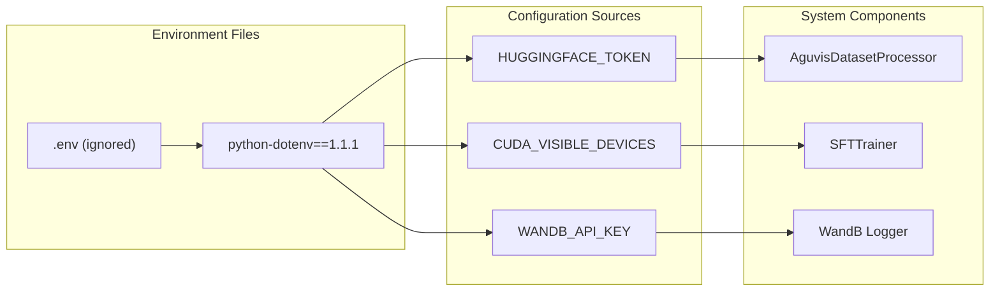

<!-- source: DeepWiki mcp.deepwiki.com · repo huggingface/smol2operator · page 7 Setup and Dependencies · fetched 2026-10-26 -->

# Setup and Dependencies

<details>
<summary>Relevant source files</summary>

The following files were used as context for generating this wiki page:

- [.gitignore](.gitignore)
- [__init__.py](__init__.py)
- [requirements.txt](requirements.txt)
- [utils/__init__.py](utils/__init__.py)

</details>


This document covers the installation requirements, dependency management, project structure, and environment configuration for the Smol2Operator system. It provides the technical foundation needed to set up and run the GUI agent training pipeline.

For information about the data processing workflow, see [Data Processing Pipeline](#3). For details about the training system configuration, see [Training System](#4).

## Installation Requirements

The Smol2Operator system requires Python 3.8+ and is built on the PyTorch ecosystem for deep learning. The system is designed to work with CUDA-enabled GPUs for training Vision-Language Models, though CPU operation is possible for smaller-scale experimentation.

### Core Dependencies

The system's dependencies are managed through a requirements file that specifies exact versions for reproducibility:

| Package | Version | Purpose |
|---------|---------|---------|
| `trl` | 0.21.0 | Supervised Fine-Tuning with `SFTTrainer` |
| `transformers` | 4.56.1 | HuggingFace model management and tokenization |
| `Pillow` | 11.3.0 | Image loading and preprocessing |
| `torchvision` | 0.23.0 | Computer vision transforms and utilities |
| `num2words` | 0.5.14 | Number-to-text conversion for training data |
| `wandb` | 0.21.1 | Experiment tracking and logging |
| `python-dotenv` | 1.1.1 | Environment variable management |

Sources: [requirements.txt:1-7]()

### Dependency Architecture

```mermaid
graph TB
    subgraph "Core ML Framework"
        torch["torch (PyTorch)"]
        transformers["transformers==4.56.1"]
        trl["trl==0.21.0"]
    end
    
    subgraph "Vision Processing"
        pillow["Pillow==11.3.0"]
        torchvision["torchvision==0.23.0"]
    end
    
    subgraph "Data Processing"
        num2words["num2words==0.5.14"]
        dotenv["python-dotenv==1.1.1"]
    end
    
    subgraph "Experiment Management"
        wandb["wandb==0.21.1"]
    end
    
    transformers --> trl
    torch --> torchvision
    pillow --> torchvision
    
    trl --> "SFTTrainer"
    transformers --> "SmolVLM2 Models"
    torchvision --> "Image Transforms"
    pillow --> "Image Loading"
    num2words --> "Text Normalization"
    wandb --> "Training Logs"
    dotenv --> "Environment Config"
```

Sources: [requirements.txt:1-7]()

## Project Structure

The codebase follows a modular architecture with clear separation between data processing, training utilities, and evaluation components:

```mermaid
graph TD
    subgraph "Root Directory"
        root["/"]
        requirements["requirements.txt"]
        gitignore[".gitignore"]
        init_root["__init__.py"]
    end
    
    subgraph "Utils Package"
        utils_dir["utils/"]
        init_utils["utils/__init__.py"]
        aguvis_proc["aguvis_processor.py"]
        aguvis_models["aguvis_models.py"]
        action_conv["action_conversion.py"]
        func_parser["function_parser.py"]
        action_space["action_space_converter.py"]
        collator["collator.py"]
        prompts["prompts.py"]
    end
    
    subgraph "Training Components"
        recipe["recipe.ipynb"]
        eval_prompt["eval_prompt.py"]
    end
    
    subgraph "Ignored Data Directories"
        data_dir["data/ (ignored)"]
        wandb_dir["wandb/ (ignored)"]
        logs_dir["logs/ (ignored)"]
        results_dir["results/ (ignored)"]
    end
    
    root --> requirements
    root --> gitignore
    root --> init_root
    root --> utils_dir
    root --> recipe
    root --> eval_prompt
    
    utils_dir --> init_utils
    utils_dir --> aguvis_proc
    utils_dir --> aguvis_models
    utils_dir --> action_conv
    utils_dir --> func_parser
    utils_dir --> action_space
    utils_dir --> collator
    utils_dir --> prompts
    
    root -.-> data_dir
    root -.-> wandb_dir
    root -.-> logs_dir
    root -.-> results_dir
```



Sources: [.gitignore:174-178](), [__init__.py:1](), [utils/__init__.py:1]()

### Key Directories

The project structure includes several directories that are excluded from version control but are created during operation:

- `data/` - Dataset storage and caching
- `wandb/` - Weights & Biases experiment logs  
- `logs/` - Training and processing logs
- `results/` - Evaluation outputs and model artifacts

Sources: [.gitignore:174-178]()

## Environment Configuration

### Environment Variables

The system uses `python-dotenv` for environment variable management, allowing configuration through `.env` files that are excluded from version control:



Sources: [requirements.txt:7](), [.gitignore:131]()

### Git Configuration

The `.gitignore` file excludes common Python artifacts and project-specific directories:

- Python bytecode and cache files
- Virtual environment directories (`venv/`, `.env`, `ENV/`)
- IDE configuration (`.vscode/`, `.idea/`)
- Package management artifacts (`__pycache__/`, `*.egg-info/`)
- Development tools (`pytest_cache/`, `.mypy_cache/`)

Sources: [.gitignore:1-181]()

## Setup Process

### 1. Repository Setup

```bash
git clone https://github.com/huggingface/smol2operator
cd smol2operator
```

### 2. Environment Creation

Create a Python virtual environment and install dependencies:

```bash
python -m venv venv
source venv/bin/activate  # On Windows: venv\Scripts\activate
pip install -r requirements.txt
```

### 3. Environment Configuration

Create a `.env` file in the project root with necessary API keys:

```bash
HUGGINGFACE_TOKEN=your_hf_token_here
WANDB_API_KEY=your_wandb_key_here
```

### 4. Directory Structure

The system will automatically create required directories during operation:

- `data/` for dataset storage
- `wandb/` for experiment tracking
- `logs/` for processing logs
- `results/` for evaluation outputs

Sources: [requirements.txt:1-7](), [.gitignore:174-178]()

## Hardware Requirements

While not explicitly documented in the configuration files, the system's dependencies suggest:

- **GPU**: CUDA-compatible GPU recommended for training with `torchvision` and `transformers`
- **Memory**: Sufficient RAM for loading Vision-Language Models (typically 8GB+ for SmolVLM2-2.2B)
- **Storage**: Space for datasets in `data/` directory and model checkpoints

The modular architecture allows components to be run independently, enabling distributed processing across different hardware configurations.

Sources: [requirements.txt:1-7]()