# Page: Overview

# Overview

<details>
<summary>Relevant source files</summary>

The following files were used as context for generating this wiki page:

- [README.md](README.md)
- [assets/google.png](assets/google.png)
- [assets/screenspot-v2.png](assets/screenspot-v2.png)

</details>


## Purpose and Scope

The Smol2Operator system is a comprehensive pipeline for training GUI agents using vision-language models through post-training techniques. This wiki documents the complete system for transforming raw GUI interaction datasets into trained models capable of understanding and interacting with graphical user interfaces.

The system takes raw heterogeneous GUI datasets and applies a two-phase supervised fine-tuning approach to create models that can perceive GUI elements and perform agentic reasoning for computer interaction tasks. For specific implementation details of individual components, see [Data Processing Pipeline](#3), [Training System](#4), and [Utility Systems](#6).

## High-Level System Architecture

The Smol2Operator system follows a pipeline architecture that transforms raw datasets through processing, training, and evaluation stages:

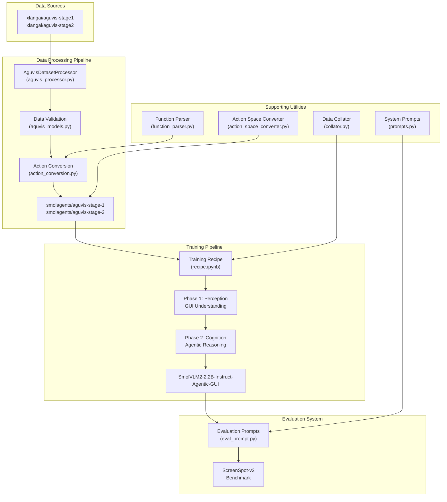

Sources: [README.md:1-703]()

## Training Performance Results

The system demonstrates significant performance improvements through its two-phase approach:

| Stage | Model | ScreenSpot-v2 Performance | Improvement |
|-------|--------|--------------------------|-------------|
| Baseline | SmolVLM2-2.2B-Instruct | 0.47% | - |
| Phase 1 | After GUI Perception Training | 41.27% | +40.8% |
| Phase 2 | After Agentic Reasoning Training | 61.71% | +20.44% |

## Core Training Methodology

The system implements a progressive two-phase training strategy:

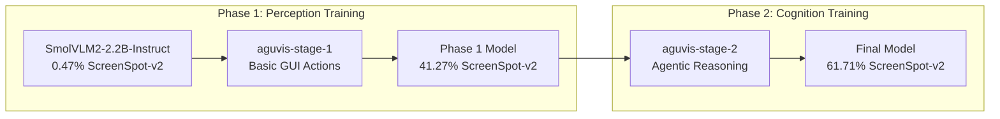

Sources: [README.md:257-703]()

## Action Space Unification

A critical component of the system is the transformation of heterogeneous action formats into a unified API:

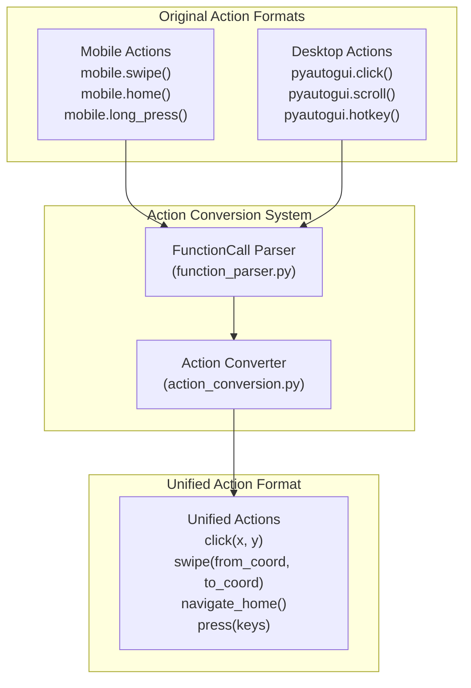

Sources: [README.md:93-255]()

## Key System Components

The system consists of several interconnected modules:

### Data Processing Components
- **AguvisDatasetProcessor**: Main dataset processing orchestrator in [preprocessing/aguvis_processor.py]()
- **Action Conversion System**: Unifies heterogeneous action formats in [preprocessing/action_conversion.py]()
- **Data Models**: Pydantic validation models in [preprocessing/aguvis_models.py]()

### Training Infrastructure
- **Training Recipe**: Complete training pipeline in [recipe.ipynb]()
- **Data Collation**: VLM-specific data preparation in [utils/collator.py]()
- **TRL Integration**: Uses TRL library's `SFTTrainer` for supervised fine-tuning

### Evaluation System
- **ScreenSpot-v2 Evaluation**: Benchmark prompts in [eval/eval_prompt.py]()
- **Action Definitions**: System prompts and actions in [utils/prompts.py]()

### Utility Systems
- **Function Call Parser**: Extracts and reconstructs function calls in [utils/function_parser.py]()
- **Action Space Converter**: Adapts actions to custom vocabularies in [utils/action_space_converter.py]()

Sources: [README.md:674-684]()

## Dataset Transformation Pipeline

The system transforms raw AGUVIS datasets through a comprehensive processing pipeline:

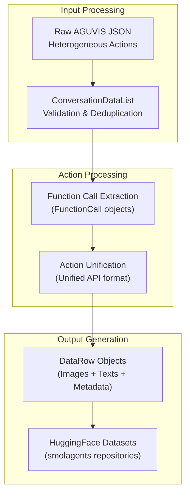

Sources: [README.md:93-255](), [preprocessing/aguvis_processor.py](), [preprocessing/action_conversion.py]()

## Technical Architecture Highlights

1. **Normalized Coordinates**: Uses 0-1 normalized coordinates instead of pixel coordinates for resolution independence
2. **Progressive Training**: Two-phase approach builds perception capabilities before adding agentic reasoning
3. **Modular Design**: Clear separation between data processing, training, evaluation, and utilities
4. **Open Source**: All components, datasets, and models are publicly available
5. **Reproducible**: Complete training recipes and data processing tools enable full reproducibility

The system demonstrates how careful data curation and progressive training can transform a base vision-language model with no GUI capabilities into an effective GUI agent through supervised fine-tuning alone.

Sources: [README.md:1-703]()

---

# Page: System Architecture

# System Architecture

<details>
<summary>Relevant source files</summary>

The following files were used as context for generating this wiki page:

- [README.md](README.md)

</details>


## Purpose and Scope

This document details the overall system design of Smol2Operator, a comprehensive pipeline for training Vision-Language Models (VLMs) to perform GUI automation tasks. The architecture implements a two-phase training strategy that transforms a baseline VLM into an agentic GUI agent capable of understanding and interacting with graphical interfaces.

For detailed information about data processing workflows, see [Data Processing Pipeline](#3). For training implementation details, see [Training System](#4). For evaluation methodology, see [Evaluation and Benchmarking](#5).

## Overall System Design

The Smol2Operator system consists of four major subsystems that work together to create a complete GUI agent training pipeline:

**System Architecture Overview**

```mermaid
graph TB
    subgraph "Data_Processing" ["Data Processing Subsystem"]
        ADP["AguvisDatasetProcessor"] 
        ACM["aguvis_models.py<br/>ConversationData<br/>ChatMessage<br/>DataRow"]
        AC["action_conversion.py<br/>convert_mobile_actions<br/>convert_desktop_actions"]
    end
    
    subgraph "Training_Subsystem" ["Training Subsystem"]  
        RNB["recipe.ipynb<br/>TRL_SFTTrainer"]
        COL["collator.py<br/>create_collate_fn"]
        CFG["DatasetConfig<br/>ProcessingConfig"]
    end
    
    subgraph "Evaluation_Subsystem" ["Evaluation Subsystem"]
        EP["eval_prompt.py<br/>PHASE_1_PROMPT<br/>PHASE_2_PROMPT"] 
        SS["ScreenSpot-v2<br/>Benchmark"]
    end
    
    subgraph "Utility_Subsystem" ["Utility Subsystem"]
        FP["function_parser.py<br/>FunctionCall<br/>parse_function_call"]
        ASC["action_space_converter.py<br/>ActionSpaceConverter<br/>ActionMapping"]
        PR["prompts.py<br/>SYSTEM_PROMPT<br/>ACTIONS"]
    end
    
    ADP --> ACM
    ACM --> AC
    AC --> RNB
    CFG --> RNB
    COL --> RNB
    RNB --> EP
    EP --> SS
    FP --> AC
    ASC --> AC
    PR --> EP
    
    style Data_Processing fill:#f9f9f9
    style Training_Subsystem fill:#f0f8ff  
    style Evaluation_Subsystem fill:#fff8f0
    style Utility_Subsystem fill:#f0fff0
```

Sources: [README.md:1-703](), [recipe.ipynb](), [preprocessing/aguvis_processor.py](), [preprocessing/aguvis_models.py](), [preprocessing/action_conversion.py](), [utils/collator.py](), [eval_prompt.py](), [utils/function_parser.py](), [utils/action_space_converter.py](), [prompts.py]()

## Two-Phase Training Strategy

The system implements a progressive training approach where each phase builds specific capabilities:

**Two-Phase Training Flow**

```mermaid
graph TD
    subgraph "Phase_1" ["Phase 1: Perception Training"]
        SM1["SmolVLM2-2.2B-Instruct<br/>Base Model<br/>0.47% ScreenSpot-v2"]
        AS1["smolagents/aguvis-stage-1<br/>GUI Grounding Data"]
        ST1["SFTTrainer<br/>create_collate_fn"]
        M1["Phase 1 Model<br/>41.27% ScreenSpot-v2"]
    end
    
    subgraph "Phase_2" ["Phase 2: Cognition Training"] 
        AS2["smolagents/aguvis-stage-2<br/>Agentic Reasoning Data"]
        ST2["SFTTrainer<br/>create_collate_fn"]  
        M2["SmolVLM2-2.2B-Instruct-Agentic-GUI<br/>61.71% ScreenSpot-v2"]
    end
    
    subgraph "Training_Config" ["Training Configuration"]
        TC1["DatasetConfig<br/>8 stage-1 configs"]
        TC2["DatasetConfig<br/>15 stage-2 configs"]
        WB["wandb<br/>Experiment Tracking"]
    end
    
    SM1 --> AS1
    AS1 --> ST1
    TC1 --> ST1
    ST1 --> M1
    M1 --> AS2
    AS2 --> ST2
    TC2 --> ST2
    ST2 --> M2
    WB --> ST1
    WB --> ST2
    
    style Phase_1 fill:#e8f5e8
    style Phase_2 fill:#f0f8ff
    style Training_Config fill:#fff8f0
```

Sources: [README.md:257-648](), [recipe.ipynb](), [preprocessing/aguvis_models.py:1-50](), [utils/collator.py:1-100]()

## Component Interactions

The system components interact through well-defined interfaces and data structures:

**Component Interaction Flow**

```mermaid
graph LR
    subgraph "Input_Data" ["Input Data Sources"]
        RD["xlangai/aguvis-stage1<br/>xlangai/aguvis-stage2<br/>Raw JSON"]
    end
    
    subgraph "Data_Models" ["Data Models"] 
        CD["ConversationData<br/>image: PIL.Image<br/>messages: List[ChatMessage]"]
        CM["ChatMessage<br/>role: str<br/>content: str"]
        DR["DataRow<br/>images: List<PIL.Image]<br/>texts: List[str]<br/>source: str"]
    end
    
    subgraph "Processing_Engine" ["Processing Engine"]
        ADP["AguvisDatasetProcessor<br/>process_dataset<br/>_process_batch"]
        FC["FunctionCall<br/>function_name: str<br/>parameters: Dict"]
        ASP["parse_function_call<br/>convert_mobile_actions<br/>convert_desktop_actions"] 
    end
    
    subgraph "Training_Engine" ["Training Engine"]
        CCF["create_collate_fn<br/>processor: AutoProcessor<br/>apply_chat_template"]
        SFT["SFTTrainer<br/>model: AutoModelForVision2Seq<br/>train_dataset: Dataset"]
    end
    
    RD --> ADP
    ADP --> CD
    CD --> CM
    CD --> DR
    ASP --> FC
    FC --> DR
    DR --> CCF
    CCF --> SFT
    
    style Input_Data fill:#ffebee
    style Data_Models fill:#e3f2fd
    style Processing_Engine fill:#f3e5f5
    style Training_Engine fill:#e8f5e8
```

Sources: [preprocessing/aguvis_processor.py:50-150](), [preprocessing/aguvis_models.py:20-80](), [utils/function_parser.py:1-100](), [preprocessing/action_conversion.py:1-200](), [utils/collator.py:20-80]()

## Core Processing Pipelines  

### Action Space Unification Pipeline

The system converts heterogeneous action formats from different frameworks into a unified API:

| Original Framework | Example Action | Unified Action |
|-------------------|----------------|----------------|
| Mobile Actions | `mobile.swipe(from_coord=[0.581, 0.898], to_coord=[0.601, 0.518])` | `swipe(from_coord=[0.581, 0.898], to_coord=[0.601, 0.518])` |
| Desktop Actions | `pyautogui.click(x=0.8102, y=0.9463)` | `click(x=0.8102, y=0.9463)` |
| Mobile Actions | `mobile.home()` | `navigate_home()` |
| Desktop Actions | `pyautogui.hotkey(keys=['ctrl', 'c'])` | `press(keys=['ctrl', 'c'])` |

**Action Conversion Flow**

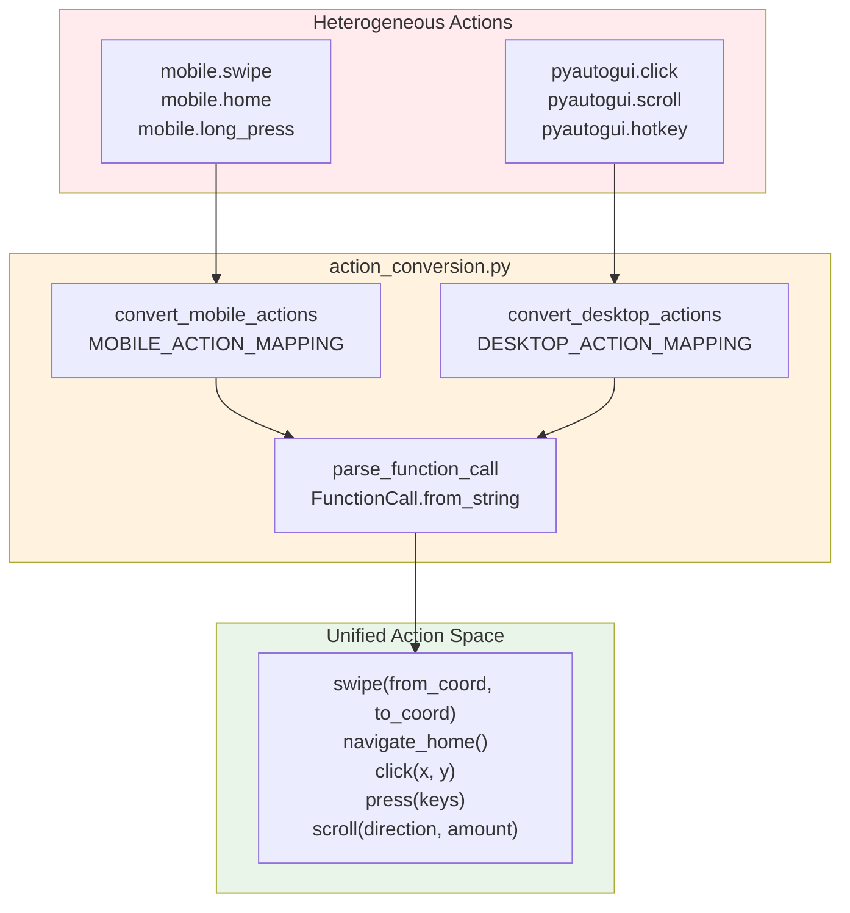

Sources: [preprocessing/action_conversion.py:50-200](), [utils/function_parser.py:20-80](), [README.md:114-154]()

### Training Data Collation Pipeline

The `create_collate_fn` function handles VLM-specific data preparation for training:

**Data Collation Process**

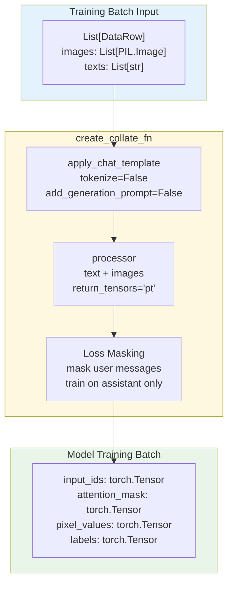

Sources: [utils/collator.py:1-100](), [README.md:270-280]()

The system architecture enables complete reproducibility through modular design, with each component handling a specific aspect of the GUI agent training pipeline. The two-phase approach progressively builds capabilities from basic perception to advanced agentic reasoning, while the unified action space ensures consistent training across diverse GUI environments.

---

# Page: Data Processing Pipeline

# Data Processing Pipeline

<details>
<summary>Relevant source files</summary>

The following files were used as context for generating this wiki page:

- [README.md](README.md)
- [preprocessing/aguvis_models.py](preprocessing/aguvis_models.py)
- [preprocessing/aguvis_processor.py](preprocessing/aguvis_processor.py)

</details>


The data processing pipeline transforms raw AGUVIS datasets into standardized, training-ready formats for GUI agent development. This system handles the complete end-to-end workflow from downloading heterogeneous datasets to producing unified, validated training data with consistent action spaces.

This document covers the core data transformation pipeline. For training system integration, see [Training System](#4). For action space unification details, see [Action Space Unification](#3.3).

## Pipeline Architecture Overview

The data processing pipeline operates through several coordinated components that handle dataset downloading, validation, transformation, and upload:

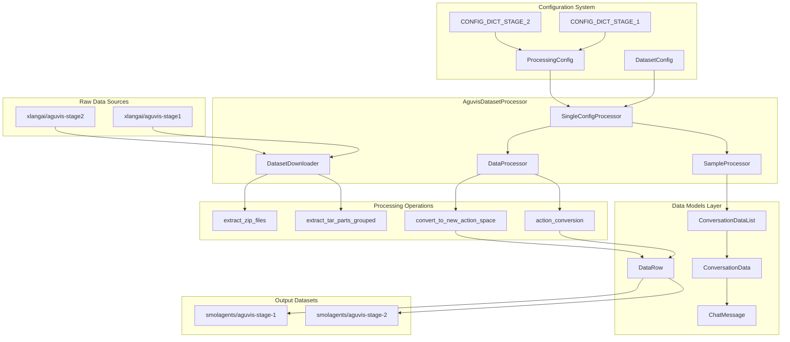

**Sources:** [preprocessing/aguvis_processor.py:1-526](), [preprocessing/aguvis_models.py:1-362]()

## Core Processing Workflow

The pipeline executes through a structured sequence of operations managed by the `AguvisDatasetProcessor` class:

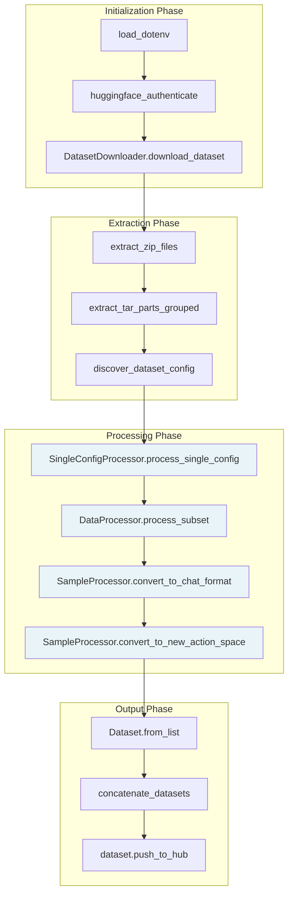

**Sources:** [preprocessing/aguvis_processor.py:430-492](), [preprocessing/aguvis_processor.py:350-411]()

## Data Models and Validation Layer

The pipeline uses Pydantic models to enforce data consistency and validation throughout the transformation process:

| Model Class | Purpose | Key Validation |
|-------------|---------|----------------|
| `ChatMessage` | Individual conversation turns | Role validation (user/assistant/system) |
| `ConversationData` | Image + conversation pairs | Image path normalization, multi-image handling |
| `ConversationDataList` | Collections with deduplication | Text and image duplicate removal |
| `DataRow` | Final training format | Chat message organization, image attachment |

```mermaid
graph LR
    subgraph "Input Validation"
        A[Raw_JSON_Data]
        B[ConversationDataList.from_json_with_deduplication]
        C[ConversationData.validate_image]
    end
    
    subgraph "Data Transformation"
        D[ConversationEntry.to_chat_message]
        E[ChatMessage.from_conversation_list] 
        F[SampleProcessor.convert_to_chat_format]
    end
    
    subgraph "Output Generation"
        G[DataRow.from_chat_messages]
        H[DataRow.model_dump]
        I[Dataset.from_list]
    end
    
    A --> B
    B --> C
    C --> D
    D --> E
    E --> F
    F --> G
    G --> H
    H --> I
```

The `ConversationDataList` model implements sophisticated deduplication logic that can be controlled via the `deduplicate` parameter in `DatasetConfig`:

**Sources:** [preprocessing/aguvis_models.py:81-138](), [preprocessing/aguvis_models.py:141-191]()

## Dataset Configuration Discovery

The pipeline automatically discovers dataset configurations using predefined configuration dictionaries that map JSON files to their corresponding image directories:

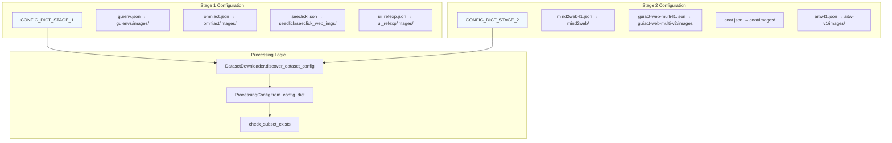

The `discover_dataset_config` method scans the downloaded dataset directory and creates `ProcessingConfig` objects for each discovered configuration, enabling parallel processing of multiple dataset subsets.

**Sources:** [preprocessing/aguvis_processor.py:132-159](), [preprocessing/aguvis_models.py:240-361]()

## Parallel Processing Architecture

The pipeline supports configurable parallel processing to handle multiple dataset configurations simultaneously:

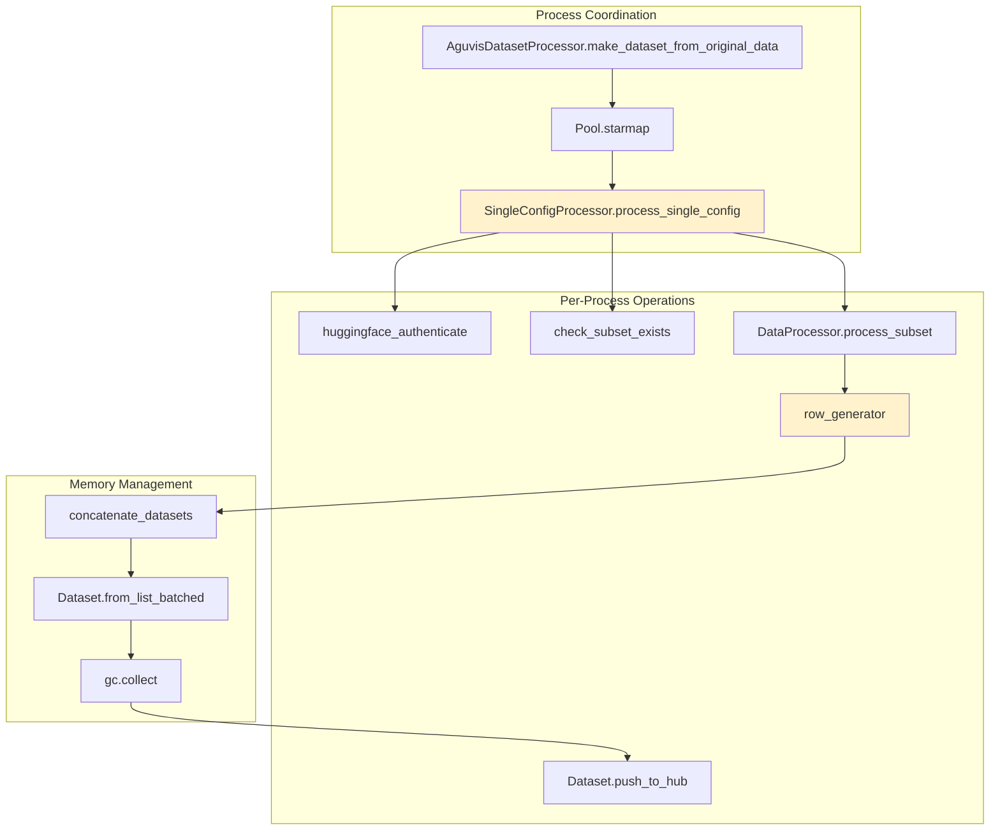

Each process handles authentication independently and implements memory management through garbage collection and dataset batching to prevent memory overflow during large dataset processing.

**Sources:** [preprocessing/aguvis_processor.py:454-492](), [preprocessing/aguvis_processor.py:334-411]()

## Sample Processing and Action Conversion

The `SampleProcessor` class handles the core transformation logic, converting raw conversation data into standardized chat formats and applying action space unification:

```mermaid
graph LR
    subgraph "Input Processing"
        A[load_image_from_folder]
        B[convert_to_chat_format]
        C[convert_to_code_agent_format]
    end
    
    subgraph "Action Space Processing"
        D[convert_to_new_action_space]
        E[parse_function_call]
        F[action_conversion]
    end
    
    subgraph "Output Generation"
        G[DataRow.from_chat_messages]
        H[model_dump]
    end
    
    A --> B
    B --> C
    C --> D
    D --> E
    E --> F
    F --> G
    G --> H
    
    style D fill:#e8f5e8
    style E fill:#e8f5e8  
    style F fill:#e8f5e8
```

The processing pipeline applies different formatting based on the `reasoning` parameter in `DatasetConfig`:
- **Stage 1 (reasoning=False)**: Direct action format without thinking blocks
- **Stage 2 (reasoning=True)**: Wrapped in `<think>` and `<code>` blocks for agentic reasoning

**Sources:** [preprocessing/aguvis_processor.py:163-278](), [preprocessing/aguvis_processor.py:310-332]()

---

# Page: Dataset Processing

# Dataset Processing

<details>
<summary>Relevant source files</summary>

The following files were used as context for generating this wiki page:

- [preprocessing/aguvis_processor.py](preprocessing/aguvis_processor.py)

</details>


This document covers the `AguvisDatasetProcessor` and its associated components, which implement the end-to-end transformation workflow for converting raw AGUVIS datasets from xlangai repositories into processed, training-ready datasets hosted on smolagents repositories. The system handles downloading, extraction, format conversion, action space unification, and batch uploading.

For information about the data models and validation used throughout this process, see [Data Models and Validation](#3.2). For details about action space unification specifically, see [Action Space Unification](#3.3).

## Processing Pipeline Overview

The dataset processing pipeline transforms raw AGUVIS datasets through a multi-stage workflow that handles heterogeneous data formats, extracts compressed archives, applies format conversions, and uploads the results to HuggingFace Hub.

**Dataset Processing Pipeline**
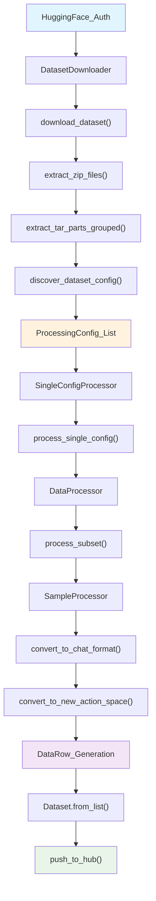

Sources: [preprocessing/aguvis_processor.py:413-521]()

## Core Components

### AguvisDatasetProcessor

The `AguvisDatasetProcessor` serves as the main orchestrator class that coordinates the entire processing pipeline. It initializes the necessary components and manages the high-level workflow.

| Component | Class | Primary Responsibility |
|-----------|-------|----------------------|
| Main Orchestrator | `AguvisDatasetProcessor` | Pipeline coordination and multiprocessing |
| Download Manager | `DatasetDownloader` | Repository downloading and archive extraction |
| Config Processor | `SingleConfigProcessor` | Individual dataset configuration processing |
| Data Transformer | `DataProcessor` | Subset processing and data generation |
| Sample Converter | `SampleProcessor` | Message format conversion and action space transformation |

**Component Architecture**
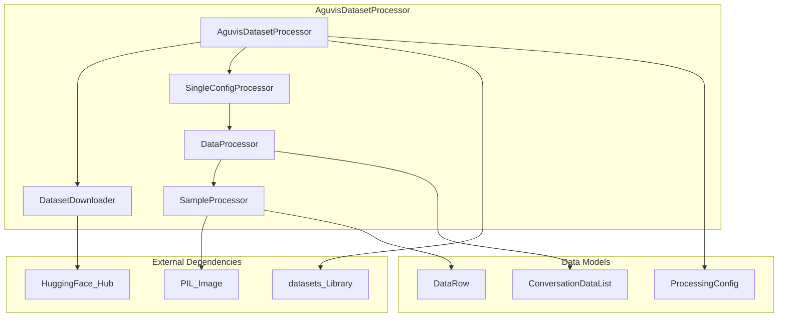

Sources: [preprocessing/aguvis_processor.py:413-419](), [preprocessing/aguvis_processor.py:55-85](), [preprocessing/aguvis_processor.py:163-178](), [preprocessing/aguvis_processor.py:280-332](), [preprocessing/aguvis_processor.py:334-411]()

### Dataset Download and Extraction

The `DatasetDownloader` handles repository cloning and archive extraction operations. It supports both ZIP files and split TAR archives that need to be merged before extraction.

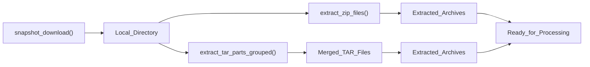

The extraction process includes intelligent deduplication - archives are only extracted if the target directory doesn't already exist and contain files [preprocessing/aguvis_processor.py:74-78](). For TAR files, the system groups split parts by prefix, merges them sequentially, and then extracts the unified archive [preprocessing/aguvis_processor.py:103-130]().

Sources: [preprocessing/aguvis_processor.py:55-131]()

## Data Transformation Workflow

### Configuration Discovery and Processing

The system discovers dataset configurations by scanning the downloaded data directory and matching against predefined configuration dictionaries. Each configuration becomes a `ProcessingConfig` that defines the subset name, JSON path, and images folder.

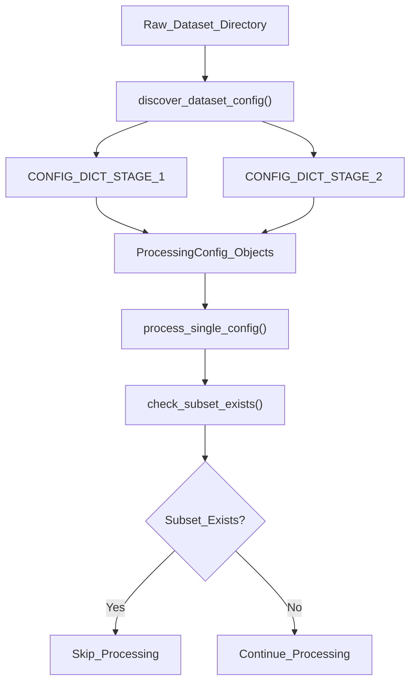

Sources: [preprocessing/aguvis_processor.py:132-158](), [preprocessing/aguvis_processor.py:340-367]()

### Message Format Conversion

The `SampleProcessor` handles the critical transformation from raw AGUVIS message formats to training-ready chat formats. This involves several steps:

1. **Chat Format Conversion**: Raw conversation data is converted to `ChatMessage` objects using `convert_to_chat_format()` [preprocessing/aguvis_processor.py:224-230]()
2. **Code Agent Format**: Messages are transformed to include system prompts (mobile vs desktop), reasoning blocks (`<think>` and `<code>`), and content cleanup [preprocessing/aguvis_processor.py:176-221]()
3. **Action Space Conversion**: Function calls are parsed and converted to the unified action space using `convert_to_new_action_space()` [preprocessing/aguvis_processor.py:233-277]()

**Message Transformation Pipeline**


Sources: [preprocessing/aguvis_processor.py:176-277]()

### Batch Processing and Memory Management

The data processing implements sophisticated memory management through batching and garbage collection. Rows are collected up to 20,000 samples before creating intermediate datasets, which are then concatenated for final upload.

```python
# Batch processing logic from the row_generator
for row in self.data_processor.row_generator(data, image_folder, json_path, reasoning):
    rows.append(row)
    if len(rows) > 20000:
        logger.info("Creating batch dataset")
        dataset = Dataset.from_list(rows)
        datasets.append(dataset)
        rows = []
        gc.collect()
```

Sources: [preprocessing/aguvis_processor.py:372-403]()

## Parallel Processing Architecture

The system supports parallel processing of multiple dataset configurations using multiprocessing. Each configuration is processed in isolation to prevent memory issues and enable efficient resource utilization.

**Multiprocessing Workflow**
```mermaid
graph TD
    A[Dataset_Configs] --> B["Pool(processes=num_processes)"]
    B --> C[Process_1]
    B --> D[Process_2]
    B --> E[Process_N]
    C --> F["process_single_config()"]
    D --> F
    E --> F
    F --> G["huggingface_authenticate()"]
    G --> H[Individual_Processing]
    H --> I["push_to_hub()"]
    I --> J[Results_Aggregation]
    
    subgraph "Fallback_Mechanism"
        K[Sequential_Processing]
    end
    
    B -.->|"Error"| K
```

The system includes a fallback mechanism that switches to sequential processing if multiprocessing fails [preprocessing/aguvis_processor.py:467-480]().

Sources: [preprocessing/aguvis_processor.py:454-491]()

## Configuration and Execution

The main execution flow creates `DatasetConfig` objects for both Stage 1 and Stage 2 processing, with different parameters for reasoning and deduplication:

| Stage | Repository | Reasoning | Deduplication | Purpose |
|-------|------------|-----------|---------------|---------|
| Stage 1 | `xlangai/aguvis-stage1` | False | True | Basic GUI understanding |
| Stage 2 | `xlangai/aguvis-stage2` | True | False | Agentic reasoning with `<think>` blocks |

The processor is invoked through the `make_dataset_from_original_data()` method, which orchestrates the complete pipeline from download to upload [preprocessing/aguvis_processor.py:430-491]().

Sources: [preprocessing/aguvis_processor.py:494-525]()

---

# Page: Data Models and Validation

# Data Models and Validation

<details>
<summary>Relevant source files</summary>

The following files were used as context for generating this wiki page:

- [preprocessing/aguvis_models.py](preprocessing/aguvis_models.py)

</details>


This document covers the Pydantic data models and validation logic used throughout the AGUVIS dataset processing pipeline. These models provide structured data representation, automatic validation, and transformation capabilities that ensure data integrity as raw datasets are converted into training-ready formats.

For information about the end-to-end dataset processing workflow, see [Dataset Processing](#3.1). For details on action space conversion, see [Action Space Unification](#3.3).

## Core Data Model Hierarchy

The system uses a hierarchical set of Pydantic models that transform raw conversation data through multiple stages of validation and processing. The primary models form a clear progression from basic messages to complete training examples.

```mermaid
graph TD
    A[ConversationEntry] --> B[ConversationData]
    B --> C[ConversationDataList]
    D[ChatMessage] --> E[DataRow]
    
    A --> |"to_chat_message()"| D
    B --> |"to_chat_messages()"| D
    C --> |"model_validator"| F["Deduplicated ConversationData[]"]
    F --> E
    
    G[DatasetConfig] --> H["Processing Pipeline"]
    I[ProcessingConfig] --> H
    H --> E
```

**Core Data Model Flow**

Sources: [preprocessing/aguvis_models.py:1-362]()

### ChatMessage Class

The `ChatMessage` class represents individual conversation messages with strict role validation and conversion utilities.

```mermaid
graph LR
    A["ChatMessage"] --> B["role: Literal['user', 'assistant', 'system']"]
    A --> C["content: str"]
    
    D["from_conversation_list()"] --> A
    E["Raw conversation list"] --> D
```

**ChatMessage Structure and Conversion**

The class provides the `from_conversation_list` static method that handles conversion from various input formats, ensuring consistent role mapping from source formats (`"human"`, `"gpt"`, `"system"`) to standardized roles.

Sources: [preprocessing/aguvis_models.py:13-36]()

### ConversationEntry and ConversationData Models

These models handle the intermediate representation of conversation data with image associations and validation.

| Model | Purpose | Key Validation |
|-------|---------|----------------|
| `ConversationEntry` | Single conversation turn | Role mapping via `from_` field alias |
| `ConversationData` | Complete conversation with image | Image field normalization for single/dual image inputs |

The `ConversationData` model includes a field validator for the image field that handles both single images and image pairs, selecting the appropriate image based on list length.

Sources: [preprocessing/aguvis_models.py:39-79]()

## Validation Logic and Deduplication

The `ConversationDataList` class implements sophisticated validation and deduplication logic through its model validator.

```mermaid
graph TD
    A["ConversationDataList"] --> B["model_validator(mode='after')"]
    B --> C["Image-based grouping"]
    C --> D["Text duplicate detection"]
    D --> E["Conversation merging"]
    E --> F["Deduplicated output"]
    
    G["validate_conversation()"] --> C
    H["from_json_with_deduplication()"] --> |"deduplicate=True"| B
    H --> |"deduplicate=False"| I["Direct instantiation"]
```

**ConversationDataList Validation Flow**

### Deduplication Algorithm

The validation process follows a three-step deduplication algorithm:

1. **Image Grouping**: Groups conversations by image path using a dictionary structure
2. **Text Deduplication**: Compares conversation content within each image group, removing exact duplicates based on `model_dump()` comparison
3. **Conversation Merging**: Merges remaining conversations for the same image into single entries

The `from_json_with_deduplication` class method provides control over whether deduplication runs, allowing bypass for performance optimization when duplicates are not expected.

Sources: [preprocessing/aguvis_models.py:81-138]()

## Configuration Models

Two configuration models control dataset processing parameters and provide structured access to processing configurations.

### DatasetConfig Model

```python
class DatasetConfig(BaseModel):
    huggingface_repo_id: str
    local_path: str  
    config_dict: List[Dict[str, Any]]
    smolagents_repo_id: str
    reasoning: bool
    deduplicate: bool = False
```

This model encapsulates all parameters needed for dataset processing, including source and target repository IDs, local paths, and processing flags.

### ProcessingConfig Model

The `ProcessingConfig` model handles individual subset processing parameters and provides factory methods for configuration creation.

| Field | Purpose |
|-------|---------|
| `subset_name` | Derived from JSON filename |
| `json_path` | Path to source JSON data |
| `images_folder` | Path to associated images |

The `from_config_dict` class method automatically generates subset names by removing `.json` extensions from file paths.

Sources: [preprocessing/aguvis_models.py:193-221]()

## Data Transformation Pipeline

The `DataRow` class represents the final processed format that bridges validated conversation data with training pipeline requirements.

```mermaid
graph LR
    A["ChatMessage[]"] --> B["DataRow.from_chat_messages()"]
    C["Image.Image"] --> B
    D["source: str"] --> B
    
    B --> E["DataRow"]
    E --> F["images: List[Image.Image]"]
    E --> G["texts: List[OrderedDict[str, str]]"]
    E --> H["source: str"]
    
    I["to_model_dump()"] --> J["Training format"]
```

**DataRow Transformation Process**

### Message Processing Logic

The `from_chat_messages` static method implements sophisticated message processing logic that handles both system-message and non-system-message conversations:

- **System Message Handling**: Requires all three roles (system, user, assistant) before creating training examples
- **Direct Conversations**: Processes user-assistant pairs directly when no system messages are present
- **Ordered Dictionary Structure**: Maintains consistent field ordering for training compatibility

The method processes messages sequentially, accumulating role-based content until complete conversation turns are formed, then converts them to `OrderedDict` structures suitable for training collation.

Sources: [preprocessing/aguvis_models.py:141-191]()

## Static Dataset Configurations

The module includes predefined configuration dictionaries for the two training stages:

| Configuration | Purpose | Dataset Count |
|--------------|---------|---------------|
| `CONFIG_DICT_STAGE_1` | Basic GUI understanding datasets | 8 datasets |
| `CONFIG_DICT_STAGE_2` | Advanced agentic reasoning datasets | 19 datasets |
| `MOBILE_FILES` | Mobile-specific action space files | 11 files |

These configurations provide standardized paths and folder structures for consistent dataset processing across different training phases.

Sources: [preprocessing/aguvis_models.py:224-361]()

---

# Page: Action Space Unification

# Action Space Unification

<details>
<summary>Relevant source files</summary>

The following files were used as context for generating this wiki page:

- [preprocessing/action_conversion.py](preprocessing/action_conversion.py)

</details>


## Purpose and Scope

The Action Space Unification system transforms heterogeneous action formats from different GUI automation frameworks into a standardized, unified API. This system enables consistent training across diverse GUI environments by converting mobile actions (Aguvis framework) and desktop actions (PyAutoGUI framework) into a common action vocabulary.

For information about how these unified actions are used during training, see [Training System](#4). For details on how the converted actions are further processed into custom formats, see [Action Space Conversion](#6.2).

## System Overview

The action conversion pipeline operates as the central unification layer between raw dataset actions and the training system. It handles coordinate normalization, parameter standardization, and semantic mapping across different action frameworks.

### Conversion Architecture

```mermaid
graph TD
    subgraph "Input Actions"
        A[mobile_actions] --> A1["mobile.home()"]
        A --> A2["mobile.swipe(from_coord, to_coord)"]
        A --> A3["mobile.open_app(app_name)"]
        
        B[pyautogui_actions] --> B1["pyautogui.click(x, y)"]
        B --> B2["pyautogui.scroll(page)"]
        B --> B3["pyautogui.hotkey(keys)"]
    end
    
    subgraph "Processing Pipeline"
        C[rename_parameters]
        D[action_conversion]
        E[change_argument_name]
        F[convert_to_pixel_coordinates]
    end
    
    subgraph "Unified Actions"
        G[unified_actions] --> G1["navigate_home()"]
        G --> G2["swipe(from_coord, to_coord)"]
        G --> G3["open_app(app_name)"]
        G --> G4["click(x, y)"]
        G --> G5["scroll(direction, amount)"]
        G --> G6["press(keys)"]
    end
    
    A1 --> C
    A2 --> C
    A3 --> C
    B1 --> C
    B2 --> C
    B3 --> C
    
    C --> D
    D --> E
    E --> F
    F --> G1
    F --> G2
    F --> G3
    F --> G4
    F --> G5
    F --> G6
```

Sources: [preprocessing/action_conversion.py:120-233]()

### Core Conversion Functions

The system implements four main conversion functions that work together to transform actions:

| Function | Purpose | Input | Output |
|----------|---------|-------|--------|
| `rename_parameters` | Standardize parameter names to `arg_0`, `arg_1` format | Named parameters | Generic indexed parameters |
| `action_conversion` | Master orchestrator for all conversions | List of `FunctionCall` objects | Unified action format |
| `change_argument_name` | Convert generic args to semantic names | `arg_0`, `arg_1` | `x`, `y`, `from_coord`, `to_coord` |
| `convert_to_pixel_coordinates` | Transform normalized coords to pixels | Float coordinates (0.0-1.0) | Integer pixel coordinates |

Sources: [preprocessing/action_conversion.py:96-117](), [preprocessing/action_conversion.py:70-94](), [preprocessing/action_conversion.py:44-69](), [preprocessing/action_conversion.py:120-233]()

## Mobile Action Conversions

The system converts Aguvis mobile framework actions into the unified API format. Each mobile action maps to a corresponding unified action with standardized parameters.

### Mobile Action Mapping

```mermaid
graph LR
    subgraph "Aguvis Mobile Actions"
        A1["mobile.home()"] --> U1["navigate_home()"]
        A2["mobile.open_app(app_name)"] --> U2["open_app(app_name)"]
        A3["mobile.swipe(from_coord, to_coord)"] --> U3["swipe(from_coord, to_coord)"]
        A4["mobile.back()"] --> U4["navigate_back()"]
        A5["mobile.long_press(x, y)"] --> U5["long_press(x, y)"]
        A6["mobile.terminate(status)"] --> U6["final_answer(answer)"]
        A7["mobile.wait(seconds)"] --> U7["wait(seconds)"]
    end
    
    subgraph "Unified API"
        U1
        U2
        U3
        U4
        U5
        U6
        U7
    end
```

The mobile action conversion logic processes each action type with specific parameter handling:

- **Navigation actions**: `mobile.home()` and `mobile.back()` become `navigate_home()` and `navigate_back()`
- **Coordinate actions**: `mobile.swipe()` and `mobile.long_press()` preserve coordinate parameters through `change_argument_name()`
- **Completion actions**: Both `mobile.terminate()` and `answer()` map to `final_answer()`
- **Timing actions**: `mobile.wait()` converts seconds parameter to integer format

Sources: [preprocessing/action_conversion.py:150-175]()

## Desktop Action Conversions

PyAutoGUI desktop actions undergo more complex transformations, particularly for scroll actions which require direction detection and coordinate actions which need parameter standardization.

### Desktop Action Mapping

```mermaid
graph LR
    subgraph "PyAutoGUI Desktop Actions"
        P1["pyautogui.click(x, y)"] --> U1["click(x, y)"]
        P2["pyautogui.doubleClick()"] --> U2["double_click()"]
        P3["pyautogui.rightClick()"] --> U3["right_click()"]
        P4["pyautogui.hotkey(keys)"] --> U4["press(keys)"]
        P5["pyautogui.press(keys)"] --> U4
        P6["pyautogui.moveTo(x, y)"] --> U5["move_mouse(x, y)"]
        P7["pyautogui.write(message)"] --> U6["type(text)"]
        P8["pyautogui.dragTo(from_coord, to_coord)"] --> U7["drag(from_coord, to_coord)"]
    end
    
    subgraph "Unified API"
        U1
        U2
        U3
        U4
        U5
        U6
        U7
    end
```

### Scroll Action Intelligence

The scroll conversion implements intelligent direction detection based on the sign of the scroll value:

```mermaid
graph TD
    A[pyautogui_scroll] --> B{Check scroll value}
    B -->|"value < 0"| C[Negative Direction]
    B -->|"value > 0"| D[Positive Direction]
    
    C --> E{Action Type}
    E -->|"pyautogui.scroll"| F["scroll(direction='up')"]
    E -->|"pyautogui.hscroll"| G["scroll(direction='left')"]
    
    D --> H{Action Type}
    H -->|"pyautogui.scroll"| I["scroll(direction='down')"]
    H -->|"pyautogui.hscroll"| J["scroll(direction='right')"]
    
    F --> K["amount = abs(value * 100)"]
    G --> K
    I --> K
    J --> K
```

Sources: [preprocessing/action_conversion.py:207-222]()

## Coordinate System Handling

The system supports both normalized coordinates (0.0-1.0 range) and absolute pixel coordinates, with bidirectional conversion capabilities based on screen resolution.

### Coordinate Conversion Pipeline

The coordinate handling implements two main conversion modes:

**Normalized Coordinate Mode** (`change_argument_name`):
- Preserves float values in 0.0-1.0 range
- Converts `arg_0`, `arg_1` to semantic names (`x`, `y`, `from_coord`, `to_coord`)
- Maintains coordinate pairs as tuples

**Pixel Coordinate Mode** (`convert_to_pixel_coordinates`):
- Multiplies normalized values by screen resolution
- Converts float coordinates to integer pixel positions
- Applies resolution scaling: `pixel_x = int(normalized_x * screen_width)`

```mermaid
graph TB
    A["FunctionCall(arg_0=0.5, arg_1=0.8)"] --> B{Conversion Mode}
    
    B -->|"Normalized"| C[change_argument_name]
    C --> D["FunctionCall(x=0.5, y=0.8)"]
    
    B -->|"Pixel"| E[convert_to_pixel_coordinates]
    E --> F["FunctionCall(x=540, y=1536)"]
    
    G["Resolution: (1080, 1920)"] --> E
```

Sources: [preprocessing/action_conversion.py:70-94](), [preprocessing/action_conversion.py:44-69]()

## Implementation Details

### Parameter Standardization Process

The conversion process follows a three-stage parameter standardization pipeline:

1. **Parameter Renaming**: All parameters are first converted to generic `arg_0`, `arg_1`, `arg_2` format
2. **Action Conversion**: Function names are mapped to unified API equivalents
3. **Semantic Naming**: Generic parameters are converted back to meaningful names

This standardization ensures consistent parameter handling across all action types and frameworks.

### Error Handling and Validation

The system implements strict validation with explicit error handling for unsupported actions:

```python
# Unsupported action detection
else:
    raise ValueError(f"🚫 Unsupported action: {action.function_name}")
```

Each converted action preserves its original string representation for debugging purposes through the `original_string` attribute.

### Function Call Integration

The conversion system integrates with the `FunctionCall` class from the function parser utility, which provides the foundational data structure for representing and manipulating GUI actions throughout the pipeline.

Sources: [preprocessing/action_conversion.py:227-231](), [preprocessing/action_conversion.py:1-3]()

---

# Page: Training System

# Training System

<details>
<summary>Relevant source files</summary>

The following files were used as context for generating this wiki page:

- [README.md](README.md)
- [recipe.ipynb](recipe.ipynb)

</details>


This document covers the two-phase training pipeline that transforms vision-language models into GUI agents capable of understanding and interacting with graphical user interfaces. The training system implements supervised fine-tuning using TRL's `SFTTrainer` to progress from basic GUI perception to advanced agentic reasoning capabilities.

For information about data preprocessing and action space unification, see [Data Processing Pipeline](#3). For evaluation methodologies and benchmarks, see [Evaluation and Benchmarking](#5).

## Training Pipeline Overview

The training system implements a sequential two-phase approach where Phase 1 builds fundamental GUI grounding capabilities, and Phase 2 adds sophisticated reasoning and planning abilities.

```mermaid
graph TB
    subgraph "Base Model Input"
        A[base_model_name]
        B["HuggingFaceTB/SmolVLM2-2.2B-Instruct"]
    end
    
    subgraph "Phase 1 Training"
        C[dataset_mixture_phase_1]
        D["smolagents/aguvis-stage-1"]
        E[get_dataset]
        F[SFTTrainer]
        G[phase_1_model_name]
    end
    
    subgraph "Phase 2 Training"
        H[dataset_mixture_phase_2] 
        I["smolagents/aguvis-stage-2"]
        J[get_dataset]
        K[SFTTrainer]
        L[phase_2_model_name]
    end
    
    subgraph "Training Infrastructure"
        M[create_collate_fn]
        N[AutoProcessor]
        O[SFTConfig]
        P[training_and_save]
    end
    
    A --> B
    B --> F
    C --> E
    D --> E
    E --> F
    F --> G
    G --> K
    H --> J
    I --> J
    J --> K
    K --> L
    
    N --> M
    M --> F
    M --> K
    O --> F
    O --> K
    P --> F
    P --> K
```

**Sources:** [recipe.ipynb:311-315](), [recipe.ipynb:514-521](), [recipe.ipynb:590-596]()

## Phase 1: Basic GUI Understanding

Phase 1 training focuses on establishing fundamental grounding capabilities by training the model to understand and locate visual elements within screenshots. This phase uses eight distinct dataset configurations from `smolagents/aguvis-stage-1`.

### Dataset Configuration

The `dataset_mixture_phase_1` variable defines the training data mixture for Phase 1:

| Dataset Config | Purpose | Weight |
|---|---|---|
| `guienv` | GUI environment understanding | 1.0 |
| `omniact` | Multi-modal action grounding | 1.0 |
| `ricoig16k` | Mobile UI icon grounding | 1.0 |
| `ricosca` | Screen content analysis | 1.0 |
| `seeclick` | Click target identification | 1.0 |
| `ui_refexp` | UI reference expression | 1.0 |
| `webui350k` | Web interface understanding | 1.0 |
| `widget_captioning` | Widget description generation | 1.0 |

**Sources:** [recipe.ipynb:55-112]()

### Training Parameters

Phase 1 uses specific hyperparameters optimized for GUI perception learning:

- **Epochs:** 2.0
- **Learning Rate:** 2.0e-05
- **Batch Size:** 2 per device with 32 gradient accumulation steps
- **Image Size:** 1152px (configured via `image_size` parameter)
- **Max Length:** 16384 tokens
- **Coordinate System:** Normalized coordinates (0-1 range)

**Sources:** [recipe.ipynb:529-562](), [recipe.ipynb:314-315]()

## Phase 2: Agentic Reasoning

Phase 2 builds upon Phase 1 capabilities by introducing explicit reasoning through `<think>` and `<code>` blocks. This phase trains the model to deliberate before acting and execute multi-step interactions.

### Dataset Configuration

The `dataset_mixture_phase_2` includes 15 dataset configurations with varying weights:

| Dataset Config | Purpose | Weight |
|---|---|---|
| `mind2web-l1/l2` | Web navigation reasoning | 1.0 |
| `guiact-web-*` | Web GUI action sequences | 1.0 |
| `miniwob-l1/l2` | MiniWoB task completion | 1.0 |
| `coat` | Code-based action training | 1.0 |
| `android_control` | Mobile device control | 1.0 |
| `gui-odyssey-l1/l2` | Complex GUI navigation | 0.33 |
| `amex-l1/l2` | Application interaction | 0.33 |
| `aitw-l1/l2` | AI task workflow | 1.0 |

**Sources:** [recipe.ipynb:128-234]()

### Training Adjustments

Phase 2 modifies training parameters to handle more complex reasoning patterns:

- **Gradient Accumulation:** Reduced to 16 steps
- **Batch Size:** Increased to 4 per device
- **Model Base:** Loads from Phase 1 checkpoint (`phase_1_model_name`)

**Sources:** [recipe.ipynb:614-618]()

## Dataset Loading and Mixing

The `get_dataset` function implements weighted dataset mixing with train/test splitting:

```mermaid
graph LR
    subgraph "Dataset Loading Flow"
        A[dataset_mixture]
        B[load_dataset]
        C[select_columns]
        D[shuffle]
        E[weight_sampling]
        F[concatenate_datasets]
        G[train_test_split]
        H[DatasetDict]
    end
    
    A --> B
    B --> C
    C --> D
    D --> E
    E --> F
    F --> G
    G --> H
```

The function processes each dataset configuration by:

1. Loading datasets using `load_dataset` with specified `id`, `config`, and `split`
2. Selecting only required columns (`images`, `texts`)
3. Applying dataset weights through sampling
4. Combining all datasets with `concatenate_datasets`
5. Splitting into train/test sets (1% test by default)

**Sources:** [recipe.ipynb:252-295]()

## Model Training Infrastructure

### Processor Configuration

The `AutoProcessor` is configured for optimal image and text processing:

```python
processor = AutoProcessor.from_pretrained(base_model_name, ...)
processor.image_processor.size = {"longest_edge": image_size}
processor.tokenizer.truncation_side = "right"
processor.tokenizer.padding_side = "right"
```

**Sources:** [recipe.ipynb:333-340]()

### Data Collation System

The `create_collate_fn` function implements specialized VLM data preparation:

```mermaid
graph TD
    subgraph "Collation Process"
        A["examples[images, texts]"]
        B[message_formatting]
        C[apply_chat_template]
        D[processor_encoding]
        E[label_masking]
        F[batch_output]
    end
    
    subgraph "Message Structure"
        G[system_message]
        H[user_message_with_image]
        I[assistant_message]
    end
    
    subgraph "Label Masking"
        J[input_ids]
        K[assistant_token_detection]
        L[mask_non_assistant_tokens]
        M[labels_with_ignore_index]
    end
    
    A --> B
    B --> C
    C --> D
    D --> E
    E --> F
    
    B --> G
    B --> H
    B --> I
    
    J --> K
    K --> L
    L --> M
```

Key features of the collation system:

- **Message Formatting:** Converts raw examples into chat message format with proper role attribution
- **Image Integration:** Adds images to the first user message in each conversation
- **Label Masking:** Masks all tokens except assistant responses for loss computation using `-100` ignore index
- **Assistant Detection:** Uses tokenizer encoding to locate assistant message positions for precise masking

**Sources:** [recipe.ipynb:349-457]()

## Training Orchestration

The `training_and_save` function coordinates the complete training workflow:

### SFTTrainer Configuration

```python
trainer = SFTTrainer(
    model=model,
    args=training_args,
    data_collator=data_collator,
    train_dataset=dataset["train"],
    eval_dataset=dataset["test"],
    processing_class=processor,
)
```

### Training Workflow

1. **Model Loading:** Loads model with specified dtype (`torch.bfloat16`) and attention implementation (`sdpa`)
2. **Training Execution:** Runs training with configured `SFTConfig` parameters
3. **Metrics Logging:** Records training metrics and saves to output directory
4. **Model Persistence:** Saves trained model, tokenizer, and training state
5. **Experiment Tracking:** Integrates with Weights & Biases for monitoring

**Sources:** [recipe.ipynb:475-496]()

### SFTConfig Parameters

The training configuration uses TRL's `SFTConfig` with GUI-specific optimizations:

- **Optimization:** `adamw_torch` optimizer with cosine learning rate scheduling
- **Memory Management:** Gradient checkpointing enabled with `use_reentrant=False`
- **Evaluation Strategy:** Steps-based evaluation every 100 steps
- **Logging:** Detailed logging every 5 steps with WandB integration
- **Saving Strategy:** Epoch-based model saving with limit of 1 checkpoint

**Sources:** [recipe.ipynb:529-562]()

This training system successfully transforms the base SmolVLM2-2.2B-Instruct model from 0.47% ScreenSpot-v2 accuracy to 61.71% through the two-phase approach, demonstrating the effectiveness of progressive capability building for GUI agent training.

---

# Page: Evaluation and Benchmarking

# Evaluation and Benchmarking

<details>
<summary>Relevant source files</summary>

The following files were used as context for generating this wiki page:

- [README.md](README.md)
- [utils/eval_prompt.py](utils/eval_prompt.py)

</details>


This document covers the evaluation and benchmarking system used to measure GUI agent performance throughout the Smol2Operator training pipeline. The system primarily uses the ScreenSpot-v2 benchmark to evaluate GUI grounding capabilities and tracks performance improvements across the two-phase training process.

For information about the training pipeline itself, see [Training System](#4). For details about the data processing that prepares evaluation datasets, see [Data Processing Pipeline](#3).

## ScreenSpot-v2 Benchmark

The evaluation system centers around the **ScreenSpot-v2** benchmark, which tests a model's ability to understand and locate GUI elements within screenshots. This benchmark provides quantitative measurements of GUI interaction capabilities by requiring models to generate precise click coordinates for specified interface elements.

### Benchmark Characteristics

ScreenSpot-v2 evaluates GUI grounding through:
- **Element Localization**: Models must identify target GUI elements from natural language instructions
- **Coordinate Prediction**: Accurate coordinate generation in normalized [0,1] range
- **Screenshot Understanding**: Visual comprehension of diverse GUI environments including mobile, desktop, and web interfaces

The benchmark serves as the primary metric for measuring training progress, with performance tracked from the base model (0.47% accuracy) through both training phases to the final model (61.71% accuracy).

**Sources**: [README.md:76-76](), [README.md:492-492]()

## Two-Phase Evaluation Strategy

The evaluation system implements distinct approaches for Phase 1 and Phase 2 training, reflecting the different capabilities developed at each stage.

```mermaid
graph TD
    A[ScreenSpot-v2_Dataset] --> B[Phase_1_Evaluation]
    A --> C[Phase_2_Evaluation]
    
    B --> B1[SCREENSPOT_V2_USER_PROMPT_PHASE_1]
    B --> B2["Direct click() prediction"]
    B --> B3["Simple action format"]
    
    C --> C1[SCREENSPOT_V2_SYSTEM_PROMPT_PHASE_1]
    C --> C2[SCREENSPOT_V2_USER_PROMPT_PHASE_2]
    C --> C3["<think> reasoning blocks"]
    C --> C4["<code> execution blocks"]
    
    B3 --> D["Performance: Base→41.27%"]
    C4 --> E["Performance: 41.27%→61.71%"]
    
    D --> F[click_function_validation]
    E --> F
```
*Evaluation Pipeline Architecture*

### Phase 1 Evaluation: Basic Grounding

Phase 1 evaluation focuses on fundamental GUI element identification and coordinate prediction. The model receives direct instructions to click on specified elements and must respond with precise coordinate predictions.

**Prompt Structure**: The evaluation uses `SCREENSPOT_V2_USER_PROMPT_PHASE_1` which requests simple action output in the format `click(0.XXXX, 0.YYYY)` with normalized coordinates.

### Phase 2 Evaluation: Agentic Reasoning

Phase 2 evaluation incorporates the agentic reasoning capabilities developed in the second training phase. The evaluation framework requires models to demonstrate explicit reasoning before action execution.

**Prompt Structure**: Uses both `SCREENSPOT_V2_SYSTEM_PROMPT_PHASE_1` and `SCREENSPOT_V2_USER_PROMPT_PHASE_2` to establish the agentic framework with `<think>` and `<code>` block structure.

**Sources**: [utils/eval_prompt.py:5-49]()

## Evaluation Prompt System

The evaluation prompts are defined in `utils/eval_prompt.py` and implement the two distinct evaluation approaches.

### Phase 1 Prompt Implementation

```mermaid
graph LR
    A[instruction] --> B[SCREENSPOT_V2_USER_PROMPT_PHASE_1]
    B --> C["Action: click(0.XXXX, 0.YYYY)"]
    C --> D[coordinate_validation]
    
    B1["screenshot"] --> B
    B2["normalized_coordinates"] --> C
```
*Phase 1 Evaluation Flow*

The Phase 1 prompt (`SCREENSPOT_V2_USER_PROMPT_PHASE_1`) implements a direct instruction-to-action paradigm:
- Takes screenshot and instruction as input
- Requests immediate action output in standardized format
- Emphasizes normalized coordinate requirements
- Focuses on element targeting accuracy

### Phase 2 Prompt Implementation

```mermaid
graph LR
    A[instruction] --> B[SCREENSPOT_V2_SYSTEM_PROMPT_PHASE_1]
    B --> C[SCREENSPOT_V2_USER_PROMPT_PHASE_2]
    C --> D["<think> reasoning"]
    D --> E["<code> click() execution"]
    E --> F[coordinate_validation]
    
    G["click_function_definition"] --> B
    H["python_environment"] --> E
```
*Phase 2 Evaluation Flow*

The Phase 2 evaluation combines system and user prompts to establish the agentic framework:
- `SCREENSPOT_V2_SYSTEM_PROMPT_PHASE_1` defines the GUI agent role and available functions
- Includes complete `click()` function definition with parameter specifications
- `SCREENSPOT_V2_USER_PROMPT_PHASE_2` structures the task presentation
- Requires explicit reasoning in `<think>` blocks before action execution

**Sources**: [utils/eval_prompt.py:7-16](), [utils/eval_prompt.py:20-42](), [utils/eval_prompt.py:44-49]()

## Coordinate System and Action Validation

The evaluation system enforces strict coordinate validation to ensure consistent performance measurement across different image resolutions and GUI environments.

### Normalized Coordinate System

All evaluation uses normalized coordinates in the [0,1] range:
- **X-coordinates**: Horizontal position relative to image width
- **Y-coordinates**: Vertical position relative to image height
- **Resolution Independence**: Coordinates remain valid across image size changes

This approach contrasts with pixel-based coordinates, which showed significantly lower performance during optimization experiments (0.55% baseline vs 0.47% for normalized coordinates).

### Action Function Definition

The evaluation system defines the `click()` function with specific parameter requirements:

```python
def click(x: Optional[float] = None, y: Optional[float] = None) -> str:
    """
    Performs a left-click at the specified normalized coordinates
    Args:
        x: The x coordinate (horizontal position)
        y: The y coordinate (vertical position)
    """
```

This function definition appears in the Phase 2 system prompt, establishing the expected action interface for agentic reasoning evaluation.

**Sources**: [utils/eval_prompt.py:32-38](), [README.md:165-168]()

## Performance Measurement and Results

The evaluation system tracks quantitative improvements across the training pipeline, demonstrating the effectiveness of the two-phase training approach.

| Training Phase | ScreenSpot-v2 Accuracy | Improvement |
|----------------|------------------------|-------------|
| Base Model | 0.47% | - |
| Phase 1 Complete | 41.27% | +40.8% |
| Phase 2 Complete | 61.71% | +20.44% |

### Optimization Experiment Results

The evaluation system was used to validate training configuration choices:

| Configuration | Coordinate System | Image Size | Accuracy |
|---------------|------------------|------------|----------|
| Optimal | Normalized | 1152px | 33.72% |
| Alternative | Normalized | 768px | 32.32% |
| Suboptimal | Pixel-based | 1152px | 4.32% |

These results informed the final training configuration selection and demonstrated the importance of normalized coordinates for GUI grounding tasks.

### Cross-Model Validation

The evaluation system also validated training strategy scalability:
- **nanoVLM-460M**: Achieved ~58% ScreenSpot-v2 accuracy
- Demonstrates training approach effectiveness across different model sizes
- Establishes SOTA performance for 460M parameter models on ScreenSpot-v2

**Sources**: [README.md:503-503](), [README.md:601-601](), [README.md:670-670]()

---

# Page: Utility Systems

# Utility Systems

<details>
<summary>Relevant source files</summary>

The following files were used as context for generating this wiki page:

- [preprocessing/prompts.py](preprocessing/prompts.py)
- [utils/action_space_converter.py](utils/action_space_converter.py)
- [utils/collator.py](utils/collator.py)
- [utils/function_parser.py](utils/function_parser.py)

</details>


This document provides an overview of the supporting utility systems that enable data processing, training, and evaluation in the Smol2Operator pipeline. These utilities handle function call parsing, action space conversion, training data preparation, and system prompt management.

For detailed information about data processing workflows, see [Data Processing Pipeline](#3). For training system integration, see [Training System](#4). For evaluation workflows, see [Evaluation and Benchmarking](#5).

## Overview

The Smol2Operator system relies on several utility modules that provide essential functionality across the pipeline. These utilities transform data between different representations, parse function calls from text, prepare training batches, and manage system prompts and action definitions.

## System Architecture

The utility systems form a supporting layer that integrates with the main data processing and training pipelines:

### Utility Systems Integration

```mermaid
graph TB
    subgraph "Data Processing Pipeline"
        A[aguvis_processor.py]
        B[action_conversion.py]
    end
    
    subgraph "Training Pipeline"
        C[recipe.ipynb]
        D[SFTTrainer]
    end
    
    subgraph "Evaluation System"
        E[eval_prompt.py]
        F[ScreenSpot-v2]
    end
    
    subgraph "Utility Systems"
        G[function_parser.py<br/>FunctionCall]
        H[action_space_converter.py<br/>ActionSpaceConverter]
        I[collator.py<br/>create_collate_fn]
        J[prompts.py<br/>OS_ACTIONS, MOBILE_ACTIONS]
    end
    
    A --> G
    B --> G
    B --> H
    C --> I
    D --> I
    E --> J
    F --> J
    
    G --> H
    H --> A
    I --> D
    J --> E
```

**Sources:** [utils/function_parser.py:1-546](), [utils/action_space_converter.py:1-384](), [utils/collator.py:1-111](), [preprocessing/prompts.py:1-143]()

### Core Utility Components

```mermaid
graph LR
    subgraph "Function Call Processing"
        A[FunctionCall] --> B[parse_function_call]
        B --> C[parse_parameters]
        C --> D[parse_value]
    end
    
    subgraph "Action Space Conversion"
        E[ActionMapping] --> F[ParameterMapping]
        F --> G[ActionSpaceConverter]
        G --> H[convert_actions]
    end
    
    subgraph "Training Data Preparation"
        I[create_collate_fn] --> J[collate_fn]
        J --> K[batch processing]
        K --> L[label masking]
    end
    
    subgraph "System Prompts"
        M[OS_ACTIONS] --> N[OS_SYSTEM_PROMPT]
        O[MOBILE_ACTIONS] --> P[MOBILE_SYSTEM_PROMPT]
    end
    
    A --> G
    N --> E
    P --> E
    J --> F
```

**Sources:** [utils/function_parser.py:12-95](), [utils/action_space_converter.py:24-157](), [utils/collator.py:4-111](), [preprocessing/prompts.py:1-143]()

## Utility System Components

### Function Call Parser

The `FunctionCall` class and parsing utilities in [utils/function_parser.py]() handle extraction and reconstruction of function calls from strings. Key components include:

| Component | Purpose | Key Methods |
|-----------|---------|-------------|
| `FunctionCall` | Represents parsed function calls | `to_string()`, `_value_to_string()` |
| `parse_function_call()` | Extracts function calls from text | Parameter and value parsing |
| `parse_parameters()` | Parses parameter strings | Handles positional and named arguments |
| `extract_function_calls_from_text()` | Finds function calls in text blocks | Text pattern matching |

### Action Space Converter

The `ActionSpaceConverter` in [utils/action_space_converter.py]() transforms unified API actions into custom action formats:

| Component | Purpose | Configuration |
|-----------|---------|---------------|
| `ActionMapping` | Defines action conversions | `source_function`, `target_function` |
| `ParameterMapping` | Maps parameters between actions | `source_name`, `target_name`, `transform` |
| `ActionSpaceConverter` | Executes action transformations | `convert_actions()`, `_convert_single_action()` |
| `create_default_unified_to_custom_converter()` | Factory for default mappings | Predefined action mappings |

### Training Data Collator

The `create_collate_fn()` function in [utils/collator.py]() prepares VLM training data:

| Stage | Process | Implementation |
|-------|---------|---------------|
| Message Processing | Formats conversation data | Multi-turn dialogue handling |
| Image Integration | Combines images with text | First message image attachment |
| Tokenization | Applies chat templates | Processor tokenization |
| Label Masking | Masks non-assistant tokens | Assistant token identification |

### System Prompts and Actions

The [preprocessing/prompts.py]() module defines action schemas and system prompts:

| Component | Content | Usage |
|-----------|---------|-------|
| `OS_ACTIONS` | Desktop GUI actions | `click()`, `type()`, `scroll()`, `drag()` |
| `MOBILE_ACTIONS` | Mobile device actions | `swipe()`, `long_press()`, `open_app()` |
| `OS_SYSTEM_PROMPT` | Desktop agent instructions | Phase 1 and Phase 2 training |
| `MOBILE_SYSTEM_PROMPT` | Mobile agent instructions | Combined OS and mobile actions |

## Data Flow Through Utilities

### Function Call Processing Flow

```mermaid
graph TD
    A["Raw Text<br/>'mobile.click(x=0.5, y=0.8)'"] --> B[parse_function_call]
    B --> C[FunctionCall<br/>function_name: 'mobile.click'<br/>parameters: {x: 0.5, y: 0.8}]
    C --> D[ActionSpaceConverter]
    D --> E[FunctionCall<br/>function_name: 'touch'<br/>parameters: {x_coord: 0.5, y_coord: 0.8}]
    E --> F[to_string]
    F --> G["Converted Text<br/>'touch(x_coord=0.5, y_coord=0.8)'"]
    
    H[ParameterMapping<br/>source_name: 'x'<br/>target_name: 'x_coord'] --> D
    I[ActionMapping<br/>source_function: 'mobile.click'<br/>target_function: 'touch'] --> D
```

**Sources:** [utils/function_parser.py:97-151](), [utils/action_space_converter.py:70-138]()

### Training Data Preparation Flow

```mermaid
graph TD
    A[Training Examples<br/>images + texts] --> B[create_collate_fn]
    B --> C[collate_fn]
    
    subgraph "Batch Processing"
        C --> D[Format Messages<br/>system, user, assistant roles]
        D --> E[Apply Chat Template<br/>processor.apply_chat_template]
        E --> F[Tokenize<br/>processor tokenization]
        F --> G[Create Labels<br/>input_ids.clone]
        G --> H[Mask Non-Assistant Tokens<br/>labels[i, pos] = -100]
    end
    
    H --> I[Training Batch<br/>input_ids, attention_mask, labels]
    
    J[Assistant Message Encoding<br/>processor.tokenizer] --> G
    K[Image Processing<br/>PIL Images] --> E
```

**Sources:** [utils/collator.py:4-111]()

## Integration with Main Pipeline

The utility systems integrate at key points in the Smol2Operator pipeline:

### Data Processing Integration

- `function_parser.py` extracts function calls during action conversion
- `action_space_converter.py` transforms actions in dataset processing
- Action definitions from `prompts.py` guide conversion logic

### Training Integration

- `collator.py` provides the data collation function for `SFTTrainer`
- System prompts from `prompts.py` structure training conversations
- Label masking ensures only assistant responses contribute to loss

### Evaluation Integration

- System prompts define the action space for ScreenSpot-v2 evaluation
- Function parsing extracts predicted actions from model outputs
- Action definitions provide the vocabulary for GUI interaction tasks

**Sources:** [utils/function_parser.py:1-546](), [utils/action_space_converter.py:1-384](), [utils/collator.py:1-111](), [preprocessing/prompts.py:1-143]()

---

# Page: Function Call Parsing

# Function Call Parsing

<details>
<summary>Relevant source files</summary>

The following files were used as context for generating this wiki page:

- [utils/function_parser.py](utils/function_parser.py)

</details>


## Purpose and Scope

The Function Call Parsing system extracts and reconstructs function calls from string representations, enabling the conversion between text-based function calls and structured data objects. This utility is essential for processing training data that contains function calls in various formats, particularly for mobile and desktop GUI automation actions.

The system handles complex parameter parsing including nested data structures, positional and named arguments, and provides bidirectional conversion between string representations and structured `FunctionCall` objects. For information about converting parsed function calls into specific action formats, see [Action Space Conversion](#6.2).

## Core Components

The function parsing system is built around the `FunctionCall` Pydantic model and a suite of parsing functions that handle various complexity levels of parameter extraction.

```mermaid
graph TB
    subgraph "FunctionCall Model"
        A[FunctionCall] --> B["function_name: str"]
        A --> C["parameters: Dict[str, Any]"]
        A --> D["original_string: str"]
        A --> E["description: str"]
        A --> F["to_string() method"]
    end
    
    subgraph "Core Parsing Functions"
        G[parse_function_call] --> H["Regex pattern matching"]
        G --> I["Multiple function extraction"]
        J[parse_parameters] --> K["Parameter splitting"]
        J --> L["Named vs positional args"]
        M[parse_value] --> N["Type inference"]
        M --> O["Complex type parsing"]
    end
    
    subgraph "Utility Functions"
        P[split_parameters] --> Q["Comma splitting with nesting"]
        R[parse_single_parameter] --> S["Name-value extraction"]
        T[extract_function_calls_from_text] --> U["Text block processing"]
    end
    
    G --> J
    J --> R
    R --> M
    P --> J
    T --> G
    
    style A fill:#e3f2fd
    style G fill:#f3e5f5
    style P fill:#fff3e0
```

Sources: [utils/function_parser.py:12-17](), [utils/function_parser.py:97-150](), [utils/function_parser.py:153-204]()

## Function Call Parsing Pipeline

The parsing process follows a systematic pipeline that transforms string representations into structured `FunctionCall` objects through multiple stages of analysis and type inference.

```mermaid
graph LR
    subgraph "Input Processing"
        A["Function String"] --> B["parse_function_call()"]
        B --> C["Regex Pattern Matching"]
        C --> D["Function Name Extraction"]
        C --> E["Parameters String"]
    end
    
    subgraph "Parameter Processing"
        E --> F["split_parameters()"]
        F --> G["Parameter Parts"]
        G --> H["parse_single_parameter()"]
        H --> I["Named vs Positional"]
        H --> J["parse_value()"]
    end
    
    subgraph "Value Type Inference"
        J --> K["String Detection"]
        J --> L["Numeric Parsing"]
        J --> M["List/Dict Parsing"]
        J --> N["Boolean/None"]
        K --> O["Typed Values"]
        L --> O
        M --> O
        N --> O
    end
    
    subgraph "Object Construction"
        D --> P["FunctionCall Object"]
        I --> P
        O --> P
        P --> Q["Structured Result"]
    end
    
    style B fill:#e8f5e8
    style F fill:#fff9c4
    style J fill:#ffecb3
    style P fill:#e3f2fd
```

Sources: [utils/function_parser.py:97-150](), [utils/function_parser.py:207-256](), [utils/function_parser.py:259-298](), [utils/function_parser.py:301-361]()

## Parameter Handling Architecture

The system distinguishes between positional and named arguments, using a sophisticated indexing scheme to preserve argument order while enabling flexible parameter access.

| Parameter Type | Storage Format | Example Input | Parsed Result |
|----------------|----------------|---------------|---------------|
| Named Arguments | `{param_name: value}` | `x=0.5, y=0.6` | `{'x': 0.5, 'y': 0.6}` |
| Positional Arguments | `{arg_N: value}` | `'hello', 123` | `{'arg_0': 'hello', 'arg_1': 123}` |
| Mixed Arguments | Combined format | `'text', x=0.5` | `{'arg_0': 'text', 'x': 0.5}` |
| Complex Types | Nested parsing | `[0.5, 0.6]` | `{'coords': [0.5, 0.6]}` |

The `parse_parameters()` function handles the complexity of splitting parameter strings while respecting nested structures such as lists, dictionaries, and quoted strings. The `split_parameters()` utility manages bracket and quote tracking to ensure accurate parameter boundary detection.

Sources: [utils/function_parser.py:153-204](), [utils/function_parser.py:207-256](), [utils/function_parser.py:259-298]()

## Value Type Inference System

The `parse_value()` function implements a comprehensive type inference system that converts string representations into appropriate Python types through pattern matching and evaluation.

```mermaid
graph TB
    subgraph "Type Detection Pipeline"
        A["Value String"] --> B{"Quoted String?"}
        B -->|Yes| C["Extract String Content"]
        B -->|No| D{"List Pattern?"}
        D -->|Yes| E["parse_list()"]
        D -->|No| F{"Dict Pattern?"}
        F -->|Yes| G["parse_dict()"]
        F -->|No| H{"Boolean Pattern?"}
        H -->|Yes| I["Boolean Conversion"]
        H -->|No| J{"None Pattern?"}
        J -->|Yes| K["None Value"]
        J -->|No| L{"Numeric Pattern?"}
        L -->|Yes| M["Integer/Float Parsing"]
        L -->|No| N["String Fallback"]
    end
    
    subgraph "Complex Type Parsing"
        E --> O["Recursive parse_value()"]
        G --> P["Key-Value Pair Parsing"]
        O --> Q["List[Any]"]
        P --> R["Dict[str, Any]"]
    end
    
    C --> S["String Result"]
    I --> T["Boolean Result"]
    K --> U["None Result"]
    M --> V["Numeric Result"]
    N --> W["String Result"]
    Q --> X["Complex Result"]
    R --> X
    
    style A fill:#f3e5f5
    style O fill:#fff3e0
    style P fill:#fff3e0
```

Sources: [utils/function_parser.py:301-361](), [utils/function_parser.py:364-386](), [utils/function_parser.py:389-416]()

## Function Call Reconstruction

The `FunctionCall.to_string()` method provides bidirectional conversion, reconstructing valid function call strings from parsed data structures. This capability is essential for training data processing and action execution.

The reconstruction process handles the complexity of distinguishing between positional arguments (stored as `arg_0`, `arg_1`, etc.) and named parameters, ensuring proper function call syntax:

```mermaid
graph LR
    subgraph "Reconstruction Pipeline"
        A["FunctionCall Object"] --> B["Parameter Separation"]
        B --> C["Positional Args"]
        B --> D["Named Args"]
        C --> E["Index-based Sorting"]
        D --> F["Name-Value Formatting"]
        E --> G["_value_to_string()"]
        F --> G
        G --> H["Parameter String Assembly"]
        H --> I["Function Call String"]
    end
    
    subgraph "Value Serialization"
        J["Value Types"] --> K{"String?"}
        K -->|Yes| L["Add Quotes"]
        K -->|No| M{"List/Dict?"}
        M -->|Yes| N["Recursive Formatting"]
        M -->|No| O{"Boolean?"}
        O -->|Yes| P["Lowercase String"]
        O -->|No| Q["Direct String Conversion"]
    end
    
    G --> J
    L --> R["Formatted Value"]
    N --> R
    P --> R
    Q --> R
    
    style A fill:#e3f2fd
    style G fill:#fff9c4
    style J fill:#ffecb3
```

Sources: [utils/function_parser.py:19-64](), [utils/function_parser.py:66-94]()

## Text Extraction Capabilities

The system provides `extract_function_calls_from_text()` for processing text blocks that may contain multiple function calls, enabling batch processing of training data and code analysis scenarios.

| Function | Purpose | Pattern | Example Input |
|----------|---------|---------|---------------|
| `parse_function_call()` | Single/multiple calls in string | `([a-zA-Z_][a-zA-Z0-9_.]*)\(([^)]*)\)` | `"mobile.wait(seconds=3)"` |
| `extract_function_calls_from_text()` | Function calls within text | `[a-zA-Z_][a-zA-Z0-9_.]*\([^)]*\)` | Code blocks, documentation |
| `parse_multiple_functions()` | List of function strings | Iterative parsing | Batch processing |

The regex patterns support both mobile action calls (e.g., `mobile.swipe()`) and desktop automation calls (e.g., `pyautogui.click()`), making the parser suitable for diverse GUI automation scenarios.

Sources: [utils/function_parser.py:419-438](), [utils/function_parser.py:441-456](), [utils/function_parser.py:97-150]()

---

# Page: Action Space Conversion

# Action Space Conversion

<details>
<summary>Relevant source files</summary>

The following files were used as context for generating this wiki page:

- [utils/action_space_converter.py](utils/action_space_converter.py)

</details>


This document covers the Action Space Conversion system, which provides a configurable framework for transforming unified API actions into custom action formats. This system enables users to define domain-specific action vocabularies for training assistants with different action spaces.

For information about the initial unification of heterogeneous actions into the unified API, see [Action Space Unification](#3.3). For details about how function calls are parsed and reconstructed, see [Function Call Parsing](#6.1).

## System Purpose

The `ActionSpaceConverter` allows users to map the standardized unified API actions (such as `click`, `swipe`, `navigate_home`) into custom action formats that match their specific training requirements or target environments. This flexibility enables domain-specific customization while maintaining compatibility with the broader training pipeline.

## Core Components

### Data Models

The system uses three main Pydantic models to define conversion behavior:

#### ParameterMapping
The `ParameterMapping` class [utils/action_space_converter.py:24-30]() defines how individual parameters are transformed between source and target functions:

- `source_name`: Parameter name in the original function
- `target_name`: Parameter name in the target function  
- `transform`: Optional callable for parameter value transformation
- `default_value`: Fallback value when source parameter is missing

#### ActionMapping
The `ActionMapping` class [utils/action_space_converter.py:32-38]() defines complete function conversions:

- `source_function`: Name of the unified API function
- `target_function`: Name of the custom target function
- `parameter_mappings`: List of `ParameterMapping` objects
- `custom_transform`: Optional callable for complex transformations
- `description`: Human-readable description of the mapping

#### ActionSpaceConverter
The main `ActionSpaceConverter` class [utils/action_space_converter.py:41-157]() orchestrates the conversion process and maintains the mapping registry.

**Conversion Flow Diagram**
```mermaid
graph LR
    subgraph "Input"
        A[FunctionCall] --> B["function_name<br/>parameters<br/>original_string"]
    end
    
    subgraph "ActionSpaceConverter"
        C[ActionMapping] --> D["source_function<br/>target_function<br/>parameter_mappings"]
        E[ParameterMapping] --> F["source_name → target_name<br/>transform()<br/>default_value"]
    end
    
    subgraph "Transformation Process"
        G["_convert_single_action()"] --> H["Apply parameter mappings"]
        H --> I["Execute transforms"]
        I --> J["Set default values"]
    end
    
    subgraph "Output"
        K[FunctionCall] --> L["new_function_name<br/>new_parameters<br/>updated_original_string"]
    end
    
    B --> G
    D --> H
    F --> I
    J --> K
```

Sources: [utils/action_space_converter.py:24-157]()

## Conversion Process

### Single Action Conversion

The `_convert_single_action` method [utils/action_space_converter.py:95-138]() handles individual function transformations:

1. **Mapping Lookup**: Retrieves the `ActionMapping` for the source function
2. **Custom Transform Check**: If `custom_transform` exists, applies it directly
3. **Parameter Processing**: Iterates through `parameter_mappings` to build new parameters
4. **Value Transformation**: Applies transform functions and handles default values
5. **Function Construction**: Creates new `FunctionCall` with target function name and parameters

### Batch Conversion

The `convert_actions` method [utils/action_space_converter.py:70-93]() processes lists of actions with error handling and logging.

**Parameter Transformation Flow**
```mermaid
graph TD
    subgraph "Source Parameters"
        A[x=0.5] --> B[y=0.8]
        B --> C[direction='up']
    end
    
    subgraph "Parameter Mappings"
        D["x → x_coord"] --> E["y → y_coord"]  
        E --> F["direction → scroll_direction<br/>transform: up→north"]
    end
    
    subgraph "Target Parameters"
        G[x_coord=0.5] --> H[y_coord=0.8]
        H --> I[scroll_direction='north']
    end
    
    A --> D
    B --> E
    C --> F
    D --> G
    E --> H
    F --> I
```

Sources: [utils/action_space_converter.py:95-138]()

## Configuration System

### Default Mapping Factory

The `create_default_unified_to_custom_converter` function [utils/action_space_converter.py:159-325]() demonstrates comprehensive mapping configurations across different action categories:

| Action Category | Source Functions | Target Functions | Transformations |
|---|---|---|---|
| Navigation | `navigate_home`, `navigate_back` | `go_home`, `go_back` | Direct mapping |
| Touch Interaction | `click`, `long_press` | `touch`, `long_touch` | Coordinate renaming |
| Gestures | `swipe`, `drag` | `gesture_swipe`, `drag_and_drop` | Complex coordinate mapping |
| Scrolling | `scroll` | `scroll_view` | Direction vocabulary transformation |
| Input | `type`, `press` | `input_text`, `key_press` | Parameter renaming |
| Mouse Actions | `double_click`, `right_click` | `double_touch`, `context_menu` | Coordinate defaults |

### Custom Transform Examples

The default converter includes several transform patterns:

**Direction Mapping Transform** [utils/action_space_converter.py:236-239]():
```python
transform=lambda x: {"up": "north", "down": "south", "left": "west", "right": "east"}.get(x, x)
```

**Default Value Assignment** [utils/action_space_converter.py:279-280]():
```python
ParameterMapping(source_name="x", target_name="x_coord", default_value=0.5)
```

Sources: [utils/action_space_converter.py:159-325]()

## Integration Patterns

### Message Conversion

The `convert_assistant` function [utils/action_space_converter.py:327-355]() integrates with chat message processing:

1. **Function Call Extraction**: Uses `parse_function_call` to identify function calls
2. **Action Conversion**: Applies `ActionSpaceConverter.convert_actions`
3. **String Replacement**: Updates the original message text with converted function calls
4. **Message Return**: Returns modified chat message dictionary

**Message Conversion Flow**
```mermaid
graph LR
    subgraph "Input Message"
        A["{'user': '...', 'assistant': 'click(x=0.5, y=0.8)'}"]
    end
    
    subgraph "Conversion Process"
        B[parse_function_call] --> C[ActionSpaceConverter]
        C --> D[convert_actions]
        D --> E[String Replacement]
    end
    
    subgraph "Output Message"
        F["{'user': '...', 'assistant': 'touch(x_coord=0.5, y_coord=0.8)'}"]
    end
    
    A --> B
    E --> F
```

Sources: [utils/action_space_converter.py:327-355]()

### Validation and Management

The converter includes several management capabilities:

- **Mapping Validation** [utils/action_space_converter.py:59-68](): Ensures target functions are specified and parameter names are unique
- **Dynamic Management** [utils/action_space_converter.py:140-156](): Add/remove mappings and query supported actions
- **Error Handling** [utils/action_space_converter.py:86-91](): Comprehensive logging and exception handling during conversion

## Training Pipeline Integration

The Action Space Conversion system serves as a bridge between the unified action API and domain-specific training requirements. It enables:

1. **Custom Vocabulary Training**: Train models with action names that match target deployment environments
2. **Parameter Format Adaptation**: Adjust parameter naming and value formats for different frameworks
3. **Domain-Specific Transformations**: Apply business logic transformations during action conversion
4. **Flexible Action Sets**: Support subsets or extensions of the unified action API

This system complements the data processing pipeline by allowing post-unification customization, enabling researchers and practitioners to adapt the standardized actions to their specific use cases while maintaining compatibility with the broader Smol2Operator training infrastructure.

Sources: [utils/action_space_converter.py:1-384]()

---

# Page: Training Data Collation

# Training Data Collation

<details>
<summary>Relevant source files</summary>

The following files were used as context for generating this wiki page:

- [utils/collator.py](utils/collator.py)

</details>


This document describes the training data collation system used to prepare Vision-Language Model (VLM) batches during training. The system handles the conversion of conversational GUI interaction data into properly formatted and masked tensors for supervised fine-tuning.

For information about the overall training pipeline, see [Training System](#4). For details about data preprocessing before collation, see [Data Processing Pipeline](#3).

## Overview

The training data collation system is implemented in [utils/collator.py]() and provides the `create_collate_fn` function that generates custom collate functions for VLM training. The primary purpose is to transform batches of conversational examples containing images and text into tokenized tensors with appropriate masking for supervised learning.

The collation process handles multimodal data (images + text), applies chat templates, and implements a masking strategy that trains the model only on assistant responses while ignoring system prompts and user inputs.

Sources: [utils/collator.py:1-111]()

## Collation Function Architecture

The system uses a factory pattern where `create_collate_fn` creates customized collate functions based on the provided processor and maximum sequence length.

```mermaid
graph TB
    A["create_collate_fn(processor, max_length)"] --> B["collate_fn"]
    B --> C["Input: List[Dict[str, List|str|Image]]"]
    C --> D["Process Conversations"]
    D --> E["Apply Chat Templates"]
    E --> F["Tokenize with Processor"]
    F --> G["Create Labels with Masking"]
    G --> H["Output: Batch Tensors"]
    
    subgraph "collate_fn Components"
        D1["Extract Images"]
        D2["Build Message Structure"]
        D3["Handle System/User/Assistant Roles"]
    end
    
    D --> D1
    D --> D2
    D --> D3
```

Sources: [utils/collator.py:4-11]()

## Data Processing Flow

The collate function processes each example through several stages to create properly formatted conversational data:

### Conversation Structure Building

The system processes examples with the following structure:
- `images`: List of PIL Image objects
- `texts`: List of conversation turns containing system, user, and assistant messages

```mermaid
graph LR
    subgraph "Input Example"
        A["images: List[Image]"]
        B["texts: List[Dict]"]
        B1["system: str"]
        B2["user: str"] 
        B3["assistant: str"]
    end
    
    subgraph "Message Processing"
        C["First User Message"]
        D["Subsequent User Messages"]
        E["Assistant Responses"]
        F["System Messages"]
    end
    
    subgraph "Output Structure"
        G["role: system"]
        H["role: user + image"]
        I["role: user (text only)"]
        J["role: assistant"]
    end
    
    A --> C
    B1 --> F
    B2 --> C
    B2 --> D
    B3 --> E
    
    C --> H
    D --> I
    E --> J
    F --> G
```

Sources: [utils/collator.py:12-56]()

### Chat Template Application

The processed conversations are formatted using the processor's chat template system:

[utils/collator.py:58-63]()

The `apply_chat_template` method converts the structured conversation format into the specific text format expected by the model, handling special tokens and formatting conventions.

Sources: [utils/collator.py:58-73]()

## Token Masking Strategy

The collation system implements a sophisticated masking strategy to ensure the model only learns from assistant responses during training.

### Label Creation Process

```mermaid
graph TD
    A["input_ids = batch['input_ids']"] --> B["labels = input_ids.clone()"]
    B --> C["Tokenize Assistant Messages"]
    C --> D["Find Assistant Positions in Sequences"]
    D --> E["Mask Non-Assistant Tokens with -100"]
    E --> F["batch['labels'] = masked_labels"]
    
    subgraph "Assistant Position Finding"
        G["For each assistant message"]
        H["Find token sequence in input_ids"]
        I["Record position ranges"]
        J["Set non-assistant positions to -100"]
    end
    
    D --> G
    G --> H
    H --> I
    I --> J
    J --> E
```

Sources: [utils/collator.py:74-108]()

### Masking Implementation Details

The masking algorithm:

1. **Clone Input IDs**: Creates labels as a copy of input tokens [utils/collator.py:75]()
2. **Tokenize Assistant Messages**: Separately tokenizes each assistant response with `<end_of_utterance>` suffix [utils/collator.py:77-84]()
3. **Position Finding**: Locates assistant token sequences within the full input sequence [utils/collator.py:87-101]()
4. **Mask Application**: Sets all non-assistant positions to `-100` to exclude from loss calculation [utils/collator.py:103-105]()

The `-100` label value is a PyTorch convention that causes CrossEntropyLoss to ignore these positions during backpropagation.

Sources: [utils/collator.py:86-108]()

## Multimodal Data Handling

The collation system properly handles Vision-Language Model requirements by coordinating image and text inputs:

| Component | Handling Method | Purpose |
|-----------|-----------------|---------|
| **Images** | First user message gets image attachment [utils/collator.py:29-34]() | Provides visual context for GUI interactions |
| **Text Processing** | Chat template formatting [utils/collator.py:58-63]() | Ensures proper conversation structure |
| **Tokenization** | Combined text-image processing [utils/collator.py:65-72]() | Creates unified multimodal tensors |

### Image Integration Strategy

```mermaid
graph LR
    A["images[0]"] --> B["First User Message"]
    C["Subsequent User Messages"] --> D["Text Only"]
    B --> E["Multimodal Content"]
    D --> F["Text Content"]
    E --> G["processor(text, images)"]
    F --> G
```

Sources: [utils/collator.py:25-44]()

## Integration with Training Pipeline

The collate function integrates with the Hugging Face training ecosystem:

```mermaid
graph TB
    A["SFTTrainer"] --> B["DataCollator"]
    B --> C["create_collate_fn(processor, max_length)"]
    C --> D["Generated collate_fn"]
    D --> E["Batch Processing"]
    E --> F["Tokenized Tensors"]
    F --> G["Forward Pass"]
    
    subgraph "Batch Processing Details"
        E1["Input Examples"]
        E2["Message Structuring"]
        E3["Template Application"]
        E4["Tokenization"]
        E5["Label Masking"]
    end
    
    E --> E1
    E1 --> E2
    E2 --> E3
    E3 --> E4
    E4 --> E5
    E5 --> F
```

The function returns a collate function that can be directly used with PyTorch DataLoader or Hugging Face Trainer classes, handling the conversion from raw conversational data to training-ready tensors.

Sources: [utils/collator.py:4-111]()

## Configuration Parameters

The `create_collate_fn` function accepts two key parameters:

- **`processor`**: The model processor that handles tokenization and chat template application
- **`max_length`**: Maximum sequence length for truncation, passed to the processor during tokenization [utils/collator.py:68-69]()

The processor must support:
- `apply_chat_template` method for conversation formatting
- Combined text and image processing capabilities
- `tokenizer` attribute for assistant message encoding

Sources: [utils/collator.py:4-5]()

---

# Page: System Prompts and Actions

# System Prompts and Actions

<details>
<summary>Relevant source files</summary>

The following files were used as context for generating this wiki page:

- [preprocessing/prompts.py](preprocessing/prompts.py)

</details>


This document covers the standardized action APIs and system prompts that define how GUI agents interact with different environments in the Smol2Operator system. These components specify the available functions that trained models can call to perform GUI interactions and the contextual instructions that guide agent behavior.

For information about how these prompts are used during evaluation, see [Evaluation and Benchmarking](#5). For details on action space conversion and unification, see [Action Space Unification](#3.3).

## Action Categories

The system defines two primary categories of actions for GUI interaction, each tailored to specific environment types. These action definitions serve as the function call vocabulary available to trained agents.

### OS/Desktop Actions

Desktop environment actions provide comprehensive control over mouse, keyboard, and browser interactions. The `OS_ACTIONS` constant defines ten core functions for desktop GUI manipulation:

| Function | Purpose | Key Parameters |
|----------|---------|----------------|
| `click()` | Left-click at normalized coordinates | `x`, `y` (Optional[float]) |
| `double_click()` | Double-click at normalized coordinates | `x`, `y` (Optional[float]) |
| `type()` | Text input at cursor position | `text` (str) |
| `press()` | Keyboard key presses | `keys` (str \| list[str]) |
| `drag()` | Click-drag-release operation | `from_coord`, `to_coord` (list[float]) |
| `scroll()` | Page/element scrolling | `direction` ("up"/"down"), `amount` (int) |
| `move_mouse()` | Cursor positioning | `x`, `y` (float) |
| `navigate_back()` | Browser back navigation | None |
| `wait()` | Execution pause | `seconds` (float) |
| `final_answer()` | Task completion signal | `answer` (any) |

**Sources:** [preprocessing/prompts.py:1-78]()

### Mobile Actions

Mobile-specific actions extend the desktop action set with touch-based interactions optimized for mobile interfaces:

| Function | Purpose | Key Parameters |
|----------|---------|----------------|
| `swipe()` | Touch gesture between coordinates | `from_coord`, `to_coord` (list[str]) |
| `long_press()` | Extended touch at coordinates | `x`, `y` (int) |
| `open_app()` | Application launcher | `app_name` (str) |
| `navigate_back()` | Return to home page | None |

**Sources:** [preprocessing/prompts.py:80-108]()

## System Prompts

System prompts establish the behavioral framework and available capabilities for GUI agents operating in different environments.

### Desktop Environment Configuration

```mermaid
graph TB
    subgraph "OS_SYSTEM_PROMPT Structure"
        A["System Role Definition<br/>'You are a helpful GUI agent'"]
        B["Task Input Format<br/>'task and screenshot'"]
        C["Response Structure<br/>'&lt;think&gt; then &lt;code&gt;'"]
        D["Available Functions<br/>OS_ACTIONS"]
        E["Execution Context<br/>'stateful environment'"]
    end
    
    A --> B
    B --> C
    C --> D
    D --> E
```

The `OS_SYSTEM_PROMPT` provides desktop GUI agents with:
- **Structured reasoning**: `` blocks for action planning
- **Code execution**: `<code></code>` blocks for function calls
- **Function registry**: Complete OS_ACTIONS function set
- **State persistence**: Variables and imports maintained across calls

**Sources:** [preprocessing/prompts.py:110-122]()

### Mobile Environment Configuration

```mermaid
graph TB
    subgraph "MOBILE_SYSTEM_PROMPT Structure"
        A["System Role Definition<br/>'You are a helpful GUI agent'"]
        B["Task Input Format<br/>'task and screenshot'"]
        C["Response Structure<br/>'&lt;think&gt; then &lt;code&gt;'"]
        D["OS Actions Section<br/>Desktop Functions"]
        E["Mobile Actions Section<br/>Touch-based Functions"]
        F["Execution Context<br/>'stateful environment'"]
    end
    
    A --> B
    B --> C
    C --> D
    C --> E
    D --> F
    E --> F
```

The `MOBILE_SYSTEM_PROMPT` combines both action sets, providing mobile GUI agents with:
- **Unified capability**: Both OS_ACTIONS and MOBILE_ACTIONS function sets
- **Cross-platform support**: Desktop and mobile interaction patterns
- **Consistent structure**: Same reasoning and execution framework as desktop

**Sources:** [preprocessing/prompts.py:124-143]()

## Action API Reference

### Coordinate System

All spatial actions use normalized coordinates where values range from 0.0 to 1.0:
- **X-axis**: 0.0 = left edge, 1.0 = right edge
- **Y-axis**: 0.0 = top edge, 1.0 = bottom edge

This normalization ensures consistency across different screen resolutions and device types.

### Function Call Patterns

```mermaid
graph LR
    subgraph "Agent Response Flow"
        A["Screenshot Analysis"]
        B["&lt;think&gt; Block<br/>Action Planning"]
        C["&lt;code&gt; Block<br/>Function Execution"]
        D["Environment Response"]
    end
    
    A --> B
    B --> C
    C --> D
    D --> A
    
    subgraph "Function Categories"
        E["Input Actions<br/>click(), type(), press()"]
        F["Navigation Actions<br/>navigate_back(), scroll()"]
        G["Complex Actions<br/>drag(), swipe(), wait()"]
        H["Control Actions<br/>final_answer()"]
    end
    
    C --> E
    C --> F
    C --> G
    C --> H
```

**Sources:** [preprocessing/prompts.py:110-143]()

### Environment-Specific Behavior

The action system adapts to different GUI environments:

| Environment | Action Set | Coordinate Type | Special Considerations |
|-------------|------------|-----------------|----------------------|
| **Desktop/OS** | OS_ACTIONS only | Normalized float | Browser navigation support |
| **Mobile** | OS_ACTIONS + MOBILE_ACTIONS | Mixed (float/str/int) | Touch gesture optimization |

The mobile environment includes both action sets to handle hybrid interfaces that may require both traditional mouse/keyboard interactions and touch-based gestures.

**Sources:** [preprocessing/prompts.py:1-143]()

## Usage in Training and Evaluation

These prompts and actions serve as the foundation for:
- **Training data generation**: Function calls are parsed from agent responses during dataset processing
- **Model evaluation**: ScreenSpot-v2 benchmarks measure agent performance using these action APIs
- **Multi-environment support**: Single models can operate across desktop and mobile interfaces

The standardized action vocabulary ensures consistent behavior across different GUI environments while maintaining the flexibility to handle environment-specific interaction patterns.

**Sources:** [preprocessing/prompts.py:1-143]()

---

# Page: Setup and Dependencies

# Setup and Dependencies

<details>
<summary>Relevant source files</summary>

The following files were used as context for generating this wiki page:

- [.gitignore](.gitignore)
- [__init__.py](__init__.py)
- [requirements.txt](requirements.txt)
- [utils/__init__.py](utils/__init__.py)

</details>


This document covers the installation requirements, dependency management, project structure, and environment configuration for the Smol2Operator system. It provides the technical foundation needed to set up and run the GUI agent training pipeline.

For information about the data processing workflow, see [Data Processing Pipeline](#3). For details about the training system configuration, see [Training System](#4).

## Installation Requirements

The Smol2Operator system requires Python 3.8+ and is built on the PyTorch ecosystem for deep learning. The system is designed to work with CUDA-enabled GPUs for training Vision-Language Models, though CPU operation is possible for smaller-scale experimentation.

### Core Dependencies

The system's dependencies are managed through a requirements file that specifies exact versions for reproducibility:

| Package | Version | Purpose |
|---------|---------|---------|
| `trl` | 0.21.0 | Supervised Fine-Tuning with `SFTTrainer` |
| `transformers` | 4.56.1 | HuggingFace model management and tokenization |
| `Pillow` | 11.3.0 | Image loading and preprocessing |
| `torchvision` | 0.23.0 | Computer vision transforms and utilities |
| `num2words` | 0.5.14 | Number-to-text conversion for training data |
| `wandb` | 0.21.1 | Experiment tracking and logging |
| `python-dotenv` | 1.1.1 | Environment variable management |

Sources: [requirements.txt:1-7]()

### Dependency Architecture

```mermaid
graph TB
    subgraph "Core ML Framework"
        torch["torch (PyTorch)"]
        transformers["transformers==4.56.1"]
        trl["trl==0.21.0"]
    end
    
    subgraph "Vision Processing"
        pillow["Pillow==11.3.0"]
        torchvision["torchvision==0.23.0"]
    end
    
    subgraph "Data Processing"
        num2words["num2words==0.5.14"]
        dotenv["python-dotenv==1.1.1"]
    end
    
    subgraph "Experiment Management"
        wandb["wandb==0.21.1"]
    end
    
    transformers --> trl
    torch --> torchvision
    pillow --> torchvision
    
    trl --> "SFTTrainer"
    transformers --> "SmolVLM2 Models"
    torchvision --> "Image Transforms"
    pillow --> "Image Loading"
    num2words --> "Text Normalization"
    wandb --> "Training Logs"
    dotenv --> "Environment Config"
```

Sources: [requirements.txt:1-7]()

## Project Structure

The codebase follows a modular architecture with clear separation between data processing, training utilities, and evaluation components:

```mermaid
graph TD
    subgraph "Root Directory"
        root["/"]
        requirements["requirements.txt"]
        gitignore[".gitignore"]
        init_root["__init__.py"]
    end
    
    subgraph "Utils Package"
        utils_dir["utils/"]
        init_utils["utils/__init__.py"]
        aguvis_proc["aguvis_processor.py"]
        aguvis_models["aguvis_models.py"]
        action_conv["action_conversion.py"]
        func_parser["function_parser.py"]
        action_space["action_space_converter.py"]
        collator["collator.py"]
        prompts["prompts.py"]
    end
    
    subgraph "Training Components"
        recipe["recipe.ipynb"]
        eval_prompt["eval_prompt.py"]
    end
    
    subgraph "Ignored Data Directories"
        data_dir["data/ (ignored)"]
        wandb_dir["wandb/ (ignored)"]
        logs_dir["logs/ (ignored)"]
        results_dir["results/ (ignored)"]
    end
    
    root --> requirements
    root --> gitignore
    root --> init_root
    root --> utils_dir
    root --> recipe
    root --> eval_prompt
    
    utils_dir --> init_utils
    utils_dir --> aguvis_proc
    utils_dir --> aguvis_models
    utils_dir --> action_conv
    utils_dir --> func_parser
    utils_dir --> action_space
    utils_dir --> collator
    utils_dir --> prompts
    
    root -.-> data_dir
    root -.-> wandb_dir
    root -.-> logs_dir
    root -.-> results_dir
```

Sources: [.gitignore:174-178](), [__init__.py:1](), [utils/__init__.py:1]()

### Key Directories

The project structure includes several directories that are excluded from version control but are created during operation:

- `data/` - Dataset storage and caching
- `wandb/` - Weights & Biases experiment logs  
- `logs/` - Training and processing logs
- `results/` - Evaluation outputs and model artifacts

Sources: [.gitignore:174-178]()

## Environment Configuration

### Environment Variables

The system uses `python-dotenv` for environment variable management, allowing configuration through `.env` files that are excluded from version control:

```mermaid
graph LR
    subgraph "Environment Files"
        env_file[".env (ignored)"]
        dotenv_pkg["python-dotenv==1.1.1"]
    end
    
    subgraph "Configuration Sources"
        hf_token["HUGGINGFACE_TOKEN"]
        wandb_key["WANDB_API_KEY"]
        cuda_config["CUDA_VISIBLE_DEVICES"]
    end
    
    subgraph "System Components"
        aguvis_proc["AguvisDatasetProcessor"]
        sft_trainer["SFTTrainer"]
        wandb_logger["WandB Logger"]
    end
    
    env_file --> dotenv_pkg
    dotenv_pkg --> hf_token
    dotenv_pkg --> wandb_key
    dotenv_pkg --> cuda_config
    
    hf_token --> aguvis_proc
    wandb_key --> wandb_logger
    cuda_config --> sft_trainer
```

Sources: [requirements.txt:7](), [.gitignore:131]()

### Git Configuration

The `.gitignore` file excludes common Python artifacts and project-specific directories:

- Python bytecode and cache files
- Virtual environment directories (`venv/`, `.env`, `ENV/`)
- IDE configuration (`.vscode/`, `.idea/`)
- Package management artifacts (`__pycache__/`, `*.egg-info/`)
- Development tools (`pytest_cache/`, `.mypy_cache/`)

Sources: [.gitignore:1-181]()

## Setup Process

### 1. Repository Setup

```bash
git clone https://github.com/huggingface/smol2operator
cd smol2operator
```

### 2. Environment Creation

Create a Python virtual environment and install dependencies:

```bash
python -m venv venv
source venv/bin/activate  # On Windows: venv\Scripts\activate
pip install -r requirements.txt
```

### 3. Environment Configuration

Create a `.env` file in the project root with necessary API keys:

```bash
HUGGINGFACE_TOKEN=your_hf_token_here
WANDB_API_KEY=your_wandb_key_here
```

### 4. Directory Structure

The system will automatically create required directories during operation:

- `data/` for dataset storage
- `wandb/` for experiment tracking
- `logs/` for processing logs
- `results/` for evaluation outputs

Sources: [requirements.txt:1-7](), [.gitignore:174-178]()

## Hardware Requirements

While not explicitly documented in the configuration files, the system's dependencies suggest:

- **GPU**: CUDA-compatible GPU recommended for training with `torchvision` and `transformers`
- **Memory**: Sufficient RAM for loading Vision-Language Models (typically 8GB+ for SmolVLM2-2.2B)
- **Storage**: Space for datasets in `data/` directory and model checkpoints

The modular architecture allows components to be run independently, enabling distributed processing across different hardware configurations.

Sources: [requirements.txt:1-7]()