<!-- source: DeepWiki mcp.deepwiki.com · repo huggingface/smollm · page 1.2 System Architecture · fetched 2026-10-26 -->

# System Architecture

Relevant source files

The following files were used as context for generating this wiki page:

- [README.md](README.md)
- [text/README.md](text/README.md)
- [text/finetuning/README.md](text/finetuning/README.md)
- [vision/README.md](vision/README.md)

## Purpose and Scope

This document provides a comprehensive overview of the Smol Models architecture, detailing how the different components interact to form a cohesive system. It covers the repository structure, model architectures, training infrastructure, and inference options. For specific details about individual model implementations, see [SmolLM2](#2) and [SmolVLM](#3). For local inference tools, see [Local Inference](#5.1).

## Repository Structure

The Smol Models repository follows a clear organizational structure that separates the different model families and shared utilities:

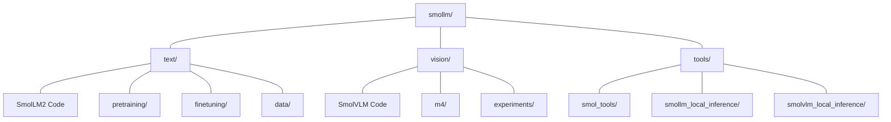

Sources: [README.md:22-32]()

The main directories serve the following purposes:

- `text/`: Contains SmolLM2 language model code and resources
- `vision/`: Contains SmolVLM multimodal model code and resources  
- `tools/`: Contains shared utilities and local inference implementations

## Model Families Overview

Smol Models consists of three primary model families with distinct capabilities but shared infrastructure:

### SmolLM Family Evolution
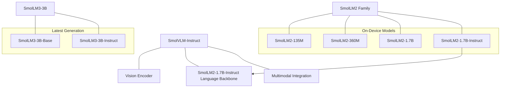

Sources: [README.md:5-21](), [text/README.md:15-30](), [vision/README.md:4-5]()

**SmolLM3** is the latest 3B parameter model featuring dual-mode reasoning, multilingual support (6 languages), and long context capabilities up to 128k tokens. **SmolLM2** provides a family of smaller models (135M, 360M, 1.7B) optimized for on-device usage. **SmolVLM** extends SmolLM2-1.7B-Instruct with vision-language capabilities.

### SmolLM3 Architecture

SmolLM3 introduces architectural innovations including Grouped Query Attention (GQA) and No Position Encoding (NoPE), trained on 11T tokens:

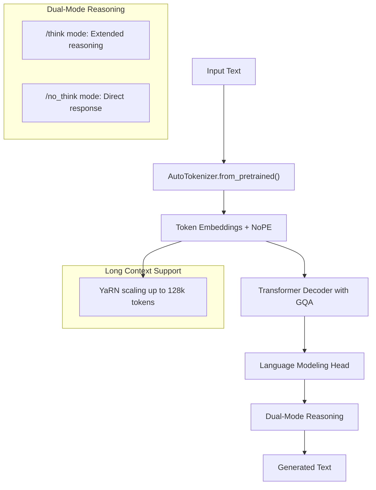

Sources: [README.md:16-21](), [text/README.md:25-30](), [text/README.md:82-98]()

### SmolLM2 Architecture

SmolLM2 provides the foundational architecture used across the on-device model family:

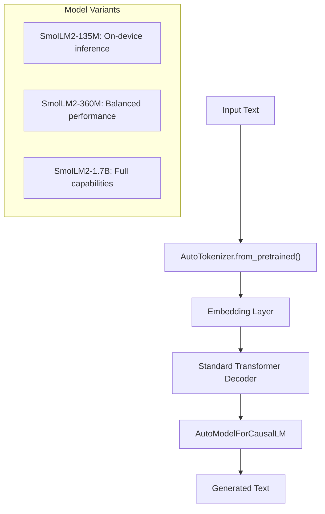

Sources: [text/README.md:32-40](), [text/README.md:51-80]()

### SmolVLM Architecture

SmolVLM extends SmolLM2 with vision capabilities, using SmolLM2-1.7B-Instruct as its language backbone. The architecture integrates visual and textual inputs through a multimodal fusion mechanism:

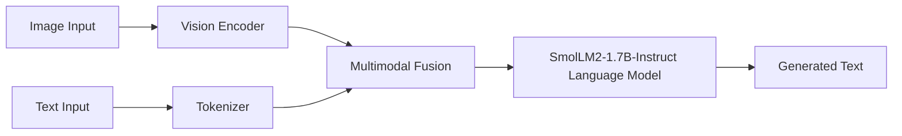

Sources: [vision/README.md:4-5](), [vision/README.md:16-18]()

## Training Infrastructure

The training infrastructure uses different frameworks for different model generations and training stages:

### SmolLM3 Training Pipeline
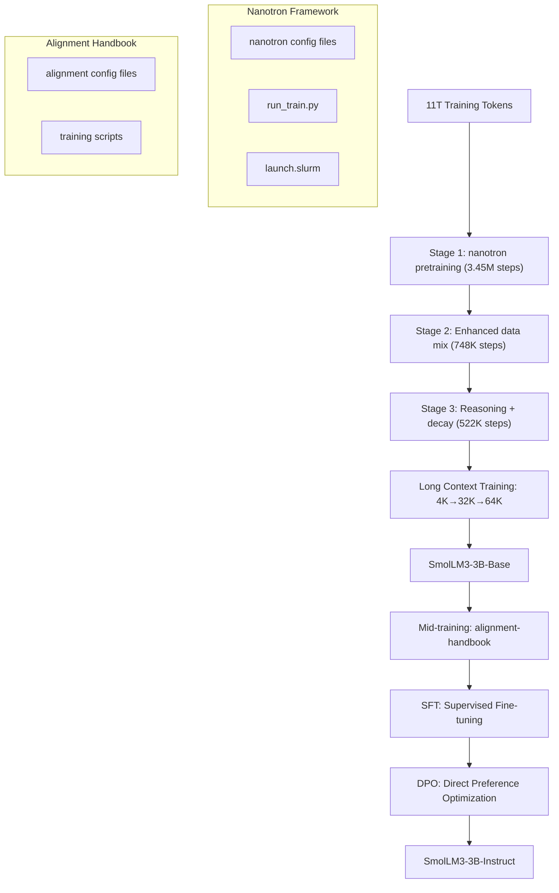

Sources: [README.md:16-21](), [text/README.md:130-134](), [text/finetuning/README.md:3-6]()

### SmolLM2 Training Pipeline
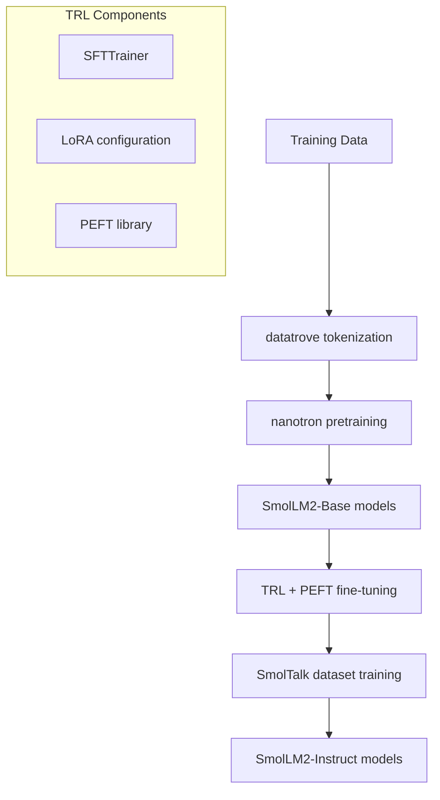

Sources: [text/README.md:130-138](), [text/finetuning/README.md:8-20](), [text/finetuning/README.md:36-55]()

### SmolVLM Training Pipeline
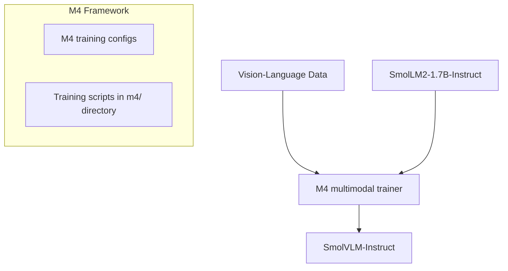

Sources: [vision/README.md:92-104]()

### Training Framework Components

#### Nanotron Framework
Used for distributed pretraining of SmolLM3 and SmolLM2:
- `run_train.py`: Main training script
- Configuration files in `text/pretraining/` directory
- Support for both single-node (`torchrun`) and multi-node (SLURM) training
- Checkpoint management and continual pretraining capabilities

#### Alignment Handbook  
Used for SmolLM3 post-training stages:
- Mid-training for domain adaptation
- Supervised fine-tuning (SFT) for instruction following
- Direct Preference Optimization (DPO) for preference alignment
- Configuration recipes available at external alignment-handbook repository

#### TRL + PEFT Framework
Used for SmolLM2 fine-tuning:
- `SFTTrainer` class for supervised fine-tuning
- `LoRA` configuration for parameter-efficient training
- `train.py` script in `text/finetuning/` directory
- Integration with `accelerate` for distributed training

Sources: [text/README.md:130-138](), [text/finetuning/README.md:3-20](), [text/finetuning/README.md:36-55]()

## Inference Architecture

The Smol Models support multiple inference pathways across all model families:

### Model Loading and Inference APIs
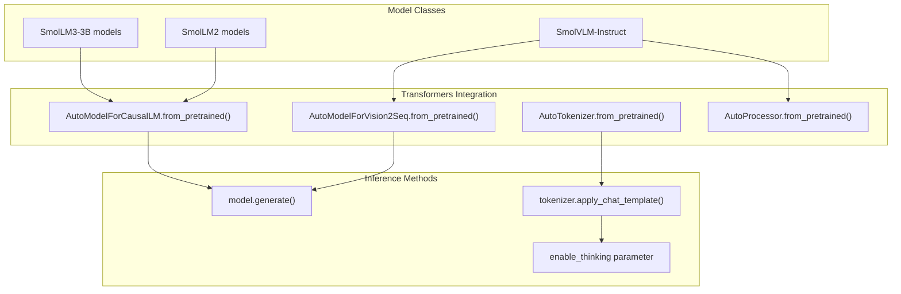

Sources: [README.md:44-75](), [text/README.md:51-112](), [vision/README.md:26-77]()

### Local Inference Backends
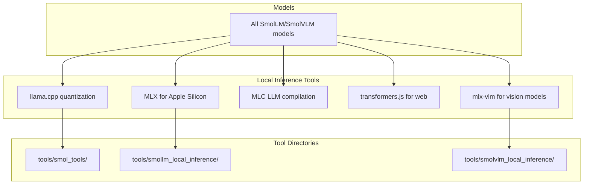

Sources: [text/README.md:124-128](), [vision/README.md:78-84](), [README.md:106]()

### Command Line Interfaces
Key CLI tools for interaction:
- `trl chat --model_name_or_path HuggingFaceTB/SmolLM2-1.7B-Instruct`: TRL chat interface
- `python -m mlx_vlm.chat_ui --model mlx-community/SmolVLM-Instruct-8bit`: MLX VLM chat UI
- Scripts in `tools/smol_tools/` for lightweight AI-powered utilities

Sources: [text/README.md:115-119](), [vision/README.md:81-84]()

Implementation details for local inference are provided in the `tools/smollm_local_inference` and `tools/smolvlm_local_inference` directories, which contain scripts for running inference with various backends.

## Data Pipeline Architecture

The data processing pipeline supports both SmolLM3 and SmolLM2 training with specialized datasets:

### Dataset Processing Flow
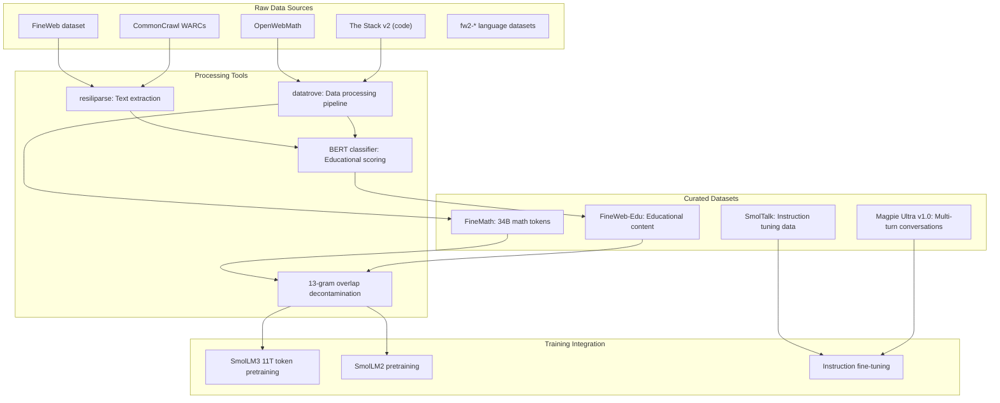

Sources: [README.md:113-117](), [text/README.md:141-142]()

### Dataset Specifications

| Dataset | Purpose | Size | Processing Pipeline |
|---------|---------|------|-------------------|
| `FineMath` | Mathematical reasoning | 34B tokens | 3-phase curation with LLM annotation |
| `FineWeb-Edu` | Educational content | Variable | BERT-based educational scoring |
| `SmolTalk` | Instruction tuning | Variable | Multi-turn conversation generation |
| `Magpie Ultra v1.0` | Advanced conversations | Variable | Distilabel pipeline processing |

Sources: [README.md:113-117](), [text/README.md:141-142]()

The specialized datasets include:
- **FineMath**: Mathematics pretraining dataset
- **FineWeb-Edu**: Educational content pretraining dataset
- **SmolTalk**: Instruction-tuning dataset

## Integration Between Components

The following table summarizes the key integration points between major system components:

| Component 1 | Component 2 | Integration Type | Description |
|-------------|-------------|------------------|-------------|
| SmolLM2-1.7B-Instruct | SmolVLM | Model Backbone | SmolVLM uses SmolLM2-1.7B-Instruct as its language foundation |
| datatrove | nanotron | Data Pipeline | datatrove prepares tokenized data for nanotron training |
| Pretrained Models | TRL+PEFT | Fine-tuning | Base models are adapted for instruction following using TRL+PEFT |
| HuggingFace Hub | Inference Backends | Deployment | Models are hosted on the Hub and pulled by various inference tools |

This architecture allows for a modular approach to training and deployment, where components can be developed and improved independently while maintaining compatibility with the overall system.

Sources: [README.md:9-22](), [text/pretraining/README.md:1-11](), [vision/README.md:4-5]()

---

