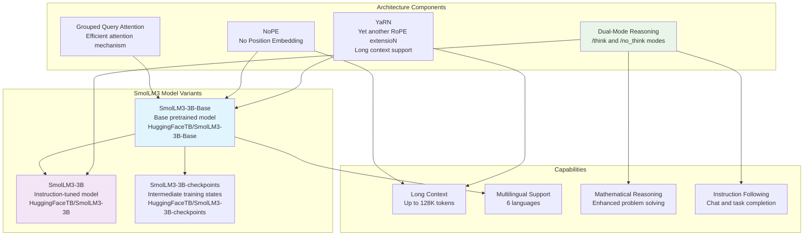
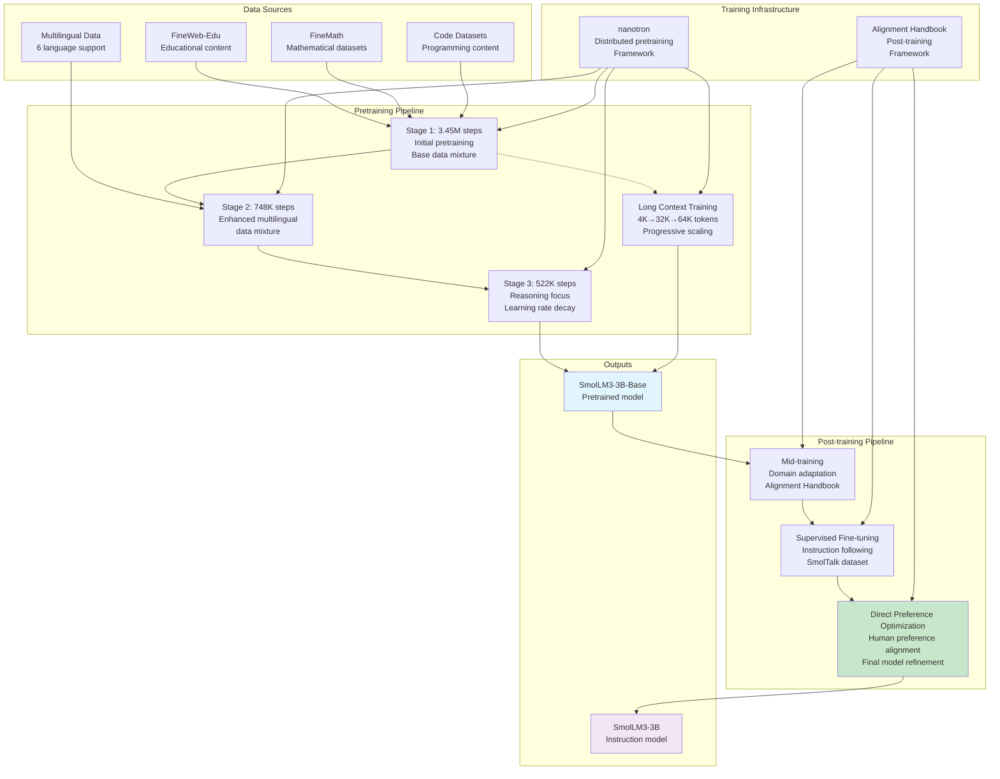
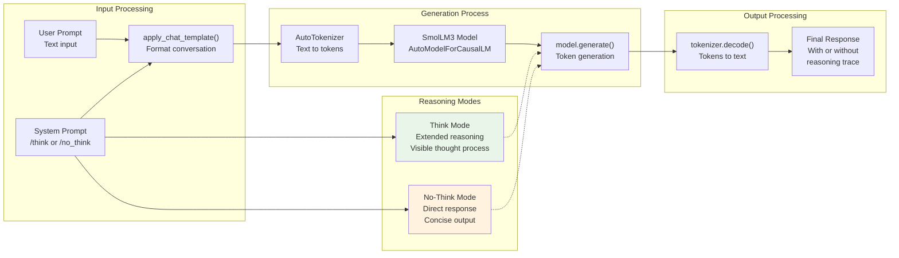
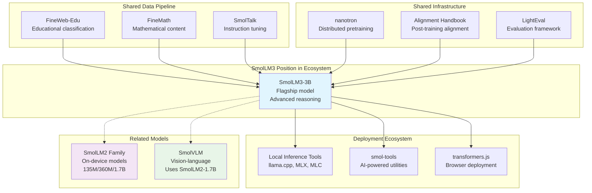

<!-- source: DeepWiki mcp.deepwiki.com · repo huggingface/smollm · page 2 SmolLM3 · fetched 2026-10-26 -->

# SmolLM3

<details>
<summary>Relevant source files</summary>

The following files were used as context for generating this wiki page:

- [README.md](README.md)
- [text/README.md](text/README.md)
- [text/finetuning/README.md](text/finetuning/README.md)
- [vision/README.md](vision/README.md)

</details>


SmolLM3 is a 3 billion parameter language model representing the latest generation in the SmolLM family. This document covers SmolLM3's architecture, training methodology, capabilities, and usage patterns. SmolLM3 introduces dual-mode reasoning, extended multilingual support, and long context capabilities while maintaining the compact, efficient design philosophy of the SmolLM series.

For information about the broader SmolLM family including SmolLM2 models, see [SmolLM2](#3). For vision-language capabilities, see [SmolVLM](#4).

## Overview and Capabilities

SmolLM3 achieves state-of-the-art performance at the 3B scale, outperforming Llama 3.2 3B and Qwen2.5 3B while remaining competitive with larger 4B alternatives. The model is fully open, with complete training details, public data mixture, and training configurations provided.

### Key Features

| Feature | Description |
|---------|-------------|
| **Model Size** | 3B parameters trained on 11T tokens |
| **Dual-Mode Reasoning** | Supports both thinking (`/think`) and direct response (`/no_think`) modes |
| **Multilingual Support** | 6 languages: English, French, Spanish, German, Italian, Portuguese |
| **Long Context** | Up to 128K tokens using NoPE (No Position Embedding) and YaRN |
| **Architecture** | Grouped Query Attention (GQA), advanced positional encoding |
| **Variants** | Base model (`SmolLM3-3B-Base`) and instruct model (`SmolLM3-3B`) |

The model demonstrates strong performance across mathematical reasoning, instruction following, and multilingual tasks while maintaining efficiency for deployment scenarios.

Sources: [README.md:5-31](), [text/README.md:15-31]()

## Model Variants and Architecture



The SmolLM3 architecture incorporates several key innovations. The base model uses Grouped Query Attention for efficient processing and NoPE with YaRN for extended context handling. The instruct variant adds dual-mode reasoning capabilities, allowing users to toggle between extended thinking processes and direct responses.

For detailed architectural specifications and model capabilities, see [SmolLM3 Models](#2.1).

Sources: [README.md:11-21](), [text/README.md:20-30]()

## Training Pipeline

SmolLM3 follows a comprehensive multi-stage training pipeline combining large-scale pretraining with sophisticated post-training alignment techniques.



The training process consists of three main phases:

1. **Pretraining**: Multi-stage approach with 11T tokens using `nanotron` framework, progressing through increasingly sophisticated data mixtures and culminating in long context training
2. **Post-training**: Alignment process using the Alignment Handbook, including mid-training for domain adaptation, supervised fine-tuning on instruction data, and DPO for preference alignment  
3. **Quality Assurance**: Comprehensive evaluation at each stage to ensure model performance and safety

For detailed pretraining procedures and configurations, see [SmolLM3 Pretraining](#2.2). For post-training alignment details, see [SmolLM3 Post-training](#2.3).

Sources: [text/README.md:130-132](), [text/finetuning/README.md:3-7]()

## Usage and Inference

SmolLM3 supports multiple inference modes and deployment options, with particular emphasis on its dual-mode reasoning capability.

### Dual-Mode Reasoning

SmolLM3's signature feature is dual-mode reasoning, controlled through system prompts or the `enable_thinking` parameter:

| Mode | System Prompt | Behavior |
|------|---------------|----------|
| **Think Mode** | `/think` | Extended reasoning with visible thought process |
| **No-Think Mode** | `/no_think` | Direct response without reasoning trace |
| **Default** | None | Think mode enabled by default |



### Basic Usage Example

The standard inference pattern follows the transformers library conventions with SmolLM3-specific chat template handling:

```python
# Basic setup from transformers library
tokenizer = AutoTokenizer.from_pretrained("HuggingFaceTB/SmolLM3-3B")
model = AutoModelForCausalLM.from_pretrained("HuggingFaceTB/SmolLM3-3B")

# Message formatting with dual-mode control
messages = [
    {"role": "system", "content": "/no_think"},  # or "/think"
    {"role": "user", "content": prompt}
]

# Alternative: using enable_thinking parameter
text = tokenizer.apply_chat_template(
    messages, 
    enable_thinking=False,  # Controls reasoning mode
    add_generation_prompt=True
)
```

### Deployment Options

SmolLM3 supports multiple deployment frameworks for different use cases:

| Framework | Use Case | Benefits |
|-----------|----------|----------|
| `transformers` | Standard inference | Full feature support, dual-mode reasoning |
| `vllm` | High-throughput serving | Optimized batch processing |
| `trl` | Interactive chat | Terminal-based conversations |
| `llama.cpp` | Local deployment | Quantized models, CPU optimization |
| `MLX` | Apple Silicon | Hardware-accelerated inference |
| `transformers.js` | Web deployment | Browser-based inference |

For comprehensive local inference setup across all frameworks, see [Local Inference Tools](#6.1).

Sources: [README.md:44-75](), [text/README.md:46-124]()

## Evaluation Framework

SmolLM3 evaluation employs a comprehensive assessment system designed to measure performance across multiple dimensions including mathematical reasoning, instruction following, and multilingual capabilities.

```mermaid
graph TB
    subgraph "Evaluation Infrastructure"
        LightEval["LightEval Framework<br/>Core evaluation system"]
        CustomTasks["Custom Task Definitions<br/>SmolLM3-specific tasks"]
        JudgeModels["Judge Models<br/>Flow-Judge for MixEval"]
    end
    
    subgraph "Benchmark Categories"
        MathReasoning["Mathematical Reasoning<br/>GSM8K, MATH, FineMath"]
        InstructionFollowing["Instruction Following<br/>MixEval, AlpacaEval"]
        GeneralKnowledge["General Knowledge<br/>MMLU, ARC, HellaSwag"]
        Multilingual["Multilingual Tasks<br/>6 language evaluation"]
        LongContext["Long Context Tasks<br/>128K token evaluation"]
    end
    
    subgraph "Model Variants Tested"
        BaseEval["SmolLM3-3B-Base<br/>Pretrained model eval"]
        InstructEval["SmolLM3-3B<br/>Instruction model eval"]
        ThinkModeEval["Think Mode Evaluation<br/>Reasoning trace analysis"]
        NoThinkModeEval["No-Think Mode Evaluation<br/>Direct response assessment"]
    end
    
    subgraph "Comparison Baselines"
        Llama32["Llama 3.2 3B<br/>Baseline comparison"]
        Qwen25["Qwen2.5 3B<br/>Performance benchmark"]
        Larger4B["4B Models<br/>Gemma3, Qwen3"]
    end
    
    %% Infrastructure relationships
    LightEval --> MathReasoning
    LightEval --> InstructionFollowing
    LightEval --> GeneralKnowledge
    LightEval --> Multilingual
    LightEval --> LongContext
    
    CustomTasks --> MathReasoning
    CustomTasks --> InstructionFollowing
    JudgeModels --> InstructionFollowing
    
    %% Model evaluation relationships
    BaseEval --> MathReasoning
    BaseEval --> GeneralKnowledge
    InstructEval --> InstructionFollowing
    ThinkModeEval --> MathReasoning
    NoThinkModeEval --> InstructionFollowing
    
    %% Comparison relationships
    InstructEval -.-> Llama32
    InstructEval -.-> Qwen25
    InstructEval -.-> Larger4B
    
    style ThinkModeEval fill:#e8f5e8
    style InstructEval fill:#f3e5f5
```



The evaluation system demonstrates SmolLM3's competitive performance, particularly in mathematical reasoning where the dual-mode thinking capability provides significant advantages. The model achieves state-of-the-art results at the 3B scale while maintaining efficiency.

Key evaluation highlights include superior performance on GSM8K mathematical reasoning tasks, strong instruction-following capabilities in MixEval assessments, and robust multilingual performance across the supported languages.

For detailed evaluation procedures, benchmark results, and performance analysis, see [SmolLM3 Evaluation](#2.4).

Sources: [text/README.md:137-138](), [README.md:8-22]()

## Integration with SmolLM Ecosystem

SmolLM3 serves as the flagship model in the broader SmolLM ecosystem, providing the most advanced capabilities while maintaining integration with shared tooling and datasets.



SmolLM3 leverages the same data curation pipelines, training infrastructure, and evaluation frameworks as other models in the SmolLM family, ensuring consistency and reproducibility across the ecosystem. The model's advanced capabilities make it suitable for applications requiring sophisticated reasoning while maintaining the efficiency principles of the SmolLM family.

The shared tooling approach enables users to seamlessly transition between different SmolLM models based on their computational requirements and performance needs, with SmolLM3 serving as the high-capability option for demanding applications.

Sources: [README.md:95-118](), [text/README.md:42-44]()

---

