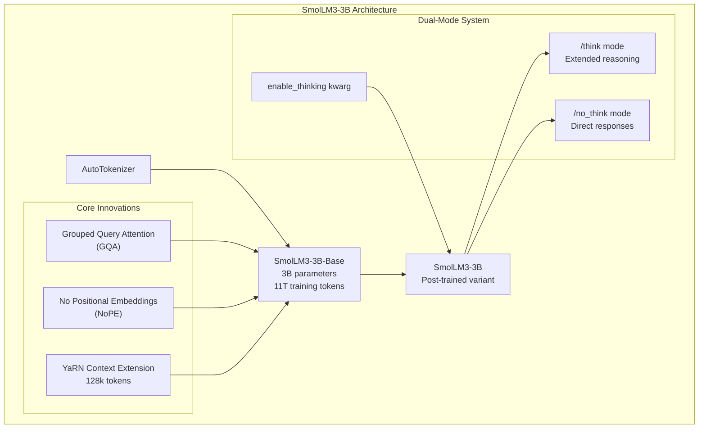
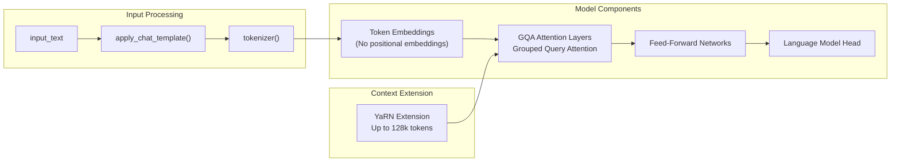
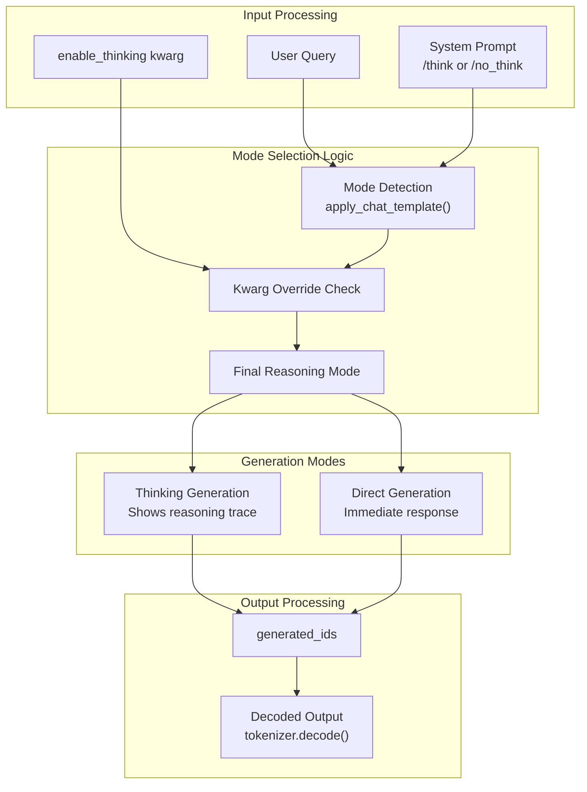

<!-- source: DeepWiki mcp.deepwiki.com · repo huggingface/smollm · page 2.1 SmolLM3 Models · fetched 2026-10-26 -->

# SmolLM3 Models

Relevant source files

The following files were used as context for generating this wiki page:

- [README.md](README.md)
- [text/README.md](text/README.md)
- [text/finetuning/README.md](text/finetuning/README.md)
- [vision/README.md](vision/README.md)

This document covers the SmolLM3 model variants, their architectural innovations, and core capabilities including dual-mode reasoning and long context support. For information about SmolLM3 training processes, see [SmolLM3 Pretraining](#2.2) and [SmolLM3 Post-training](#2.3). For evaluation details, see [SmolLM3 Evaluation](#2.4).

## Model Variants

SmolLM3 is available in two primary variants, both with 3 billion parameters:

| Model | Purpose | HuggingFace ID | Description |
|-------|---------|----------------|-------------|
| SmolLM3-3B-Base | Pretraining base | `HuggingFaceTB/SmolLM3-3B-Base` | Base model for continued pretraining or fine-tuning |
| SmolLM3-3B | Instruction-following | `HuggingFaceTB/SmolLM3-3B` | Post-trained instruct model with dual-mode reasoning |

Additional resources include intermediate checkpoints available at `HuggingFaceTB/SmolLM3-3B-checkpoints` for research and analysis purposes.

**SmolLM3 Model Architecture Overview**

Sources: [README.md:5-31](), [text/README.md:15-30]()

## Architecture Innovations

SmolLM3 incorporates several key architectural improvements that enable its strong performance at the 3B parameter scale:

### Grouped Query Attention (GQA)
SmolLM3 uses Grouped Query Attention to improve inference efficiency while maintaining model quality. This architectural choice reduces memory requirements during generation compared to standard multi-head attention.

### No Positional Embeddings (NoPE)
The model eliminates traditional positional embeddings, relying on the attention mechanism's inherent ability to capture positional information. This innovation contributes to the model's long context capabilities.

### YaRN Context Extension
SmolLM3 supports context lengths up to 128,000 tokens through YaRN (Yet another RoPE extensioN), enabling processing of very long documents and conversations.

**Architecture Components**

Sources: [README.md:20](), [text/README.md:30]()

## Dual-Mode Reasoning

SmolLM3's most distinctive feature is its dual-mode reasoning system, allowing users to choose between extended thinking and direct response modes.

### System Prompt Control
The reasoning mode is controlled through system prompts:

| Mode | System Prompt | Behavior |
|------|---------------|----------|
| Think Mode | `/think` | Generates reasoning trace before final answer |
| No-Think Mode | `/no_think` | Provides direct responses without reasoning |
| Default | None | Enables extended thinking by default |

### Programmatic Control
The `apply_chat_template()` method supports an `enable_thinking` parameter for programmatic control, overriding system prompt settings when specified.

**Dual-Mode Implementation Flow**

Sources: [text/README.md:82-112](), [README.md:58-74]()

## Model Specifications

### Technical Specifications
- **Parameters**: 3 billion
- **Training Tokens**: 11 trillion tokens
- **Context Length**: Up to 128,000 tokens (with YaRN)
- **Languages**: 6 languages (English, French, Spanish, German, Italian, Portuguese)
- **Architecture**: Transformer with GQA and NoPE innovations

### Performance Characteristics
- Competitive with 4B parameter models (Qwen3, Gemma3)
- Outperforms Llama 3.2 3B and Qwen2.5 3B
- State-of-the-art performance at the 3B parameter scale
- Suitable for on-device deployment scenarios

### Integration Points
SmolLM3 integrates with standard HuggingFace ecosystem components:

- `AutoModelForCausalLM` for model loading
- `AutoTokenizer` for text processing  
- `transformers.generate()` method with `max_new_tokens=32768` support
- Compatible with TRL, vLLM, and quantization frameworks

Sources: [README.md:8-21](), [text/README.md:16-30](), [text/README.md:42-80]()

---

