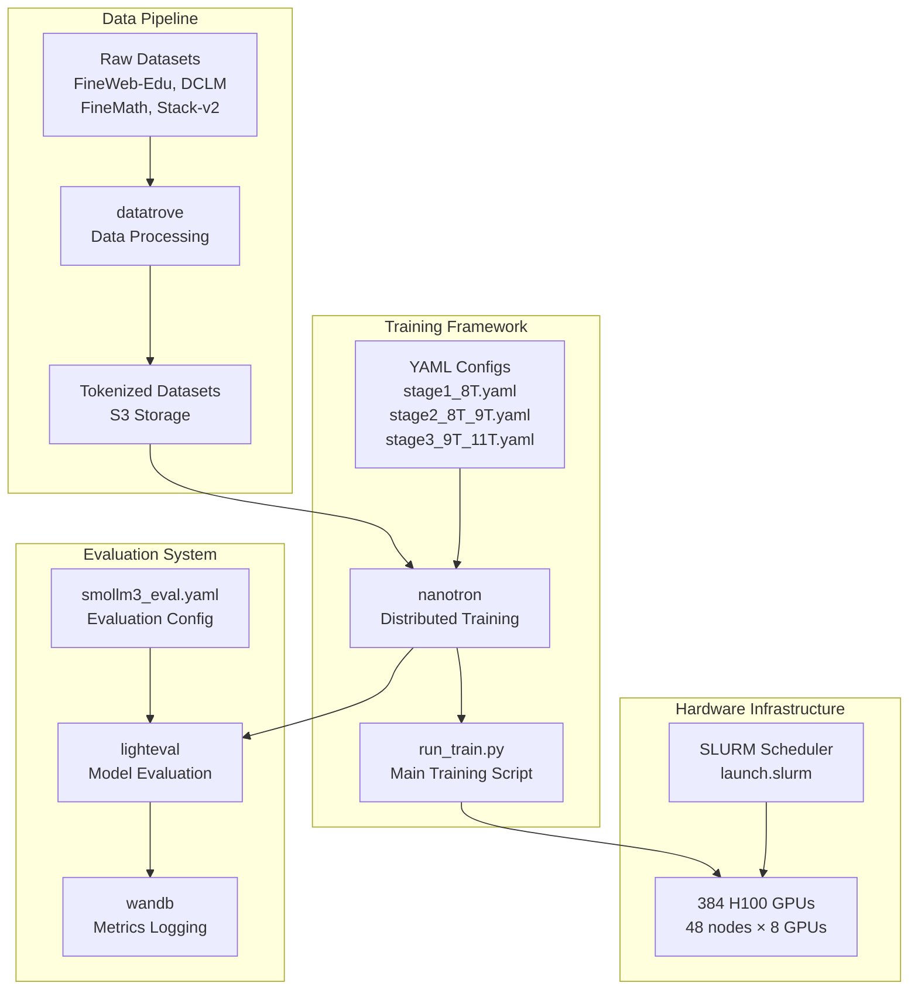
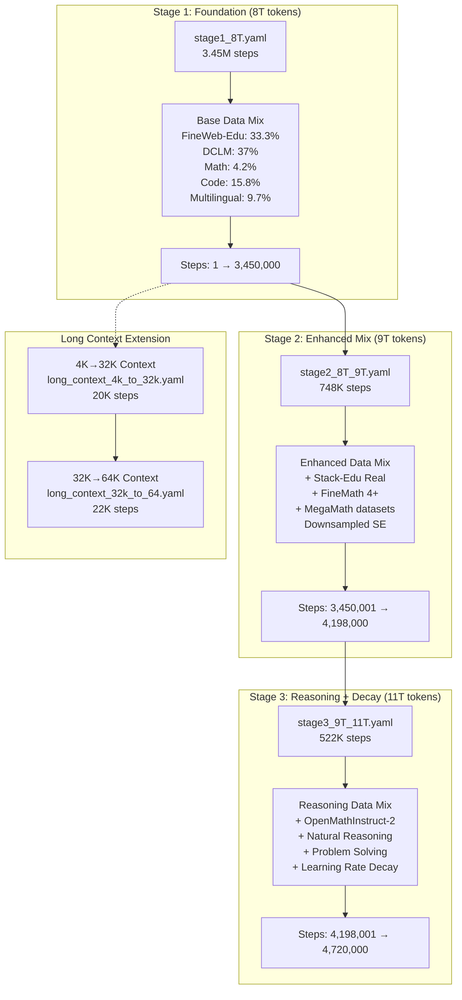
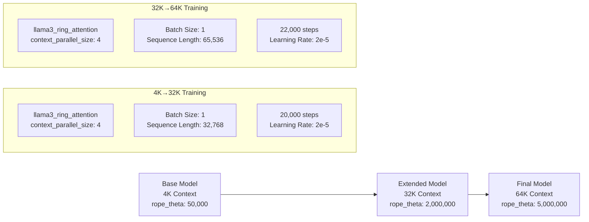
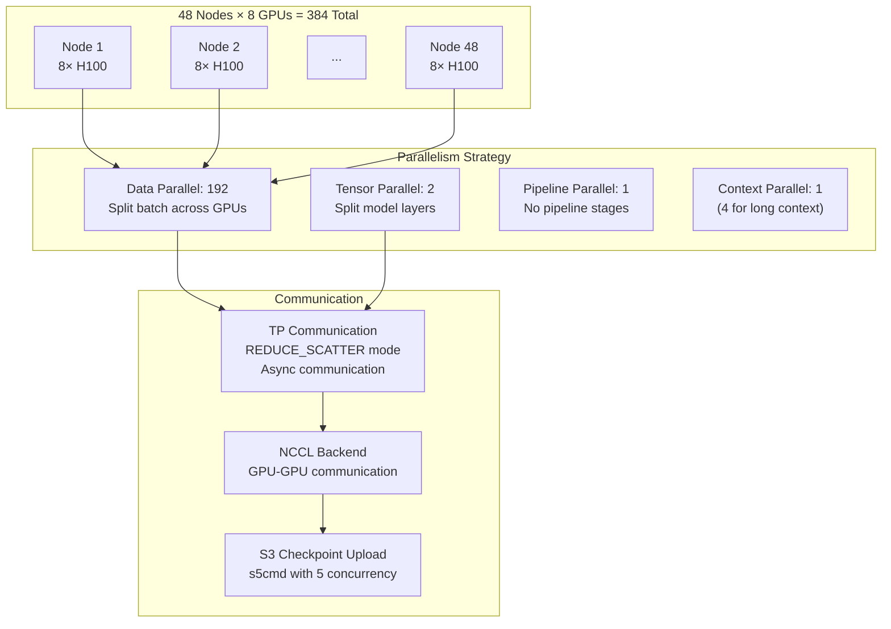
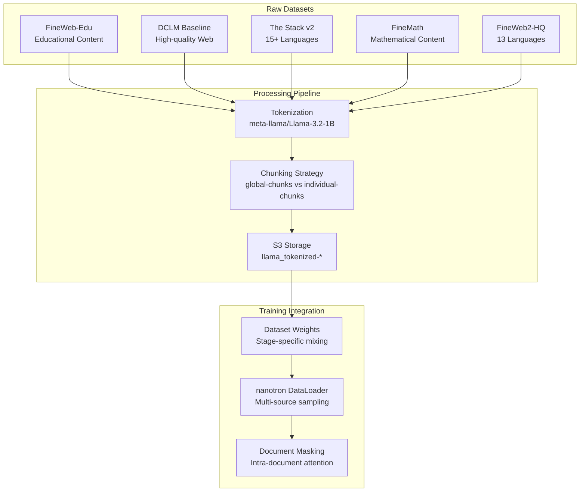

<!-- source: DeepWiki mcp.deepwiki.com · repo huggingface/smollm · page 2.2 SmolLM3 Pretraining · fetched 2026-10-26 -->

# SmolLM3 Pretraining

<details>
<summary>Relevant source files</summary>

The following files were used as context for generating this wiki page:

- [text/pretraining/README.md](text/pretraining/README.md)
- [text/pretraining/launch.slurm](text/pretraining/launch.slurm)
- [text/pretraining/smollm3/long_context_32k_to_64.yaml](text/pretraining/smollm3/long_context_32k_to_64.yaml)
- [text/pretraining/smollm3/long_context_4k_to_32k.yaml](text/pretraining/smollm3/long_context_4k_to_32k.yaml)
- [text/pretraining/smollm3/stage1_8T.yaml](text/pretraining/smollm3/stage1_8T.yaml)
- [text/pretraining/smollm3/stage2_8T_9T.yaml](text/pretraining/smollm3/stage2_8T_9T.yaml)
- [text/pretraining/smollm3/stage3_9T_11T.yaml](text/pretraining/smollm3/stage3_9T_11T.yaml)

</details>


This page documents the pretraining infrastructure, architecture, and process for SmolLM3, the latest 3B parameter model in the SmolLM family. It covers the distributed training setup using nanotron, architectural innovations, multi-stage training progression, and long context extensions. For post-training processes including supervised fine-tuning and preference optimization, see [SmolLM3 Post-training](#2.3). For evaluation frameworks and metrics, see [SmolLM3 Evaluation](#2.4).

## Architecture Innovations

SmolLM3 builds on the Llama architecture with several key modifications optimized for efficiency and long context performance. All architectural changes were validated through ablations using a 3B model trained on 100B tokens from FineWeb-Edu.

### Grouped Query Attention (GQA)

SmolLM3 replaces multi-head attention with grouped query attention using 4 groups. This modification matches the performance of multi-head attention while significantly reducing KV cache size during inference.

**Configuration:**
- `num_attention_heads: 16` - Total attention heads
- `num_key_value_heads: 4` - Key-value heads for GQA groups

### NoPE (No Position Embeddings)

The model implements NoPE from "RoPE to NoRoPE and Back Again: A New Hybrid Attention Strategy", selectively removing rotary position embeddings from every 4th layer. This improves long context performance without affecting short context capabilities.

**Configuration:**
- `no_rope_layer: 4` - Remove RoPE from every 4th layer

### Training Stability Improvements

Following OLMo 2, weight decay is removed from embedding layers to improve training stability, allowing embedding norms to stabilize naturally during training.

**Configuration:**
- `weight_decay_exclude_named_params: [".*token_embedding.*"]`

### Intra-Document Masking

During training, attention masking ensures tokens from different documents in the same training sequence don't attend to each other, similar to Llama 3. This enables faster and more stable long context training.

**Configuration:**
- `_use_doc_masking: true`

Sources: [text/pretraining/README.md:4-14](), [text/pretraining/smollm3/stage1_8T.yaml:169-201]()

## Training Infrastructure

SmolLM3 pretraining uses a distributed infrastructure built on nanotron for training, datatrove for data processing, and lighteval for evaluation.



### Framework Components

**nanotron**: Distributed training framework handling model parallelism, data parallelism, and gradient synchronization.

**datatrove**: Data processing pipeline for tokenization, chunking, and S3 storage management.

**lighteval**: Evaluation framework running periodic assessments during training with configurable intervals.

Sources: [text/pretraining/README.md:16-22](), [text/pretraining/launch.slurm:1-59]()

## Training Configuration

The core training configuration uses a global batch size of 2.36M tokens with specific optimizer and scheduler settings optimized for stability and convergence.

### Hyperparameters

| Parameter | Value | Description |
|-----------|--------|-------------|
| Global Batch Size | 2.36M tokens | Total tokens per training step |
| Sequence Length | 4,096 tokens | Context window during training |
| Learning Rate | 2e-4 | Peak learning rate |
| Optimizer | AdamW | β₁=0.9, β₂=0.95 |
| Weight Decay | 0.1 | Applied to all params except embeddings |
| Gradient Clipping | 1.0 | Prevents gradient explosion |
| Warmup Steps | 2,000 | Linear warmup period |

### Learning Rate Schedule

SmolLM3 uses a WSD (Warmup-Stable-Decay) scheduler:
- **Warmup**: Linear increase over 2,000 steps
- **Stable**: Constant learning rate through most training
- **Decay**: Linear decay to 0 in final 10% of training steps

**Configuration:**
```yaml
learning_rate_scheduler:
  learning_rate: 0.0002
  lr_warmup_steps: 2000
  lr_decay_starting_step: 4198001
  lr_decay_steps: 522000
  lr_decay_style: linear
```

Sources: [text/pretraining/README.md:16](), [text/pretraining/smollm3/stage1_8T.yaml:202-219]()

## Multi-Stage Training Process

SmolLM3 training follows a carefully orchestrated multi-stage process, progressively refining the data mixture and introducing specialized content for enhanced reasoning capabilities.



### Stage 1: Foundation Training

The initial stage establishes core language understanding across multiple domains and languages.

**Data Composition:**
- **FineWeb-Edu** (33.3%): Educational web content
- **DCLM** (37%): High-quality web text from DataComp-LM
- **Mathematical Content** (4.2%): InfiWebMath + FineMath datasets
- **Code** (15.8%): The Stack v2 across 15+ programming languages
- **Multilingual** (9.7%): 13 languages from FineWeb2-HQ

**Training Steps:** 3,450,000 steps (8T tokens total)

### Stage 2: Enhanced Data Mix

The second stage introduces higher-quality code data and expanded mathematical content while reducing lower-quality sources.

**Key Changes:**
- Replace Stack-v2 with Stack-Edu-Real for major programming languages
- Add FineMath 4+ and InfiWebMath 4+ datasets
- Introduce MegaMath collections (Web-Pro, QA-Qwen, Text-Code-Block)
- Downsample StackExchange content

**Training Steps:** 748,000 additional steps (1T tokens)

### Stage 3: Reasoning and Decay

The final pretraining stage emphasizes reasoning capabilities while initiating learning rate decay.

**Reasoning Data Added:**
- **OpenMathInstruct-2**: Mathematical instruction-following
- **OpenMathReasoning-4K**: Mathematical reasoning chains  
- **Natural Reasoning**: General reasoning tasks
- **Problem Solving**: Multi-step problem decomposition
- **Dolmino Math Synthesis**: Synthetic mathematical content

**Learning Rate Decay:** Begins at step 4,198,001 with linear decay over 522,000 steps

Sources: [text/pretraining/smollm3/stage1_8T.yaml:10-150](), [text/pretraining/smollm3/stage2_8T_9T.yaml:149-301](), [text/pretraining/smollm3/stage3_9T_11T.yaml:302-484]()

## Long Context Training

SmolLM3 extends context length through a progressive scaling approach, moving from the base 4K context to 64K tokens while maintaining performance across all context ranges.

### Progressive Context Scaling



### Context Extension Configuration

**4K→32K Extension:**
- **Attention Implementation:** `llama3_ring_attention` for memory efficiency
- **Context Parallelism:** 4-way parallel context processing
- **RoPE Theta:** Increased to 2,000,000 for extended positions
- **Sequence Length:** 32,768 tokens
- **Training Steps:** 20,000 steps

**32K→64K Extension:**
- **RoPE Theta:** Further increased to 5,000,000
- **Sequence Length:** 65,536 tokens  
- **Training Steps:** 22,000 steps
- **Gradient Accumulation:** 3 steps per replica

### Memory Optimization

Long context training uses several memory optimization techniques:

- **Ring Attention:** Distributes attention computation across devices
- **Gradient Checkpointing:** `recompute_layer: true` for 64K training
- **Context Parallelism:** Splits sequence dimension across multiple GPUs
- **Mixed Precision:** bfloat16 throughout training

Sources: [text/pretraining/smollm3/long_context_4k_to_32k.yaml:1-326](), [text/pretraining/smollm3/long_context_32k_to_64.yaml:1-329]()

## Distributed Training Setup

SmolLM3 training uses a sophisticated distributed setup across 384 H100 GPUs, leveraging multiple parallelism strategies for optimal throughput and memory efficiency.

### Parallelism Configuration



### Hardware Configuration

**Total Resources:**
- **Nodes:** 48 compute nodes
- **GPUs per Node:** 8 H100 GPUs
- **Total GPUs:** 384 H100s
- **Training Duration:** 24 days continuous

**Parallelism Settings:**
```yaml
parallelism:
  dp: 192              # Data parallel replicas
  tp: 2                # Tensor parallel groups  
  pp: 1                # Pipeline parallel stages
  context_parallel_size: 1  # Context parallel (4 for long context)
```

### Memory and Communication Optimization

**Tensor Parallelism:**
- `tp_mode: REDUCE_SCATTER` - Efficient gradient reduction
- `tp_linear_async_communication: true` - Overlapped communication
- `tp_recompute_allgather: true` - Memory-efficient activation recomputation

**Gradient Accumulation:**
- `batch_accumulation_per_replica: 1` - No gradient accumulation for base training
- `micro_batch_size: 3` - Micro-batch size per GPU

**Checkpoint Management:**
- `checkpoint_interval: 2000` - Save every 2000 steps  
- Automatic S3 upload with `s5cmd` tool
- `remove_after_upload: true` - Local cleanup after upload

Sources: [text/pretraining/smollm3/stage1_8T.yaml:223-241](), [text/pretraining/launch.slurm:1-59]()

## Dataset Integration

The training pipeline integrates dozens of datasets through a sophisticated weighting and tokenization system managed by datatrove and stored in S3.



### Dataset Weighting Strategy

Training stages use carefully tuned dataset weights to balance different content types:

**Stage 1 Weights (Major Components):**
- FineWeb-Edu: 33.3%
- DCLM: 37.0%  
- Mathematical (InfiWebMath + FineMath): 4.2%
- Code (Python, Java, JavaScript, etc.): 15.8%

**Stage 3 Reasoning Weights:**
- Base content: Reduced proportions
- OpenMathInstruct-2: 0.5%
- Natural Reasoning: 0.1%
- Problem Solving: 0.3%

### Storage and Access Patterns

**Tokenization Strategy:**
- **Tokenizer:** `meta-llama/Llama-3.2-1B` (128,256 vocab size)
- **Chunking:** Global chunks for large datasets, individual chunks for smaller ones
- **Storage:** S3 buckets with organized paths by dataset and chunking strategy

**S3 Path Structure:**
```
s3://smollm3/datasets/
├── llama_tokenized-global-chunks/
│   ├── fineweb-edu/fineweb-edu/
│   └── dclm/dclm/
├── llama_tokenized-individual-chunks/
│   ├── stack-edu-Python/
│   ├── finemath/
│   └── fw2-*/
```

Sources: [text/pretraining/smollm3/stage1_8T.yaml:57-146](), [text/pretraining/smollm3/stage3_9T_11T.yaml:361-417]()

## Training Monitoring and Evaluation

SmolLM3 training incorporates comprehensive monitoring through wandb integration and periodic evaluation using lighteval framework.

### Evaluation Configuration

```yaml
lighteval:
  eval_interval: 4000          # Evaluate every 4000 steps
  batch_size: 8               # Evaluation batch size
  parallelism:
    dp: 4                     # Evaluation parallelism
    tp: 2                     
  upload_to_wandb: true       # Upload results to wandb
  wandb_project: "smollm3-3B-evals"
```

### Monitoring Infrastructure

**Metrics Logging:**
- Training loss and learning rate tracking
- Gradient norms and parameter statistics  
- Throughput metrics (tokens/second, steps/second)
- Memory utilization and communication overhead

**Evaluation Tasks:**
- Periodic evaluation on downstream tasks
- Custom evaluation configurations per training stage
- Automatic upload of results to wandb for analysis

**Checkpoint Management:**
- Regular checkpoints every 2000 steps
- Automatic S3 upload with cleanup
- Resume capabilities from any checkpoint

Sources: [text/pretraining/smollm3/stage1_8T.yaml:257-283](), [text/pretraining/README.md:18]()

---

