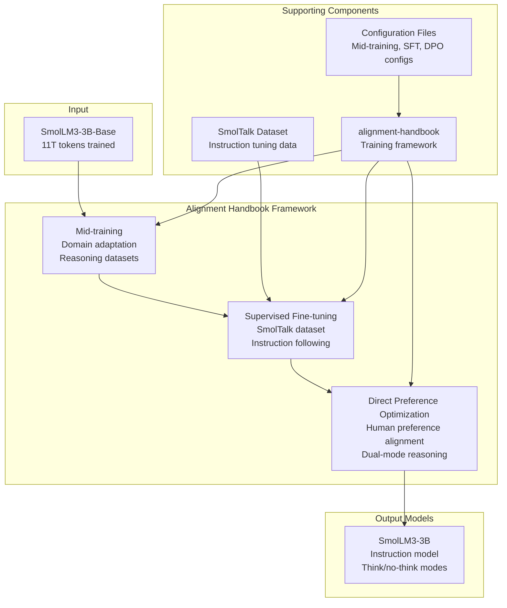
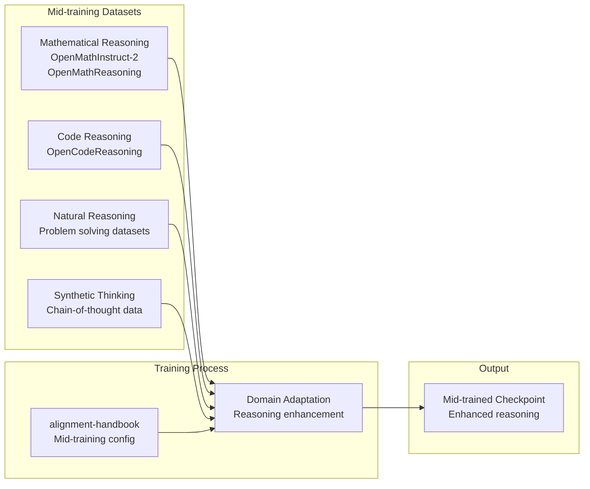
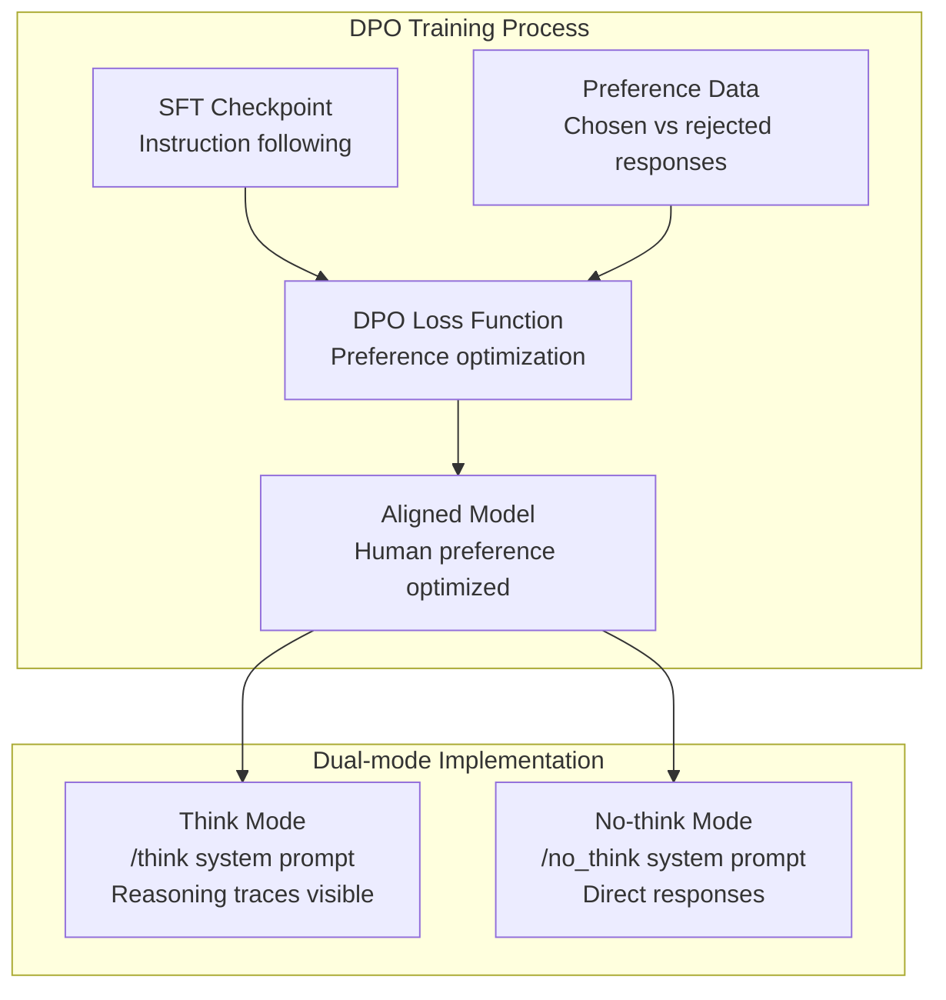
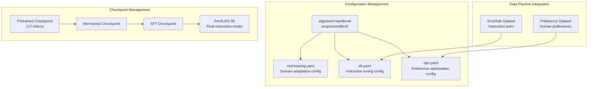

<!-- source: DeepWiki mcp.deepwiki.com · repo huggingface/smollm · page 2.3 SmolLM3 Post-training · fetched 2026-10-26 -->

# SmolLM3 Post-training

<details>
<summary>Relevant source files</summary>

The following files were used as context for generating this wiki page:

- [README.md](README.md)
- [text/README.md](text/README.md)
- [text/finetuning/README.md](text/finetuning/README.md)
- [text/pretraining/smollm3/long_context_32k_to_64.yaml](text/pretraining/smollm3/long_context_32k_to_64.yaml)
- [text/pretraining/smollm3/long_context_4k_to_32k.yaml](text/pretraining/smollm3/long_context_4k_to_32k.yaml)
- [text/pretraining/smollm3/stage1_8T.yaml](text/pretraining/smollm3/stage1_8T.yaml)
- [text/pretraining/smollm3/stage2_8T_9T.yaml](text/pretraining/smollm3/stage2_8T_9T.yaml)
- [text/pretraining/smollm3/stage3_9T_11T.yaml](text/pretraining/smollm3/stage3_9T_11T.yaml)
- [vision/README.md](vision/README.md)

</details>


SmolLM3 post-training encompasses the alignment and instruction-tuning processes that transform the pretrained base model into the final SmolLM3-3B instruction-following model. This includes mid-training domain adaptation, supervised fine-tuning (SFT) for instruction following, and direct preference optimization (DPO) for alignment with human preferences. The post-training pipeline also implements SmolLM3's dual-mode reasoning capability, allowing the model to operate in both thinking and no-thinking modes.

For information about the base model architecture and pretraining, see [SmolLM3 Pretraining](#2.2). For evaluation of the post-trained models, see [SmolLM3 Evaluation](#2.4).

## Post-training Pipeline Architecture

The SmolLM3 post-training process follows a three-stage pipeline implemented using the Alignment Handbook framework. The pipeline takes the final pretrained checkpoint and progressively refines it through specialized training phases.



**Post-training Pipeline Flow**

Sources: [text/finetuning/README.md:3-6](), [text/README.md:28]()

## Mid-training Phase

Mid-training serves as a bridge between pretraining and instruction tuning, focusing on domain adaptation and reasoning capability enhancement. This phase continues training on curated datasets that improve mathematical reasoning, code understanding, and general problem-solving abilities.

The mid-training stage uses reasoning-focused datasets that were introduced in the final pretraining stages, including mathematical reasoning datasets and synthetic thinking traces. This phase prepares the model for the structured instruction-following training that follows in SFT.



**Mid-training Domain Adaptation Process**

Sources: [text/pretraining/smollm3/stage3_9T_11T.yaml:353-358](), [text/finetuning/README.md:4-6]()

## Supervised Fine-tuning (SFT)

The SFT phase transforms the mid-trained model into an instruction-following assistant using the SmolTalk dataset. This stage implements the chat template format and trains the model to respond appropriately to user instructions while maintaining its reasoning capabilities.

During SFT, the model learns to follow the ChatML conversation format and develops its dual-mode reasoning capability. The training process uses the SmolTalk dataset, which contains high-quality instruction-response pairs designed for small language models.

| Component | Description | Implementation |
|-----------|-------------|----------------|
| Dataset | SmolTalk instruction tuning dataset | Curated conversation pairs |
| Format | ChatML conversation template | User/assistant message structure |
| Training Framework | Alignment Handbook SFT | Supervised learning on responses |
| Output Format | Instruction-following responses | Think/no-think mode support |

Sources: [text/finetuning/README.md:4-6](), [text/README.md:28](), [README.md:115]()

## Direct Preference Optimization (DPO)

DPO represents the final alignment stage, where the model learns to prefer responses that align with human preferences. This phase refines the model's behavior to produce more helpful, harmless, and honest responses while preserving its reasoning capabilities.

The DPO process uses preference data to optimize the model's response quality without requiring explicit reward modeling. This approach directly optimizes for human-preferred outputs while maintaining the model's instruction-following capabilities developed during SFT.



**DPO Alignment and Dual-mode Reasoning**

Sources: [text/finetuning/README.md:4-6](), [text/README.md:82-96]()

## Dual-mode Reasoning Implementation

SmolLM3's dual-mode reasoning capability allows users to control whether the model shows its reasoning process. This feature is implemented through system prompt flags that modify the model's response generation behavior.

The dual-mode system supports two operational modes:

**Think Mode** (`/think`): The model generates visible reasoning traces before providing its final answer, similar to chain-of-thought prompting but integrated into the model's native behavior.

**No-think Mode** (`/no_think`): The model provides direct responses without showing intermediate reasoning steps, optimizing for conciseness and speed.

```python
# Think mode example
messages_think = [
    {"role": "user", "content": prompt}
]
# Default behavior shows reasoning traces

# No-think mode example  
messages_no_think = [
    {"role": "system", "content": "/no_think"},
    {"role": "user", "content": prompt}
]
# Suppresses reasoning traces

# Alternative kwarg approach
text = tokenizer.apply_chat_template(
    messages,
    tokenize=False,
    add_generation_prompt=True,
    enable_thinking=False
)
```

Sources: [text/README.md:82-112]()

## Configuration and Infrastructure

The post-training pipeline relies on the Alignment Handbook framework for orchestrating the three-stage training process. Configuration files specify the hyperparameters, datasets, and training schedules for each phase.

| Stage | Configuration | Key Parameters | Framework |
|-------|--------------|----------------|-----------|
| Mid-training | Mid-training config | Domain adaptation settings | alignment-handbook |
| SFT | SFT config | Instruction tuning parameters | alignment-handbook |
| DPO | DPO config | Preference optimization settings | alignment-handbook |

The post-training infrastructure integrates with the SmolTalk dataset pipeline and maintains compatibility with the pretraining checkpoint format. All configuration files are available in the Alignment Handbook repository under the SmolLM3 recipes directory.



**Post-training Configuration and Checkpoint Flow**

Sources: [text/finetuning/README.md:3-6]()

---

