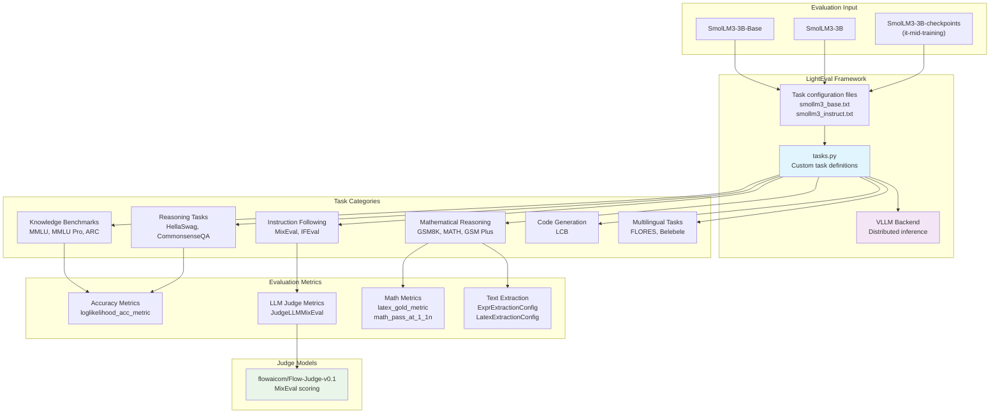
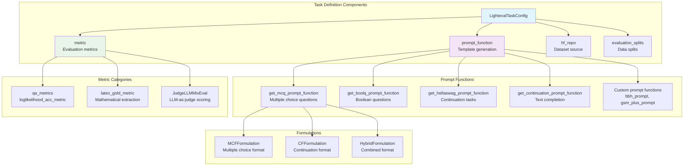
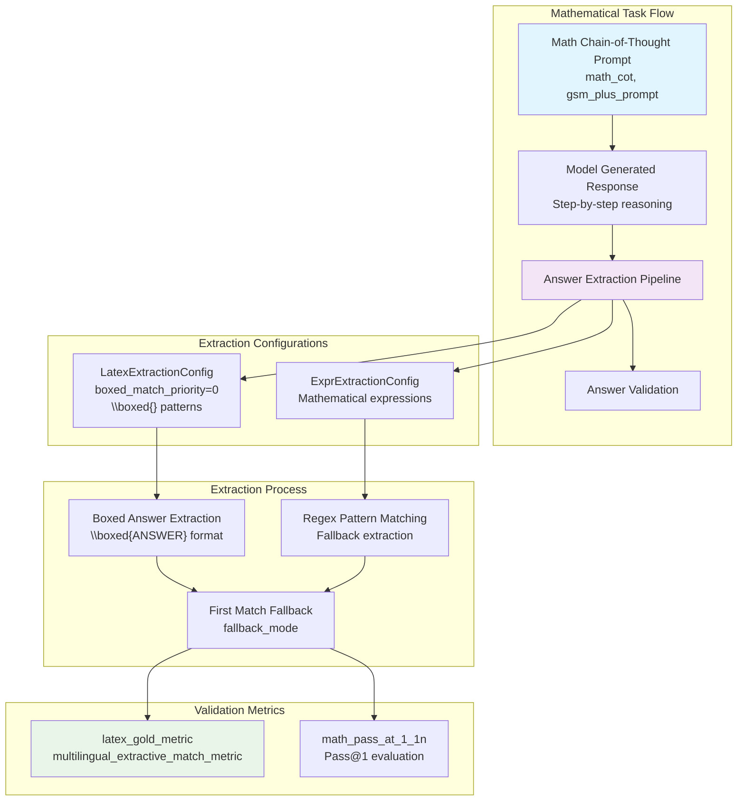
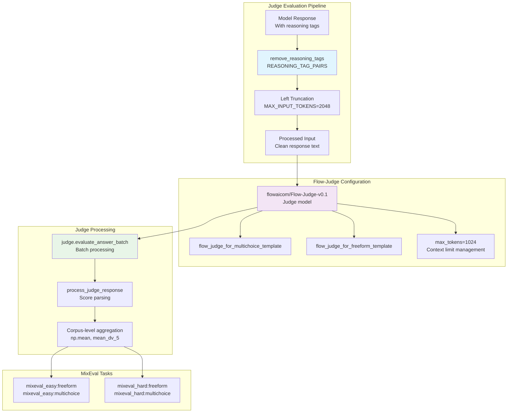

<!-- source: DeepWiki mcp.deepwiki.com · repo huggingface/smollm · page 2.4 SmolLM3 Evaluation · fetched 2026-10-26 -->

# SmolLM3 Evaluation

<details>
<summary>Relevant source files</summary>

The following files were used as context for generating this wiki page:

- [text/evaluation/smollm3/README.md](text/evaluation/smollm3/README.md)
- [text/evaluation/smollm3/requirements.txt](text/evaluation/smollm3/requirements.txt)
- [text/evaluation/smollm3/smollm3_base.txt](text/evaluation/smollm3/smollm3_base.txt)
- [text/evaluation/smollm3/smollm3_instruct.txt](text/evaluation/smollm3/smollm3_instruct.txt)
- [text/evaluation/smollm3/tasks.py](text/evaluation/smollm3/tasks.py)

</details>


This document covers the comprehensive evaluation framework for SmolLM3 models using the LightEval library. The evaluation system supports both base and instruct model variants, covering mathematical reasoning, knowledge benchmarks, instruction following, and multilingual capabilities. The framework includes custom task definitions optimized for SmolLM3's dual-mode reasoning architecture and specialized metrics for mathematical problems.

For information about SmolLM3 model architecture and capabilities, see [SmolLM3 Models](#2.1). For details about the post-training process that creates instruct variants, see [SmolLM3 Post-training](#2.3).

## Evaluation Framework Architecture

The SmolLM3 evaluation system is built on LightEval with custom task definitions and specialized metrics. The framework supports both base and instruct model evaluation with distinct task suites optimized for each model type.



**Sources:** [text/evaluation/smollm3/tasks.py:1-726](), [text/evaluation/smollm3/README.md:1-62]()

## Task Configuration System

The evaluation framework uses a modular task configuration system with separate task suites for different model types and comprehensive formulation support.

### LightevalTaskConfig Structure

The core evaluation tasks are defined using `LightevalTaskConfig` objects that specify dataset sources, prompt functions, metrics, and evaluation parameters:



**Sources:** [text/evaluation/smollm3/tasks.py:54-67](), [text/evaluation/smollm3/tasks.py:77-81]()

### Task Suite Organization

The evaluation framework organizes tasks into distinct suites optimized for different model capabilities:

| Task Suite | Model Type | Primary Focus | Example Tasks |
|------------|------------|---------------|---------------|
| Base Model Suite | SmolLM3-3B-Base | Knowledge & Reasoning | MMLU, ARC, HellaSwag, GSM8K |
| Instruct Suite | SmolLM3-3B | Instruction Following | MixEval, IFEval, GSM Plus |  
| Multilingual Suite | Both | Language Capabilities | FLORES, Belebele, Global MMLU |
| Mathematical Suite | Both | Math Reasoning | MATH, GSM8K, AIME |

**Sources:** [text/evaluation/smollm3/smollm3_base.txt:1-57](), [text/evaluation/smollm3/smollm3_instruct.txt:1-13]()

## Mathematical Reasoning Evaluation

SmolLM3's mathematical reasoning capabilities are evaluated using specialized extraction metrics and chain-of-thought prompting.

### Mathematical Extraction Pipeline

The mathematical evaluation system uses sophisticated text extraction to parse answers from model outputs:



The mathematical evaluation uses a multi-stage extraction approach defined in `latex_gold_metric`:

```
pred_extraction_target=(
    ExprExtractionConfig(),
    LatexExtractionConfig(boxed_match_priority=0),
)
```

**Sources:** [text/evaluation/smollm3/tasks.py:447-458](), [text/evaluation/smollm3/tasks.py:669-690]()

### Mathematical Task Configurations

The framework includes comprehensive mathematical reasoning tasks with specialized prompting:

| Task | Dataset | Prompt Template | Extraction Method | Metric |
|------|---------|-----------------|-------------------|---------|
| GSM8K | openai/gsm8k | `gsm8k` prompt | Expression parsing | `expr_gold_metric` |
| MATH | DigitalLearningGmbH/MATH-lighteval | `math_cot` prompt | LaTeX boxed extraction | `latex_gold_metric` |
| GSM Plus | qintongli/GSM-Plus | Custom template | Math verification | `math_pass_at_1_1n` |

**Sources:** [text/evaluation/smollm3/tasks.py:428-444](), [text/evaluation/smollm3/tasks.py:460-487](), [text/evaluation/smollm3/tasks.py:693-712]()

## LLM-as-Judge Evaluation

For instruction following tasks, the evaluation framework uses Flow-Judge for automated scoring with specialized handling of SmolLM3's reasoning capabilities.

### MixEval Judge Integration

The `JudgeLLMMixEval` class provides specialized judge evaluation for MixEval tasks:



**Sources:** [text/evaluation/smollm3/tasks.py:513-552](), [text/evaluation/smollm3/tasks.py:554-589]()

### Reasoning Tag Handling

The evaluation framework includes specialized handling for SmolLM3's dual-mode reasoning:

```
REASONING_TAG_PAIRS = [
    (""),
]
```

The `remove_reasoning_tags` function strips reasoning blocks before judge evaluation to ensure fair scoring based only on the final answer.

**Sources:** [text/evaluation/smollm3/tasks.py:492-494](), [text/evaluation/smollm3/tasks.py:528]()

## Multilingual Evaluation Support

The framework extends LightEval's multilingual capabilities with comprehensive language support across major benchmark suites.

### Multilingual Task Integration

The evaluation framework integrates multilingual tasks from LightEval's multilingual module:

```python
from lighteval.tasks.multilingual.tasks import TASKS_TABLE as ML_TASKS_TABLE
TASKS_TABLE.extend(ML_TASKS_TABLE)
```

### Language Coverage

| Language Family | Languages | Benchmarks |
|-----------------|-----------|------------|
| Romance | French, Spanish, Italian, Portuguese | FLORES, Belebele, Global MMLU |
| Germanic | German, English | FLORES, HellaSwag variants |
| Sino-Tibetan | Chinese (Simplified) | FLORES, Belebele |
| Slavic | Russian | FLORES, HellaSwag variants |
| Semitic | Arabic | FLORES, Belebele, Global MMLU |

**Sources:** [text/evaluation/smollm3/tasks.py:56](), [text/evaluation/smollm3/tasks.py:71-72](), [text/evaluation/smollm3/smollm3_base.txt:13-56]()

## Model-Specific Evaluation Commands

The evaluation framework provides optimized commands for different SmolLM3 model variants with appropriate generation parameters and system prompts.

### Base Model Evaluation

For SmolLM3-3B-Base models, the evaluation uses deterministic generation settings:

```bash
MODEL_ARGS="model_name=HuggingFaceTB/SmolLM3-3B-Base,dtype=bfloat16,max_model_length=32768,max_num_batched_tokens=32768,generation_parameters={temperature:0},tensor_parallel_size=2,gpu_memory_utilization=0.7"
```

**Sources:** [text/evaluation/smollm3/README.md:26]()

### Instruct Model Evaluation

For SmolLM3-3B instruct models, the evaluation supports dual-mode reasoning control:

```bash
SYSTEM_PROMPT="/no_think"  # or "/think" to enable extended reasoning
MODEL_ARGS="model_name=HuggingFaceTB/SmolLM3-3B,dtype=bfloat16,tensor_parallel_size=2,max_model_length=32768,gpu_memory_utilization=0.8,generation_parameters={max_new_tokens:32768,temperature:0.6,top_p:0.95}"
```

The system prompt controls whether the model uses its extended reasoning capabilities during evaluation.

**Sources:** [text/evaluation/smollm3/README.md:51-53]()

## Performance Optimization

The evaluation framework is optimized for efficient distributed evaluation on multi-GPU systems.

### Hardware Configuration

The evaluation setup is optimized for H100 GPUs with tensor parallelism:

| Parameter | Value | Purpose |
|-----------|--------|---------|
| `tensor_parallel_size` | 2 | Multi-GPU distribution |
| `gpu_memory_utilization` | 0.7-0.8 | Memory management |
| `max_model_length` | 32768 | Long context support |
| `max_num_batched_tokens` | 32768 | Batch processing |

### Metric Optimization

The framework removes computationally expensive PMI normalization metrics to improve evaluation speed:

```python
# Remove pmi_norm from all tasks to save on double inference
for task in TASKS_TABLE:
    task.metric = [
        metric
        for metric in task.metric
        if metric.category != MetricCategory.MULTICHOICE_PMI
    ]
```

**Sources:** [text/evaluation/smollm3/README.md:21](), [text/evaluation/smollm3/tasks.py:716-721]()

---

