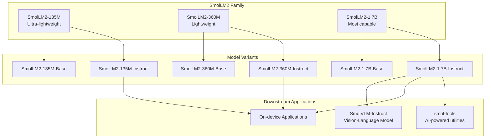
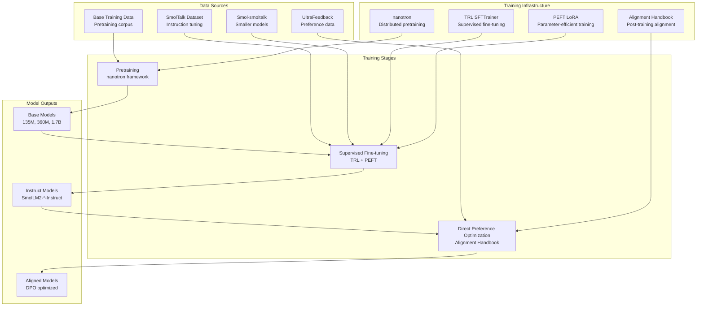
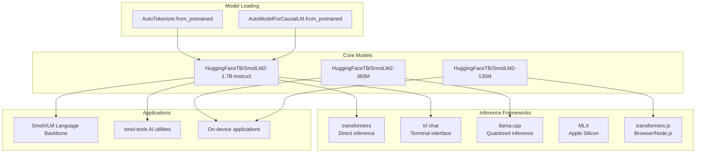

<!-- source: DeepWiki mcp.deepwiki.com · repo huggingface/smollm · page 3 SmolLM2 · fetched 2026-10-26 -->

# SmolLM2

<details>
<summary>Relevant source files</summary>

The following files were used as context for generating this wiki page:

- [README.md](README.md)
- [text/README.md](text/README.md)
- [text/finetuning/README.md](text/finetuning/README.md)
- [vision/README.md](vision/README.md)

</details>


SmolLM2 is a family of compact language models designed for on-device usage and efficiency-focused applications. This page covers the SmolLM2 model family, including the 135M, 360M, and 1.7B parameter variants, their training methodologies, and integration patterns within the broader SmolLM ecosystem.

For information about the latest SmolLM3 model, see [SmolLM3](#2). For details about SmolVLM which uses SmolLM2 as its backbone, see [SmolVLM](#4). For specific implementation details, see [SmolLM2 Models](#3.1), [SmolLM2 Fine-tuning](#3.2), and [SmolLM2 Evaluation](#3.3).

## SmolLM2 Model Family Overview

The SmolLM2 family consists of three model sizes optimized for different deployment scenarios. Each model is available in both base and instruct variants, with the instruct versions fine-tuned for conversational and instruction-following tasks.

### Model Variants

| Model | Parameters | Primary Use Case | Hub Location |
|-------|------------|------------------|--------------|
| SmolLM2-135M | 135M | Ultra-lightweight on-device | `HuggingFaceTB/SmolLM2-135M` |
| SmolLM2-360M | 360M | Lightweight on-device | `HuggingFaceTB/SmolLM2-360M` |
| SmolLM2-1.7B | 1.7B | Capable on-device, SmolVLM backbone | `HuggingFaceTB/SmolLM2-1.7B` |



**Sources:** [README.md:32-39](), [text/README.md:32-43](), [vision/README.md:5]()

## Training Pipeline Architecture

SmolLM2 models follow a multi-stage training approach involving pretraining, supervised fine-tuning, and preference optimization. The training infrastructure leverages different frameworks depending on the stage and model size.

### Training Stages



**Sources:** [text/finetuning/README.md:8-10](), [text/finetuning/README.md:36-38](), [text/README.md:131-134]()

### Fine-tuning Implementation

The SmolLM2 fine-tuning process uses parameter-efficient techniques to reduce computational requirements while maintaining performance. The training script demonstrates integration with multiple frameworks:

- **SFTTrainer**: From TRL library for supervised fine-tuning [text/finetuning/README.md:36]()
- **PEFT LoRA**: Low-Rank Adaptation for efficient parameter updates [text/finetuning/README.md:36]()
- **Accelerate**: Distributed training coordination [text/finetuning/README.md:42]()

The training command structure shows the configuration approach:

```bash
accelerate launch train.py \
    --model_id "HuggingFaceTB/SmolLM2-1.7B" \
    --dataset_name "bigcode/the-stack-smol" \
    --max_seq_length 2048 \
    --learning_rate 3e-4
```

**Sources:** [text/finetuning/README.md:42-54]()

## Code Integration Patterns

SmolLM2 models integrate with the broader ecosystem through standardized interfaces and deployment patterns. The implementation supports multiple inference frameworks and optimization techniques.



**Sources:** [text/README.md:52-61](), [text/README.md:116-119](), [text/README.md:124-128]()

## Usage Patterns

### Transformers Integration

SmolLM2 models follow the standard Transformers API pattern for loading and inference. The implementation supports both CPU and GPU deployment:

```python
model_name = "HuggingFaceTB/SmolLM2-1.7B-Instruct"
tokenizer = AutoTokenizer.from_pretrained(model_name)
model = AutoModelForCausalLM.from_pretrained(model_name).to(device)
```

**Sources:** [text/README.md:54-60]()

### Chat Interface

The TRL library provides a command-line chat interface for interactive usage:

```bash
trl chat --model_name_or_path HuggingFaceTB/SmolLM2-1.7B-Instruct --device cpu
```

**Sources:** [text/README.md:118]()

### Local Inference Options

SmolLM2 supports multiple local inference frameworks optimized for different deployment scenarios:

- **llama.cpp**: Quantized inference with CPU optimization
- **MLX**: Apple Silicon optimization  
- **MLC**: Mobile and edge deployment
- **transformers.js**: Browser and Node.js deployment

**Sources:** [text/README.md:124](), [README.md:42]()

## Ecosystem Integration

### SmolVLM Backbone

SmolLM2-1.7B-Instruct serves as the language backbone for SmolVLM, providing the text generation capabilities in the multimodal architecture. This integration demonstrates the modular design approach where language understanding is decoupled from vision processing.

**Sources:** [vision/README.md:5]()

### Training Infrastructure Dependencies  

The SmolLM2 training process integrates with several key infrastructure components:

- **nanotron**: Distributed pretraining framework [text/README.md:131]()
- **Alignment Handbook**: Post-training alignment recipes [text/finetuning/README.md:10]()
- **TRL**: Transformer Reinforcement Learning library [text/finetuning/README.md:36]()
- **PEFT**: Parameter Efficient Fine-Tuning [text/finetuning/README.md:36]()

**Sources:** [text/README.md:131-134](), [text/finetuning/README.md:8-10]()

### Hub Collections

SmolLM2 models are organized in Hugging Face Hub collections for easy discovery and access:

- **SmolLM2 Collection**: `HuggingFaceTB/smollm2-6723884218bcda64b34d7db9` [text/README.md:43]()
- **Research Paper**: Available at `huggingface.co/papers/2502.02737` [text/README.md:38]()

**Sources:** [text/README.md:37-43](), [README.md:110]()

---

