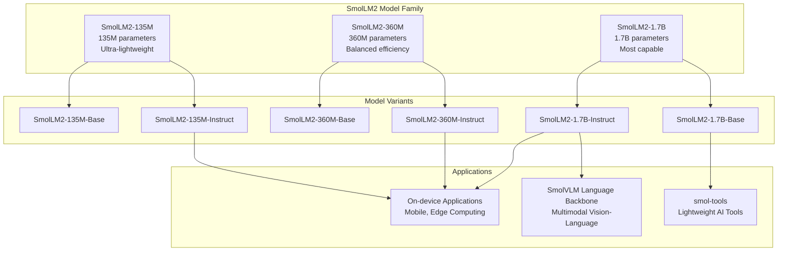
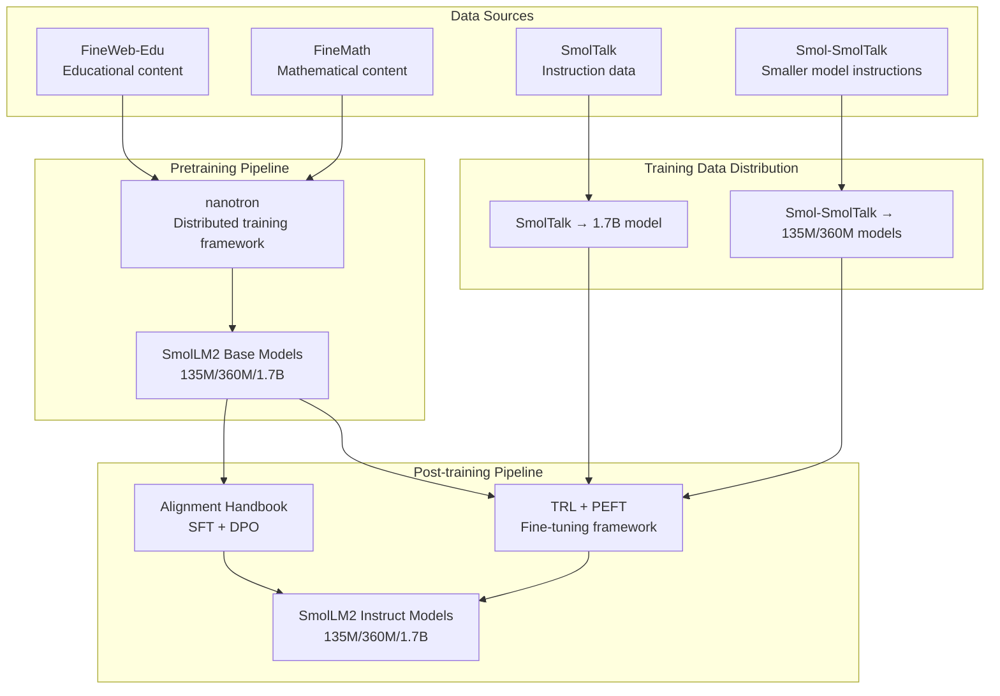
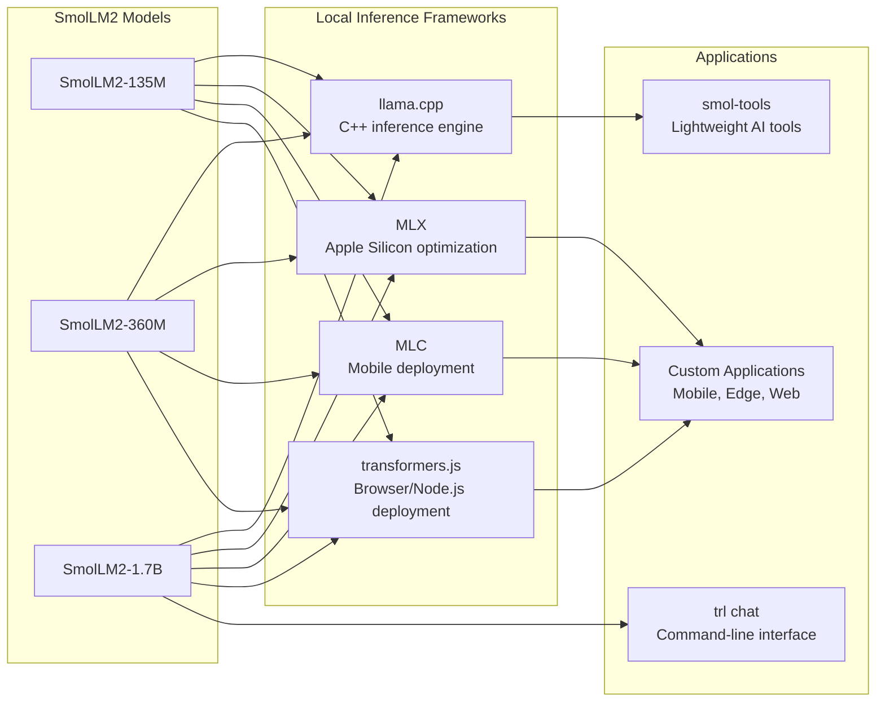
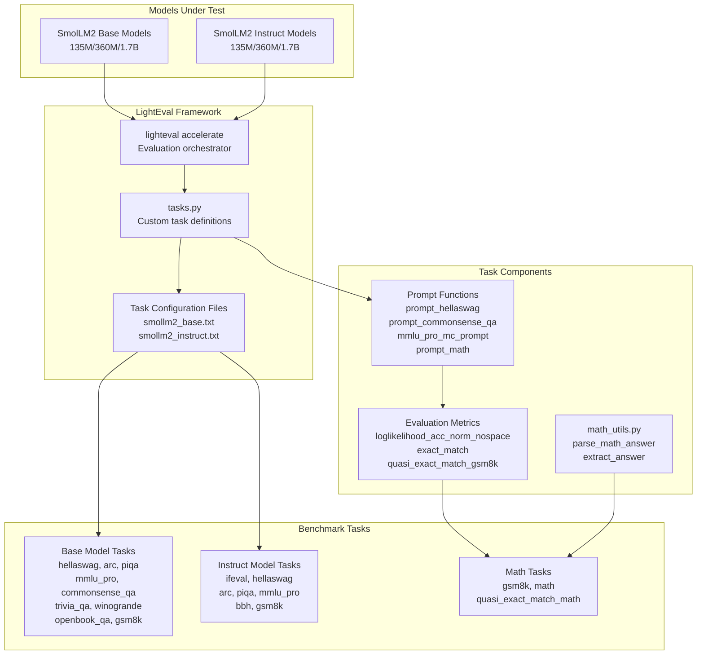
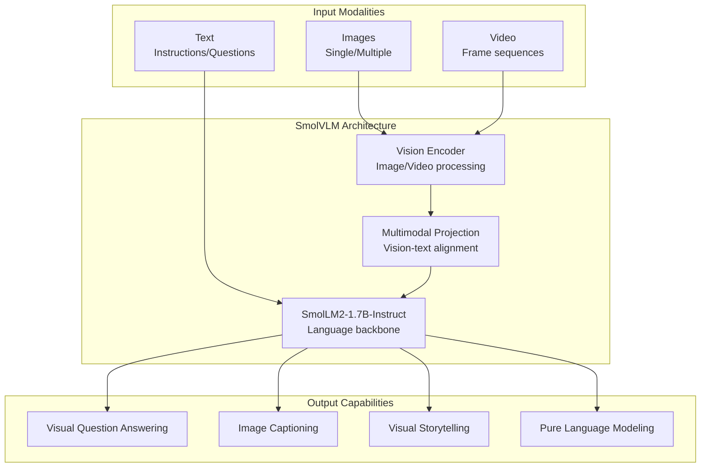

<!-- source: DeepWiki mcp.deepwiki.com · repo huggingface/smollm · page 3.1 SmolLM2 Models · fetched 2026-10-26 -->

# SmolLM2 Models

<details>
<summary>Relevant source files</summary>

The following files were used as context for generating this wiki page:

- [README.md](README.md)
- [text/README.md](text/README.md)
- [text/evaluation/smollm2/README.md](text/evaluation/smollm2/README.md)
- [text/evaluation/smollm2/math_utils.py](text/evaluation/smollm2/math_utils.py)
- [text/evaluation/smollm2/requirements.txt](text/evaluation/smollm2/requirements.txt)
- [text/evaluation/smollm2/smollm2_base.txt](text/evaluation/smollm2/smollm2_base.txt)
- [text/evaluation/smollm2/smollm2_instruct.txt](text/evaluation/smollm2/smollm2_instruct.txt)
- [text/evaluation/smollm2/tasks.py](text/evaluation/smollm2/tasks.py)
- [text/finetuning/README.md](text/finetuning/README.md)
- [vision/README.md](vision/README.md)

</details>


This document covers the SmolLM2 family of compact language models, including their architecture, variants, capabilities, and usage patterns. SmolLM2 models are designed for on-device deployment and serve as building blocks for multimodal applications. For information about SmolLM3, the latest and most capable model in the SmolLM family, see [SmolLM3](#2). For SmolVLM, which uses SmolLM2 as its language backbone, see [SmolVLM Architecture](#4.1).

## Model Family Overview

SmolLM2 is a family of three compact transformer-based language models designed for efficiency and on-device deployment. The models range from 135M to 1.7B parameters, each optimized for different computational constraints and use cases.



**Sources:** [README.md:32-33](), [text/README.md:32-33](), [vision/README.md:5]()

## Model Specifications

| Model | Parameters | Use Case | Key Features |
|-------|-----------|----------|--------------|
| SmolLM2-135M | 135M | Ultra-lightweight applications | Minimal memory footprint, fastest inference |
| SmolLM2-360M | 360M | Balanced efficiency | Moderate capability with good efficiency |
| SmolLM2-1.7B | 1.7B | Most capable on-device model | Best performance in family, SmolVLM backbone |

Each model is available in two variants:
- **Base models**: Pre-trained language models suitable for further fine-tuning
- **Instruct models**: Instruction-tuned models optimized for conversational and task-following capabilities

**Sources:** [text/README.md:32-33](), [text/README.md:37]()

## Training and Data Pipeline

SmolLM2 models undergo a two-stage training process involving pretraining on curated datasets followed by instruction tuning.



**Sources:** [text/finetuning/README.md:8-10](), [text/README.md:130-131](), [text/finetuning/README.md:36-38]()

## Usage and Integration

SmolLM2 models support multiple deployment scenarios through various frameworks and integration patterns.

### Transformers Integration

The primary interface for SmolLM2 models uses the `transformers` library with `AutoModelForCausalLM` and `AutoTokenizer` classes:

```python
from transformers import AutoModelForCausalLM, AutoTokenizer

model_name = "HuggingFaceTB/SmolLM2-1.7B-Instruct"
tokenizer = AutoTokenizer.from_pretrained(model_name)
model = AutoModelForCausalLM.from_pretrained(model_name)
```

**Sources:** [text/README.md:52-60]()

### Local Inference Frameworks

SmolLM2 models are compatible with multiple local inference frameworks:



**Sources:** [text/README.md:124](), [text/README.md:115-118](), [text/README.md:126-128]()

## Evaluation Framework

SmolLM2 models are evaluated using the LightEval framework with custom task definitions and benchmark suites.



**Sources:** [text/evaluation/smollm2/README.md:1-3](), [text/evaluation/smollm2/tasks.py:86-219](), [text/evaluation/smollm2/smollm2_base.txt:1-9](), [text/evaluation/smollm2/smollm2_instruct.txt:1-7]()

## Model Architecture and Training Configuration

SmolLM2 models use standard transformer architecture with specific configurations optimized for efficiency. The training process uses `nanotron` for distributed pretraining and `TRL` with `PEFT` for fine-tuning.

### Fine-tuning Configuration

The fine-tuning process uses LoRA (Low-Rank Adaptation) through the PEFT library for parameter-efficient training:

```python
# Example training command structure
accelerate launch train.py \
    --model_id "HuggingFaceTB/SmolLM2-1.7B" \
    --max_seq_length 2048 \
    --micro_batch_size 1 \
    --gradient_accumulation_steps 8 \
    --learning_rate 3e-4
```

**Sources:** [text/finetuning/README.md:42-54](), [text/finetuning/README.md:36]()

## SmolVLM Integration

SmolLM2-1.7B serves as the language backbone for SmolVLM, the multimodal vision-language model in the SmolLM ecosystem:



**Sources:** [vision/README.md:5](), [vision/README.md:16-18]()

## Performance Characteristics

SmolLM2 models are optimized for different performance profiles within the on-device deployment spectrum:

| Characteristic | SmolLM2-135M | SmolLM2-360M | SmolLM2-1.7B |
|----------------|--------------|--------------|--------------|
| Memory Footprint | Minimal | Moderate | Higher |
| Inference Speed | Fastest | Balanced | Slower |
| Model Capability | Basic | Good | Best in family |
| Use Case | Ultra-constrained | General on-device | High-capability on-device |

The evaluation pipeline validates performance across multiple domains including common sense reasoning, mathematical problem solving, and instruction following capabilities.

**Sources:** [text/evaluation/smollm2/smollm2_base.txt:1-9](), [text/evaluation/smollm2/smollm2_instruct.txt:1-7]()

---

