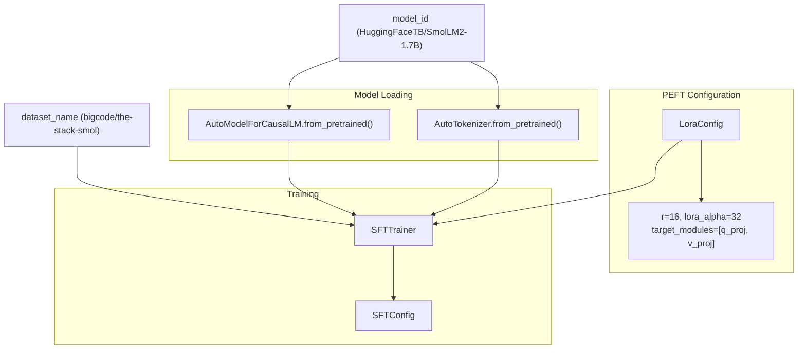
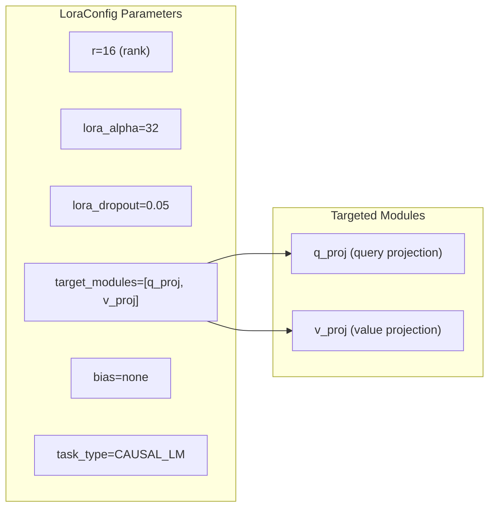
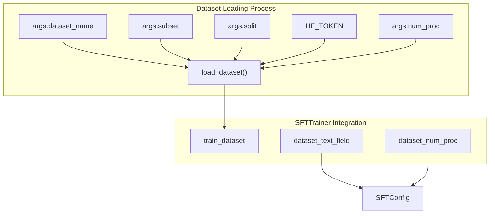
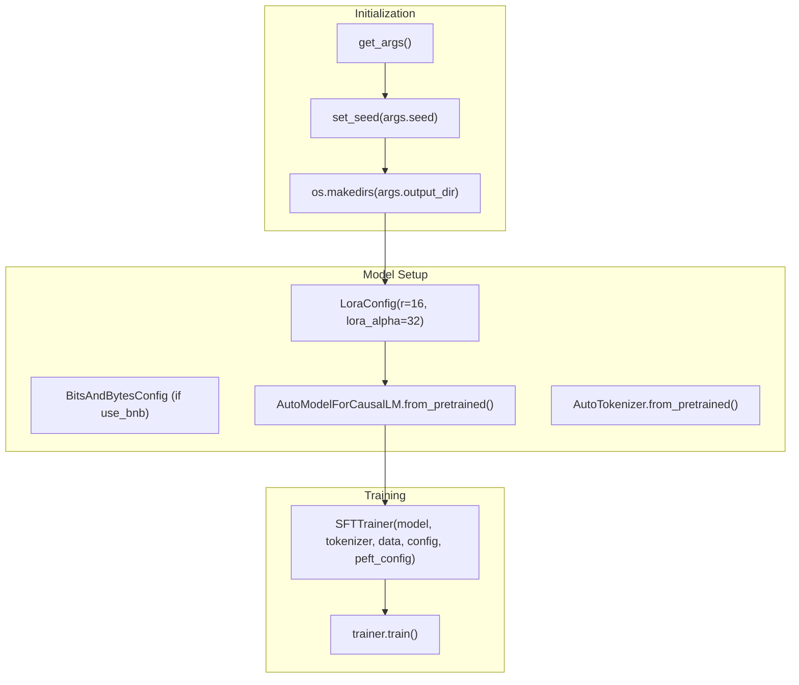
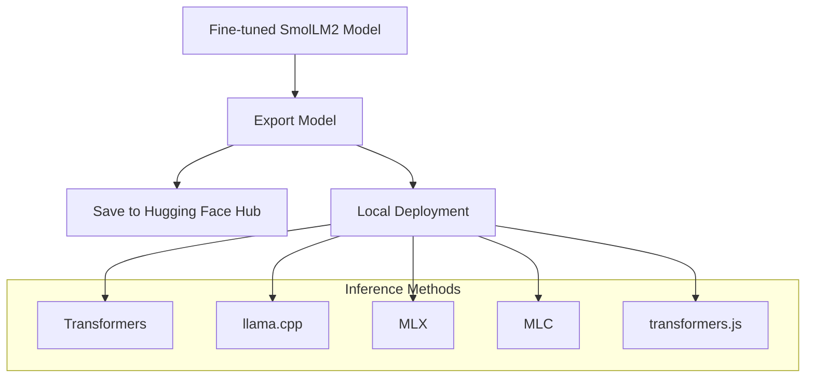

<!-- source: DeepWiki mcp.deepwiki.com · repo huggingface/smollm · page 3.2 SmolLM2 Fine-tuning · fetched 2026-10-26 -->

# SmolLM2 Fine-tuning

Relevant source files

The following files were used as context for generating this wiki page:

- [text/finetuning/train.py](text/finetuning/train.py)

This document covers the fine-tuning implementation for SmolLM2 models using TRL and PEFT libraries. The primary implementation is in the `text/finetuning/train.py` script, which provides supervised fine-tuning with LoRA adapters.

## Overview

The SmolLM2 fine-tuning system uses `SFTTrainer` from TRL combined with `LoraConfig` from PEFT to efficiently adapt pretrained models for specific tasks. The system supports quantization through `BitsAndBytesConfig` and provides configurable hyperparameters for different use cases.

### Fine-tuning Architecture

Sources: [text/finetuning/train.py:1-133]()

## Core Implementation Components

### TRL SFTTrainer Configuration

The `SFTTrainer` class handles supervised fine-tuning with the following key components:

- **Model**: Loaded via `AutoModelForCausalLM.from_pretrained()`
- **Processing**: Uses `AutoTokenizer` as processing class
- **Configuration**: `SFTConfig` with training hyperparameters
- **PEFT Integration**: `peft_config` parameter accepts `LoraConfig`

### LoRA Configuration Details

### BitsAndBytesConfig for Quantization

When `use_bnb=True`, the system applies 4-bit quantization:
- `load_in_4bit=True`
- `bnb_4bit_quant_type="nf4"`
- `bnb_4bit_compute_dtype=torch.bfloat16`

Sources: [text/finetuning/train.py:56-70]()

## Dataset Loading and Processing

### Dataset Configuration

The training script uses `load_dataset()` with configurable parameters:

| Parameter | Default Value | Purpose |
|-----------|---------------|---------|
| `dataset_name` | `bigcode/the-stack-smol` | Source dataset identifier |
| `subset` | `data/python` | Dataset subset/split |
| `split` | `train` | Dataset split |
| `dataset_text_field` | `content` | Text field name |
| `streaming` | `False` | Enable dataset streaming |

### Data Loading Implementation

Sources: [text/finetuning/train.py:81-88]()

## Training Configuration

### SFTConfig Parameters

The `SFTConfig` class configures training behavior with these key parameters:

| Parameter | Default Value | Purpose |
|-----------|---------------|---------|
| `max_seq_length` | `2048` | Maximum sequence length |
| `per_device_train_batch_size` | `1` | Micro batch size |
| `gradient_accumulation_steps` | `4` | Gradient accumulation |
| `learning_rate` | `2e-4` | Learning rate |
| `max_steps` | `1000` | Maximum training steps |
| `warmup_steps` | `100` | Learning rate warmup |
| `weight_decay` | `0.01` | Weight decay regularization |
| `lr_scheduler_type` | `cosine` | Learning rate scheduler |
| `optim` | `paged_adamw_8bit` | Optimizer type |

### Training Execution Flow

Sources: [text/finetuning/train.py:24-51](), [text/finetuning/train.py:95-118]()

## Command Line Interface

### Script Arguments

The `train.py` script accepts the following command line arguments:

#### Model Configuration
- `--model_id`: Base model identifier (default: `HuggingFaceTB/SmolLM2-1.7B`)
- `--tokenizer_id`: Tokenizer identifier (defaults to model_id)
- `--use_bnb`: Enable BitsAndBytesConfig quantization
- `--attention_dropout`: Attention dropout rate (default: `0.1`)

#### Dataset Configuration  
- `--dataset_name`: Dataset name (default: `bigcode/the-stack-smol`)
- `--subset`: Dataset subset (default: `data/python`)
- `--split`: Dataset split (default: `train`)
- `--dataset_text_field`: Text field name (default: `content`)
- `--streaming`: Enable dataset streaming

#### Training Hyperparameters
- `--max_seq_length`: Maximum sequence length (default: `2048`)
- `--max_steps`: Maximum training steps (default: `1000`) 
- `--micro_batch_size`: Per-device batch size (default: `1`)
- `--gradient_accumulation_steps`: Gradient accumulation (default: `4`)
- `--learning_rate`: Learning rate (default: `2e-4`)
- `--weight_decay`: Weight decay (default: `0.01`)

#### Output Configuration
- `--output_dir`: Output directory (default: `finetune_smollm2_python`)
- `--push_to_hub`: Push to Hugging Face Hub (default: `True`)
- `--repo_id`: Repository ID for Hub upload (default: `SmolLM2-1.7B-finetune`)

Sources: [text/finetuning/train.py:24-51]()

## Fine-tuning Examples and Resources

SmolLM2 offers resources and examples to help with fine-tuning your own models.

### Example Fine-tuning Script

The repository contains example scripts in the `finetuning` folder that demonstrate how to fine-tune SmolLM2 using TRL and PEFT. These examples provide a foundation for customizing models to specific use cases.

### Additional Resources

- **SmolCourse**: Recommended resource for in-depth guidance on fine-tuning small language models and SmolLM2
- **Alignment Handbook**: Referenced for post-training alignment techniques

Sources: [text/README.md:68-69]()

## Hardware Requirements

Fine-tuning SmolLM2 models with QLoRA significantly reduces the hardware requirements compared to full fine-tuning, making it accessible on consumer hardware.

| Model Size | Full Fine-tuning | QLoRA Fine-tuning | Minimum GPU Memory |
|------------|-----------------|-------------------|-------------------|
| 135M       | Low requirements | Very low requirements | 4GB |
| 360M       | Moderate requirements | Low requirements | 8GB |
| 1.7B       | High requirements | Moderate requirements | 16GB |

Sources: [text/README.md:68-69]()

## Integration with Inference

After fine-tuning, models can be deployed using various inference frameworks as detailed in [SmolLM2 Inference](#2.4).

Sources: [text/README.md:25-60]()

## Summary

Fine-tuning is a critical step in the SmolLM2 development pipeline, enabling the transformation of base models into specialized variants like SmolLM2-1.7B-Instruct. By leveraging efficient techniques like QLoRA and specialized datasets like SmolTalk, SmolLM2 models can be adapted for various tasks while maintaining their lightweight nature, making them suitable for on-device applications.

---

