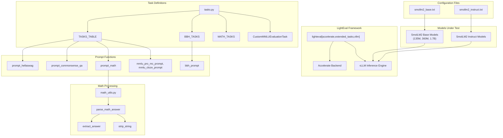
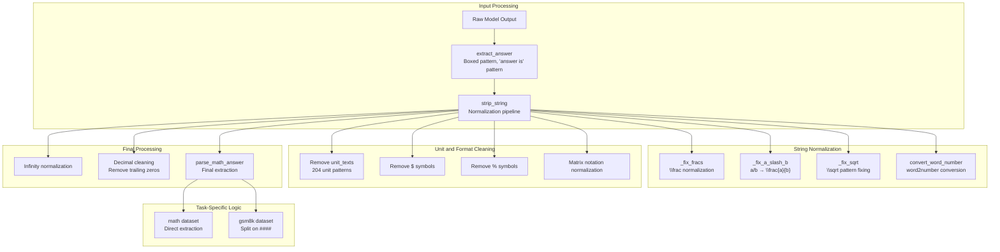

<!-- source: DeepWiki mcp.deepwiki.com · repo huggingface/smollm · page 3.3 SmolLM2 Evaluation · fetched 2026-10-26 -->

# SmolLM2 Evaluation

<details>
<summary>Relevant source files</summary>

The following files were used as context for generating this wiki page:

- [text/evaluation/smollm2/README.md](text/evaluation/smollm2/README.md)
- [text/evaluation/smollm2/math_utils.py](text/evaluation/smollm2/math_utils.py)
- [text/evaluation/smollm2/requirements.txt](text/evaluation/smollm2/requirements.txt)
- [text/evaluation/smollm2/smollm2_base.txt](text/evaluation/smollm2/smollm2_base.txt)
- [text/evaluation/smollm2/smollm2_instruct.txt](text/evaluation/smollm2/smollm2_instruct.txt)
- [text/evaluation/smollm2/tasks.py](text/evaluation/smollm2/tasks.py)

</details>


This document covers the evaluation framework for SmolLM2 models, including base and instruction-tuned variants. The system provides standardized benchmarking capabilities using the LightEval framework with custom task definitions, specialized prompt functions, and mathematical answer parsing utilities.

For SmolLM3 evaluation capabilities, see [SmolLM3 Evaluation](#2.4). For general model architecture details, see [SmolLM2 Models](#3.1).

## Architecture Overview

The SmolLM2 evaluation system is built on the LightEval framework and provides comprehensive benchmarking across multiple domains including reasoning, mathematics, and general knowledge tasks.

### Evaluation System Architecture



Sources: [text/evaluation/smollm2/tasks.py:1-344](), [text/evaluation/smollm2/math_utils.py:1-435](), [text/evaluation/smollm2/requirements.txt:1-3]()

## Task Configuration System

The evaluation system defines tasks through the `LightevalTaskConfig` class, organizing them into distinct categories with specific prompt functions and metrics.

### Task Categories and Definitions

```mermaid
graph TD
    subgraph "Core Reasoning Tasks"
        ARC["arc:easy, arc:challenge<br/>LightevalTaskConfig<br/>prompt.arc"]
        HellaSwag["hellaswag<br/>prompt_hellaswag<br/>preprocess text"]
        PIQA["piqa<br/>prompt.piqa_harness"]
        Winogrande["winogrande<br/>prompt.winogrande"]
        CommonsenseQA["commonsense_qa<br/>prompt_commonsense_qa"]
    end
    
    subgraph "Mathematical Tasks"
        GSM8K["gsm8k<br/>prompt.gsm8k<br/>quasi_exact_match_gsm8k"]
        MathTask["math<br/>prompt_math<br/>quasi_exact_match_math"]
        MathUtils["parse_math_answer<br/>extract_answer"]
    end
    
    subgraph "Knowledge Tasks"
        MMLU["mmlu<br/>mmlu_cloze_prompt"]
        MMLUPro["mmlu_pro<br/>mmlu_pro_mc_prompt"]
        MMLUSTEM["mmlu_stem<br/>mmlu_cloze_prompt"]
        TriviaQA["trivia_qa<br/>prompt.triviaqa"]
        OpenBookQA["openbook_qa<br/>prompt.openbookqa"]
    end
    
    subgraph "Reasoning Benchmarks"
        BBHNodes["BBH Tasks (25 subsets)<br/>bbh_prompt<br/>boolean_expressions, causal_judgement..."]
    end
    
    subgraph "Metrics"
        LogLikelihood["loglikelihood_acc_norm_nospace"]
        QuasiExact["quasi_exact_match_*"]
        ExactMatch["exact_match"]
    end
    
    ARC --> LogLikelihood
    HellaSwag --> LogLikelihood
    PIQA --> LogLikelihood
    Winogrande --> LogLikelihood
    CommonsenseQA --> LogLikelihood
    
    GSM8K --> QuasiExact
    MathTask --> QuasiExact
    MathTask --> MathUtils
    GSM8K --> MathUtils
    
    MMLU --> LogLikelihood
    MMLUPro --> LogLikelihood
    MMLUSTEM --> LogLikelihood
    TriviaQA --> QuasiExact
    OpenBookQA --> LogLikelihood
    
    BBHNodes --> ExactMatch
```



Sources: [text/evaluation/smollm2/tasks.py:86-219](), [text/evaluation/smollm2/tasks.py:221-268](), [text/evaluation/smollm2/tasks.py:283-302]()

### Prompt Function Implementations

The system implements specialized prompt functions for different task types:

| Task Type | Function | Key Features |
|-----------|----------|--------------|
| HellaSwag | `prompt_hellaswag` | Text preprocessing, bracket removal, context formatting |
| CommonSense QA | `prompt_commonsense_qa` | Choice formatting with labels |
| MMLU Pro | `mmlu_pro_mc_prompt` | Multiple choice with topic context |
| MMLU Cloze | `mmlu_cloze_prompt` | Question-answer format without explicit choices |
| BBH | `bbh_prompt` | Simple question-answer structure |
| Math | `prompt_math` | Step-by-step reasoning with boxed answers |

Sources: [text/evaluation/smollm2/tasks.py:11-84]()

## Mathematical Answer Parsing

The evaluation system includes sophisticated mathematical answer parsing capabilities adapted from the Qwen2.5-Math evaluation suite.

### Mathematical Processing Pipeline



Sources: [text/evaluation/smollm2/math_utils.py:350-435](), [text/evaluation/smollm2/math_utils.py:209-347](), [text/evaluation/smollm2/math_utils.py:8-68]()

The `quasi_exact_match_math` metric uses this parsing pipeline to normalize both predictions and gold answers before comparison:

```python
quasi_exact_match_math = SampleLevelMetric(
    metric_name="qem",
    sample_level_fn=ExactMatches(
        strip_strings=True,
        normalize_pred=lambda text: parse_math_answer(text, "math"),
        normalize_gold=lambda text: parse_math_answer(text, "math")
    ).compute,
    category=MetricCategory.GENERATIVE,
    use_case=MetricUseCase.MATH,
    corpus_level_fn=np.mean,
    higher_is_better=True,
)
```

Sources: [text/evaluation/smollm2/tasks.py:270-281]()

## Evaluation Configurations

The system provides pre-configured task lists for different model types through text configuration files.

### Base Model Configuration

The `smollm2_base.txt` configuration focuses on core reasoning and knowledge tasks:

| Task | Few Shots | Batch Size |
|------|-----------|------------|
| hellaswag | 0 | 1 |
| arc | 0 | 1 |
| piqa | 0 | 1 |
| mmlu_pro | 0 | 1 |
| commonsense_qa | 0 | 1 |
| trivia_qa | 0 | 1 |
| winogrande | 0 | 1 |
| openbook_qa | 0 | 1 |
| gsm8k | 5 | 1 |

Sources: [text/evaluation/smollm2/smollm2_base.txt:1-9]()

### Instruction-Tuned Model Configuration

The `smollm2_instruct.txt` configuration includes additional reasoning benchmarks:

| Task | Few Shots | Batch Size | Notes |
|------|-----------|------------|-------|
| ifeval | 0 | 0 | Extended task for instruction following |
| hellaswag | 0 | 1 | |
| arc | 0 | 1 | |
| piqa | 0 | 1 | |
| mmlu_pro | 0 | 1 | |
| bbh | 3 | 1 | Big Bench Hard reasoning tasks |
| gsm8k | 5 | 1 | Mathematical reasoning |

Sources: [text/evaluation/smollm2/smollm2_instruct.txt:1-7]()

## Running Evaluations

The evaluation system supports multiple execution modes through LightEval's command-line interface.

### Command Structure and Model Arguments

```bash
lighteval accelerate \
  --model_args "pretrained=MODEL_NAME,revision=main,dtype=bfloat16,vllm,gpu_memory_utilisation=0.8,max_model_length=2048" \
  --custom_tasks "tasks.py" --tasks "CONFIG_FILE.txt" --output_dir "./evals" --save_details
```

Key parameters:
- `vllm`: Uses vLLM inference engine for optimized generation
- `gpu_memory_utilisation=0.8`: Memory management for multi-GPU setups
- `max_model_length=2048`: Context length limit for SmolLM2 models
- `--use_chat_template`: Required flag for instruction-tuned models

Sources: [text/evaluation/smollm2/README.md:24-36]()

### FineMath Ablation Studies

The system supports specialized evaluations for FineMath dataset ablations with custom task selections:

```bash
lighteval accelerate \
  --model_args "pretrained=HuggingFaceTB/finemath-ablation-4plus-160B,revision=main,dtype=bfloat16,vllm,gpu_memory_utilisation=0.7,max_model_length=4096" \
  --custom_tasks "tasks.py" --tasks "custom|math|4|1,custom|gsm8k|5|1,custom|arc:challenge|0|1,custom|mmlu_pro|0|1,custom|hellaswag|0|1" --output_dir "./evals" --save_details
```

Sources: [text/evaluation/smollm2/README.md:39-47]()

---

