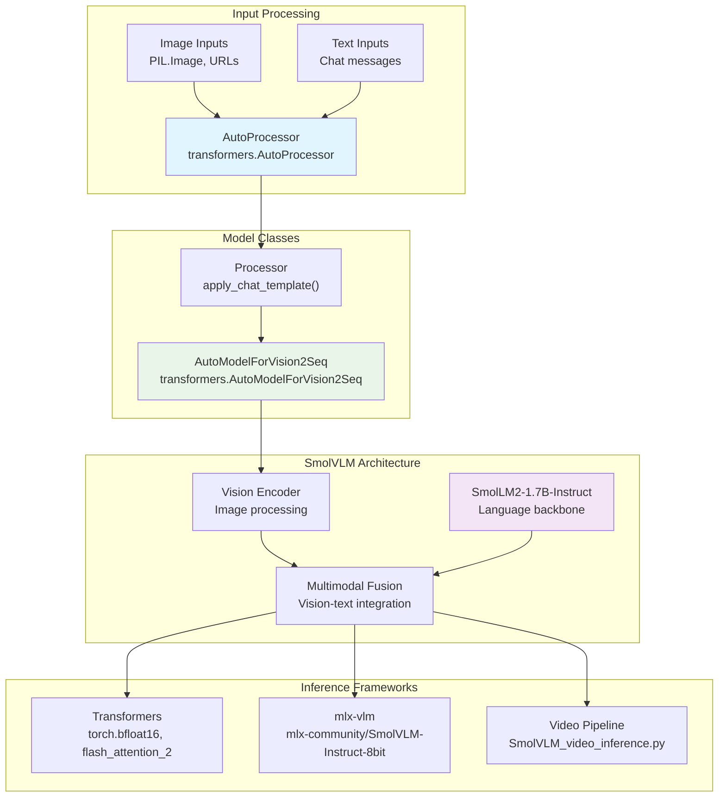
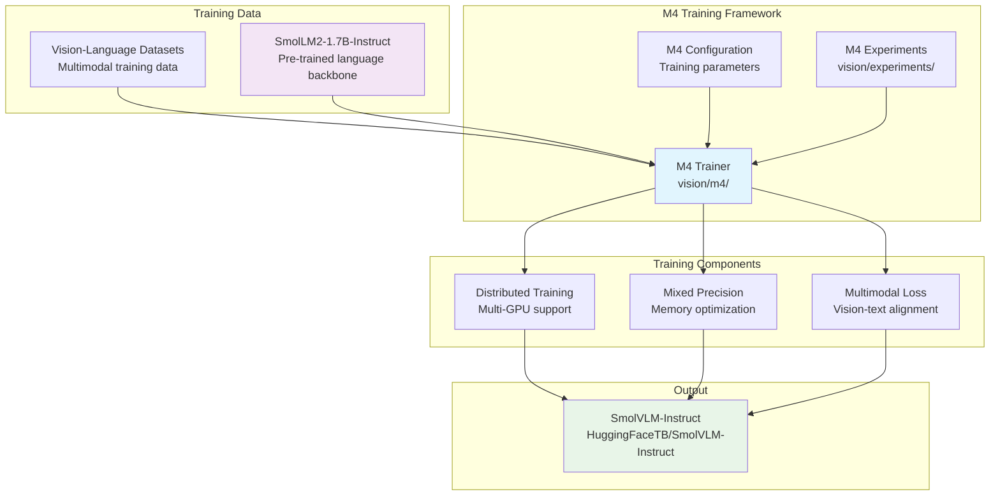
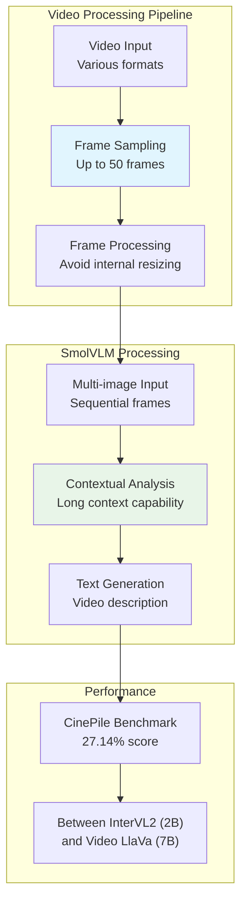
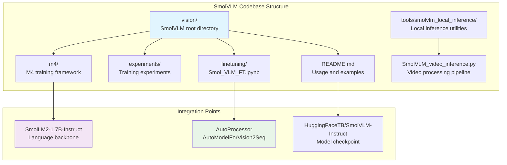

<!-- source: DeepWiki mcp.deepwiki.com · repo huggingface/smollm · page 4 SmolVLM · fetched 2026-10-26 -->

# SmolVLM

Relevant source files

The following files were used as context for generating this wiki page:

- [README.md](README.md)
- [text/README.md](text/README.md)
- [text/finetuning/README.md](text/finetuning/README.md)
- [vision/README.md](vision/README.md)

SmolVLM is a compact open multimodal model that combines vision and language capabilities. It uses SmolLM2-1.7B as its language backbone and can process arbitrary sequences of images and text to produce text outputs. This document covers SmolVLM's architecture, training infrastructure, inference capabilities, and integration with the broader SmolLM ecosystem.

For SmolLM language models, see [SmolLM3](#2) and [SmolLM2](#3). For training data and datasets, see [Data and Datasets](#5). For deployment tools, see [Tools and Deployment](#6).

## Architecture Overview

SmolVLM builds upon the SmolLM2-1.7B model as its language backbone, extending it with vision processing capabilities to handle multimodal inputs. The model accepts arbitrary sequences of images and text and generates text outputs, making it suitable for tasks like visual question answering, image captioning, and visual storytelling.

### SmolVLM System Architecture

Sources: [vision/README.md:26-44](), [vision/README.md:78-84](), [README.md:78-93]()

The model uses `HuggingFaceTB/SmolVLM-Instruct` as its primary checkpoint and integrates with the transformers library through the `AutoModelForVision2Seq` class. The `AutoProcessor` handles both text and image preprocessing, applying chat templates and preparing inputs for the multimodal model.

### Capabilities and Use Cases

| Capability | Description | Implementation |
|------------|-------------|----------------|
| Visual QA | Answer questions about images | `AutoModelForVision2Seq.generate()` |
| Image Description | Describe visual content | Chat template with image tokens |
| Multi-image Processing | Handle multiple images in conversation | Sequence of image tokens |
| Visual Storytelling | Create stories from images | Extended text generation |
| Video Analysis | Process video frames | Frame sampling pipeline |
| Pure Language Model | Function without visual inputs | Text-only chat templates |

Sources: [vision/README.md:5-6](), [vision/README.md:16-18]()

## Training Infrastructure

SmolVLM training uses the M4 framework, an internal HuggingFace codebase developed for multimodal model training. The training pipeline builds on top of the pre-trained SmolLM2-1.7B-Instruct model and adds vision capabilities through multimodal training.

### M4 Training Pipeline

Sources: [vision/README.md:92-104]()

The M4 training framework was developed internally at HuggingFace since 2022, with contributions from multiple developers. The training codebase is located in [vision/m4]() and [vision/experiments]() directories and provides the infrastructure for distributed multimodal training.

### Training Code Structure

| Component | Location | Purpose |
|-----------|----------|---------|
| M4 Framework | `vision/m4/` | Core training infrastructure |
| Experiments | `vision/experiments/` | Training configurations and scripts |
| Fine-tuning Tutorial | `vision/finetuning/Smol_VLM_FT.ipynb` | Custom fine-tuning guide |

Sources: [vision/README.md:20](), [vision/README.md:92-94]()

## Inference Implementation

SmolVLM supports multiple inference frameworks, each optimized for different use cases and hardware configurations. The model can process images and text through standardized APIs across these frameworks.

### Transformers Inference Pipeline

```mermaid
graph LR
    subgraph "Input Processing"
        ImageLoad["load_image()<br/>transformers.image_utils"]
        ChatTemplate["apply_chat_template()<br/>processor.apply_chat_template()"]
        ProcessorInput["processor()<br/>text + images"]
    end
    
    subgraph "Model Execution"
        ModelLoad["AutoModelForVision2Seq<br/>torch.bfloat16"]
        FlashAttention["flash_attention_2<br/>CUDA optimization"]
        GenerateMethod["model.generate()<br/>max_new_tokens=500"]
    end
    
    subgraph "Output Processing"
        BatchDecode["batch_decode()<br/>processor.batch_decode()"]
        SkipTokens["skip_special_tokens=True<br/>Clean output"]
    end
    
    ImageLoad --> ChatTemplate
    ChatTemplate --> ProcessorInput
    ProcessorInput --> ModelLoad
    ModelLoad --> FlashAttention
    FlashAttention --> GenerateMethod
    GenerateMethod --> BatchDecode
    BatchDecode --> SkipTokens
    
    style ModelLoad fill:#e1f5fe
    style GenerateMethod fill:#e8f5e8
```

Sources: [vision/README.md:26-77]()

The transformers implementation uses `AutoProcessor.from_pretrained("HuggingFaceTB/SmolVLM-Instruct")` for input processing and `AutoModelForVision2Seq.from_pretrained()` for model loading. The pipeline supports flash attention 2 for CUDA devices and falls back to eager attention for CPU inference.

### Alternative Inference Frameworks

| Framework | Installation | Model Path | Use Case |
|-----------|-------------|------------|----------|
| MLX-VLM | `pip install -U mlx-vlm` | `mlx-community/SmolVLM-Instruct-8bit` | Fast local inference on Apple Silicon |
| Video Pipeline | Custom implementation | `tools/smolvlm_local_inference/SmolVLM_video_inference.py` | Video analysis with frame sampling |

Sources: [vision/README.md:78-84](), [vision/README.md:86-91]()

### Video Analysis Capabilities

SmolVLM's video processing pipeline extracts up to 50 evenly sampled frames from input videos while avoiding internal frame resizing. This approach achieved competitive results on the CinePile benchmark with a score of 27.14%, positioning between InterVL2 (2B) and Video LlaVa (7B) models.

Sources: [vision/README.md:86-91]()

## Code Organization

The SmolVLM codebase is organized into distinct modules handling different aspects of the vision-language system, from training infrastructure to inference utilities.

### Repository Structure

Sources: [README.md:30-39](), [vision/README.md:92-105]()

### Key Components

| Component | Path | Description |
|-----------|------|-------------|
| Core Documentation | `vision/README.md` | Usage examples and API reference |
| M4 Training Framework | `vision/m4/` | Distributed multimodal training |
| Training Experiments | `vision/experiments/` | Experimental training configurations |
| Fine-tuning Notebook | `vision/finetuning/Smol_VLM_FT.ipynb` | Custom fine-tuning tutorial |
| Video Inference | `tools/smolvlm_local_inference/SmolVLM_video_inference.py` | Video processing pipeline |
| Local Inference Tools | `tools/smolvlm_local_inference/` | Local deployment utilities |

Sources: [vision/README.md:10-15](), [vision/README.md:20](), [vision/README.md:90]()

The SmolVLM system integrates with the broader SmolLM ecosystem through its use of SmolLM2-1.7B as the language backbone and shares inference tools with other SmolLM models through the `tools/` directory structure.

---

